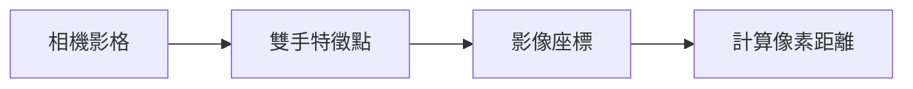

# 補充 6｜🧠 RP5 + CVZone + MediaPipe + PiCamera2 雙手偵測與距離計算教學

[原始文章](https://liusming.pixnet.net/blog/posts/14223033954) · 更新日期：2026-10-29

> **Thonny 轉換待完成。** 本篇既有程式、安裝步驟與輸出仍須逐項改寫並在 Thonny 重新操作；現有終端機紀錄不代表已用 Thonny 測試。[逐篇進度](./Thonny逐篇實測狀態.md) · [圖片與程式下載方式](./練習素材/素材下載與使用.md)

## 學習目標

確認 CVZone 的 HandDetector 在目前測試環境能否匯入。

## 事前準備

本次在 MediaPipe 測試環境以 --no-deps 安裝 CVZone 2.0.0。

MediaPipe 的已測試安裝方式請看[安裝操作與實測紀錄](../安裝操作與實測紀錄.md#5-mediapipe-手勢與-face-mesh)。不同專案請使用獨立環境。

## 程式與執行

將以下程式存為 `補充6.py`，或使用[已測試的範例程式](./範例程式/補充6.py)。在檔案所在目錄執行 `python3 補充6.py`。

```python
from cvzone.HandTrackingModule import HandDetector
print('HandDetector import', HandDetector is not None)
```

## 本機實際輸出

```text
HandDetector import True
```

匯入成功不等於可用：pip check 回報缺少 opencv-python，因環境安裝的是 opencv-contrib-python。雙手追蹤與距離計算未測試。

## 背景與核心概念

### 圖像距離與真實距離

影像上兩點可以計算像素距離，但像素距離會隨相機距離、視角與解析度改變，不能直接當成公分。CVZone 可能封裝模型的操作；匯入成功與雙手追蹤成功是不同測試。

### 思考、練習與後續應用

兩手相同實際距離卻離鏡頭遠近不同時，像素距離可能如何變化？要得到真實距離還需要哪些校正資訊？

可用於手勢互動；若需要精確距離，應先確立相機校正與測量方法。

進一步閱讀：[相關官方文件](https://ai.google.dev/edge/mediapipe/solutions/vision/hand_landmarker)。請以下方實測狀態為準；尚未實作或測試的情境不能視為已通過。

## 概念流程圖



此圖用於說明文章的概念或完整目標流程，**不是操作截圖，也不代表每個步驟都已實測**；本機實測範圍請看文章中的標示。

## 與原文章的差異

- 原文直接安裝 CVZone；本次保留依賴衝突的真實結果，沒有宣稱可直接使用。
- 本機測試範圍僅限上述流程；尚未保存操作畫面截圖。
- 新增初學者背景、概念、思考練習及後續應用，實測範圍仍以本文標示為準。
- 加入教學流程示意；圖中的完整目標流程不代表已逐步實測。
