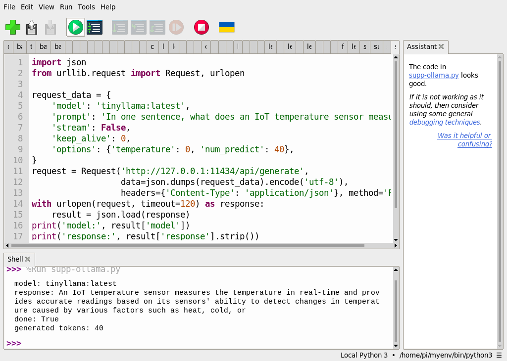
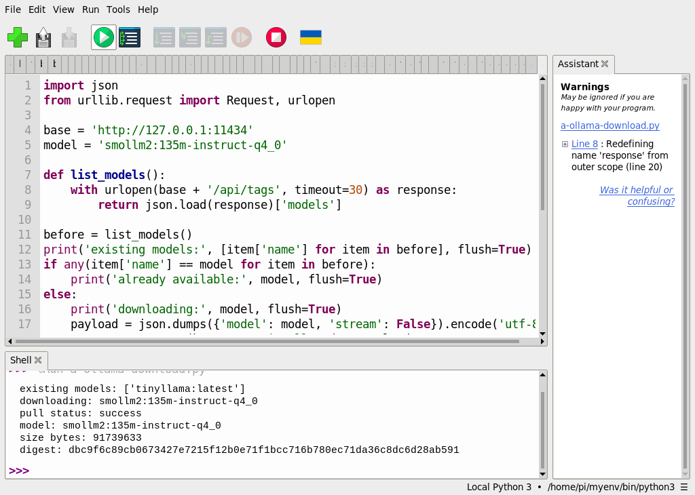
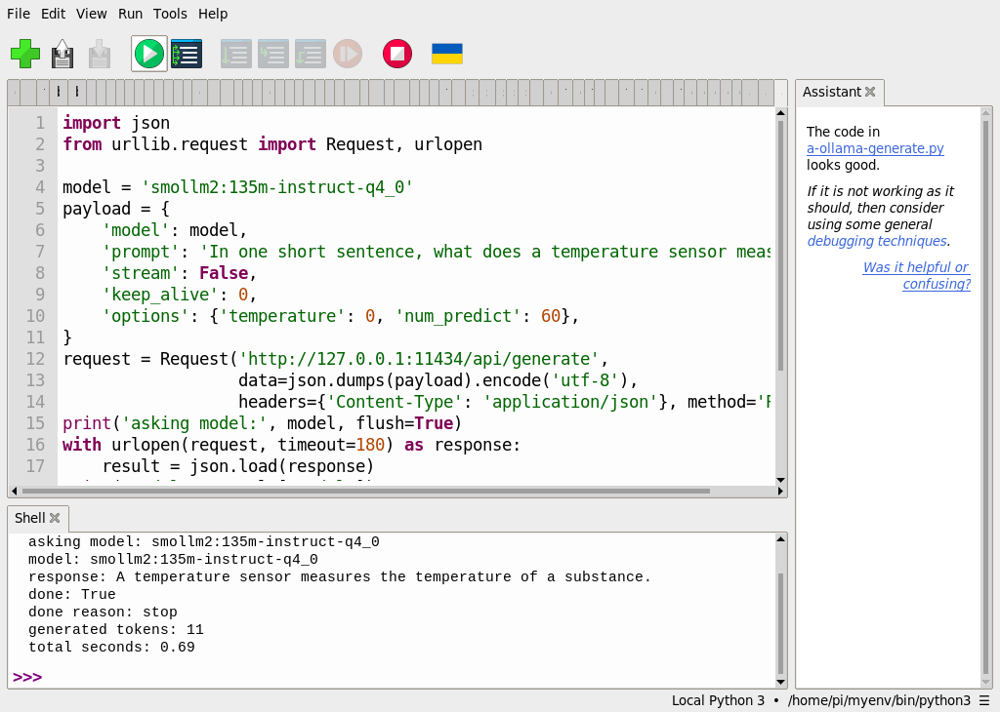

# 補充 7｜🧠 Raspberry Pi 5 上安裝 Ollama 完整教學（支援 ARM64）

[原始文章](https://liusming.pixnet.net/blog/posts/14223038205) · 更新日期：2026-10-29

> **部分實測。** 已在 Thonny 測模型下載及本機推論；Ollama 全新安裝仍待驗證。[逐篇進度](./Thonny逐篇實測狀態.md) · [圖片與程式下載方式](./練習素材/素材下載與使用.md)

## 學習目標

確認本機是否已有 Ollama，以及服務是否啟動。

## 事前準備

本次 RP5 已有 Ollama，以下使用系統現有安裝。

## 實際操作

```bash
command -v ollama
ollama --version
systemctl is-active ollama
```

## 本機實際輸出

```text
/usr/local/bin/ollama
ollama version is 0.9.0
active
```

本機已安裝 0.9.0 且服務 active；當時此步驟沒有下載模型、更新版本或驗證聊天；後續下載及推論實測見下文。模型的空間與記憶體需求因版本而異。

## 背景與核心概念

### 本地模型服務與推論

Ollama 可用來管理及執行相容的模型；應用程式通常透過服務取得推論結果。程式版本、服務狀態、模型是否存在和模型能否回答，是不同的檢查。

### 思考、練習與後續應用

服務顯示 active 但沒有模型時，能否宣稱聊天推論已成功？選擇模型時應考量哪些記憶體與儲存需求？

本地模型可用於輔助互動原型；應量測速度、回應品質，並檢查資料與模型授權。

進一步閱讀：[相關官方文件](https://docs.ollama.com/)。請以下方實測狀態為準；尚未實作或測試的情境不能視為已通過。

## 概念流程圖


此圖用於說明文章的概念或完整目標流程，**不是操作截圖，也不代表每個步驟都已實測**；本機實測範圍請看文章中的標示。

## 進一步實驗：使用本機既有模型回答問題

Ollama 是模型執行服務；服務程式與模型檔是兩回事。這台 RP5 測試時已裝好 Ollama 0.9.0，且 `ollama list` 已列出 `tinyllama:latest`（約 637 MB），因此本次**沒有重新安裝服務或下載模型**。當模型不在清單中時，需要足夠儲存空間與網路，另行下載並核對模型來源。

1. 使用 `ollama list` 檢查模型、`systemctl is-active ollama` 檢查服務，應先確認模型與服務可用。
2. 依[素材下載說明](./練習素材/素材下載與使用.md)下載[本實驗程式](./範例程式/補充7-Ollama本機推論.py)，用 Thonny 的「檔案 → 開啟」載入，按綠色執行鈕。這次請求送到 RP5 本機 `127.0.0.1` 的 Ollama 服務，完成後要求卸載本次模型以釋放資源。
3. `stream: False` 表示等完整回應；`num_predict: 40` 限制生成 token 數。token 不是固定的一個中文字或一個英文單字。參見 [Ollama 官方 Generate API 文件](https://docs.ollama.com/api/generate)。

```python
import json
from urllib.request import Request, urlopen

request_data = {
    'model': 'tinyllama:latest',
    'prompt': 'In one sentence, what does an IoT temperature sensor measure?',
    'stream': False,
    'keep_alive': 0,
    'options': {'temperature': 0, 'num_predict': 40},
}
request = Request('http://127.0.0.1:11434/api/generate',
                  data=json.dumps(request_data).encode('utf-8'),
                  headers={'Content-Type': 'application/json'}, method='POST')
with urlopen(request, timeout=120) as response:
    result = json.load(response)
print('model:', result['model'])
print('response:', result['response'].strip())
print('done:', result['done'])
print('generated tokens:', result.get('eval_count'))
```

這台 RP5 在 Thonny 的實際輸出：

```text
model: tinyllama:latest
response: An IoT temperature sensor measures the temperature in real-time and provides accurate readings based on its sensors' ability to detect changes in temperature caused by various factors such as heat, cold, or
done: True
generated tokens: 40
```



回答在 `or` 處截斷，顯示 `done: True` 只表示生成已結束，不保證句子完整或內容正確。模型聲稱「準確讀數」也需依實際感測器校準與量測驗證，不能只因模型說了就相信。不同版本、設定和硬體可能得到不同文字。該次既有模型推論未量測效能；後續另有新模型下載與推論實測。系統全新安裝仍未驗證。

練習：調整輸出長度上限並比較結果；用感測器資料或可信來源檢驗回答，不要把模型回覆視作感測器實際量測值。

## Thonny 實測：下載新模型並在本機推論

### 觀念與準備

Ollama 服務是管理與執行模型的程式，模型則是另外下載的資料；只有服務顯示 `active` 還不能證明已取得所需模型。本次選用 [SmolLM2 135M 的 Q4_0 模型](https://ollama.com/library/smollm2:135m-instruct-q4_0)：`135M` 表示約 1.35 億個參數，`Q4_0` 表示該模型使用的量化格式；這個小模型有助於練習，但回答能力不等同較大模型。

本次 RP5 是 Debian Bookworm、8 GB RAM，已安裝 Ollama 0.9.0 且服務運作。下載前根目錄可用約 2.8 GiB，測試後約 2.7 GiB。下載模型需要網路與額外儲存空間；模型由 Ollama 服務儲存及管理，並非放在本教材的 GitHub 中。[官方 Linux 安裝說明](https://docs.ollama.com/linux)可用於基本系統設定；**在這台已安裝的 RP5 上尚未重新實測全新安裝**，不要將這次下載視為乾淨安裝完成。

### 下載模型

1. 確認 Ollama 服務在 RP5 本機運行，並確認空間和網路。從本倉庫取得[下載程式](./範例程式/補充7-Thonny下載Ollama模型.py)，下載方式見[素材說明](./練習素材/素材下載與使用.md)。此程式只使用 Python 標準函式庫，無須另外安裝 Ollama 的 Python 套件。
2. 在 Thonny 開啟程式並按綠色執行鈕。程式先查詢本機模型；沒有指定模型時，透過本機的 `/api/pull` 讓 Ollama 下載。程式使用 `stream: False`，等待期間不顯示百分比，請等到出現 `pull status` 或錯誤。
3. 如果該模型已在本機清單中，程式顯示 `already available`，跳過下載。請以本機 `size bytes` 和 digest 核對實際取得的模型；網路、模型標籤與可用空間可能變動。此 digest 是 Ollama 回報的模型識別值，不是自行計算單一模型檔的 SHA-256。

完整程式：

```python
import json
from urllib.request import Request, urlopen

base = 'http://127.0.0.1:11434'
model = 'smollm2:135m-instruct-q4_0'

def list_models():
    with urlopen(base + '/api/tags', timeout=30) as response:
        return json.load(response)['models']

before = list_models()
print('existing models:', [item['name'] for item in before], flush=True)
if any(item['name'] == model for item in before):
    print('already available:', model, flush=True)
else:
    print('downloading:', model, flush=True)
    payload = json.dumps({'model': model, 'stream': False}).encode('utf-8')
    request = Request(base + '/api/pull', data=payload,
                      headers={'Content-Type': 'application/json'}, method='POST')
    with urlopen(request, timeout=600) as response:
        result = json.load(response)
    print('pull status:', result['status'], flush=True)
    if result['status'] != 'success':
        raise RuntimeError('模型下載未完成')

after = list_models()
found = next((item for item in after if item['name'] == model), None)
if found is None:
    raise RuntimeError('下載後沒有在模型清單中找到模型')
print('model:', found['name'])
print('size bytes:', found['size'])
print('digest:', found['digest'])
```

2026-10-29 首次執行時，Thonny 實際輸出：

```text
existing models: ['tinyllama:latest']
downloading: smollm2:135m-instruct-q4_0
pull status: success
model: smollm2:135m-instruct-q4_0
size bytes: 91739633
digest: dbc9f6c89cb0673427e7215f12b0e71f1bcc716b780ec71da36c8dc6d28ab591
```



畫面右側 `Redefining name 'response'` 是 Thonny 對變數名稱重複使用的提示；此次模型下載與清單查詢均成功。下載請求介面可參考 [Ollama Pull API](https://docs.ollama.com/api/pull)。

### 使用新下載的模型

下載[新模型推論程式](./範例程式/補充7-Thonny新模型推論.py)，在 Thonny 開啟並按綠色執行鈕。程式向 `127.0.0.1` 的本機 Ollama 服務提問，不會直接讀取實體感測器；`keep_alive: 0` 要求服務在回應後卸載本次使用的模型。`total_duration` 由服務回報並換算成秒，不是所有裝置都會有相同速度。

```python
import json
from urllib.request import Request, urlopen

model = 'smollm2:135m-instruct-q4_0'
payload = {
    'model': model,
    'prompt': 'In one short sentence, what does a temperature sensor measure?',
    'stream': False,
    'keep_alive': 0,
    'options': {'temperature': 0, 'num_predict': 60},
}
request = Request('http://127.0.0.1:11434/api/generate',
                  data=json.dumps(payload).encode('utf-8'),
                  headers={'Content-Type': 'application/json'}, method='POST')
print('asking model:', model, flush=True)
with urlopen(request, timeout=180) as response:
    result = json.load(response)
print('model:', result['model'])
print('response:', result['response'].strip())
print('done:', result['done'])
print('done reason:', result.get('done_reason'))
print('generated tokens:', result.get('eval_count'))
print('total seconds:', round(result['total_duration'] / 1_000_000_000, 2))
```

本次完整輸出：

```text
asking model: smollm2:135m-instruct-q4_0
model: smollm2:135m-instruct-q4_0
response: A temperature sensor measures the temperature of a substance.
done: True
done reason: stop
generated tokens: 11
total seconds: 0.69
```



本次回答可翻為「溫度感測器測量物質的溫度」；它是文字生成，並沒有取得真實讀數。`done: True` 和 `done reason: stop` 只表示這次生成結束，不保證內容永遠正確。試著修改問題、比較不同回答，並以實際感測器與可靠資料驗證。程式碼、問題及模型版本不同時，輸出也可能不同。

### 常見問題

- **連線被拒絕**：先檢查 RP5 的 Ollama 服務是否啟動，以及位址是否為本機 `127.0.0.1:11434`；此練習不需要把服務開放到網路。
- **下載失敗或等候過久**：確認網路、可用空間與模型名稱；`stream: False` 不會顯示進度。不要把尚未收到 `success` 視為下載成功。
- **模型找不到**：先重新執行下載程式並確認輸出的模型名稱；模型標籤必須與推論程式完全一致。
- **輸出不理想**：小模型可能答錯、答非所問或截斷；檢查問題、輸出 token 上限並查證答案。

## 與原文章的差異

- 新增既有模型與新下載小模型的 Thonny 本機 API 推論；系統全新安裝尚未驗證。

- 原文以安裝 Ollama 為主；本版先檢查既有服務，並以 Thonny 實測模型下載和推論。
- 已保存模型下載與推論的 Thonny 操作畫面；系統全新安裝截圖仍待補。
- 新增初學者背景、概念、思考練習及後續應用，實測範圍仍以本文標示為準。
- 加入教學流程示意；圖中的完整目標流程不代表已逐步實測。
