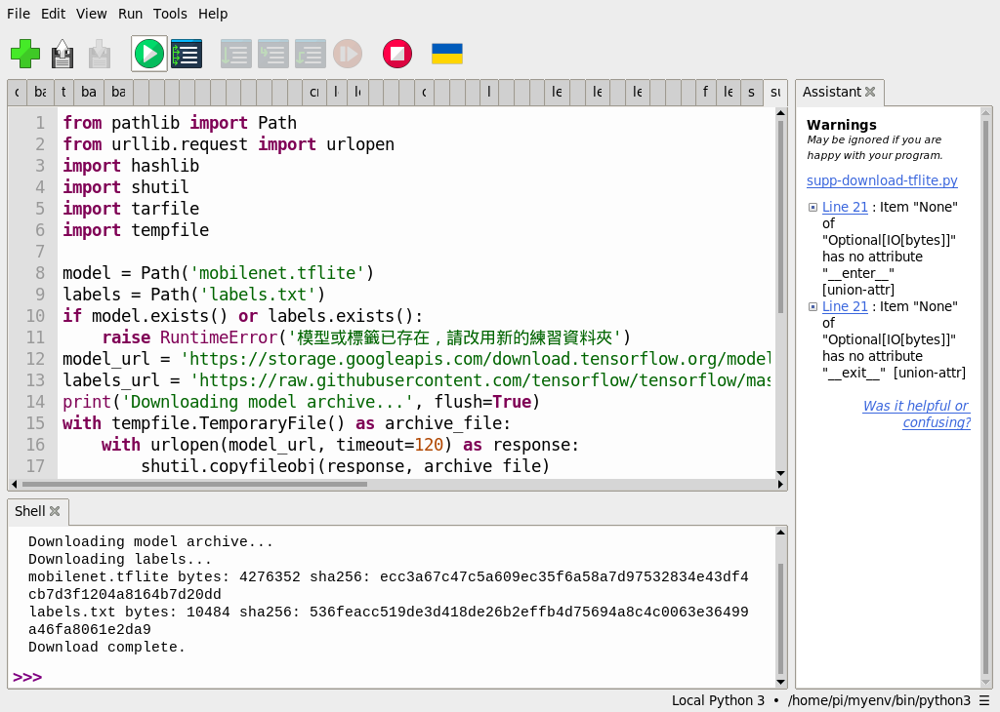
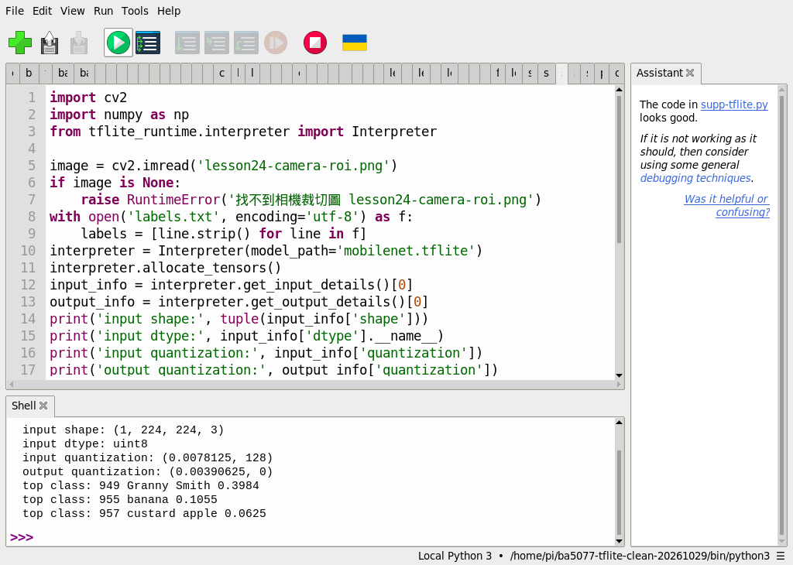
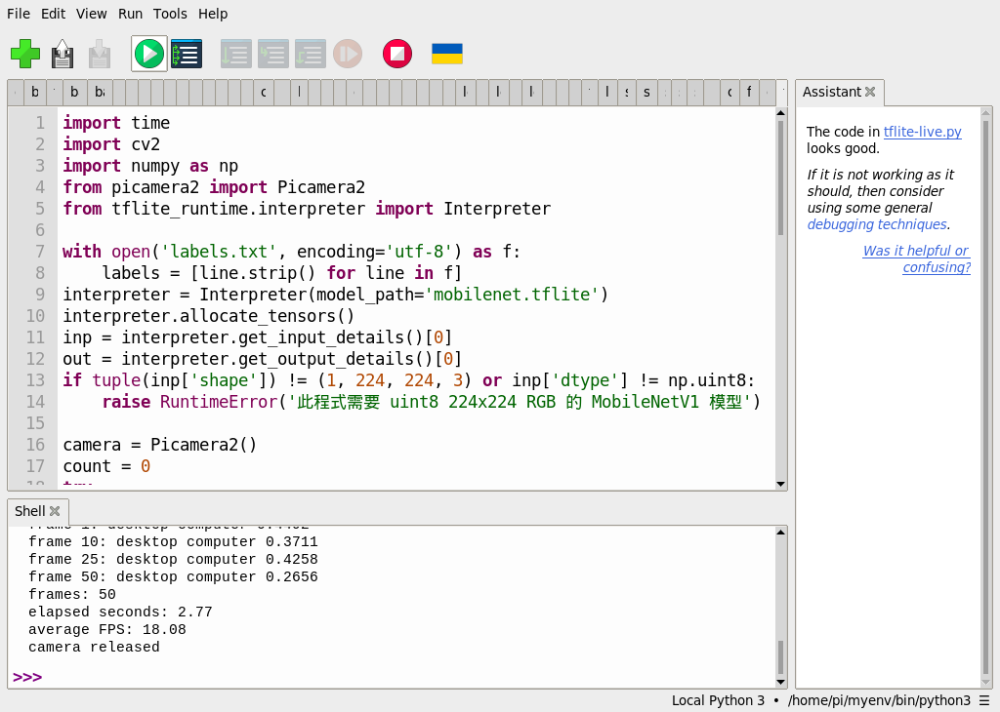
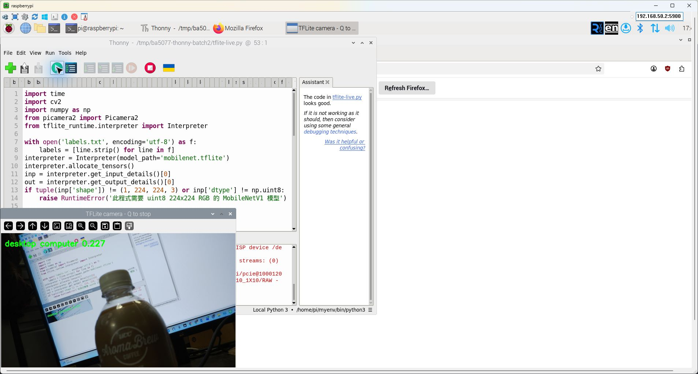
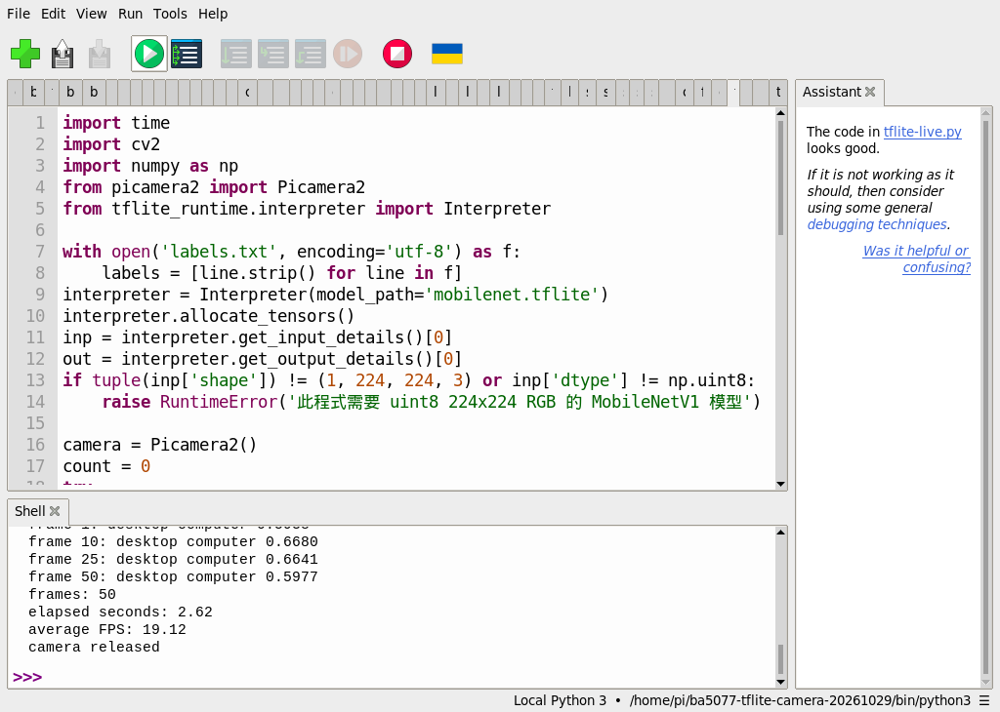

# 補充 8｜PiCamera2 + TensorFlow Lite (MobileNetV1) + 即時影像分類 + 顯示分類文字 的 完整教學

[原始文章](https://liusming.pixnet.net/blog/posts/14223038310) · 更新日期：2026-10-29

> **部分實測**：模型和標籤已在 Thonny 下載，單張分類也已在 Thonny 重測。已測獨立單圖分類，並在新建、可讀取系統套件的環境實測 50 張相機分類；全新作業系統安裝仍待驗證。[逐篇進度](./Thonny逐篇實測狀態.md)

## 學習目標與背景

理解 MobileNet 圖像分類，先以相機照片測試，再將相機的連續影格送入模型並在畫面顯示分類文字。

圖像分類根據整張圖產生各類別分數；它與物件偵測不同，通常不提供物件位置。TFLite Interpreter 載入模型並配置輸入輸出張量，資料的尺寸、型別與模型必須一致。本例使用量化模型：輸出需依 scale 與 zero point 換算；標籤列表必須與模型對應。

## 環境與素材

本次另以 Thonny 建立並選取獨立環境，安裝 NumPy 1.26.4、OpenCV 4.10.0.84 與 `tflite_runtime` 2.14.0，並實測單張分類；請依 [TFLite 環境安裝說明](./Thonny環境與套件安裝.md)操作。此單圖獨立環境未整合 Picamera2；另見下方相機環境及其系統套件限制。模型和標籤來自 TensorFlow；標籤網址追蹤上游 master，日後內容可能改變。

依[素材下載與使用說明](./練習素材/素材下載與使用.md)取得本倉庫，將[模型下載程式](./範例程式/補充3和8-Thonny下載模型.py)、[分類範例](./範例程式/補充3和8-Thonny照片分類.py)和[相機照片裁切圖](./圖檔/lesson24-camera-roi.png)放在同一個新練習資料夾。照片是 RP5 拍攝螢幕上的 AI 生成物件後裁切所得，不是真實水果。

## Thonny 模型下載：已實測

選擇含上述套件的直譯器，在 Thonny 開啟下載程式並按綠色執行鈕。程式下載 TensorFlow 的模型壓縮檔、取出需要的模型及下載標籤，並印出大小與 SHA-256。需要網路及可容納下載暫存檔的空間；若模型或標籤已存在，請改用新的資料夾。

本次 Thonny 輸出：

```text
Downloading model archive...
Downloading labels...
mobilenet.tflite bytes: 4276352 sha256: ecc3a67c47c5a609ec35f6a58a7d97532834e43df4cb7d3f1204a8164b7d20dd
labels.txt bytes: 10484 sha256: 536feacc519de3d418de26b2effb4d75694a8c4c0063e36499a46fa8061e2da9
Download complete.
```



## 單張分類範例：Thonny 實測

在同一資料夾準備好模型、標籤與圖片後，在 Thonny 開啟以下範例並按綠色執行鈕。程式先讀取圖片、轉換色彩和尺寸，然後呼叫 Interpreter 並列出前三個類別：

```python
import cv2
import numpy as np
from tflite_runtime.interpreter import Interpreter

image = cv2.imread('lesson24-camera-roi.png')
if image is None:
    raise RuntimeError('找不到相機裁切圖 lesson24-camera-roi.png')
with open('labels.txt', encoding='utf-8') as f:
    labels = [line.strip() for line in f]
interpreter = Interpreter(model_path='mobilenet.tflite')
interpreter.allocate_tensors()
input_info = interpreter.get_input_details()[0]
output_info = interpreter.get_output_details()[0]
print('input shape:', tuple(input_info['shape']))
print('input dtype:', input_info['dtype'].__name__)
print('input quantization:', input_info['quantization'])
print('output quantization:', output_info['quantization'])
if tuple(input_info['shape']) != (1, 224, 224, 3) or input_info['dtype'] != np.uint8:
    raise RuntimeError('此程式預期 MobileNetV1 量化模型的 uint8 224x224 RGB 輸入')
rgb = cv2.cvtColor(image, cv2.COLOR_BGR2RGB)
rgb = cv2.resize(rgb, (224, 224))
interpreter.set_tensor(input_info['index'], np.expand_dims(rgb, axis=0))
interpreter.invoke()
raw = interpreter.get_tensor(output_info['index'])[0]
scale, zero = output_info['quantization']
scores = (raw.astype(np.float32) - zero) * scale
if len(labels) != len(scores):
    raise RuntimeError('標籤數與模型輸出數不一致')
for index in np.argsort(scores)[-3:][::-1]:
    print(f'top class: {index} {labels[index]} {scores[index]:.4f}')
```

同一程式及模型在這台 RP5 的 Thonny Shell 實際輸出：

```text
input shape: (1, 224, 224, 3)
input dtype: uint8
input quantization: (0.0078125, 128)
output quantization: (0.00390625, 0)
top class: 949 Granny Smith 0.3984
top class: 955 banana 0.1055
top class: 957 custard apple 0.0625
```



這些是模型對這張生成圖片給出的分數，不能用來確認水果品種或估計整體準確率。不同版本與輸入可能改變結果。

## 即時相機分類：Thonny 實測 50 張影格

本實驗由 Picamera2 持續取影格，縮放為模型要求的 224 × 224 RGB，量化模型推論後把最高分標籤畫在預覽上；每一張影格都是**整張畫面的分類**，不是把瓶子框起來。模型即使沒有明確目標也會從既有類別選最高分，因此低分或不相關的標籤不能當成「偵測到」的證明。

1. 請依前節下載模型和標籤，並把 [相機分類程式](./範例程式/補充8-Thonny相機TFLite.py)、`mobilenet.tflite`、`labels.txt` 放在同一個練習資料夾。
2. 本次選擇既有 `/home/pi/myenv/bin/python3`，其中同時可匯入 Picamera2、OpenCV、NumPy 和 TFLite。前節的單圖環境不含 Picamera2；另有後續建立、讀取系統套件的新相機環境，請見下方重測。
3. 在 Thonny 開啟程式、按綠色執行鈕，觀察預覽左上角文字與分數；程式最多處理 50 張影格，自動結束並釋放相機。程式提供預覽視窗按 `q` 提前結束的分支，但這項操作尚未單獨驗證；若需確保安全結束，先等待自動完成。
4. Shell 出現 `camera released` 後，才啟動下一個相機程式。請勿同時開啟其他使用相機的程式。

完整程式：

```python
import time
import cv2
import numpy as np
from picamera2 import Picamera2
from tflite_runtime.interpreter import Interpreter

with open('labels.txt', encoding='utf-8') as f:
    labels = [line.strip() for line in f]
interpreter = Interpreter(model_path='mobilenet.tflite')
interpreter.allocate_tensors()
inp = interpreter.get_input_details()[0]
out = interpreter.get_output_details()[0]
if tuple(inp['shape']) != (1, 224, 224, 3) or inp['dtype'] != np.uint8:
    raise RuntimeError('此程式需要 uint8 224x224 RGB 的 MobileNetV1 模型')

camera = Picamera2()
count = 0
try:
    camera.configure(camera.create_preview_configuration(
        main={'size': (640, 480), 'format': 'RGB888'}))
    camera.start()
    time.sleep(1)
    start = time.perf_counter()
    while count < 50:
        frame = camera.capture_array()
        rgb = cv2.cvtColor(frame, cv2.COLOR_BGR2RGB)
        rgb = cv2.resize(rgb, (224, 224))
        interpreter.set_tensor(inp['index'], np.expand_dims(rgb, 0))
        interpreter.invoke()
        raw = interpreter.get_tensor(out['index'])[0]
        scale, zero = out['quantization']
        scores = (raw.astype(np.float32) - zero) * scale
        if len(labels) != len(scores):
            raise RuntimeError('標籤數與模型輸出數不一致')
        i = int(np.argmax(scores))
        count += 1
        cv2.putText(frame, f'{labels[i]} {scores[i]:.3f}', (10, 35),
                    cv2.FONT_HERSHEY_SIMPLEX, 0.7, (0, 255, 0), 2)
        cv2.imshow('TFLite camera - Q to stop', frame)
        if count in (1, 10, 25, 50):
            print(f'frame {count}: {labels[i]} {scores[i]:.4f}', flush=True)
        if cv2.waitKey(1) & 0xFF == ord('q'):
            break
    elapsed = time.perf_counter() - start
    print('frames:', count)
    print('elapsed seconds:', round(elapsed, 2))
    print('average FPS:', round(count / elapsed, 2))
finally:
    camera.stop()
    camera.close()
    cv2.destroyAllWindows()
    print('camera released')
```

本次第一輪的 Shell 輸出摘錄：

```text
frame 10: desktop computer 0.3711
frame 25: desktop computer 0.4258
frame 50: desktop computer 0.2656
frames: 50
elapsed seconds: 2.77
average FPS: 18.08
camera released
```





第二張是**操作截圖與相機實拍**，取自另一輪測試，畫面顯示桌上瓶子與正在顯示程式的螢幕，標籤 `desktop computer 0.227` 為當時的模型結果。速度與分數會依場景和系統負載變化；本次約 2.77 秒的測試不能證明長時間穩定，也不是準確率測試。要觀察未含目標物的情況，可拍空白背景並記下模型仍輸出的最高分，但此負例尚未完成正式重測。

### 新建相機環境後重新測試

完成上面的既有環境測試後，另依 [Thonny 相機環境安裝與截圖](./Thonny環境與套件安裝.md)建立 `/home/pi/ba5077-tflite-camera-20261029`，選取其 `bin/python3`，再次執行相同的 50 影格程式。實際輸出摘錄：

```text
frame 10: desktop computer 0.6680
frame 25: desktop computer 0.6641
frame 50: desktop computer 0.5977
frames: 50
elapsed seconds: 2.62
average FPS: 19.12
camera released
```



此新環境借用現有系統 Picamera2 0.3.31 與 OpenCV 4.10.0-dev，並非全新系統驗證；系統 OpenCV 的實際版本與套件管理器登記版本不同，細節見環境安裝說明。未測 Q 提前停止及空白負例。

## 練習與後續應用

解釋為何模型需要 224 × 224 的輸入；比較分類結果與第 40 課的物件偵測框。準備其他圖片測試前，先確認標籤順序及模型輸出是否一致，再紀錄結果與人工觀察差異。

## 與原文章的差異

- 本版在 Thonny 實測模型下載、單張圖片分類，以及 50 張影格的即時相機分類和畫面顯示；模型轉換仍未重做。
- 新增相機拍攝生成圖、模型和標籤下載方式及可核對的檔案資訊；相機範例也已在新建、讀取現有系統套件的環境短測；全新系統安裝與長時間穩定性待驗證。
