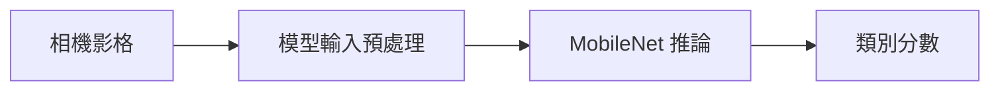

# 補充 8｜PiCamera2 + TensorFlow Lite (MobileNetV1) + 即時影像分類 + 顯示分類文字 的 完整教學

[原始文章](https://liusming.pixnet.net/blog/posts/14223038310) · 更新日期：2026-10-29

## 學習目標

以 LiteRT 對一張 Pi 相機影格執行 MobileNetV1 推論。

## 事前準備

需要 Picamera2、相機、已驗證的 LiteRT 虛擬環境及 MobileNet 模型。

依[安裝操作與實測紀錄](../安裝操作與實測紀錄.md)建立對應環境，再在練習目錄下載模型：

```bash
curl -fL https://raw.githubusercontent.com/nnsuite/testcases/master/DeepLearningModels/tensorflow-lite/Mobilenet_v1_1.0_224_quant/mobilenet_v1_1.0_224_quant.tflite -o mobilenet.tflite
```

## 程式與執行

將以下程式存為 `補充8.py`，或使用[已測試的範例程式](./範例程式/補充8.py)。在檔案所在目錄執行 `python3 補充8.py`。

```python
import cv2
import numpy as np
from ai_edge_litert.interpreter import Interpreter
from picamera2 import Picamera2

camera = Picamera2()
try:
    camera.configure(camera.create_still_configuration(main={'size': (320, 240), 'format': 'RGB888'}))
    camera.start()
    frame = camera.capture_array()
finally:
    camera.stop()
    camera.close()
interpreter = Interpreter(model_path='mobilenet.tflite')
interpreter.allocate_tensors()
input_info = interpreter.get_input_details()[0]
image = cv2.resize(frame, (224, 224)).astype(input_info['dtype'])
interpreter.set_tensor(input_info['index'], np.expand_dims(image, axis=0))
interpreter.invoke()
output = interpreter.get_tensor(interpreter.get_output_details()[0]['index'])
print('camera frame', frame.shape)
print('output shape', output.shape)
```

## 本機實際輸出

```text
camera frame (240, 320, 3)
output shape (1, 1001)
```

輸出維度成功，但程式沒有顯示標籤與信心度，也沒有測試即時畫面或分類正確率。

## 背景與核心概念

### 分類與物件偵測的不同

影像分類通常對整張輸入給出類別分數；物件偵測還會估計位置。MobileNet 模型對影像尺寸、數值型別及前處理有要求，解讀索引還需要正確標籤表。

### 思考、練習與後續應用

分類分數最高是否代表結果一定正確？如果輸入尺寸或色彩順序不符合模型要求，可能造成什麼影響？

影像分類可用於簡單分揀原型，仍需在實際環境評估多類別、低光與未知物件。

進一步閱讀：[相關官方文件](https://ai.google.dev/edge/litert)。請以下方實測狀態為準；尚未實作或測試的情境不能視為已通過。

## 概念流程圖



此圖用於說明文章的概念或完整目標流程，**不是操作截圖，也不代表每個步驟都已實測**；本機實測範圍請看文章中的標示。

## 與原文章的差異

- 原文使用 tflite-runtime；本版採 LiteRT Interpreter，並以單張影格驗證推論；完整標籤與即時顯示仍待實作。
- 本機測試範圍僅限上述流程；尚未保存操作畫面截圖。
- 新增初學者背景、概念、思考練習及後續應用，實測範圍仍以本文標示為準。
- 加入教學流程示意；圖中的完整目標流程不代表已逐步實測。
