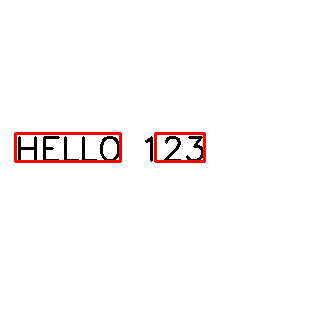

# 補充 9｜EAST（Efficient and Accurate Scene Text Detector）文字偵測演算法 的 完整 Python 教學

[原始文章](https://liusming.pixnet.net/blog/posts/14223038337) · 更新日期：2026-10-29

> **部分 Thonny 實測。** 已在 Thonny 測模型下載、相機文字照片；全新系統安裝及即時相機仍待驗證。[逐篇進度](./Thonny逐篇實測狀態.md) · [圖片與程式下載方式](./練習素材/素材下載與使用.md)

## 學習目標

載入 EAST 模型，對合成英文影像偵測文字框、執行 NMS 並保存結果。

## 事前準備

需要 OpenCV、NumPy、EAST frozen graph 及 east_helpers.py。

### 在 Thonny 下載並檢查 EAST 模型

模型是已訓練好的參數檔，EAST 用它尋找文字位置；辨認文字內容則需另外使用 OCR。模型約 96.7 MB，需要網路及足夠空間。先建立一個新的練習資料夾，下載[模型下載程式](./範例程式/補充9-Thonny下載EAST模型.py)、[模型驗證程式](./範例程式/補充9-Thonny驗證EAST模型.py)、[文字框處理程式 east_helpers.py](./範例程式/east_helpers.py)及[相機文字練習照片](./圖檔/text-board.png)放入同一資料夾。照片是相機拍攝顯示的練習文字後，經裁切及校正的素材；下載方式見[素材說明](./練習素材/素材下載與使用.md)。

1. 在 Thonny 開啟下載程式並按綠色執行鈕，等待 Shell 出現 `saved`。程式使用 Python 標準函式庫，不需額外套件。
2. 2026-10-29 在 RP5 的 Thonny 實際輸出如下；SHA-256 可用來核對本次下載內容，上游 `master` 可能變動，日後若不同應先查明來源。程式不覆寫同名檔案；下載中斷可能留下不完整檔案，請先檢查再移至其他位置或刪除後重試。

```text
Downloading EAST model...
bytes: 96662756
sha256: 9b486f3c3eee77b4c8cc91a83892c37026cca7d29b79bf3b93772ccd2db58454
saved: east-download-check.pb
```


3. 在 Thonny 選取有 OpenCV 和 NumPy 的環境，開啟模型驗證程式並執行。本次使用 `/home/pi/ba5077-tflite-camera-20261029/bin/python3`；它可讀取現有系統 OpenCV，並非全新系統。EAST 找到的框不一定都正確，也不代表已辨識文字。

```text
model loaded: east-download-check.pb
image: (675, 1200, 3)
EAST boxes: 10
```


4. 後續原有範例使用 `frozen_east_text_detection.pb` 這個檔名。確認下載完成後，可在檔案管理員將 `east-download-check.pb` 改名為 `frozen_east_text_detection.pb`，與範例及素材放在同一練習資料夾；若已有同名檔案，請勿覆寫，改用另一個新資料夾。

## 程式與執行

將以下程式存為 `補充9.py`，或使用[已測試的範例程式](./範例程式/補充9.py)。在檔案所在目錄執行 `python3 補充9.py`。

```python
import cv2
import numpy as np
from east_helpers import detect_text

net = cv2.dnn.readNet('frozen_east_text_detection.pb')
image = np.full((320, 320, 3), 255, dtype=np.uint8)
cv2.putText(image, 'HELLO 123', (15, 160), cv2.FONT_HERSHEY_SIMPLEX, 1.1, (0, 0, 0), 2)
boxes = detect_text(net, image)
for x1, y1, x2, y2 in boxes:
    cv2.rectangle(image, (x1, y1), (x2, y2), (0, 0, 255), 2)
print('text boxes', len(boxes))
print('saved', cv2.imwrite('supplement9-east.png', image))
```

## 本機實際輸出

```text
text boxes 2
saved True
```

本例在合成英文上偵測到兩個框；不同圖片與模型版本的結果可能不同，未衡量真實場景準確率。

本機產生的結果圖（這是程式輸出，不是螢幕截圖）：



## 背景與核心概念

### 文字偵測與文字辨識

EAST 偵測影像中可能有文字的區域；它本身不保證輸出文字內容。候選框可能重疊，非極大值抑制（NMS）可協助保留較適合的框。

### 思考、練習與後續應用

解釋文字區域偵測和 OCR 字元辨識的差別；合成英文圖成功是否代表中文、旋轉或模糊文字也成功？

文字偵測可用於文件擷取和標牌輔助閱讀，還需測試不同字體、角度、語言及隱私。

進一步閱讀：[相關官方文件](https://docs.opencv.org/4.x/d2/d58/tutorial_table_of_content_dnn.html)。請以下方實測狀態為準；尚未實作或測試的情境不能視為已通過。

## 進一步實驗：RP5 相機拍攝英文測試板

### 準備與執行

1. 在螢幕顯示[相機測試畫面](./練習素材/RP5相機測試.html)的「文字偵測」，由 RP5 相機拍攝，再依[實拍與校正流程](./練習素材/相機實拍與校正流程.md)裁切校正。這次得到的[實拍輸入圖 text-board.png](./圖檔/text-board.png)可供重現。
2. 將該圖片、[east_helpers.py](./範例程式/east_helpers.py) 和[本範例程式](./範例程式/補充9至11-相機文字.py)放入同一個練習目錄，依本文事前準備放入 EAST 模型，並依[安裝紀錄](../安裝操作與實測紀錄.md#6-tesseract-ocr)準備 OpenCV、NumPy、Tesseract 及英文語言資料。
3. 在該目錄執行 `python3 補充9至11-相機文字.py`。模型和語言資料缺失時先依安裝紀錄處理，不要以其他模型的結果替代。

```python
import cv2
import subprocess
from east_helpers import detect_text

# 讀取已裁切並校正的相機照片；EAST 尋找文字區域，Tesseract 嘗試辨認文字。
image = cv2.imread('text-board.png')
if image is None:
    raise RuntimeError('找不到 text-board.png')
net = cv2.dnn.readNet('frozen_east_text_detection.pb')
boxes = detect_text(net, image)
annotated = image.copy()
for x1, y1, x2, y2 in boxes:
    cv2.rectangle(annotated, (x1, y1), (x2, y2), (0, 255, 0), 2)
if not cv2.imwrite('supplement9-camera-east.png', annotated):
    raise RuntimeError('無法儲存結果')
print('EAST boxes:', len(boxes))
print('saved: supplement9-camera-east.png')
result = subprocess.run(['tesseract', 'text-board.png', 'stdout', '-l', 'eng', '--psm', '6'],
                        check=True, capture_output=True, text=True)
print('Tesseract output:')
print(result.stdout.strip())
```

RP5 本次實際輸出：

```text
EAST boxes: 10
saved: supplement9-camera-east.png
Tesseract output:
TEXT DETECTION
RASPBERRY PI 5
HELLO CAMERA
AIOT 2026
OPEN CV 12345
```


這是對相機實拍圖片畫出的結果圖，並非操作截圖。EAST 的綠框在部分文字有切割或漏框；10 個框不能解讀為 10 行文字，也不是準確率。此程式的 Tesseract 是**直接辨識整張圖片**，不是以 EAST 的每個框裁切後再辨識；前文合成圖片例子才有框選後 OCR。這次只測清楚的英文單張畫面，未測中文、真實街景、連續即時預覽或整體準確率。

練習：比較輸入圖和綠框，指出未被完整涵蓋的字；把「框定位是否正確」與「OCR 字元是否正確」分開評估。

## Thonny 實測：已保存的相機文字照片

本次以 Thonny 右下角選取既有 `/home/pi/myenv/bin/python3`；此環境含 OpenCV，系統已有 Tesseract 英文資料。這次照片辨識使用先前下載的模型副本；其 SHA-256 與後續 Thonny 下載並驗證的模型相同。全新系統安裝尚未測試。先取得[相機校正照片](./圖檔/text-board.png)、[文字框輔助程式](./範例程式/east_helpers.py)及[本次範例](./範例程式/補充9至11-相機文字.py)，連同 EAST 模型放在同一新練習資料夾，在 Thonny 開啟範例並按綠色執行鈕。詳細下載方式見[素材說明](./練習素材/素材下載與使用.md)。

```text
EAST boxes: 10
saved: supplement9-camera-east.png
Tesseract output:
TEXT DETECTION
RASPBERRY PI 5
HELLO CAMERA
AIOT 2026
OPEN CV 12345
```


此圖為先前由 RP5 拍攝文字測試畫面並校正的照片；EAST 偵測文字框，Tesseract 本次對**整張圖片**辨識，沒有逐框送入 OCR。該結果不代表相機持續預覽、逐框辨識或不同場景均已驗證；上述文字為本次觀察的完整輸出，截圖因視窗高度只顯示其中一部分。

## 與原文章的差異

- 新增 Thonny 單張相機校正照片的 EAST 框選與整圖英文 OCR 實測；已另測模型下載與載入；即時相機及逐框 OCR 仍待測。

- 新增對相機拍攝的英文測試板執行 EAST 及整圖 Tesseract；與原文即時流程的差異仍見下方。

- 原文使用外部圖片並顯示視窗；本版使用可重現的合成圖片、保存結果並附上實測輸出。
- 本機測試範圍僅限上述流程；尚未保存操作畫面截圖。
- 新增初學者背景、概念、思考練習及後續應用，實測範圍仍以本文標示為準。
