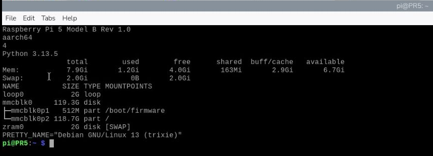

# 02｜認識你的小電腦：Raspberry Pi 5 與 Raspberry Pi OS

## [原課號：第 02 課｜認識 Raspberry Pi 與 Raspberry Pi OS](https://github.com/Samuel-ncu/BA5077-RP5-compatibility/blob/main/%E6%95%99%E6%9D%90/%E7%AC%AC%2002%20%E8%AA%B2%EF%BD%9C%E8%AA%8D%E8%AD%98%20Raspberry%20Pi%20%E8%88%87%20Raspberry%20Pi%20OS.md)

digithouse.net 原文：[第 2 課｜認識 Raspberry Pi 與 Raspberry Pi OS](https://digithouse.net/blog/ba5077-lesson-01-raspberry-pi-overview?locale=zh-TW)

> **本篇狀態**：已在目前的 Trixie 系統實測（2026-11-09），附操作截圖。這台機器是「既有系統」，不是剛重灌的乾淨系統。

第一次把 Raspberry Pi 5 放在同學手上時，常聽到的反應是：「這麼小一塊板子，真的是電腦？」是的，它有處理器、有記憶體、能裝作業系統、能接螢幕鍵盤，也能上網。今天我們不急著做任何專案，只做一件事：**用幾行指令，讓它自己告訴我們它是誰**。

## 這篇會學到什麼

- Raspberry Pi 是什麼，為什麼叫「單板電腦」。
- CPU、RAM、儲存空間、作業系統各自負責什麼。
- 用終端機查出型號、架構、核心數、Python 版本、記憶體和儲存空間。
- 看懂舊系統（Bookworm）和目前系統（Trixie）的輸出差在哪裡。

## 需要的東西

- 一台已經開機、可以登入的 Raspberry Pi（本教材用 Raspberry Pi 5、8 GB）。
- 一個**終端機**（Terminal）：讓你用打字方式對電腦下指令的視窗。可以在接著 RP5 的螢幕上開，也可以用之後會教的遠端連線開。

## 先懂幾個名詞

**單板電腦**：把處理器、記憶體和各種接頭都做在同一張電路板上的電腦。加上電源和作業系統，就能直接用。Raspberry Pi 是一系列產品；其中 Pico 是「微控制器」，寫法跟能跑 Linux 桌面的 RP5 很不一樣，不要搞混。

| 元件 | 做什麼 | 比喻 |
| --- | --- | --- |
| CPU（處理器） | 執行程式指令和計算 | 做事的人 |
| RAM（記憶體） | 暫存正在用的程式和資料，關機就清空 | 桌面上的工作空間 |
| microSD 卡（儲存） | 保存系統、程式和檔案，關機還在 | 放資料的櫃子 |
| 作業系統 | 管理硬體、檔案、程式和使用者 | 協調大家的管理者 |

**Raspberry Pi OS**：Raspberry Pi 官方的作業系統，以 Debian Linux 為基礎。它有含桌面的版本，也有只有文字介面的 Lite 版。詳見[官方 Raspberry Pi OS 文件](https://www.raspberrypi.com/documentation/computers/os.html)。

## 一步一步操作

### 步驟 1：打開終端機

**為什麼**：這些資訊都可以用指令問到，而且輸出是文字，方便你抄下來比較。

在 RP5 桌面點上方的終端機圖示，或從選單開啟 **Terminal**。如果你用 Raspberry Pi Connect 遠端（新 06 會教），先連上桌面分享，再在 RP5 裡開終端機。

### 步驟 2：一行一行輸入下面的指令

**為什麼**：每一行問一件事。一行一行打，比較容易看出哪一行對應哪一個答案。

```bash
cat /proc/device-tree/model; echo
uname -m
getconf _NPROCESSORS_ONLN
python3 --version
free -h
lsblk -o NAME,SIZE,TYPE,MOUNTPOINTS
head -1 /etc/os-release
```

每一行在問什麼：

| 指令 | 問的是 |
| --- | --- |
| `cat /proc/device-tree/model; echo` | 型號（`echo` 只是補一個換行） |
| `uname -m` | 處理器架構 |
| `getconf _NPROCESSORS_ONLN` | 有幾個 CPU 核心 |
| `python3 --version` | 系統內建的 Python 版本 |
| `free -h` | 記憶體用量（`-h` 是用人看得懂的單位顯示） |
| `lsblk ...` | 有哪些儲存裝置、各多大 |
| `head -1 /etc/os-release` | 作業系統的名稱和版本 |

### 步驟 3：對照實際輸出

2026-11-09 在目前 Trixie 上的實際輸出：

```text
Raspberry Pi 5 Model B Rev 1.0
aarch64
4
Python 3.13.5
               total        used        free      shared  buff/cache   available
Mem:           7.9Gi       1.2Gi       4.0Gi       163Mi       2.9Gi       6.7Gi
Swap:          2.0Gi          0B       2.0Gi
NAME         SIZE TYPE MOUNTPOINTS
loop0          2G loop
mmcblk0     119.3G disk
├─mmcblk0p1  512M part /boot/firmware
└─mmcblk0p2 118.7G part /
zram0          2G disk [SWAP]
PRETTY_NAME="Debian GNU/Linux 13 (trixie)"
```

怎麼讀：

- `aarch64`：64 位元的 ARM 架構。注意，這**不代表**所有軟體都能直接裝，還要看套件有沒有出 ARM64 版本。
- `4`：四個核心。程式不會自動把四個核心都用上。
- `7.9Gi`：系統看到的記憶體，對應 8 GB 機型；比標示少一點是正常的。`available` 是估計還能給程式用的量，會一直變。
- `119.3G`：這張 microSD 卡的容量，**不是記憶體**。`/` 是系統主要檔案所在的位置。
- `zram0`：這台系統用來當交換空間（Swap）的裝置。交換空間是拿儲存空間暫時充當記憶體，速度比真的 RAM 慢。

### 步驟 4：和舊系統比一比

**為什麼**：網路上很多文章是在舊系統寫的。知道差在哪，你看到不一樣的數字就不會緊張。

舊課程機器（Bookworm）當時的輸出是 `Python 3.11.2`、`Debian GNU/Linux 12 (bookworm)`、microSD 約 29.7G、記憶體一樣是 7.9Gi。

| 項目 | 舊課程機器（Bookworm） | 目前機器（Trixie） |
| --- | --- | --- |
| 系統名稱 | Debian GNU/Linux 12 (bookworm) | Debian GNU/Linux 13 (trixie) |
| Python | 3.11.2 | 3.13.5 |
| microSD | 約 29.7G | 約 119.3G |
| 環境狀態 | 先前既有系統 | 目前既有系統，非全新重灌 |

Python 版本不同，可能讓同一個套件裝不起來或用法改變。所以**不能把 Bookworm 上成功的結果，直接當作 Trixie 也會成功**。

## 成果圖



*操作截圖：透過 Pi Connect 桌面分享看到的 RP5 終端機實際畫面，為了閱讀已裁切（2026-11-09，目前 Trixie）。*

## 常見問題

| 你看到的情況 | 可能原因 | 怎麼做 |
| --- | --- | --- |
| `No such file or directory: /proc/device-tree/model` | 你其實是在 Windows 的 PowerShell 打指令，不是在 RP5 上 | 確認視窗是 RP5 的終端機 |
| Python 版本跟文章不一樣 | 系統版本不同（Bookworm 是 3.11.2、目前 Trixie 是 3.13.5） | 記下自己的版本，後面選套件時會用到 |
| 記憶體比 8 GB 少一點 | 系統本身會保留一部分 | 正常，不用處理 |
| 數字跟文章不完全一樣 | 每台機器當下執行的程式不同 | 不需要改成一樣 |

## 小結

我們用七行指令認識了手上的 RP5：它是 64 位元 ARM、四核心、8 GB 記憶體的單板電腦，目前裝的是 Debian 13 Trixie 版的 Raspberry Pi OS，內建 Python 3.13.5。記住兩件事：RAM 是「工作桌面」、microSD 是「櫃子」；系統版本不同，結果就可能不同。

**練習**：

1. 寫下你自己機器的型號、架構、核心數、RAM 總量和儲存容量。
2. 關掉幾個程式後再執行一次 `free -h`，哪些數字變了？為什麼？
3. 如果 AI 模型需要比較多記憶體、照片要存成檔案，各會用到表格裡的哪一種資源？

## 下一篇預告

下一篇[03｜網路與作業系統入門](./03-%E7%B6%B2%E8%B7%AF%E8%88%87%E4%BD%9C%E6%A5%AD%E7%B3%BB%E7%B5%B1%E5%85%A5%E9%96%80%EF%BC%9A%E4%BB%8B%E9%9D%A2%E7%8B%80%E6%85%8B%E3%80%81%E5%90%8D%E7%A8%B1%E8%A7%A3%E6%9E%90%E8%88%87%20Linux%20%E7%9B%AE%E9%8C%84.md)，我們會問 RP5：「你現在連上網了嗎？是用網路線還是 Wi-Fi？」順便認識 Linux 的資料夾長什麼樣子。
