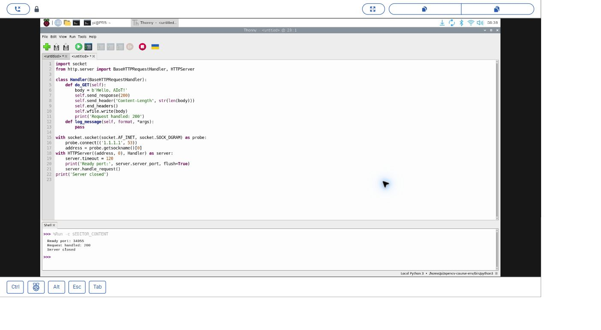
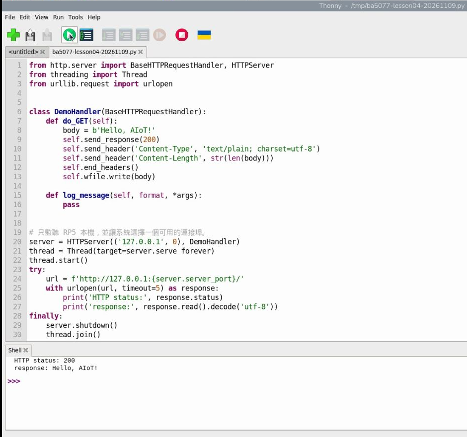
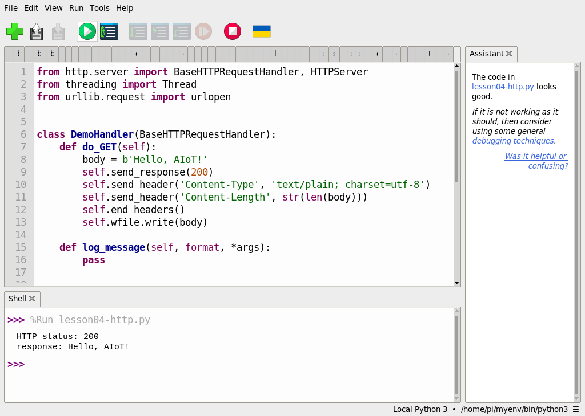

# 05｜讓 Pi 連上網路：IP、SSH 與第一個網頁伺服器

## [原課號：第 04 課｜網路基礎與作業系統：應用於 Raspberry Pi（下）](https://github.com/Samuel-ncu/BA5077-RP5-compatibility/blob/main/%E6%95%99%E6%9D%90/%E7%AC%AC%2004%20%E8%AA%B2%EF%BD%9C%E7%B6%B2%E8%B7%AF%E5%9F%BA%E7%A4%8E%E8%88%87%E4%BD%9C%E6%A5%AD%E7%B3%BB%E7%B5%B1%EF%BC%9A%E6%87%89%E7%94%A8%E6%96%BC%20Raspberry%20Pi%EF%BC%88%E4%B8%8B%EF%BC%89.md)

digithouse.net 原文：[第 4 課｜網路基礎與作業系統：應用於 Raspberry Pi（下）](https://digithouse.net/blog/ba5077-lesson-03-network-os?locale=zh-TW)

> **本篇狀態**：已在目前 Trixie 實測。Python 本機網頁（2026-11-09）、Windows 跨裝置請求（2026-11-10）、Apache 安裝與從 Windows 瀏覽器開啟（2026-11-11）都有紀錄。**修改 Apache 首頁的練習尚未實測**；SSH 登入與 Apache 的設定步驟沒有補拍截圖；乾淨重灌的系統也還沒驗證。

想像一下：你坐在宿舍書桌前，RP5 放在實驗室的架子上，沒接螢幕。你想問它一個問題，或讓它顯示一個網頁給你看——做得到嗎？做得到，這正是 AIoT 裝置平常工作的樣子。今天我們要做兩件事：一是**遠端登入**它，二是讓它**回應網頁請求**，最後真的在 RP5 上架一個網站，用筆電的瀏覽器打開。

## 這篇會學到什麼

- SSH 是什麼，怎麼確認 RP5 的 SSH 服務在跑。
- APT 套件管理器和 Python 套件的差別。
- 「請求」與「回應」：用 Python 寫一個只回應一次的小網頁服務。
- 用 APT 安裝 Apache 網頁伺服器，讓另一台電腦打開 RP5 的網頁。

## 需要的東西

- 已開機、已連網的 RP5（系統安裝見[上一篇](./04-%E5%8B%95%E6%89%8B%E5%AE%89%E8%A3%9D%20Raspberry%20Pi%20OS%EF%BC%9A%E7%94%A8%20Imager%20%E7%87%92%E9%8C%84%E8%88%87%E7%AC%AC%E4%B8%80%E6%AC%A1%E9%96%8B%E6%A9%9F.md)）。
- 另一台和 RP5 在**同一個區域網路**的電腦（本次用 Windows）。
- RP5 帳號的密碼：安裝系統軟體要用 `sudo`，它會問密碼。**密碼只輸入在自己的終端機，不要貼到聊天、作業或截圖裡。**
- Thonny（RP5 內建的 Python 編輯器，新 11 會正式介紹）。

> **關於指令**：這篇會出現 `sudo`、`apt`、`systemctl` 等指令。今天先**照著打**，知道每一行「在做什麼」就好；它們的完整意思會在[新 08 終端機入門](./08-%E7%B5%82%E7%AB%AF%E6%A9%9F%E5%85%A5%E9%96%80%EF%BC%9A%E6%9C%80%E5%B8%B8%E7%94%A8%E7%9A%84%20UNIX%20%E6%8C%87%E4%BB%A4.md)詳細說明。

## 先懂幾個名詞

- **SSH**：一種加密的遠端登入方式。你在自己的電腦打指令，指令實際在 RP5 上執行。
- **套件管理器 APT**：Debian 系統用來下載、安裝、更新**系統程式**的工具。Python 的程式庫則常用虛擬環境另外管理（新 11 會教）。系統有 `apt`，不代表某個 Python 套件已經裝好。
- **sudo**：用管理員權限執行一個指令。安裝系統軟體時需要，會問你密碼。
- **網頁伺服器**：一直在背景等候、有人來要網頁就回傳的程式。Apache 是世界上最常用的網頁伺服器之一。
- **HTTP 狀態碼 200**：伺服器回答「成功」的代號。

## 一步一步操作

### 步驟 1：確認系統、架構和 APT

**為什麼**：先知道自己在哪種系統上，後面裝東西才不會選錯版本。

在 RP5 終端機輸入：

```bash
python3 -c "import platform; print(platform.system()); print(platform.machine())"
command -v apt
```

實際輸出：

```text
Linux
aarch64
/usr/bin/apt
```

第一行是系統、第二行是架構；`/usr/bin/apt` 表示找得到 APT。這不代表需要的套件都裝好了。

### 步驟 2：確認 SSH 服務在跑

**為什麼**：遠端登入要靠 RP5 上的 SSH 服務。服務沒開，再怎麼連都沒用。

```bash
systemctl is-active ssh
```

實際輸出：

```text
active
```

`active` 表示 SSH 服務此刻正在執行。要真的登入，還需要網路通、帳號正確和適當的認證方式（燒錄時在 Imager 設定，見[新 04](./04-%E5%8B%95%E6%89%8B%E5%AE%89%E8%A3%9D%20Raspberry%20Pi%20OS%EF%BC%9A%E7%94%A8%20Imager%20%E7%87%92%E9%8C%84%E8%88%87%E7%AC%AC%E4%B8%80%E6%AC%A1%E9%96%8B%E6%A9%9F.md)）。本篇沒有補拍 SSH 登入畫面。

### 步驟 3：用 Python 理解「請求與回應」

**為什麼**：在架真正的網站之前，先用最小的程式看懂網頁怎麼運作：有人來「要」（請求），伺服器「給」（回應）。這個練習只在 RP5 自己身上進行，不會對外開放。

在 Thonny 開啟[範例程式 第04課-本機網頁.py](https://github.com/Samuel-ncu/BA5077-RP5-compatibility/blob/main/%E6%95%99%E6%9D%90/%E7%AF%84%E4%BE%8B%E7%A8%8B%E5%BC%8F/%E7%AC%AC04%E8%AA%B2-%E6%9C%AC%E6%A9%9F%E7%B6%B2%E9%A0%81.py)（下載方式見[素材下載與使用](https://github.com/Samuel-ncu/BA5077-RP5-compatibility/blob/main/%E6%95%99%E6%9D%90/%E7%B7%B4%E7%BF%92%E7%B4%A0%E6%9D%90/%E7%B4%A0%E6%9D%90%E4%B8%8B%E8%BC%89%E8%88%87%E4%BD%BF%E7%94%A8.md)），或自己貼上：

```python
from http.server import BaseHTTPRequestHandler, HTTPServer
from threading import Thread
from urllib.request import urlopen


class DemoHandler(BaseHTTPRequestHandler):
    def do_GET(self):
        body = b'Hello, AIoT!'
        self.send_response(200)
        self.send_header('Content-Type', 'text/plain; charset=utf-8')
        self.send_header('Content-Length', str(len(body)))
        self.end_headers()
        self.wfile.write(body)

    def log_message(self, format, *args):
        pass


# 只監聽 RP5 本機，並讓系統選擇一個可用的連接埠。
server = HTTPServer(('127.0.0.1', 0), DemoHandler)
thread = Thread(target=server.serve_forever)
thread.start()
try:
    url = f'http://127.0.0.1:{server.server_port}/'
    with urlopen(url, timeout=5) as response:
        print('HTTP status:', response.status)
        print('response:', response.read().decode('utf-8'))
finally:
    server.shutdown()
    thread.join()
    server.server_close()
```

確認 Thonny 右下角選的是 RP5 的系統 Python 3，按綠色執行鈕。2026-11-09 在目前 Trixie（系統 Python 3.13.5）的實際輸出：

```text
HTTP status: 200
response: Hello, AIoT!
```

怎麼讀：`127.0.0.1` 是「RP5 自己」；連接埠設成 `0` 是讓系統挑一個沒人用的。程式先開服務，再自己去要一次網頁，`200` 表示成功，下一行是回應內容，最後把服務關掉。

這只證明 RP5 自己對自己的請求可以運作，**不能證明別台電腦連得到**。

### 步驟 4：讓另一台電腦送出請求

**為什麼**：真正的 AIoT 裝置要讓別的裝置連進來。這一步用一次性的 Python 服務，只回應一次就關掉，比較安全。

1. 在 Thonny 開啟[範例程式 第04課-跨裝置HTTP.py](https://github.com/Samuel-ncu/BA5077-RP5-compatibility/blob/main/%E6%95%99%E6%9D%90/%E7%AF%84%E4%BE%8B%E7%A8%8B%E5%BC%8F/%E7%AC%AC04%E8%AA%B2-%E8%B7%A8%E8%A3%9D%E7%BD%AEHTTP.py)。本次用的直譯器是 `opencv-course-env`（新 11 建立的環境）；這個程式不需要額外套件，用系統 Python 也可以。
2. 按執行，記下 Shell 顯示的連接埠，例如 `Ready port: 34055`（每次都可能不同）。
3. 在 RP5 終端機用 `hostname -I` 查自己的 IP。
4. 在 Windows 的 PowerShell 輸入（把 `<RP5的IP>`、`<連接埠>` 換成你查到的）：

```powershell
$response = Invoke-WebRequest -Uri 'http://<RP5的IP>:<連接埠>/' -TimeoutSec 8 -UseBasicParsing
$response.StatusCode
[System.Text.Encoding]::UTF8.GetString($response.Content)
```

2026-11-10 實測：Windows 收到狀態碼 `200`，內容解碼後是 `Hello, AIoT!`；RP5 的 Thonny 顯示：

```text
Ready port: 34055
Request handled: 200
Server closed
```

要**同時**看到 `Request handled: 200` 和 Windows 收到回應，才算成功。`Server closed` 也可能是等了 120 秒沒人連而自動關閉。（當天第一次因為看錯埠號被拒絕連線，核對後才成功。）

### 步驟 5：用 APT 安裝 Apache

**為什麼**：上面的小服務回應一次就關。真正的網站需要一直在背景等候的網頁伺服器。Apache 是系統程式，所以用 APT 安裝，不是用 pip。先 `update` 讓 APT 拿到最新的套件清單，再 `install`。

在 RP5 終端機：

```bash
sudo apt update
sudo apt install -y apache2
```

輸入第一行後會出現 `[sudo] password for ...:`，輸入你的密碼（畫面不會顯示字元）再按 Enter。`-y` 表示安裝過程的確認問題都回答「是」。

2026-11-11 實際輸出的重點（中間下載與解壓縮的行省略）：

```text
Installing:
  apache2

Installing dependencies:
  apache2-bin   apache2-utils  libaprutil1-dbd-sqlite3  libaprutil1t64
  apache2-data  libapr1t64     libaprutil1-ldap

Summary:
  Upgrading: 0, Installing: 8, Removing: 0, Not Upgrading: 55
  Download size: 2,126 kB
  Space needed: 13.7 MB / 108 GB available
...
Setting up apache2 (2.4.69-1~deb13u1) ...
Enabling module mpm_event.
...
Enabling site 000-default.
Created symlink '/etc/systemd/system/multi-user.target.wants/apache2.service' → '/usr/lib/systemd/system/apache2.service'.
```

怎麼讀：APT 自動帶進 7 個 Apache 需要的套件（共 8 個）；`Enabling site 000-default` 是預設網站；最後那行表示系統已把 Apache 設成**開機自動啟動**。`Not Upgrading: 55` 只是說還有別的套件可以更新，這一課不需要全部升級。

### 步驟 6：確認 Apache 真的在跑

**為什麼**：「裝好」不等於「在跑」，也不等於「開機會自動啟動」。

```bash
systemctl is-active apache2
systemctl is-enabled apache2
/usr/sbin/apache2 -v
curl -s -o /dev/null -w "localhost HTTP %{http_code}\n" http://localhost/
hostname -I
```

實際輸出（最後一行的 IP 這裡不列出，你會看到自己的）：

```text
active
enabled
Server version: Apache/2.4.69 (Debian)
Server built:   2026-10-01T16:54:08
localhost HTTP 200
```

- `active`：現在正在執行。`enabled`：開機會自動啟動。兩者不同。
- `curl` 在 RP5 自己身上要了一次首頁，得到 `200`。
- `apache2` 放在 `/usr/sbin`，一般帳號直接打 `apache2 -v` 可能出現 `command not found`；寫完整路徑就好，這不代表安裝失敗。

### 步驟 7：從另一台電腦打開網頁

**為什麼**：這才是真正的跨裝置驗證——請求從你的電腦經過網路，到達 RP5 的 Apache，再把網頁送回來。

在 Windows 瀏覽器網址列輸入 `http://<RP5的IP>/`，按 Enter。看到 **Apache2 Debian Default Page** 和紅色的 **It works!** 就成功了。也可以在 PowerShell 用 `curl.exe -I http://<RP5的IP>/` 檢查，本次回應標頭有 `Server: Apache/2.4.69 (Debian)`，狀態碼 200。

網址列出現「不安全」是因為用的是 HTTP 而不是 HTTPS；練習網路裡可以接受，但**不要在這種頁面輸入密碼**。

## 成果圖



*操作截圖：RP5 桌面分享中 Thonny 的程式與輸出，埠號是當次動態值（2026-11-10，目前 Trixie）。*



*操作截圖：步驟 3 本機 HTTP 範例在 RP5 Thonny 的執行畫面，已裁切（2026-11-09，目前 Trixie）。*

> **【圖片預留：lesson04-apache-windows-browser-20261111.jpg】**
> 操作截圖：Windows 的 Chrome 開啟 RP5 的網址，顯示 Apache2 Debian Default Page 與紅色 It works! 橫幅（2026-11-11）。原圖網址列含私人 IP，**需遮蔽後再上傳至網站**，詳見[需上傳至網站的素材](./需上傳至網站的素材.md)。



*操作截圖（舊環境 Bookworm，2026-10-29）：同一個本機 HTTP 範例在舊機器的執行結果，保留作為比較。*

## 常見問題

| 你看到的情況 | 可能原因 | 怎麼做 |
| --- | --- | --- |
| `E: Unable to locate package apache2` | 套件清單太舊或沒有網路 | 先執行 `sudo apt update`，確認 RP5 能上網 |
| `Could not get lock /var/lib/dpkg/lock-frontend` | 另一個 APT 或系統更新正在跑 | 等它結束再試；**不要刪除鎖定檔** |
| `systemctl is-active apache2` 不是 `active` | 服務沒起來或設定有誤 | `sudo systemctl status apache2` 看紅字；再試 `sudo systemctl restart apache2` |
| RP5 上是 `localhost HTTP 200`，Windows 卻連不上 | IP 打錯、不在同一網路、網路有隔離 | 用 `hostname -I` 重查 IP；確認兩台連的是同一個網路 |
| 瀏覽器自動改成 `https://` 打不開 | 瀏覽器預設升級到 HTTPS | 網址前面明確打 `http://` |
| Python 範例出現 `ModuleNotFoundError` | 沒在 RP5 的 Python 3 執行 | 確認 Thonny 右下角的直譯器 |
| 跨裝置請求被拒絕或逾時 | 埠號看錯、程式已經關了、網路隔離 | 重新執行程式，核對 Shell 顯示的埠號；不要為了練習關掉防火牆 |

### 原文提到、但這次沒有照做的部分

- **用 `/etc/dhcpcd.conf` 設定固定 IP**：Raspberry Pi 官方在 [Bookworm 發布文章](https://www.raspberrypi.com/news/bookworm-the-new-version-of-raspberry-pi-os/)中說明，Bookworm 起預設改用 NetworkManager 管理網路，取代 dhcpcd。所以這個做法不適用於目前的系統；固定 IP 的新做法本教材**尚未實測**。
- `ping`、`ufw allow 80`（防火牆規則）、`/etc/rc.local` 開機自動執行、`apt upgrade` 全面升級：本教材都**尚未實測**，也不是完成這一課的必要步驟。

## 小結

這一課我們確認了 RP5 的 SSH 在跑，用 Python 看懂了請求與回應，再用 APT 裝了 Apache，讓另一台電腦打開 RP5 的網頁。記得：`active` 是「正在跑」、`enabled` 是「開機會跑」；在 RP5 上成功不代表別台電腦連得到。

**安全提醒**：裝好 Apache，等於讓同一個網路裡的**任何人**都能連到 RP5 的 80 埠。練習結束、不需要時，可以用 `sudo systemctl disable --now apache2` 停止並取消開機啟動；要移除就用 `sudo apt remove apache2`。在學校或公共網路開服務之前，先確認是否被允許。

**練習**：

1. 如果只執行 `sudo systemctl stop apache2`，重開機後 Apache 會不會又啟動？為什麼？
2. 預測：把 RP5 的網路斷掉後，Windows 重新整理網頁會看到什麼？
3. 進階（**尚未實測**）：先備份 `sudo cp /var/www/html/index.html /var/www/html/index.html.bak`，再用 `sudo nano /var/www/html/index.html` 把首頁改成你自己的一行字，存檔後在 Windows 重新整理。

## 下一篇預告

SSH 讓你遠端打指令，Apache 讓你遠端看網頁，但如果想看到 RP5 的**整個桌面**呢？下一篇[06｜遠端看見 Pi 的桌面](./06-%E9%81%A0%E7%AB%AF%E7%9C%8B%E8%A6%8B%20Pi%20%E7%9A%84%E6%A1%8C%E9%9D%A2%EF%BC%9Awayvnc%20%E8%88%87%20VNC%20Viewer.md)，我們用 wayvnc 和 VNC Viewer 把它整個搬到你的筆電上。
