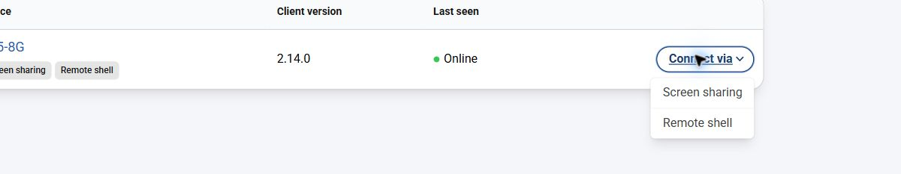
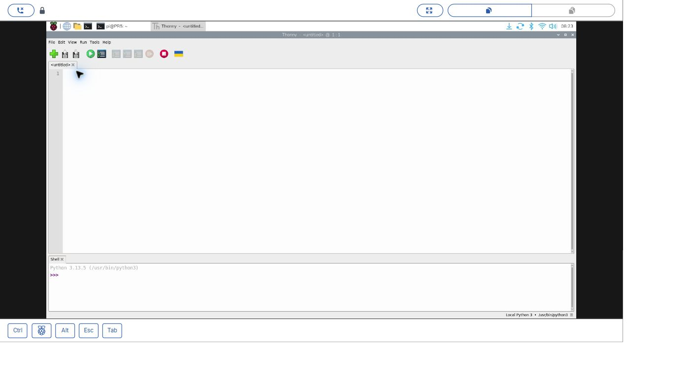
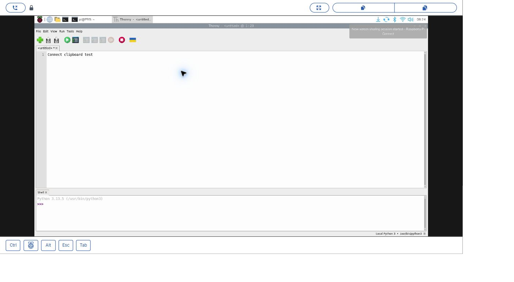
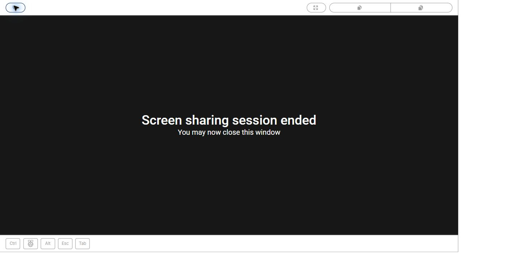

# 06｜遠端看見 Pi 的桌面：wayvnc 與 VNC Viewer

## [原課號：第 10 課｜Raspberry Pi 5 安裝與設定 VNC Viewer](https://github.com/Samuel-ncu/BA5077-RP5-compatibility/blob/main/%E6%95%99%E6%9D%90/%E7%AC%AC%2010%20%E8%AA%B2%EF%BD%9CRaspberry%20Pi%205%20%E5%AE%89%E8%A3%9D%E8%88%87%E8%A8%AD%E5%AE%9A%20VNC%20Viewer.md)

digithouse.net 原文：[第 10 課｜Raspberry Pi 5 安裝與設定 VNC Viewer](https://digithouse.net/blog/ba5077-lesson-07-vnc-viewer?locale=zh-TW)

> **本篇狀態**：依 [56 篇完成度分類](https://github.com/Samuel-ncu/BA5077-RP5-compatibility/blob/main/%E6%95%99%E6%9D%90/56%E7%AF%87%E5%AE%8C%E6%88%90%E5%BA%A6%E5%88%86%E9%A1%9E%E8%88%87%E4%BA%BA%E5%B7%A5%E4%BD%9C%E6%A5%AD.md)屬於「未完成」。2026-11-12 只驗證了**伺服器與網路這一端**：wayvnc 的服務狀態、5900 埠和連線回應。**用帳號密碼登入 VNC、看到桌面的畫面尚未實測**（密碼只能由帳號持有人輸入），也還沒有截圖。在 RP5 打開 VNC 的兩種方法同樣**尚未實測**。另一條路線 Raspberry Pi Connect 桌面分享（2026-11-10）則已實測，附截圖。

SSH 很好用，但第一次接觸 Linux 的同學常跟我說：「老師，我想要看到畫面，滑鼠點一點就好。」這很合理。之後我們要用 Thonny 寫程式、看相機畫面，有桌面會方便很多。這一課就是把 RP5 的整個桌面「搬」到你的筆電上。

## 這篇會學到什麼

- VNC 由哪兩個程式合作完成。
- 在 RP5 打開 VNC 伺服器，並確認它在跑。
- 在 Windows 安裝 VNC Viewer 並連線。
- 另一條不需要知道 IP 的路線：Raspberry Pi Connect 桌面分享。

## 需要的東西

- 已連網、可登入的 RP5，並且開機進入**桌面**（不是純文字模式）。
- 一台和 RP5 在同一個網路的 Windows 電腦，可以安裝軟體。
- RP5 的使用者名稱和密碼（**不是** Windows 的帳號）。
- 如果要用 Connect：一個 Raspberry Pi ID，並由帳號持有人完成登入和裝置連結。

## 先懂幾個名詞

VNC 由兩個程式合作：

| 角色 | 在哪台電腦 | 做什麼 |
| --- | --- | --- |
| VNC 伺服器 | RP5 | 把 RP5 桌面的畫面送出去，接收滑鼠和鍵盤 |
| VNC Viewer（觀看程式） | 你的 Windows | 顯示收到的畫面，把你的操作送回 RP5 |

**為什麼舊教學的指令不能用？** Raspberry Pi 官方在 [Bookworm 發布文章](https://www.raspberrypi.com/news/bookworm-the-new-version-of-raspberry-pi-os/)和[發行說明](https://downloads.raspberrypi.com/raspios_arm64/release_notes.txt)（2023-10-10）中說明：桌面改用 Wayland 之後，VNC 伺服器由 RealVNC 換成 **wayvnc**。舊課程那台機器跑的是 X11，用的是 RealVNC 的 `vncserver-x11-serviced`；目前這台 Trixie 用的是 wayvnc。網路上叫你啟動 `vncserver-x11-serviced` 的教學，在現在的桌面不適用。（Wayland、X11 是什麼，見[導讀](./00-%E5%B0%8E%E8%AE%80%EF%BC%9A%E5%BE%9E%20Bookworm%20%E5%88%B0%20Trixie%EF%BC%8C%E9%80%99%E5%A5%97%E6%95%99%E6%9D%90%E6%94%B9%E4%BA%86%E4%BB%80%E9%BA%BC.md)。）

## 一步一步操作

### 步驟 1：在 RP5 打開 VNC（尚未實測）

**為什麼**：沒有伺服器，Viewer 就沒有東西可以看。

兩種方法做的是同一件事：啟用並啟動 `wayvnc` 服務。本教材沒有實際操作這兩種方法，也沒有截圖。

- **方法一（圖形介面）**：點左上角選單，打開 **Control Centre（控制中心）**，切到 **介面（Interfaces）** 分頁，把 **VNC** 開關打開，依畫面輸入你自己帳號的密碼。這個分頁和開關是 2026-11-12 從 Control Centre 的程式檔與翻譯檔核對出來的，不是從畫面截圖確認的。
- **方法二（終端機）**：輸入 `sudo raspi-config`，選 **Interface Options → VNC → Yes**。

### 步驟 2：確認 wayvnc 在跑

**為什麼**：先確認伺服器這一端沒問題，連不上時才知道要往哪裡找。

在 RP5 終端機：

```bash
systemctl is-active wayvnc
systemctl is-enabled wayvnc
```

2026-11-12 在目前 Trixie 的實際結果：

```text
active
enabled
```

`active` 是伺服器正在執行；`enabled` 是下次開機會自動啟動。看到 `inactive` 就回到步驟 1。

當天另外確認：wayvnc 版本 0.10.2，正在監聽 `*:5900`；設定檔 `/etc/wayvnc/config` 有 `enable_auth=true`、`enable_pam=true`，表示**必須用 RP5 的帳號密碼登入**。

### 步驟 3：查出 RP5 的 IP

**為什麼**：Viewer 要知道去哪裡找伺服器。

```bash
hostname -I
```

第一個數字通常就是 RP5 在區網裡的位址。**請用你自己看到的數字**；換了網路位址也可能改變。

### 步驟 4：在 Windows 安裝 VNC Viewer

**為什麼**：觀看程式是裝在 **Windows**，不是裝在 RP5。

只從官方網站下載：

- **RealVNC Viewer**：[RealVNC 官方下載頁](https://www.realvnc.com/en/connect/download/viewer/)。
- **TigerVNC Viewer**：開放原始碼，[TigerVNC 官方網站](https://tigervnc.org/)。

這台測試用的 Windows 裝了 TigerVNC 1.16.0 和 RealVNC Connect。學校電腦不能裝軟體時，請改用步驟 7 的 Raspberry Pi Connect。

### 步驟 5：連線（登入部分尚未實測）

**為什麼**：前面都準備好了，這一步把兩邊接起來。

1. 打開 VNC Viewer，在位址欄輸入步驟 3 的 IP，按 Enter。預設埠號是 5900，通常不用另外打。
2. 第一次連線可能跳出「伺服器身分」或憑證提示，確認是你自己的 RP5 再接受。
3. 輸入 **RP5 的使用者名稱和密碼**。密碼自己輸入，不要寫進作業或聊天。
4. 看到 RP5 的桌面後，打開一個程式（例如 Thonny），確認滑鼠和鍵盤都能用。

**本次實測到哪裡**：2026-11-12 從 Windows 連到 RP5 的 5900 埠，伺服器回應 `RFB 003.008`（RFB 是 VNC 使用的通訊協定），而且只提供需要驗證的加密登入方式。**沒有輸入帳號密碼完成登入**，登入後的桌面畫面和憑證提示截圖，仍待帳號持有人補拍。

另外，2026-11-11 晚上教師曾在 RP5 開一個只供本機使用的臨時 wayvnc，經 SSH 通道用 Windows 的 TigerVNC 看到 RP5 桌面並操作 Thonny。那是教師測試用的方法，不是學生路線，但它說明 TigerVNC 可以顯示 Trixie 的 Wayland 桌面。

### 步驟 6：連不上時怎麼辦

見下方「常見問題」的表格。

### 步驟 7：不用 IP 的路線——Raspberry Pi Connect 桌面分享（已實測）

**為什麼**：電腦和 RP5 不在同一個網路，或你不知道 IP 時，可以用 Raspberry Pi 官方的 Connect 服務，直接在瀏覽器裡看 RP5 的桌面。

以下是 2026-11-10 在目前 Trixie、Connect 2.14.0、Windows Chrome 的實際操作。登入 Raspberry Pi ID 和連結裝置由帳號持有人完成。

1. 在電腦登入 [Connect](https://connect.raspberrypi.com/)，在 **Devices** 找到顯示 **Online** 的 RP5，按 **Connect via → Screen sharing**。

   

   *操作截圖：Connect 裝置清單的選單，已裁切（2026-11-10）。這一篇選 Screen sharing；Remote shell 會在[下一篇](./07-%E6%8A%8A%20Pi%20%E7%9A%84%E8%A6%96%E7%AA%97%E5%80%9F%E5%88%B0%20Windows%EF%BC%9AMobaXterm%20%E8%88%87%20X11%20%E8%BD%89%E7%99%BC.md)介紹。*

2. 桌面出現後就能操作。本次在遠端桌面開了 Thonny。
3. **剪貼簿**：在電腦複製文字，按上方 **Paste to remote**，再點 RP5 裡的目標欄位按 Ctrl+V。本次把 `Connect clipboard test` 貼進 Thonny；反方向用 **Copy from remote** 讀回同一段文字。
4. 按左上角 **Disconnect**，畫面出現 `Screen sharing session ended`；按 **Reconnect** 會再看到原本的桌面。

Connect 和 VNC 是兩條不同的路線：VNC 要知道 IP、通常在同一個網路；Connect 需要網際網路和 Raspberry Pi ID。功能細節見 [Connect 官方文件](https://www.raspberrypi.com/documentation/services/connect.html)。

## 成果圖

> **【圖片預留：VNC 登入後的 RP5 桌面】** 尚未實測，repo 裡沒有這張圖，待帳號持有人登入後補拍。



*操作截圖：Connect 桌面分享的實際畫面，RP5 桌面上開著 Thonny（2026-11-10）。*



*操作截圖：用 Paste to remote 把測試文字貼進 RP5 的 Thonny（2026-11-10）。練習時不要用私人資料。*



*操作截圖：按 Disconnect 之後的畫面（2026-11-10）。*

## 常見問題

| 你看到的情況 | 可能原因 | 怎麼做 |
| --- | --- | --- |
| 連線逾時、被拒絕 | 位址錯、不在同一個網路、VNC 沒開 | 重查 `hostname -I`；確認兩台在同一網路；在 RP5 執行 `systemctl is-active wayvnc` |
| 帳號或密碼錯誤 | 輸入的是 Windows 帳號 | 改用 RP5 的使用者名稱和密碼 |
| 連上後是黑畫面 | RP5 沒有進到桌面，或設成文字模式開機 | 在 RP5 確認已進入桌面；`raspi-config` 的 Boot 選項要選 Desktop |
| 舊教學的 `vncserver-x11-serviced` 失敗 | 那是 X11 時代的伺服器 | 目前桌面請用 wayvnc（步驟 1、2） |
| 舊教學叫你用預設帳號密碼登入 | 那是很舊的做法 | 用你在 Imager 自己建立的帳號（見[新 04](./04-%E5%8B%95%E6%89%8B%E5%AE%89%E8%A3%9D%20Raspberry%20Pi%20OS%EF%BC%9A%E7%94%A8%20Imager%20%E7%87%92%E9%8C%84%E8%88%87%E7%AC%AC%E4%B8%80%E6%AC%A1%E9%96%8B%E6%A9%9F.md)） |
| 用 `raspberrypi.local` 連不到 | 名稱解析或主機名稱不同 | 改用 `hostname -I` 查到的 IP（本教材沒有測試 `.local` 名稱） |

## 小結

VNC 要兩邊配合：RP5 上的伺服器（目前是 wayvnc）負責送畫面，Windows 上的 Viewer 負責看和操作。我們確認了 wayvnc 在跑、5900 埠有回應，但用帳號密碼登入的那一步還沒做完。如果你不知道 IP 或不在同一個網路，Raspberry Pi Connect 的桌面分享是已經實測過的替代路線。

**練習**：

1. 用自己的話說明 VNC 伺服器和 VNC Viewer 分別在哪台電腦執行。
2. SSH 能登入，為什麼不保證 VNC 一定能看到桌面？（提示：伺服器、桌面、埠號）
3. 比較 VNC 和 Connect：哪一個需要知道 IP？哪一個需要網際網路與 Raspberry Pi ID？
4. 分享遠端桌面截圖前，先檢查有沒有帳號、位址或私人視窗。

## 下一篇預告

VNC 搬的是整個桌面。如果你只想把**一個視窗**借到 Windows 上呢？下一篇[07｜把 Pi 的視窗借到 Windows](./07-%E6%8A%8A%20Pi%20%E7%9A%84%E8%A6%96%E7%AA%97%E5%80%9F%E5%88%B0%20Windows%EF%BC%9AMobaXterm%20%E8%88%87%20X11%20%E8%BD%89%E7%99%BC.md)，我們來看 X11 轉發和 MobaXterm——這是第一批裡最繞的一課，也還有一段沒實測完。
