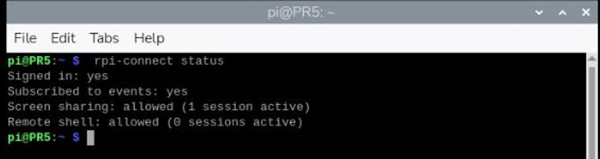
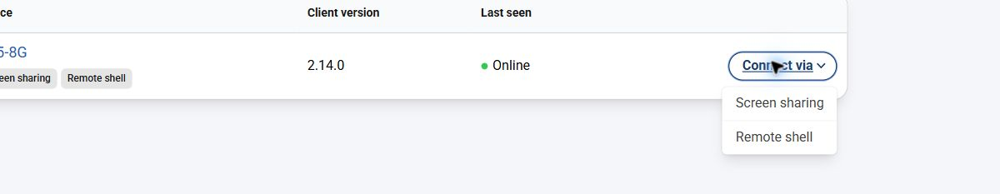
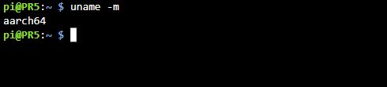

# 07｜把 Pi 的視窗借到 Windows：MobaXterm 與 X11 轉發

## [原課號：第 06 課｜使用 MobaXterm 對 Raspberry Pi 啟用 X11 轉發](https://github.com/Samuel-ncu/BA5077-RP5-compatibility/blob/main/%E6%95%99%E6%9D%90/%E7%AC%AC%2006%20%E8%AA%B2%EF%BD%9C%E4%BD%BF%E7%94%A8%20MobaXterm%20%E5%B0%8D%20Raspberry%20Pi%20%E5%95%9F%E7%94%A8%20X11%20%E8%BD%89%E7%99%BC.md)

digithouse.net 原文：[第 6 課｜使用 MobaXterm 對 Raspberry Pi 啟用 X11 轉發](https://digithouse.net/blog/ba5077-lesson-05-mobaxterm-x11?locale=zh-TW)

> **本篇狀態：MobaXterm 的 X11 視窗轉發尚未實測。** 依 [56 篇完成度分類](https://github.com/Samuel-ncu/BA5077-RP5-compatibility/blob/main/%E6%95%99%E6%9D%90/56%E7%AF%87%E5%AE%8C%E6%88%90%E5%BA%A6%E5%88%86%E9%A1%9E%E8%88%87%E4%BA%BA%E5%B7%A5%E4%BD%9C%E6%A5%AD.md)屬於「未完成」：測試用的 Windows 沒有安裝 MobaXterm，也沒有 X server，所以還沒有看到 RP5 的視窗出現在 Windows 上。已實測的部分是：RP5 端允許 X11 轉發（2026-11-12）、Raspberry Pi Connect 的狀態（2026-11-09）和遠端終端機（2026-11-10）。

上一篇我們把整個桌面搬到筆電上。但有時候你只想看**一個視窗**，例如在 RP5 上開一張圖片，或跑一個會跳出視窗的小程式，其他東西都不需要。X11 轉發就是為這件事設計的：程式在 RP5 上跑，視窗卻畫在你的 Windows 上。這一課的觀念比前幾篇繞一點，而且還有一段沒測完，我會清楚標出來。

## 這篇會學到什麼

- SSH 終端機、X11 單一視窗轉發、整個桌面分享，三者的差別。
- 確認 RP5 端是否允許 X11 轉發。
- MobaXterm 的設定步驟（尚未實測）。
- 用 Raspberry Pi Connect 開一個遠端終端機（已實測）。

## 需要的東西

- 已連網、SSH 服務在跑的 RP5（見[新 05](./05-%E8%AE%93%20Pi%20%E9%80%A3%E4%B8%8A%E7%B6%B2%E8%B7%AF%EF%BC%9AIP%E3%80%81SSH%20%E8%88%87%E7%AC%AC%E4%B8%80%E5%80%8B%E7%B6%B2%E9%A0%81%E4%BC%BA%E6%9C%8D%E5%99%A8.md)）。
- 一台可以安裝軟體的 Windows 電腦（MobaXterm 只裝在 Windows 端）。
- 要用 Connect 的話：已由帳號持有人登入並連結裝置的 Raspberry Pi ID。

## 先懂幾個名詞

- **X11**：一種「把視窗畫到螢幕上」的系統，已經用了三十多年。
- **X server**：負責實際把視窗畫出來的程式。做 X11 轉發時，它在**你的 Windows** 上（MobaXterm 內建一個）。
- **X11 轉發**：RP5 上的程式說「我要畫一個視窗」，這個要求經過 SSH 連線送到你電腦上的 X server，視窗就出現在你的桌面。程式本身還是在 RP5 上執行。
- **DISPLAY**：一個環境變數，告訴程式「視窗要畫到哪裡」。轉發成功時，它會是類似 `localhost:10.0` 的值。
- **xauth**：處理 X11 授權的小工具，SSH 轉發會用到它。

三種遠端方式比一比：

| 方式 | 傳的是什麼 | 這套教材在哪一篇 |
| --- | --- | --- |
| SSH 終端機 | 文字指令 | 新 05 |
| X11 轉發 | 單一程式的視窗 | 本篇 |
| VNC／Connect 桌面分享 | 整個桌面 | 新 06 |

## 一步一步操作

### 步驟 1：確認 RP5 端有工具、有服務

**為什麼**：X11 轉發要靠 SSH，也要有 `xauth`。先確認 RP5 這一端的條件。

在 RP5 終端機：

```bash
command -v xauth
systemctl is-active ssh
```

實際輸出：

```text
/usr/bin/xauth
active
```

這只確認 `xauth` 存在、SSH 服務在跑，**不代表轉發已經成功**。

### 步驟 2：確認 RP5 允許 X11 轉發（已實測）

**為什麼**：SSH 伺服器的設定檔可以關掉 X11 轉發。原文要你用 nano 改 `/etc/ssh/sshd_config`；我們先看看它本來的設定，已經允許就不用改。

```bash
grep -i '^X11Forwarding' /etc/ssh/sshd_config
```

2026-11-12 在目前 Trixie 的實際輸出：

```text
X11Forwarding yes
```

當天另外從 Windows 用 OpenSSH 的 `ssh -Y` 連進 RP5，在 RP5 上輸入 `echo $DISPLAY`，得到 `localhost:10.0`。這表示 SSH 伺服器已經替這次連線準備好轉發用的顯示位置。但因為那台 Windows 沒有 X server，**視窗本身沒有顯示出來**——這一步只證明 RP5 端的設定正確。

### 步驟 3：在 Windows 安裝 MobaXterm（尚未實測）

**為什麼**：MobaXterm 同時提供 SSH 用戶端和 X server，是 Windows 上做 X11 轉發最省事的工具之一。

從 [MobaXterm 官方網站](https://mobaxterm.mobatek.net/)下載 Home Edition（Installer 或 Portable 版都可以），只從官方網站取得。學校電腦不能安裝時，請找老師。

### 步驟 4：建立 SSH 連線並開啟 X11 轉發（尚未實測）

**為什麼**：要在連線設定裡打開 X11-Forwarding，視窗才會被送過來。

1. 開啟 MobaXterm，按左上角 **Session → SSH**。
2. **Remote host** 填 RP5 的 IP（在 RP5 用 `hostname -I` 查）。
3. 勾選 **Specify username**，填你自己的 RP5 使用者名稱。
4. 在 **Advanced SSH settings** 分頁確認 **X11-Forwarding** 有勾選，按 OK。
5. 第一次連線會詢問是否信任主機金鑰，確認是自己的 RP5 再接受，然後輸入 RP5 密碼。
6. 確認 MobaXterm 右上角的 **X server** 圖示是啟動狀態。原文說明：沒有啟動時，可以到 Settings → X11 勾選 Start X11 server at MobaXterm startup。

### 步驟 5：確認轉發並開一個視窗（尚未實測）

**為什麼**：`DISPLAY` 有值，代表轉發通道建立了；視窗真的出現，才算端到端成功。

在 MobaXterm 的終端機輸入：

```bash
echo $DISPLAY
```

應該看到類似 `localhost:10.0` 的值；空白代表轉發沒有建立。

接著開一個圖形程式測試，例如 `thonny &`，或開一張圖片 `qiv ~/Pictures/某張圖片.png &`（qiv 在[新 10](./10-%E7%94%A8%20qiv%20%E5%9C%A8%E7%B5%82%E7%AB%AF%E6%A9%9F%E9%96%8B%E5%9C%96%E7%89%87%EF%BC%88%E9%A0%86%E4%BE%BF%E5%AD%B8%20apt%20%E5%AE%89%E8%A3%9D%EF%BC%89.md) 安裝）。結尾的 `&` 讓程式在背景執行，終端機還能繼續打字。視窗應該出現在 Windows 桌面上，但程式其實在 RP5 執行。原文用的測試程式是 `xclock`（要先 `sudo apt install x11-apps`），本教材沒有在目前系統測試這個套件。

### 步驟 6：另一種遠端方式——Connect 遠端終端機（已實測）

**為什麼**：如果你只需要打指令，不需要視窗，Raspberry Pi Connect 的 Remote shell 不用知道 IP，也不用裝 SSH 用戶端。

1. 先在 RP5 終端機確認 Connect 的狀態：

   ```bash
   rpi-connect status
   ```

   2026-11-09 的實際輸出：

   ```text
   Signed in: yes
   Subscribed to events: yes
   Screen sharing: allowed (1 session active)
   Remote shell: allowed (0 sessions active)
   ```

   `allowed` 只表示「允許」，不代表已經連線成功。

2. 在 [Connect](https://connect.raspberrypi.com/) 的 Devices 頁找到自己的 RP5，按 **Connect via → Remote shell**（不要選成 Screen sharing）。
3. 等出現提示字元後，輸入 `uname -m` 按 Enter。這個指令只查架構，不會改任何檔案。2026-11-10 的實際輸出：

   ```text
   $ uname -m
   aarch64
   ```

4. 輸入 `exit` 按 Enter，頁面顯示 **Connection closed** 和 Reconnect。重新連線會開一個新的工作階段。

這次以 Connect 2.14.0、目前 Trixie、Windows Chrome 實測，不是重灌的乾淨系統；重開機後再連線也沒有測試。

## 成果圖

> **【圖片預留：MobaXterm 中 RP5 程式視窗出現在 Windows 桌面】** 尚未實測，repo 裡沒有這張圖，待 Windows 安裝 MobaXterm 後補拍。



*操作截圖：RP5 桌面終端機執行 `rpi-connect status`，已裁切；數字是截圖當時的連線狀態（2026-11-09）。*



*操作截圖：Connect 裝置清單的 Connect via 選單，已裁切，裝置名稱左側被裁去（2026-11-10）。*



*操作截圖：Connect 遠端終端機執行 `uname -m` 的輸出，已裁切（2026-11-10）。*

## 常見問題

| 你看到的情況 | 可能原因 | 怎麼做 |
| --- | --- | --- |
| `echo $DISPLAY` 是空的 | 連線沒有開 X11-Forwarding | 回到步驟 4 確認勾選 |
| `cannot open display` | Windows 端 X server 沒啟動，或轉發沒建立 | 檢查 MobaXterm 右上角 X server 圖示，再檢查步驟 4 |
| `X11Forwarding no` | RP5 的 SSH 設定關掉了轉發 | 需要用 `sudo nano /etc/ssh/sshd_config` 改成 `yes`，再 `sudo systemctl restart ssh`（本教材的機器本來就是 `yes`，**這個修改尚未實測**） |
| Connect 一直停在等待畫面 | 裝置沒上線、沒登入，或不允許 Remote shell | 確認 Devices 顯示 Online，`rpi-connect status` 顯示 allowed，並檢查網路 |
| 程式有跑，但沒有視窗 | 三個環節（RP5 程式、SSH 轉發、Windows X server）有一個沒接上 | 依序從 RP5 端往 Windows 端檢查 |

## 小結

X11 轉發是「程式在 RP5 跑，視窗畫在你的電腦上」。它需要三方配合：RP5 的 SSH 允許轉發、連線時開啟轉發、Windows 端有 X server。目前我們確認了 RP5 端沒問題（`X11Forwarding yes`、`DISPLAY=localhost:10.0`），但 Windows 端還沒裝 MobaXterm，所以視窗真正出現的那一步尚未實測。只需要打指令時，Connect 的遠端終端機是已經測過的替代方案。

**練習**：

1. 畫出「Windows、SSH、RP5、X server、遠端程式」的關係，標出程式實際在哪台機器執行。
2. SSH 能登入時，為什麼還可能看不到圖形視窗？
3. 列出 SSH 終端機、X11 單一視窗、VNC 完整桌面的差別，各舉一個適合的使用情境。

## 下一篇預告

連線的方法都認識了，接下來要真正開始「用」終端機。下一篇[08｜終端機入門](./08-%E7%B5%82%E7%AB%AF%E6%A9%9F%E5%85%A5%E9%96%80%EF%BC%9A%E6%9C%80%E5%B8%B8%E7%94%A8%E7%9A%84%20UNIX%20%E6%8C%87%E4%BB%A4.md)，我們會把前面照著打的 `sudo`、`apt`、`cd`、`ls` 這些指令一個一個弄懂。
