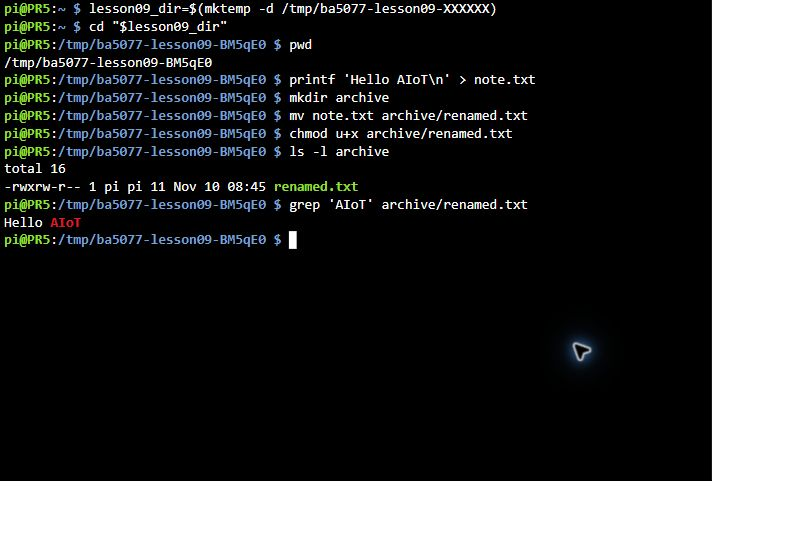
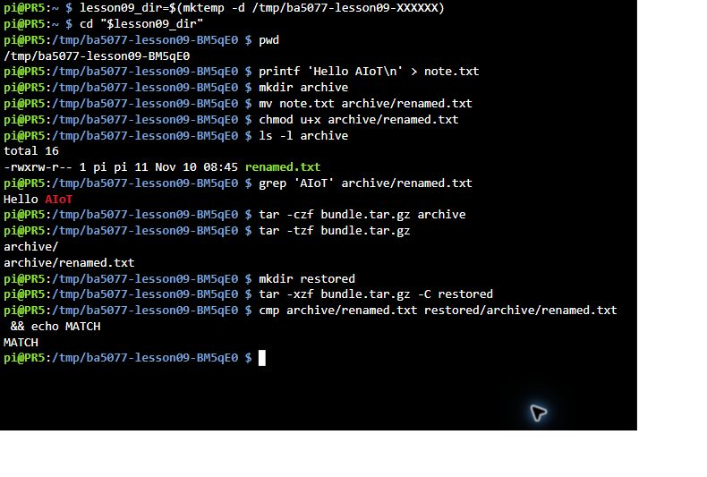
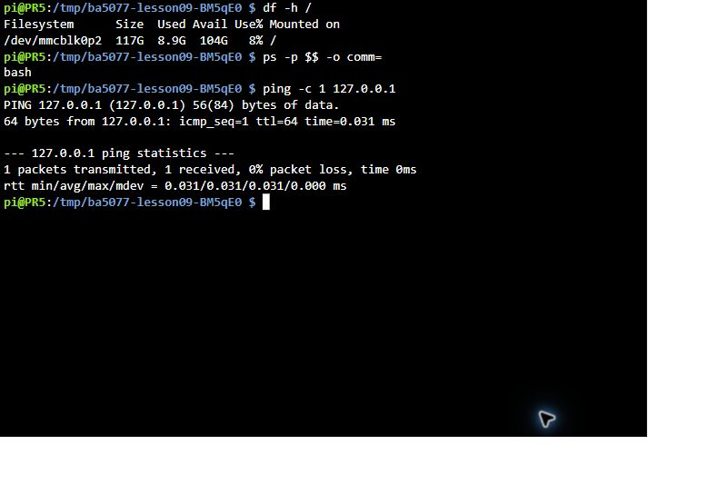

# 08｜終端機入門：最常用的 UNIX 指令

## [原課號：第 09 課｜Raspberry Pi 的 UNIX 指令教學](https://github.com/Samuel-ncu/BA5077-RP5-compatibility/blob/main/%E6%95%99%E6%9D%90/%E7%AC%AC%2009%20%E8%AA%B2%EF%BD%9CRaspberry%20Pi%20%E7%9A%84%20UNIX%20%E6%8C%87%E4%BB%A4%E6%95%99%E5%AD%B8.md)

digithouse.net 原文：[第 9 課｜Raspberry Pi 的 UNIX 指令教學](https://digithouse.net/blog/ba5077-lesson-06-unix-commands?locale=zh-TW)

> **本篇狀態**：依 [56 篇完成度分類](https://github.com/Samuel-ncu/BA5077-RP5-compatibility/blob/main/%E6%95%99%E6%9D%90/56%E7%AF%87%E5%AE%8C%E6%88%90%E5%BA%A6%E5%88%86%E9%A1%9E%E8%88%87%E4%BA%BA%E5%B7%A5%E4%BD%9C%E6%A5%AD.md)屬於「待核」。建立、移動、權限、封存、搜尋、磁碟與回送測試，已在目前 Trixie 實測（2026-11-10，透過 Raspberry Pi Connect 遠端終端機）。原文的 `rm`、`chown`、`top`、`htop`、`kill`、`pkill` 等管理指令**尚未實測**。

前幾篇我請大家「照著打」了不少指令：`sudo apt install`、`systemctl is-active`、`hostname -I`……有同學私下問我：「老師，我打是打了，但我其實不知道自己在幹嘛。」這篇就是來還債的。我們在一個不會弄壞任何東西的練習資料夾裡，把最常用的指令一個一個試過，每一步都把結果讀回來確認。

## 這篇會學到什麼

- 終端機、shell、提示字元、路徑是什麼。
- 查詢類指令：`pwd`、`ls`、`uname`、`df`、`ps`。
- 檔案類指令：`mkdir`、`cp`、`mv`、`cat`、`grep`、`chmod`、`tar`、`cmp`。
- 補上前幾篇照著打的 `sudo`、`apt`、`systemctl` 的意思。
- 哪些指令會改寫或刪除資料，執行前要先確認什麼。

## 需要的東西

- 已開機的 RP5，以及一個終端機：RP5 桌面上的 Terminal、SSH（[新 05](./05-%E8%AE%93%20Pi%20%E9%80%A3%E4%B8%8A%E7%B6%B2%E8%B7%AF%EF%BC%9AIP%E3%80%81SSH%20%E8%88%87%E7%AC%AC%E4%B8%80%E5%80%8B%E7%B6%B2%E9%A0%81%E4%BC%BA%E6%9C%8D%E5%99%A8.md)），或 Raspberry Pi Connect 的遠端終端機（[新 07](./07-%E6%8A%8A%20Pi%20%E7%9A%84%E8%A6%96%E7%AA%97%E5%80%9F%E5%88%B0%20Windows%EF%BC%9AMobaXterm%20%E8%88%87%20X11%20%E8%BD%89%E7%99%BC.md)）都可以。
- 不需要安裝任何軟體。

## 先懂幾個名詞

- **終端機**：用打字方式下指令的視窗。
- **shell**：在終端機裡接收你的指令、啟動對應程式的那個程式。這台 RP5 用的是 `bash`。
- **提示字元**：例如 `pi@PR5:~ $`，代表「我準備好了，請輸入」。它**不是**指令的一部分，不要照抄。
- **路徑**：檔案的地址。`/tmp/abc` 從根目錄 `/` 開始寫，叫**絕對路徑**；`./note.txt` 是從「現在所在的資料夾」開始算，叫**相對路徑**。`~` 代表自己的家目錄。

## 一步一步操作

### 步驟 1：先問電腦幾個問題（只讀，不會改任何東西）

**為什麼**：查詢類指令只讀資料，最適合拿來熟悉終端機。

```bash
uname -m
python3 --version
command -v apt
```

| 指令 | 回答的問題 |
| --- | --- |
| `uname -m` | 處理器架構 |
| `python3 --version` | 系統 Python 版本 |
| `command -v apt` | `apt` 這個程式放在哪裡；沒有輸出代表找不到 |

舊課程機器（Bookworm）的輸出是 `aarch64`、`Python 3.11.2`、`/usr/bin/apt`；目前 Trixie 的 Python 是 `Python 3.13.5`（見[新 02](./02-%E8%AA%8D%E8%AD%98%E4%BD%A0%E7%9A%84%E5%B0%8F%E9%9B%BB%E8%85%A6%EF%BC%9ARaspberry%20Pi%205%20%E8%88%87%20Raspberry%20Pi%20OS.md)）。

### 步驟 2：建立一個專屬的練習資料夾

**為什麼**：等一下會建立、移動檔案。在新的空資料夾裡練習，就不會不小心動到原有的檔案。

逐行輸入（開頭的提示字元不用打）：

```bash
lesson09_dir=$(mktemp -d /tmp/ba5077-lesson09-XXXXXX)
cd "$lesson09_dir"
pwd
```

- `mktemp -d` 建立一個名字保證不重複的新資料夾，`XXXXXX` 會被換成隨機字元。
- `lesson09_dir=...` 把這個路徑存到一個叫 `lesson09_dir` 的變數裡。
- `cd` 是「切換到某個資料夾」；`pwd` 是「印出我現在在哪裡」。

本次 `pwd` 顯示 `/tmp/ba5077-lesson09-BM5qE0`，隨機的部分每次都不同。

### 步驟 3：建立、移動、改權限、搜尋

**為什麼**：這幾個動作就是平常整理檔案的基本功。

```bash
printf 'Hello AIoT\n' > note.txt
mkdir archive
mv note.txt archive/renamed.txt
chmod u+x archive/renamed.txt
ls -l archive
grep 'AIoT' archive/renamed.txt
```

| 指令 | 做什麼 | 要注意 |
| --- | --- | --- |
| `printf '...' > note.txt` | 把文字寫進檔案 | `>` 會**覆寫**同名檔案 |
| `mkdir archive` | 建立資料夾 | — |
| `mv 來源 目的地` | 移動或改名 | 目的地已有同名檔案時可能被覆寫 |
| `chmod u+x 檔案` | 替擁有者（u）加上執行權限（x） | 這裡只是示範，不代表文字檔能執行 |
| `ls -l 資料夾` | 列出詳細資訊 | 第一欄是權限 |
| `grep 關鍵字 檔案` | 找出含有關鍵字的那幾行 | — |

本次 `grep` 印出 `Hello AIoT`；`ls -l` 中這個檔案的權限欄是 `-rwxrw-r--`。權限、擁有者和時間會依環境不同。

怎麼讀 `-rwxrw-r--`：第一個 `-` 表示一般檔案，接著三個一組，依序是擁有者、群組、其他人的權限；`r` 讀、`w` 寫、`x` 執行、`-` 沒有。

### 步驟 4：打包、解開，再確認內容一樣

**為什麼**：交作業、備份時常要把一整個資料夾打包成一個檔案。

```bash
tar -czf bundle.tar.gz archive
tar -tzf bundle.tar.gz
mkdir restored
tar -xzf bundle.tar.gz -C restored
cmp archive/renamed.txt restored/archive/renamed.txt && echo MATCH
```

- `tar -czf` 建立（c）壓縮（z）的封存檔（f 後面接檔名）；`-tzf` 只列出內容；`-xzf ... -C restored` 解開到 `restored` 資料夾。
- `cmp` 比對兩個檔案；內容相同時「成功結束」，`&&` 後面的 `echo MATCH` 才會執行。

本次封存清單是 `archive/` 和 `archive/renamed.txt`，最後印出 `MATCH`。解開封存檔前，記得先用 `-tzf` 看內容，並解到**空的**資料夾，避免覆寫。

### 步驟 5：查磁碟、shell 和本機網路

**為什麼**：裝套件前要知道空間夠不夠；排錯時要知道自己在哪個 shell。

```bash
df -h /
ps -p $$ -o comm=
ping -c 1 127.0.0.1
```

本次結果：根目錄所在的空間顯示容量 `117G`、已用 `8.9G`、可用 `104G`、使用率 `8%`；目前 shell 是 `bash`；回送測試 `1 packets transmitted, 1 received, 0% packet loss`。`127.0.0.1` 是 RP5 自己，所以這只證明 RP5 自己的網路功能正常，**不能**證明連得到外面。

### 步驟 6：補上前幾篇照著打的指令

| 指令 | 意思 | 在哪一篇用過 |
| --- | --- | --- |
| `sudo 指令` | 用管理員權限執行後面的指令，會問**你自己帳號**的密碼；輸入時畫面不顯示字元 | [新 05](./05-%E8%AE%93%20Pi%20%E9%80%A3%E4%B8%8A%E7%B6%B2%E8%B7%AF%EF%BC%9AIP%E3%80%81SSH%20%E8%88%87%E7%AC%AC%E4%B8%80%E5%80%8B%E7%B6%B2%E9%A0%81%E4%BC%BA%E6%9C%8D%E5%99%A8.md) |
| `sudo apt update` | 讓套件管理器 APT 下載最新的「套件清單」，還沒安裝任何東西 | 新 05 |
| `sudo apt install -y 套件` | 安裝系統套件；`-y` 代表確認問題都回答「是」 | 新 05、[新 10](./10-%E7%94%A8%20qiv%20%E5%9C%A8%E7%B5%82%E7%AB%AF%E6%A9%9F%E9%96%8B%E5%9C%96%E7%89%87%EF%BC%88%E9%A0%86%E4%BE%BF%E5%AD%B8%20apt%20%E5%AE%89%E8%A3%9D%EF%BC%89.md) |
| `systemctl is-active 服務` | 問某個背景服務現在有沒有在跑 | 新 05、[新 06](./06-%E9%81%A0%E7%AB%AF%E7%9C%8B%E8%A6%8B%20Pi%20%E7%9A%84%E6%A1%8C%E9%9D%A2%EF%BC%9Awayvnc%20%E8%88%87%20VNC%20Viewer.md) |
| `systemctl is-enabled 服務` | 問它開機會不會自動啟動 | 新 05、新 06 |
| `hostname -I` | 列出這台 RP5 的 IP 位址 | 新 05、新 06 |
| `command -v 程式` | 找出程式放在哪裡 | 本篇 |

`sudo` 權力很大：它能改系統檔案、也能刪掉系統檔案。**看不懂的 sudo 指令，先不要執行**。

## 成果圖



*操作截圖：Raspberry Pi Connect 遠端終端機，步驟 2～3 的實際畫面（2026-11-10，目前 Trixie）。*



*操作截圖：步驟 4 的打包、解開與比對；長指令在終端機裡自動換行（2026-11-10）。*



*操作截圖：步驟 5 的磁碟、shell 與回送測試輸出（2026-11-10）。*

## 常見問題

| 你看到的情況 | 可能原因 | 怎麼做 |
| --- | --- | --- |
| `command not found` | 指令打錯，或程式沒安裝 | 檢查拼字；用 `command -v` 確認 |
| `No such file or directory` | 路徑或檔名不對，或你不在你以為的資料夾 | 先 `pwd` 看自己在哪，`ls` 看檔名；大小寫要一樣 |
| `Permission denied` | 沒有權限 | 先想清楚為什麼需要權限；確定要改系統檔案才用 `sudo` |
| 打完指令沒有任何輸出 | 很多指令成功時本來就不說話 | 用 `ls`、`cat` 把結果讀回來確認 |
| 畫面卡住不動 | 指令還在執行，或在等你輸入 | 按 `Ctrl+C` 中止 |

### 原文還有、這次沒有實測的指令

原文還介紹了 `ls -a`（顯示隱藏檔）、`cd ..`（回上一層）、`rm`／`rm -r`（刪除檔案或資料夾）、`chown`（改擁有者）、`top`／`htop`（看執行中的程式）、`kill`／`pkill`（結束程式）、`man`（查說明書）。這些本教材**尚未實測**。特別提醒：`rm -r` 刪掉就沒有資源回收筒，不要對不確定的路徑使用。

## 小結

終端機的每一行指令都在回答一個問題，或做一件事。練習時記得三件事：在專屬的練習資料夾裡做；做完用 `ls`、`cat`、`cmp` 把結果讀回來；看到 `>`、`mv`、`rm`、`sudo` 時先停一下，確認目標。

**練習**：

1. 用一句話說明 `uname -m`、`python3 --version`、`command -v apt` 各回答什麼問題。
2. 說明 `./note.txt` 和 `/tmp/ba5077-lesson09-BM5qE0/note.txt` 的差別。
3. `/tmp` 裡的東西可能被系統清掉。如果要保留作業，應該放在哪裡？

## 下一篇預告

會打指令之後，下一步是在終端機裡**改檔案**。下一篇[09｜在終端機裡改檔案：nano 與 vi](./09-%E5%9C%A8%E7%B5%82%E7%AB%AF%E6%A9%9F%E8%A3%A1%E6%94%B9%E6%AA%94%E6%A1%88%EF%BC%9Anano%20%E8%88%87%20vi.md)，我們會各用一個編輯器寫一句話、存檔，再讀回來確認。
