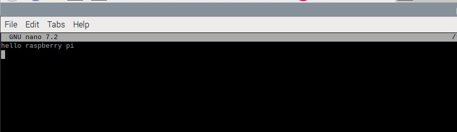
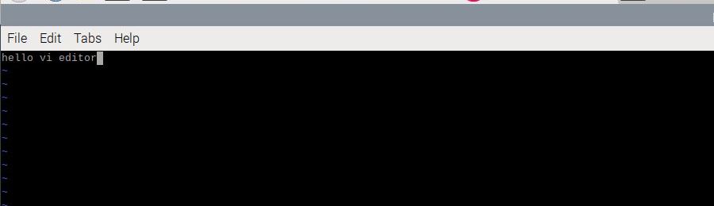
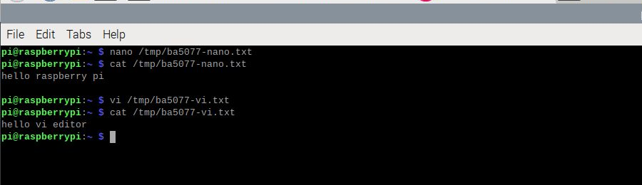

# 09｜在終端機裡改檔案：nano 與 vi

## [原課號：第 11 課｜Raspberry Pi 的 vi 與 nano 編輯器教學與比較](https://github.com/Samuel-ncu/BA5077-RP5-compatibility/blob/main/%E6%95%99%E6%9D%90/%E7%AC%AC%2011%20%E8%AA%B2%EF%BD%9CRaspberry%20Pi%20%E7%9A%84%20vi%20%E8%88%87%20nano%20%E7%B7%A8%E8%BC%AF%E5%99%A8%E6%95%99%E5%AD%B8%E8%88%87%E6%AF%94%E8%BC%83.md)

digithouse.net 原文：[第 11 課｜Raspberry Pi 的 vi 與 nano 編輯器教學與比較](https://digithouse.net/blog/ba5077-lesson-08-vi-nano?locale=zh-TW)

> **本篇狀態**：依 [56 篇完成度分類](https://github.com/Samuel-ncu/BA5077-RP5-compatibility/blob/main/%E6%95%99%E6%9D%90/56%E7%AF%87%E5%AE%8C%E6%88%90%E5%BA%A6%E5%88%86%E9%A1%9E%E8%88%87%E4%BA%BA%E5%B7%A5%E4%BD%9C%E6%A5%AD.md)屬於「待核」。nano 和 vi 的「輸入一行、存檔、離開、讀回」已實測（2026-10-29，**舊環境 Bookworm** 的 RP5 桌面終端機）。搜尋、復原等進階操作**尚未實測**。

我第一次用 vi 的時候，打了半天字，畫面上卻什麼都沒出現，反而游標亂跳。後來才知道，vi 一打開是在「下指令」的模式，不是「打字」的模式。這個經驗大概每個學 Linux 的人都有過。這篇我們用兩個終端機編輯器各寫一句話，存檔、讀回，順便搞懂 vi 的「模式」到底是怎麼回事。

## 這篇會學到什麼

- 為什麼要在終端機裡編輯文字檔。
- nano 的開啟、存檔、離開。
- vi 的兩種模式，以及 `i`、`Esc`、`:wq`。
- 怎麼確認檔案真的存好了。

## 需要的東西

- RP5 的終端機（桌面 Terminal 或遠端都可以）。
- 會用 `cat` 讀檔案（[新 08](./08-%E7%B5%82%E7%AB%AF%E6%A9%9F%E5%85%A5%E9%96%80%EF%BC%9A%E6%9C%80%E5%B8%B8%E7%94%A8%E7%9A%84%20UNIX%20%E6%8C%87%E4%BB%A4.md)）。

## 先懂幾個名詞

- **文字編輯器**：專門改純文字檔的程式。程式碼、設定檔都是純文字檔。
- **nano**：畫面底部會顯示快捷鍵提示，對初學者友善。`^` 代表 `Ctrl` 鍵，例如 `^X` 就是 `Ctrl+X`。
- **vi**：分成「命令模式」和「插入模式」。在命令模式按鍵是下指令，在插入模式按鍵才是打字。

## 一步一步操作

### 步驟 1：確認兩個編輯器都在

**為什麼**：先確認工具存在，後面出問題時才不會懷疑錯方向。

```bash
command -v nano
command -v vi
```

實際輸出：

```text
/usr/bin/nano
/usr/bin/vi
```

### 步驟 2：用 nano 寫一句話

**為什麼**：nano 的提示都在畫面上，最適合第一次練習。

1. 輸入 `nano /tmp/ba5077-nano.txt` 按 Enter，開啟一個空白檔。如果這個檔名已經存在，請換成自己的新檔名。
2. 輸入 `hello raspberry pi`，再按 Enter。
3. 按 **Ctrl+O**（寫入），畫面下方會問檔名，直接按 Enter 確認。
4. 按 **Ctrl+X** 離開。
5. 輸入 `cat /tmp/ba5077-nano.txt`，看看內容有沒有存進去。

如果想放棄修改：按 `Ctrl+X`，問你要不要存檔時按 `N`。

### 步驟 3：用 vi 寫一句話

**為什麼**：很多伺服器只有 vi。至少要會「進去、打字、存檔、出來」。

1. 輸入 `vi /tmp/ba5077-vi.txt` 按 Enter。此時是**命令模式**，直接打字不會出現文字。
2. 按 `i` 進入**插入模式**，輸入 `hello vi editor`。
3. 按 **Esc** 回到命令模式。
4. 輸入 `:wq` 按 Enter：`w` 是寫入、`q` 是離開。
5. 輸入 `cat /tmp/ba5077-vi.txt` 確認內容。

如果想放棄修改：按 `Esc`，輸入 `:q!` 按 Enter。

### 步驟 4：把兩個檔案讀回來

**為什麼**：編輯器關掉時沒有報錯，不等於有存到。用 `cat` 讀回，才是真正的確認。

舊環境（Bookworm）的實際讀回輸出：

```text
$ cat /tmp/ba5077-nano.txt
hello raspberry pi

$ cat /tmp/ba5077-vi.txt
hello vi editor
```

## nano 和 vi 比一比

| 比較項目 | nano | vi |
| --- | --- | --- |
| 第一次打開 | 直接可以打字 | 先在命令模式，要按 `i` 才能打字 |
| 存檔 | `Ctrl+O`，再按 Enter 確認檔名 | `Esc` 後輸入 `:w` |
| 離開 | `Ctrl+X` | `Esc` 後輸入 `:q` |
| 存檔並離開 | `Ctrl+O`、Enter、`Ctrl+X` | `Esc` 後輸入 `:wq` |
| 不存檔離開 | `Ctrl+X` 後按 `N` | `Esc` 後輸入 `:q!` |
| 適合 | 初學、快速修改 | 熟悉後效率高；幾乎每台 Linux 都有 |

## 成果圖



*操作截圖：nano 輸入練習文字的畫面（2026-10-29，舊環境 Bookworm），已裁切。*



*操作截圖：vi 插入模式輸入文字的畫面（舊環境 Bookworm），已裁切。*



*操作截圖：用 `cat` 讀回兩個檔案的實際輸出（舊環境 Bookworm），已裁切。*

## 常見問題

| 你看到的情況 | 可能原因 | 怎麼做 |
| --- | --- | --- |
| 在 vi 裡打字，畫面卻亂跳或沒反應 | 還在命令模式 | 先按 `Esc`，再按 `i` 進入插入模式 |
| vi 輸入 `:q` 後不讓你離開，底下出現錯誤訊息 | 有改過但沒存檔（這個情況本教材尚未實測，訊息文字以畫面為準） | 要存就 `:wq`，不存就 `:q!` |
| 存檔時出現 `Permission denied` | 這個位置你沒有寫入權限 | 練習請改用 `/tmp` 或家目錄裡的檔案；不要拿系統設定檔練習 |
| `cat` 讀回來是空的 | 沒有存到，或檔名打錯 | 重新開啟檔案確認；檢查路徑 |
| nano 底部的 `^O` 看不懂 | `^` 代表 `Ctrl` | `^O` 就是 `Ctrl+O` |

## 小結

在終端機改檔案的固定流程是「開啟、輸入、存檔、離開、讀回確認」。nano 直接打字就好；vi 要記得 `i` 進入插入模式、`Esc` 回命令模式、`:wq` 存檔離開。第一次練習請用 `/tmp` 裡的練習檔，不要直接改系統設定。

**練習**：

1. 先在紙上寫出「開啟、輸入、儲存、離開、重新開啟確認」五個步驟在 nano 和 vi 各要按什麼。
2. 在 vi 裡故意不存檔就輸入 `:q`，記下錯誤訊息，再用 `:q!` 離開。

## 下一篇預告

會改文字檔了，那圖片檔呢？下一篇[10｜用 qiv 在終端機開圖片](./10-%E7%94%A8%20qiv%20%E5%9C%A8%E7%B5%82%E7%AB%AF%E6%A9%9F%E9%96%8B%E5%9C%96%E7%89%87%EF%BC%88%E9%A0%86%E4%BE%BF%E5%AD%B8%20apt%20%E5%AE%89%E8%A3%9D%EF%BC%89.md)，我們會第一次自己用 `sudo apt install` 安裝一個程式，再用一行指令打開一張照片。
