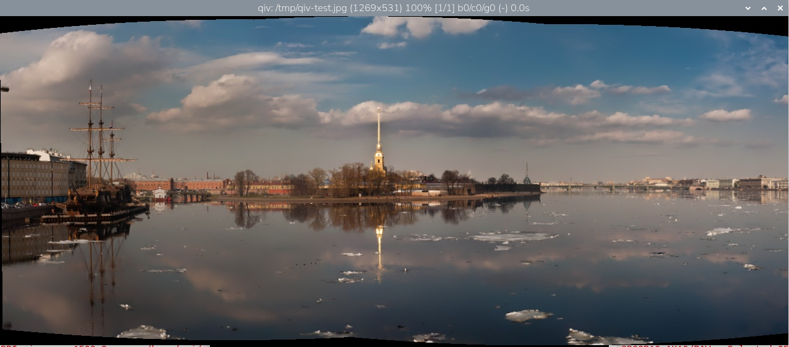
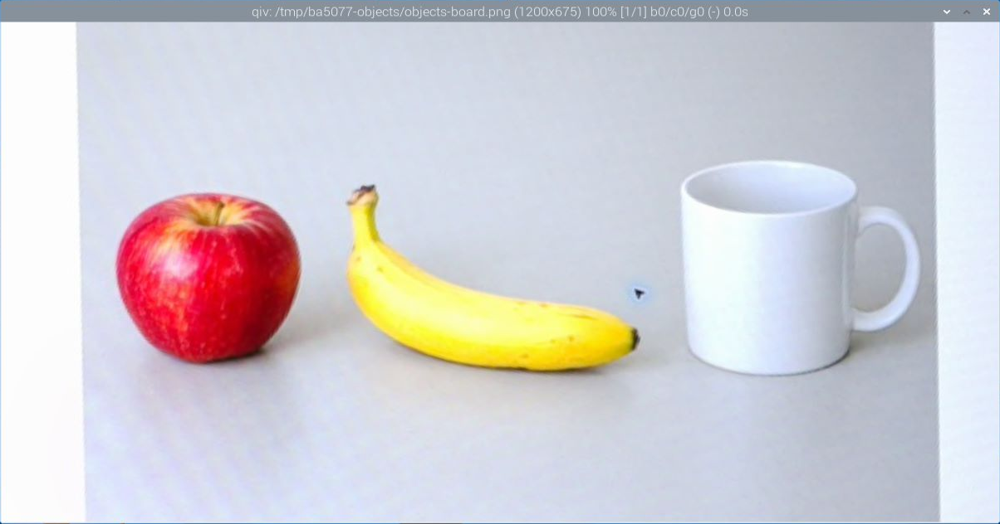

# 10｜用 qiv 在終端機開圖片（順便學 apt 安裝）

## [原課號：第 08 課｜Raspberry Pi 5 安裝與使用 qiv 圖片檢視器](https://github.com/Samuel-ncu/BA5077-RP5-compatibility/blob/main/%E6%95%99%E6%9D%90/%E7%AC%AC%2008%20%E8%AA%B2%EF%BD%9CRaspberry%20Pi%205%20%E5%AE%89%E8%A3%9D%E8%88%87%E4%BD%BF%E7%94%A8%20qiv%20%E5%9C%96%E7%89%87%E6%AA%A2%E8%A6%96%E5%99%A8.md)

digithouse.net 原文：[第 8 課｜Raspberry Pi 5 安裝與使用 qiv 圖片檢視器](https://digithouse.net/blog/ba5077-lesson-06-qiv-image-viewer?locale=zh-TW)

> **本篇狀態**：已在目前 Trixie 實測（2026-11-11）：從零安裝 qiv 3.0.1、用三種方法確認，並在 RP5 桌面開啟圖片截圖。開圖截圖是老師從 SSH 指定桌面顯示啟動的，**學生在桌面終端機手動輸入、以及按鍵操作，尚未實測**。

後面的課會拍很多照片、產生很多影像處理的結果。每次都要打開檔案管理員、找資料夾、雙擊圖片，其實有點慢。有沒有辦法在終端機打一行指令就看到圖？有，這篇我們裝一個很小的看圖程式 qiv。這也是你第一次自己用 `sudo apt install` 從零裝一個程式，正好把[新 08](./08-%E7%B5%82%E7%AB%AF%E6%A9%9F%E5%85%A5%E9%96%80%EF%BC%9A%E6%9C%80%E5%B8%B8%E7%94%A8%E7%9A%84%20UNIX%20%E6%8C%87%E4%BB%A4.md) 學到的指令用上。

## 這篇會學到什麼

- 用 APT 安裝系統程式，看懂安裝訊息。
- 用三種方法確認程式真的裝好了。
- 看一張圖需要的三個條件：檔案找得到、程式看得懂、有地方顯示。

## 需要的東西

- 已連網的 RP5，以及你自己帳號的密碼（`sudo` 會問）。
- RP5 的**桌面**終端機，或 Raspberry Pi Connect 的桌面分享（[新 06](./06-%E9%81%A0%E7%AB%AF%E7%9C%8B%E8%A6%8B%20Pi%20%E7%9A%84%E6%A1%8C%E9%9D%A2%EF%BC%9Awayvnc%20%E8%88%87%20VNC%20Viewer.md)）。純文字的 SSH 通常沒有桌面可以顯示視窗。
- 一張圖片。

## 先懂幾個名詞

- **APT**：Raspberry Pi OS 的套件管理器，負責從官方套件庫下載、安裝**系統程式**。Python 套件之後會用 Thonny 和 pip 安裝（[新 11](./11-%E5%9C%A8%20Thonny%20%E6%BA%96%E5%82%99%20OpenCV%20%E5%B7%A5%E5%85%B7%E7%AE%B1%EF%BC%9A%E8%99%9B%E6%93%AC%E7%92%B0%E5%A2%83%E8%88%87%E5%AE%89%E8%A3%9D.md)），兩者不要搞混。
- **sudo**：用管理員身分執行下一個指令，第一次會問你自己帳號的密碼。
- **圖形桌面**：能顯示視窗的環境。程式能執行，不代表它一定有地方顯示視窗。

## 一步一步操作

### 步驟 1：先確認有沒有裝過

**為什麼**：先知道現況，才知道之後的結果是誰造成的，也避免重複安裝。

```bash
command -v qiv
```

**什麼都沒印出來**，代表系統找不到 qiv。目前這台 Trixie 就是這樣，`apt-cache policy qiv` 也顯示 `Installed: (none)`、`Candidate: 3.0.1-2+deb13u1`。如果你印出 `/usr/bin/qiv`，表示已經裝過，可以跳到步驟 4。

### 步驟 2：用 APT 安裝

**為什麼**：qiv 是系統程式，所以用 APT 安裝。`update` 先拿最新的套件清單，`install` 才是真的安裝。

```bash
sudo apt update
sudo apt install -y qiv
```

出現 `[sudo] password for ...:` 時輸入你的密碼（畫面不會顯示字元），按 Enter。本次實際輸出：

```text
Installing:
  qiv

Summary:
  Upgrading: 0, Installing: 1, Removing: 0, Not Upgrading: 55
  Download size: 102 kB
  Space needed: 244 kB / 108 GB available

Get:1 http://deb.debian.org/debian trixie/main arm64 qiv arm64 3.0.1-2+deb13u1 [102 kB]
Fetched 102 kB in 1s (71.0 kB/s)
Selecting previously unselected package qiv.
Preparing to unpack .../qiv_3.0.1-2+deb13u1_arm64.deb ...
Unpacking qiv (3.0.1-2+deb13u1) ...
Setting up qiv (3.0.1-2+deb13u1) ...
Processing triggers for desktop-file-utils (0.28-1) ...
Processing triggers for man-db (2.13.1-1) ...
Processing triggers for mailcap (3.74) ...
```

怎麼讀：

- 只要下載 `102 kB`，非常小。
- `Selecting previously unselected package` 表示這是第一次安裝。
- 看到 `Setting up qiv`，而且沒有 `E:` 開頭的錯誤，就是安裝成功。
- 最後幾行 `Processing triggers` 是系統順便更新選單和說明文件，不是錯誤。

### 步驟 3：用三種方法確認裝好了

**為什麼**：只看一種方法不夠。找得到程式，不代表它能在你的環境開出視窗。

```bash
command -v qiv
dpkg -l qiv | tail -1
qiv --version
```

本次輸出：

```text
/usr/bin/qiv
ii  qiv            3.0.1-2+deb13u1 arm64        Quick image viewer for X
qiv (Quick Image Viewer) v3.0.1
```

三行分別說明：系統**找得到**程式；套件管理器記錄它**已安裝**（開頭的 `ii`）；程式**能執行**，並報出版本 3.0.1。

### 步驟 4：打開一張圖片

**為什麼**：這才是我們真正要的結果。

在 **RP5 桌面的終端機**，進入放圖片的資料夾，執行：

```bash
qiv 圖片檔名.jpg
```

本次開的是後面[新 34 全景拼接](./34-%E6%8A%8A%E7%9B%B8%E9%84%B0%E7%85%A7%E7%89%87%E6%8E%A5%E6%88%90%E5%85%A8%E6%99%AF.md)產生的 `lesson36-boat-123.jpg`。視窗標題列會顯示檔名、圖片尺寸和縮放比例，本次是 `(1269x531) 100%`，也就是寬 1269、高 531、原尺寸顯示。

依 qiv 說明，常用按鍵是：`+`／`-` 放大縮小、空白鍵切換下一張、`q` 關閉視窗。這些按鍵本教材**尚未逐一實測**。

## 成果圖



*操作截圖：安裝後在 RP5 桌面開啟圖片（2026-11-11，目前 Trixie），只裁切 qiv 視窗。圖片是新 34 拼接的輸出圖，原始照片來自 OpenCV 官方測試資料。*



*操作截圖（較早的紀錄）：在另一台已裝好 qiv 2.3.3 的 RP5 開啟測試圖，標題列顯示 `1200x675`。當時沒有記錄是哪一套系統。圖中物件是螢幕上顯示的 AI 生成圖，再由 RP5 相機拍攝（生成素材的實拍），原圖見[測試圖片 objects-board.png](https://raw.githubusercontent.com/Samuel-ncu/BA5077-RP5-compatibility/main/%E6%95%99%E6%9D%90/%E5%9C%96%E6%AA%94/objects-board.png)。*

## 常見問題

| 你看到的情況 | 可能原因 | 怎麼做 |
| --- | --- | --- |
| `E: Unable to locate package qiv` | 套件清單太舊或沒有網路 | 先 `sudo apt update`，確認 RP5 能上網 |
| `Could not get lock /var/lib/dpkg/lock-frontend` | 另一個 APT 或自動更新正在跑 | 等它結束再試，**不要刪除鎖定檔** |
| `qiv: command not found` | 還沒安裝或安裝失敗 | 回步驟 2，看輸出裡有沒有 `E:` 開頭的錯誤 |
| `Unable to open display` 或 `cannot open display` | 在純文字 SSH 執行，沒有桌面 | 改在 RP5 桌面或 Connect 桌面分享的終端機執行 |
| 視窗沒出現，說找不到檔案 | 檔名或目前資料夾不對 | 先 `pwd`、`ls` 確認；大小寫要一樣 |

### 原文還有、這次沒有實測的用法

原文另外介紹了全螢幕 `qiv -f`、幻燈片 `qiv -m -d 3`（每 3 秒換一張）、開啟系統桌布資料夾的圖片，以及安裝 `libjpeg-dev`、`libpng-dev`。這些本教材**尚未實測**；只是看圖的話，步驟 2 安裝的 qiv 就夠了。

## 小結

這篇第一次從零安裝系統程式：先確認現況、用 `sudo apt install` 安裝、用三種方法確認、最後實際打開圖片。看一張圖要同時滿足三個條件：檔案找得到、程式看得懂、有桌面可以顯示。

**練習**：

1. 一次打開兩張圖 `qiv a.jpg b.jpg`，用空白鍵切換，觀察標題列的變化。
2. 故意打錯檔名執行一次；再從純文字 SSH 用正確檔名執行一次。比較兩種錯誤各缺了哪個條件。
3. 為什麼 `command -v qiv` 有結果，仍不能保證視窗一定開得出來？

分享圖片前，記得檢查有沒有他人的臉或私人環境。

## 下一篇預告

系統程式用 APT 裝；Python 的工具呢？下一篇[11｜在 Thonny 準備 OpenCV 工具箱](./11-%E5%9C%A8%20Thonny%20%E6%BA%96%E5%82%99%20OpenCV%20%E5%B7%A5%E5%85%B7%E7%AE%B1%EF%BC%9A%E8%99%9B%E6%93%AC%E7%92%B0%E5%A2%83%E8%88%87%E5%AE%89%E8%A3%9D.md)，我們會建立第一個 Python 虛擬環境，裝好 OpenCV，畫出第一個綠色圓形。
