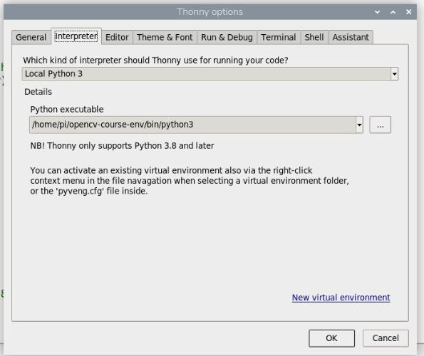
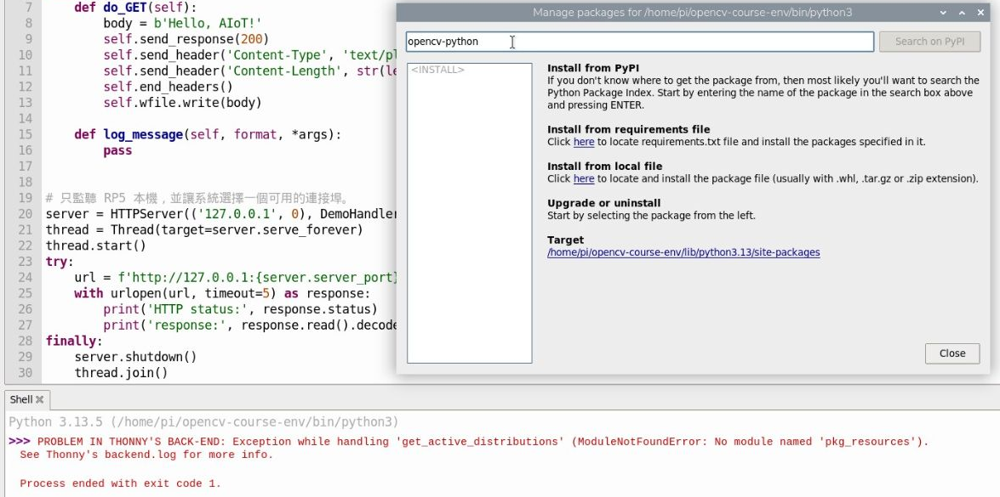
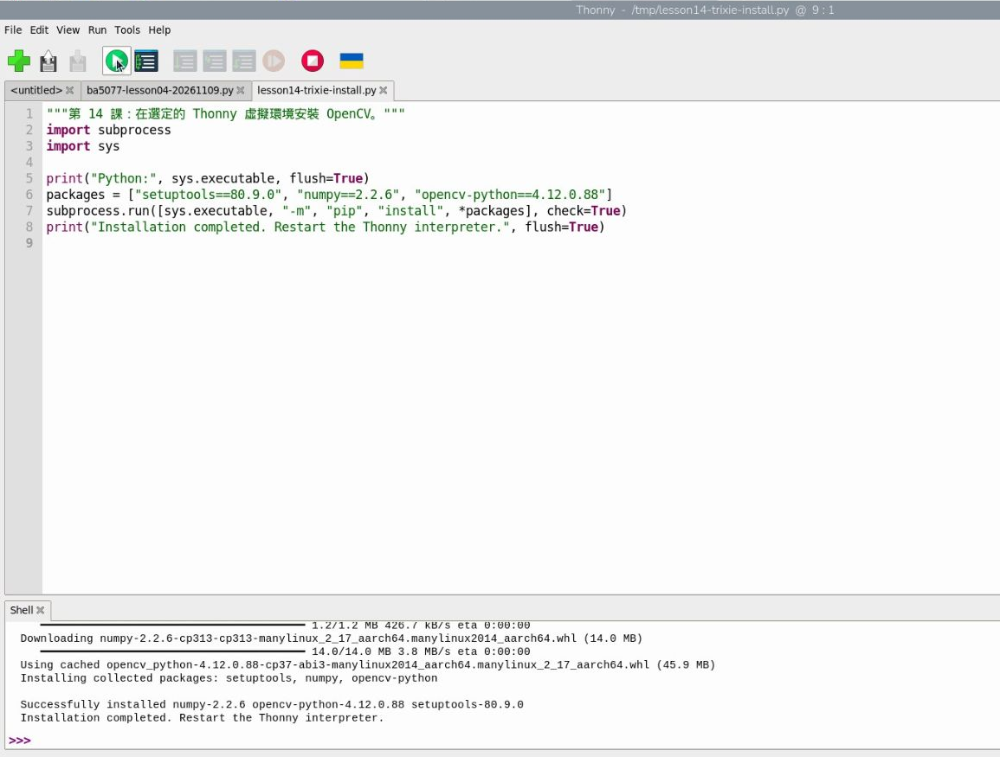
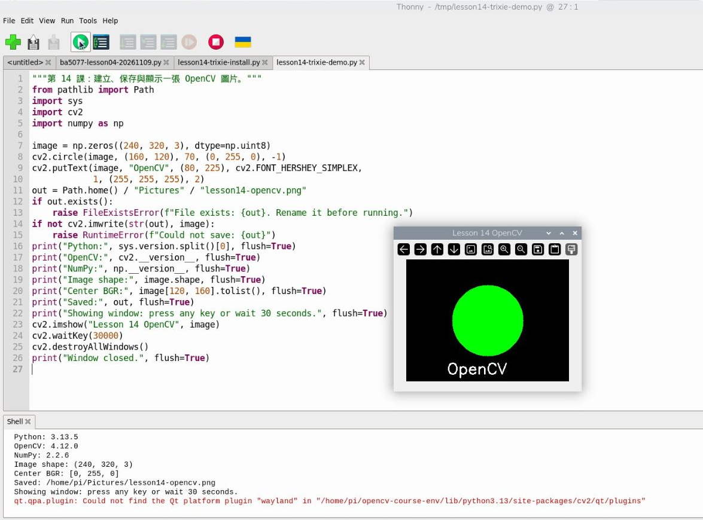

# 11｜在 Thonny 準備 OpenCV 工具箱：虛擬環境與安裝

## [原課號：第 14 課｜在 Raspberry Pi 5 安裝 OpenCV](https://github.com/Samuel-ncu/BA5077-RP5-compatibility/blob/main/%E6%95%99%E6%9D%90/%E7%AC%AC%2014%20%E8%AA%B2%EF%BD%9C%E5%9C%A8%20Raspberry%20Pi%205%20%E5%AE%89%E8%A3%9D%20OpenCV.md)

digithouse.net 原文：[第 14 課｜在 Raspberry Pi 5 安裝 OpenCV](https://digithouse.net/blog/ba5077-lesson-11-install-opencv?locale=zh-TW)

> **本篇狀態**：已在目前 Trixie 實測（Python 3.13.5）：在 Thonny 新建虛擬環境、安裝 OpenCV、畫圖、存檔、開視窗，都有截圖。2026-11-11 重新編排教學順序，沒有新增實機測試。**全新重灌的系統、Thonny 套件管理員修好後的用法、相機環境**都還沒用這個流程驗證。

這門課之後大部分的影像處理都靠 OpenCV。可是我每學期都會看到同一幕：同學照網路教學打 `pip install opencv-python`，結果出現一大串紅字，或是裝好了，Thonny 卻說找不到 `cv2`。問題通常不在 OpenCV，而在「裝到哪裡」。這篇我們先準備一個專屬的工具箱，把 OpenCV 放進去，然後畫出你的第一張圖。

## 這篇會學到什麼

- 什麼是虛擬環境，為什麼要用它。
- 在 Thonny 建立虛擬環境，並確認 Thonny 正在用它。
- 安裝 OpenCV，以及遇到 `pkg_resources` 錯誤時怎麼繼續。
- 用 OpenCV 畫圖、存檔、開視窗。

## 需要的東西

- 已開機的 RP5 **桌面**、網路連線。
- Thonny（RP5 桌面內建的 Python 編輯器）。
- 這一課不需要相機。

## 先懂幾個名詞

- **Python 套件**：別人寫好、可以直接拿來用的程式工具，例如 OpenCV。
- **虛擬環境**：一個獨立的「Python 工具箱」資料夾。裝在裡面的套件不會影響系統或其他專案，壞了也可以整個重建。
- **pip**：安裝 Python 套件的工具。系統程式用 APT（[新 10](./10-%E7%94%A8%20qiv%20%E5%9C%A8%E7%B5%82%E7%AB%AF%E6%A9%9F%E9%96%8B%E5%9C%96%E7%89%87%EF%BC%88%E9%A0%86%E4%BE%BF%E5%AD%B8%20apt%20%E5%AE%89%E8%A3%9D%EF%BC%89.md)），Python 套件用 pip。
- **OpenCV**：處理圖片的工具庫。套件名稱叫 `opencv-python`，在程式裡卻寫 `import cv2`，看到名字不同不用緊張。
- **NumPy**：用來保存與計算大量數字的工具；在 OpenCV 裡，一張圖就是一個 NumPy 陣列。

## 一步一步操作

### 步驟 1：在 Thonny 建立虛擬環境

**為什麼**：先準備好工具箱，再往裡面放工具。之後每個需要 OpenCV 的程式都選這個環境。

1. 在 RP5 桌面開啟 Thonny。
2. 點 **Tools → Options → Interpreter**（工具 → 選項 → 直譯器）。
3. 點 **New virtual environment**，看完提示後按 OK。
4. 在家目錄建立一個**新的空資料夾**，例如 `opencv-course-env`。已經有同名資料夾就換個名字，不要蓋掉原本的作品。進入這個資料夾後按 OK，等它建立完成。
5. 看 **Python executable**：路徑最後應該是新資料夾裡的 `bin/python3`。按 OK 回主畫面，右下角也應該顯示同一個環境。

右下角如果還是系統 Python，先回直譯器設定選回新環境，再繼續。

### 步驟 2：安裝 OpenCV

**為什麼**：工具箱建好了，現在把 OpenCV 和 NumPy 放進去。

有些版本的 Thonny，打開 **Tools → Manage packages** 會出現 `No module named 'pkg_resources'` 錯誤。這是套件管理畫面需要的一個舊元件不見了。你**不用**重灌系統，也不用去搜尋叫 `pkg_resources` 的套件。我們改用一個小程式來安裝：

1. 如果錯誤視窗還開著，先關掉，再按紅色的 **Stop/Restart backend**。
2. 點 File → New，貼上下面的程式，存成 `install_opencv.py`。也可以下載[同一份安裝程式](https://github.com/Samuel-ncu/BA5077-RP5-compatibility/blob/main/%E6%95%99%E6%9D%90/%E7%AF%84%E4%BE%8B%E7%A8%8B%E5%BC%8F/%E7%AC%AC14%E8%AA%B2-Trixie-Thonny%E5%AE%89%E8%A3%9D.py)。
3. 確認右下角是剛建立的環境，按綠色 **Run**，等它跑完。

```python
"""第 14 課：在選定的 Thonny 虛擬環境安裝 OpenCV。"""
import subprocess
import sys

print("Python:", sys.executable, flush=True)
packages = ["setuptools==80.9.0", "numpy==2.2.6", "opencv-python==4.12.0.88"]
subprocess.run([sys.executable, "-m", "pip", "install", *packages], check=True)
print("Installation completed. Restart the Thonny interpreter.", flush=True)
```

Shell 第一行印出的 `Python:` 路徑，應該指向你的新環境，這代表套件會裝到這裡。完成時，實測輸出是：

```text
Successfully installed numpy-2.2.6 opencv-python-4.12.0.88 setuptools-80.9.0
Installation completed. Restart the Thonny interpreter.
```

4. 再按一次紅色 **Stop/Restart backend**，讓 Python 重新讀取剛裝好的工具。

**為什麼要指定版本？** 較新的工具可能拿掉舊介面。[setuptools 官方紀錄](https://setuptools.pypa.io/en/stable/history.html#v82-0-0)說明 82.0.0 移除了 `pkg_resources`，所以這裡固定 80.9.0，配合當時的 Thonny。固定版本是為了重現已經測過的流程，不代表以後升級全部套件就沒問題。

### 步驟 3：畫圖、存檔、開視窗

**為什麼**：用一個最小的程式確認 OpenCV 真的能用。

開新檔，貼上下面的程式，存成 `draw_circle.py`，或開啟[繪圖範例](https://github.com/Samuel-ncu/BA5077-RP5-compatibility/blob/main/%E6%95%99%E6%9D%90/%E7%AF%84%E4%BE%8B%E7%A8%8B%E5%BC%8F/%E7%AC%AC14%E8%AA%B2-Trixie-OpenCV%E6%B8%AC%E8%A9%A6.py)。確認右下角還是同一個環境，按 Run。

```python
"""第 14 課：建立、保存與顯示一張 OpenCV 圖片。"""
from pathlib import Path
import sys

import cv2
import numpy as np

image = np.zeros((240, 320, 3), dtype=np.uint8)
cv2.circle(image, (160, 120), 70, (0, 255, 0), -1)
cv2.putText(image, "OpenCV", (80, 225), cv2.FONT_HERSHEY_SIMPLEX,
            1, (255, 255, 255), 2)

out = Path.home() / "Pictures" / "lesson14-opencv.png"
if out.exists():
    raise FileExistsError(f"File exists: {out}. Rename it before running.")
if not cv2.imwrite(str(out), image):
    raise RuntimeError(f"Could not save: {out}")

print("Python:", sys.version.split()[0], flush=True)
print("OpenCV:", cv2.__version__, flush=True)
print("NumPy:", np.__version__, flush=True)
print("Image shape:", image.shape, flush=True)
print("Center BGR:", image[120, 160].tolist(), flush=True)
print("Saved:", out, flush=True)
print("Showing window: press any key or wait 30 seconds.", flush=True)
cv2.imshow("Lesson 14 OpenCV", image)
cv2.waitKey(30000)
cv2.destroyAllWindows()
print("Window closed.", flush=True)
```

會跳出一個黑底、綠色圓形、白色 OpenCV 字的視窗。點一下視窗按任意鍵，或等 30 秒，它會自己關掉。Shell 的重點輸出：

```text
OpenCV: 4.12.0
NumPy: 2.2.6
Image shape: (240, 320, 3)
Center BGR: [0, 255, 0]
Window closed.
```

怎麼讀：

- `(240, 320, 3)`：圖片高 240、寬 320，每個點有 3 個顏色數值。
- OpenCV 的顏色順序是**藍、綠、紅**（BGR），所以圓心 `[0, 255, 0]` 就是綠色。
- 如果另外出現一行關於 Wayland 的 `qt.qpa.plugin` 提示，實測時也有出現；圓形能正常顯示、視窗能正常關掉就沒關係。

### 步驟 4：關掉視窗後，圖片還在嗎？

**為什麼**：分清「顯示」和「保存」是兩件事。

打開檔案管理員，進入 Home → Pictures，找到 `lesson14-opencv.png` 打開。程式結束了，檔案還在。`imshow` 讓你現在看到；`imwrite` 把圖片留下來。

## 成果圖



*操作截圖：Thonny 直譯器設定選擇新建的 `opencv-course-env`（目前 Trixie）。圖中的帳號名稱是預設的 `pi`，你的帳號可能不同。*



*操作截圖：Manage packages 出現 `pkg_resources` 錯誤的畫面（目前 Trixie）。*



*操作截圖：執行安裝程式後的完成訊息（目前 Trixie）。*



*操作截圖：執行繪圖程式，OpenCV 視窗顯示綠色圓形（目前 Trixie）。*


*程式輸出：程式保存的 `lesson14-opencv.png`。*

## 常見問題

| 你看到的情況 | 怎麼做 |
| --- | --- |
| `No module named 'pkg_resources'` | 回步驟 2：關掉套件管理視窗，在編輯區執行安裝程式，完成後重啟 |
| 找不到 `install` 這個套件 | pip 把指令的一部分當成套件名稱了；直接執行本篇的完整安裝程式 |
| `No module named cv2` | 比對右下角的環境和安裝程式印出的 `Python:`；選回同一個環境，重啟後再試 |
| `No matching distribution` 後面接 NumPy 或 OpenCV | 先看 Python 版本和前面的網路訊息；這和上面的 `install` 錯誤是兩件事 |
| `FileExistsError` | 之前的作品還在。保留它，把舊檔改名或換一個輸出檔名 |
| 有 Wayland 提示，但圓形有出現 | 實測也有這個提示；能正常關掉視窗就沒關係 |

一般套件問題不需要重灌系統。真的卡住時，把[環境觀察小程式](https://github.com/Samuel-ncu/BA5077-RP5-compatibility/blob/main/%E6%95%99%E6%9D%90/%E7%AF%84%E4%BE%8B%E7%A8%8B%E5%BC%8F/%E7%9C%8B%E7%9C%8B%E7%9B%AE%E5%89%8D%E7%9A%84Python%E7%92%B0%E5%A2%83.py)的輸出和完整紅字交給老師。

### 原文的三種安裝方法

原文介紹了三種方法：`sudo apt install python3-opencv`、直接 `pip install opencv-python opencv-python-headless`，以及從原始碼編譯（需要安裝 `libatlas-base-dev`、`libgtk2.0-dev` 等，或使用第三方腳本）。這三種在目前 Trixie 上，本教材都**尚未實測**。本教材改用「Thonny 虛擬環境＋固定版本安裝程式」這一條路。也請注意，`opencv-python` 和 `opencv-python-headless` 都提供 `cv2`，不要裝在同一個環境裡。

## 小結

這篇完成了一整個循環：建立虛擬環境、安裝 OpenCV、執行程式、觀察輸出、保存作品。記住：**右下角的環境，就是程式真正使用的工具箱**。找不到套件時，第一件事是看右下角。

**練習**：

1. 把 `cv2.circle` 裡的 `(0, 255, 0)` 改成 `(255, 0, 0)`，並換一個輸出檔名。執行前先猜：圓會變成什麼顏色？
2. 只改半徑 `70`，比較圓的大小。一次只改一個地方，才看得出哪個數字控制哪個效果。

## 下一篇預告

工具箱準備好了。下一篇[12｜第一支 Python 程式：Thonny 與 OpenCV 初體驗](./12-%E7%AC%AC%E4%B8%80%E6%94%AF%20Python%20%E7%A8%8B%E5%BC%8F%EF%BC%9AThonny%20%E8%88%87%20OpenCV%20%E5%88%9D%E9%AB%94%E9%A9%97.md)，我們從一行 `print` 開始，認識 Thonny 的每個區塊，再用數字描述一張圖。
