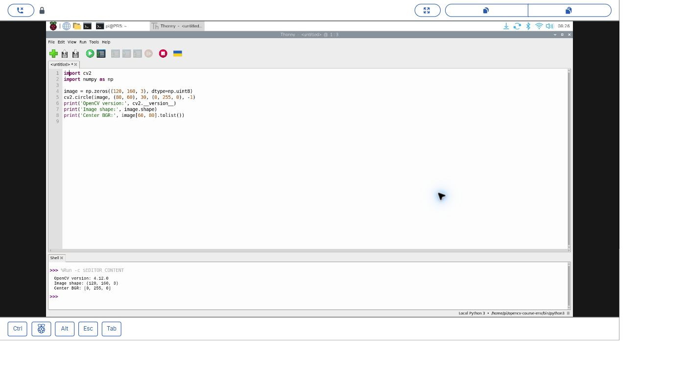

# 12｜第一支 Python 程式：Thonny 與 OpenCV 初體驗

## [原課號：第 12 課｜使用 Thonny IDE 與 OpenCV 進行 Python 開發](https://github.com/Samuel-ncu/BA5077-RP5-compatibility/blob/main/%E6%95%99%E6%9D%90/%E7%AC%AC%2012%20%E8%AA%B2%EF%BD%9C%E4%BD%BF%E7%94%A8%20Thonny%20IDE%20%E8%88%87%20OpenCV%20%E9%80%B2%E8%A1%8C%20Python%20%E9%96%8B%E7%99%BC.md)

digithouse.net 原文：[第 12 課｜使用 Thonny IDE 與 OpenCV 進行 Python 開發](https://digithouse.net/blog/ba5077-lesson-09-thonny-opencv?locale=zh-TW)

> **本篇狀態**：用數字描述一張圖的 OpenCV 練習，已在目前 Trixie 的 Thonny 實測（2026-11-10），附截圖。開頭的一行問候 `print` 和查詢直譯器的練習，是 2026-11-11 新增的入門步驟，**尚未在 RP5 上實際操作**。

很多同學第一次寫程式時最怕的，不是語法，而是「按下去之後到底發生了什麼」。這篇我們放慢速度：先讓 Python 說一句話，再搞清楚是「誰」在執行你的程式，最後用上一篇裝好的 OpenCV 做出一張圖，並把它變成幾個看得懂的數字。

## 這篇會學到什麼

- Thonny 的編輯區、Shell、直譯器分別在哪裡、做什麼。
- 「存檔」和「執行」的差別。
- 用 `sys.executable` 找出程式是哪個 Python 在跑。
- 用 OpenCV 建立一張圖，讀出它的尺寸和顏色。

## 需要的東西

- RP5 桌面上的 Thonny。
- 上一篇建立的 OpenCV 環境（[新 11](./11-%E5%9C%A8%20Thonny%20%E6%BA%96%E5%82%99%20OpenCV%20%E5%B7%A5%E5%85%B7%E7%AE%B1%EF%BC%9A%E8%99%9B%E6%93%AC%E7%92%B0%E5%A2%83%E8%88%87%E5%AE%89%E8%A3%9D.md)）。還沒做的話，請先回去完成，不然會遇到找不到 `cv2` 的錯誤。

## 先懂幾個名詞

- **編輯區**：Thonny 上方的白色大區域，寫程式的地方。
- **Shell**：下方的區域，顯示程式的輸出，也可以直接輸入一行 Python 試試看。
- **直譯器**：真正讀懂並執行程式的 Python。右下角顯示目前用的是哪一個。
- **陣列**：一格一格排好的數字。對 OpenCV 來說，一張圖就是一個三層的數字陣列。

## 一步一步操作

### 步驟 1：讓 Python 向你打招呼（尚未實測）

**為什麼**：先用最小的程式，熟悉「寫下來、存檔、執行、看回應」的流程。

在編輯區輸入：

```python
print('你好，Raspberry Pi！')
```

點 File → Save as，存到自己的練習資料夾，命名為 `hello_pi.py`。按綠色 **Run**，下方 Shell 應該出現同一句話。

沒有反應的話：確認已經存檔、引號左右成對、括號沒有漏掉；或按紅色 **Stop/Restart backend** 再試一次。

### 步驟 2：程式是誰在執行？（尚未實測）

**為什麼**：同一台 RP5 可以有好幾個 Python 環境。把 OpenCV 裝進其中一個，不代表每個環境都有。

開新檔，輸入並執行：

```python
import sys
print(sys.executable)
```

印出來的路徑就是正在執行程式的 Python，應該和右下角顯示的一致。把它記在筆記裡，之後找不到套件時，這是第一個線索。你的路徑不需要和老師一模一樣。

### 步驟 3：用數字描述一張圖（已實測）

**為什麼**：OpenCV 處理的「圖」，對電腦來說就是一堆數字。先看懂這些數字，後面的影像處理才不會像魔術。

確認右下角是[新 11](./11-%E5%9C%A8%20Thonny%20%E6%BA%96%E5%82%99%20OpenCV%20%E5%B7%A5%E5%85%B7%E7%AE%B1%EF%BC%9A%E8%99%9B%E6%93%AC%E7%92%B0%E5%A2%83%E8%88%87%E5%AE%89%E8%A3%9D.md) 建立的環境。下載[本課範例](https://github.com/Samuel-ncu/BA5077-RP5-compatibility/blob/main/%E6%95%99%E6%9D%90/%E7%AF%84%E4%BE%8B%E7%A8%8B%E5%BC%8F/%E7%AC%AC12%E8%AA%B2-Thonny%E6%B8%AC%E8%A9%A6.py)，用 File → Open 開啟，或貼上：

```python
import cv2
import numpy as np

image = np.zeros((120, 160, 3), dtype=np.uint8)
cv2.circle(image, (80, 60), 30, (0, 255, 0), -1)

print('OpenCV version:', cv2.__version__)
print('Image shape:', image.shape)
print('Center BGR:', image[60, 80].tolist())
```

按 Run。這個程式只在記憶體裡建立圖片，**不會**開視窗，所以只看到文字是正常的。目前 Trixie 的實際輸出：

```text
OpenCV version: 4.12.0
Image shape: (120, 160, 3)
Center BGR: [0, 255, 0]
```

怎麼讀：

- `np.zeros((120, 160, 3))`：建立一張全黑的圖，高 120、寬 160、3 個顏色通道。
- `cv2.circle(...)`：在 (80, 60) 畫一個半徑 30 的實心圓，顏色 `(0, 255, 0)`。
- `image.shape` 先寫高、再寫寬、最後是通道數。
- OpenCV 的顏色順序是藍、綠、紅，所以圓心的 `[0, 255, 0]` 是綠色。

## 成果圖



*操作截圖：透過遠端桌面看到的 RP5 Thonny，執行步驟 3 的程式與輸出（2026-11-10，目前 Trixie）。*

## 常見問題

| 你看到的情況 | 可能原因 | 怎麼做 |
| --- | --- | --- |
| `No module named cv2` | 右下角選到的不是新 11 的環境 | 在右下角選回該環境；不用改程式檔名 |
| `SyntaxError` | 引號或括號沒有成對、用了全形符號 | 程式裡的括號、引號都要用半形 |
| 按 Run 沒有反應 | 還沒存檔，或後端卡住 | 先存檔，再按紅色 Stop/Restart backend |
| 只有文字、沒有圖片視窗 | 步驟 3 本來就沒有開視窗 | 正常。要看圖片請參考新 11 的 `imshow` |

## 小結

Thonny 有三個要認得的地方：上方的編輯區寫程式、下方的 Shell 看結果、右下角看是哪個 Python 在執行。對 OpenCV 來說，一張圖就是「高 × 寬 × 3」的數字陣列，而且顏色順序是藍、綠、紅。

**練習**：先猜再改：把畫布寬度從 160 改成 200，哪一行輸出會改變？只改那個數字，執行後檢查你的猜測。

## 下一篇預告

工具都準備好了，接下來要讓 RP5 真的「看見」東西。下一篇[13｜接上相機模組並確認它活著](./13-%E6%8E%A5%E4%B8%8A%E7%9B%B8%E6%A9%9F%E6%A8%A1%E7%B5%84%E4%B8%A6%E7%A2%BA%E8%AA%8D%E5%AE%83%E6%B4%BB%E8%91%97%EF%BC%9Arpicam-hello.md)，我們會用一行 `rpicam-hello` 確認系統認得相機。
