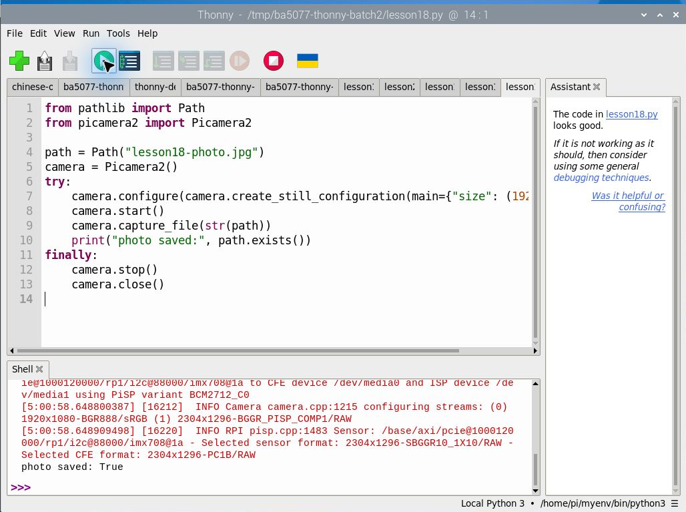
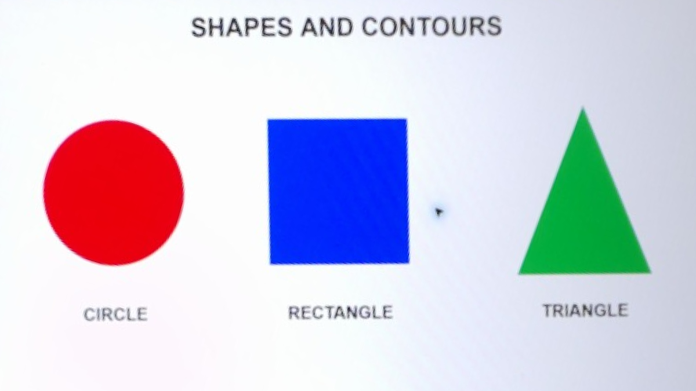

# 14｜用 Picamera2 拍一張照片並存檔

## [原課號：第 18 課｜使用 Picamera2 拍攝照片並保存至本地](https://github.com/Samuel-ncu/BA5077-RP5-compatibility/blob/main/%E6%95%99%E6%9D%90/%E7%AC%AC%2018%20%E8%AA%B2%EF%BD%9C%E4%BD%BF%E7%94%A8%20Picamera2%20%E6%8B%8D%E6%94%9D%E7%85%A7%E7%89%87%E4%B8%A6%E4%BF%9D%E5%AD%98%E8%87%B3%E6%9C%AC%E5%9C%B0.md)

digithouse.net 原文：[第 18 課｜使用 Picamera2 拍攝照片並保存至本地](https://digithouse.net/blog/ba5077-lesson-15-picamera2-save-image?locale=zh-TW)

> **本篇狀態**：用 Thonny 執行 Picamera2 拍照、存成 JPEG 已實測，但用的是**舊環境 Bookworm** 的 `/home/pi/myenv`。這個環境在目前 Trixie 已經不存在，**在目前 Trixie 重新拍照尚未實測**。2026-11-11 在目前 Trixie 的 Thonny 只另外確認了「按 Run 時，程式的工作目錄會切到程式所在的資料夾」。

相機預覽很好玩，但視窗一關，畫面就不見了。如果我們要讓 AI 判斷零件、比較兩天的實驗結果，就得先把畫面**留下來**。這篇我們寫一個不到十五行的程式，讓相機拍一張照片存成檔案，再到資料夾裡把它找出來。

## 這篇會學到什麼

- 用 Picamera2 拍照並存檔的基本流程。
- 解析度 1920 × 1080 的意思。
- 為什麼要用 `try`／`finally` 釋放相機。
- 「工作目錄」是什麼，照片存到哪裡去了。

## 需要的東西

- 已接好、系統看得到的相機（[新 13](./13-%E6%8E%A5%E4%B8%8A%E7%9B%B8%E6%A9%9F%E6%A8%A1%E7%B5%84%E4%B8%A6%E7%A2%BA%E8%AA%8D%E5%AE%83%E6%B4%BB%E8%91%97%EF%BC%9Arpicam-hello.md)）。
- RP5 **桌面上**的 Thonny。相機接在 RP5 上，Windows 上的 Python 用不到它。
- 一個**能讀到 Picamera2** 的 Python 環境。[新 11](./11-%E5%9C%A8%20Thonny%20%E6%BA%96%E5%82%99%20OpenCV%20%E5%B7%A5%E5%85%B7%E7%AE%B1%EF%BC%9A%E8%99%9B%E6%93%AC%E7%92%B0%E5%A2%83%E8%88%87%E5%AE%89%E8%A3%9D.md) 建立的繪圖環境不一定有 Picamera2。目前 Trixie 的相機環境建法見 [Thonny 環境與套件安裝：既有 Trixie 同時使用 Picamera2 與 OpenCV](https://github.com/Samuel-ncu/BA5077-RP5-compatibility/blob/main/%E6%95%99%E6%9D%90/Thonny%E7%92%B0%E5%A2%83%E8%88%87%E5%A5%97%E4%BB%B6%E5%AE%89%E8%A3%9D.md)，[下一篇](./15-%E7%9B%B8%E6%A9%9F%E7%95%AB%E9%9D%A2%E8%AE%8A%E6%88%90%E6%95%B8%E5%AD%97%EF%BC%9APicamera2%20%E5%8A%A0%20OpenCV%20%E8%AE%80%E4%B8%80%E5%BC%B5%E5%BD%B1%E6%A0%BC.md)會詳細說明。
- 一個新的空練習資料夾。

## 先懂幾個名詞

- **Picamera2**：Raspberry Pi 官方的 Python 相機程式庫，用來控制相機、取得影像。
- **解析度**：1920 × 1080 代表寬 1920、高 1080 個像素。解析度高不等於照片一定清楚，還要看鏡頭、對焦、光線和距離。
- **工作目錄**：程式執行時「所在的資料夾」。用相對路徑存檔時，檔案就存在這裡。
- **釋放相機**：一次只能有一個程式使用相機。用完要停止並關閉，下一個程式才能用。

## 一步一步操作

### 步驟 1：準備環境和資料夾

**為什麼**：選錯環境會出現 `No module named 'picamera2'`；在舊資料夾裡拍照，可能蓋掉同名的舊照片。

1. 關掉其他正在使用相機的程式（預覽、錄影）。
2. 在 Thonny 的 Tools → Options → Interpreter 選擇有 Picamera2 的環境，確認右下角顯示的路徑。
3. 建立一個新的空資料夾，把[範例程式](https://github.com/Samuel-ncu/BA5077-RP5-compatibility/blob/main/%E6%95%99%E6%9D%90/%E7%AF%84%E4%BE%8B%E7%A8%8B%E5%BC%8F/%E7%AC%AC18%E8%AA%B2.py)存進去。

### 步驟 2：執行拍照程式

**為什麼**：最短的流程是「建立相機、設定、啟動、拍照存檔、停止、關閉」。

```python
from pathlib import Path

from picamera2 import Picamera2

path = Path("lesson18-photo.jpg")
camera = Picamera2()
try:
    camera.configure(camera.create_still_configuration(main={"size": (1920, 1080)}))
    camera.start()
    camera.capture_file(str(path))
    print("photo saved:", path.exists())
finally:
    camera.stop()
    camera.close()
```

用 File → Open 開啟，確認右下角是相機環境，按綠色 **Run**。這個程式不會開預覽視窗。舊環境（Bookworm）的實際輸出：

```text
photo saved: True
```

逐行看：

1. `Path("lesson18-photo.jpg")` 是**相對路徑**，照片會存在工作目錄。
2. `create_still_configuration` 設定照片尺寸；`camera.start()` 開始使用相機。
3. `capture_file` 拍照並寫成 JPEG；`path.exists()` 檢查檔案存在。
4. `finally` 不管拍照成不成功都會執行，確保相機被停止和釋放。

注意：如果資料夾裡本來就有同名檔案，`True` 不能證明是新拍的。所以才要用**空的**資料夾。

### 步驟 3：找到照片並打開來看

**為什麼**：`True` 只代表檔案存在，照片內容要親眼確認。

程式結束後，在 Shell 輸入：

```python
import os; print(os.getcwd())
```

到印出的資料夾找 `lesson18-photo.jpg`，用圖片檢視器打開，例如[新 10](./10-%E7%94%A8%20qiv%20%E5%9C%A8%E7%B5%82%E7%AB%AF%E6%A9%9F%E9%96%8B%E5%9C%96%E7%89%87%EF%BC%88%E9%A0%86%E4%BE%BF%E5%AD%B8%20apt%20%E5%AE%89%E8%A3%9D%EF%BC%89.md) 的 qiv。

在目前 Trixie 的 Thonny 另外確認過：按 Run 時，工作目錄會切到**程式所在的資料夾**，所以照片通常會和程式放在一起。不同的 Thonny 設定可能不同，以 `os.getcwd()` 印出的結果為準。

## 成果圖



*操作截圖（舊環境 Bookworm）：Thonny 執行拍照程式，Shell 最後一行是 `photo saved: True`；右下角是舊環境 `/home/pi/myenv/bin/python3`。*



*相機實拍：RP5 相機對準螢幕，用上面的 1920 × 1080 程式拍攝，再用[新 23](./23-%E6%89%BE%E5%87%BA%E7%89%A9%E9%AB%94%E7%9A%84%E5%A4%96%E6%A1%86%EF%BC%9A%E8%BC%AA%E5%BB%93%E5%81%B5%E6%B8%AC.md) 的程式裁切與透視校正。圖形是螢幕上顯示的測試素材，不是原始整張照片；原始照片包含周圍環境，所以沒有公開。*

想自己拍同樣的測試圖，可以下載[相機測試畫面](https://github.com/Samuel-ncu/BA5077-RP5-compatibility/blob/main/%E6%95%99%E6%9D%90/%E7%B7%B4%E7%BF%92%E7%B4%A0%E6%9D%90/RP5%E7%9B%B8%E6%A9%9F%E6%B8%AC%E8%A9%A6.html)，在電腦瀏覽器開啟，選「形狀與輪廓」，再把相機對準螢幕。

## 常見問題

| 你看到的情況 | 可能原因 | 怎麼做 |
| --- | --- | --- |
| `No module named 'picamera2'` | 右下角選到沒有 Picamera2 的環境 | 換成相機環境，見步驟 1 |
| 相機無法啟動、顯示忙碌 | 另一個程式正在用相機 | 關掉其他相機程式；必要時按 Stop/Restart backend |
| 找不到照片 | 工作目錄不是你以為的資料夾 | 用 `os.getcwd()` 查，不要假設 |
| 印出 `True`，但照片是舊的 | 資料夾裡本來就有同名檔案 | 改用空資料夾，或換檔名 |
| 照片很模糊 | 對焦、光線或距離 | 調整拍攝條件；解析度不是唯一因素 |

## 小結

拍照存檔的流程是：選對環境、建立相機、設定、啟動、拍照、停止並關閉。照片用相對路徑存在工作目錄，找不到時就用 `os.getcwd()` 查。拍到他人、螢幕上的私人資料或周圍環境時，分享前先檢查並取得同意。

**練習**：

1. 在空資料夾執行程式，打開照片，觀察相機實際拍到的範圍。
2. 說明 1920 × 1080 兩個數字的意思。解析度越高，辨識一定越準嗎？
3. 改變光線或拍攝目標再拍一次，比較兩張照片。

## 下一篇預告

照片存起來了，但 Python 看到的其實不是照片，而是一堆數字。下一篇[15｜相機畫面變成數字：Picamera2 加 OpenCV](./15-%E7%9B%B8%E6%A9%9F%E7%95%AB%E9%9D%A2%E8%AE%8A%E6%88%90%E6%95%B8%E5%AD%97%EF%BC%9APicamera2%20%E5%8A%A0%20OpenCV%20%E8%AE%80%E4%B8%80%E5%BC%B5%E5%BD%B1%E6%A0%BC.md)，我們讓相機直接把畫面交給 OpenCV，再把彩色轉成灰階。
