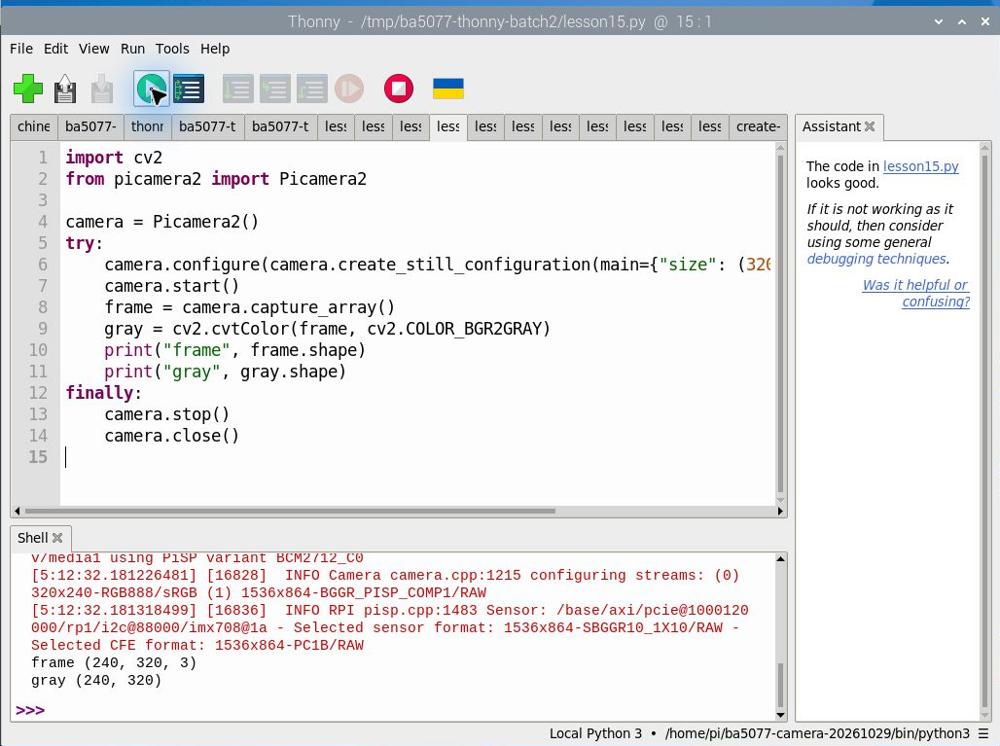
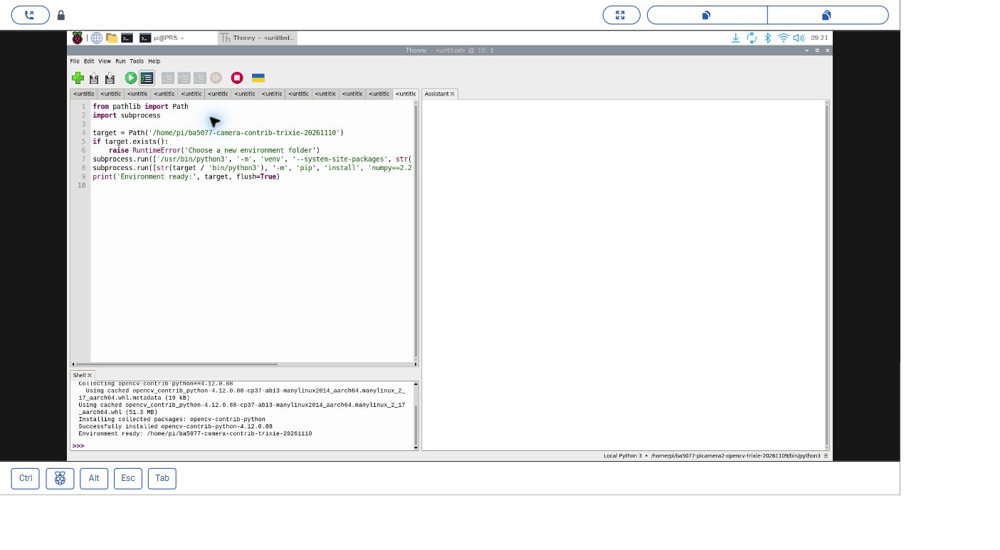

# 15｜相機畫面變成數字：Picamera2 加 OpenCV 讀一張影格

## [原課號：第 15 課｜在 Raspberry Pi 5 使用 Libcamera、Picamera2 與 OpenCV](https://github.com/Samuel-ncu/BA5077-RP5-compatibility/blob/main/%E6%95%99%E6%9D%90/%E7%AC%AC%2015%20%E8%AA%B2%EF%BD%9C%E5%9C%A8%20Raspberry%20Pi%205%20%E4%BD%BF%E7%94%A8%20Libcamera%E3%80%81Picamera2%20%E8%88%87%20OpenCV.md)

digithouse.net 原文：[第 15 課｜在 Raspberry Pi 5 使用 Libcamera、Picamera2 與 OpenCV](https://digithouse.net/blog/ba5077-lesson-12-libcamera-picamera2-opencv?locale=zh-TW)

> **本篇狀態**：相機取一張影格並轉成灰階，已在 Thonny 實測，但輸出和截圖來自**舊環境 Bookworm**（Python 3.11）。目前 Trixie 已經建好「同時能用 Picamera2 和 OpenCV」的環境（2026-11-10），也確認能匯入兩者，但**本篇的程式在目前 Trixie 重新執行，尚未實測**。

上一篇我們拍了一張照片存成檔案。但在做即時影像處理時，我們不想每一張都先存檔、再讀回來，太慢了。比較好的做法是讓相機直接把畫面交給 OpenCV。這篇我們就讓這兩個工具「接力」：Picamera2 負責拿畫面，OpenCV 負責處理，先從最簡單的「彩色轉灰階」開始。

## 這篇會學到什麼

- Picamera2 和 OpenCV 各負責什麼。
- 為什麼需要一個「同時有兩者」的 Python 環境。
- 用 `capture_array()` 拿到影格，用 `cvtColor()` 轉成灰階。
- 看懂影像的形狀：為什麼 320 × 240 會印成 `(240, 320, 3)`。

## 需要的東西

- 已接好、系統看得到的相機（[新 13](./13-%E6%8E%A5%E4%B8%8A%E7%9B%B8%E6%A9%9F%E6%A8%A1%E7%B5%84%E4%B8%A6%E7%A2%BA%E8%AA%8D%E5%AE%83%E6%B4%BB%E8%91%97%EF%BC%9Arpicam-hello.md)）。
- RP5 桌面上的 Thonny。
- 一個**同時能用 Picamera2 和 OpenCV** 的 Python 環境，建法見下面的步驟 1。

## 先懂幾個名詞

- **影格（frame）**：影片或相機畫面中的「一張」。
- **灰階**：只保留亮度、沒有顏色的影像。每個點只有一個數字，彩色則有三個。
- **通道**：每個點的顏色由幾個數字組成。彩色有 3 個通道，灰階只有 1 個。
- **libcamera**：Picamera2 底層使用的相機系統。這篇不用直接呼叫它。

## 一步一步操作

### 步驟 1：準備一個看得到相機的工具箱

**為什麼**：[新 11](./11-%E5%9C%A8%20Thonny%20%E6%BA%96%E5%82%99%20OpenCV%20%E5%B7%A5%E5%85%B7%E7%AE%B1%EF%BC%9A%E8%99%9B%E6%93%AC%E7%92%B0%E5%A2%83%E8%88%87%E5%AE%89%E8%A3%9D.md) 建立的環境只有 OpenCV，沒有 Picamera2。Picamera2 是系統安裝的套件，要建立一個「能讀到系統套件」的虛擬環境，再在裡面裝 OpenCV。

目前 Trixie 的做法（2026-11-10 實測建立）寫在 [Thonny 環境與套件安裝：既有 Trixie 同時使用 Picamera2 與 OpenCV 擴充功能](https://github.com/Samuel-ncu/BA5077-RP5-compatibility/blob/main/%E6%95%99%E6%9D%90/Thonny%E7%92%B0%E5%A2%83%E8%88%87%E5%A5%97%E4%BB%B6%E5%AE%89%E8%A3%9D.md)：

1. 下載並開啟[建立環境程式](https://github.com/Samuel-ncu/BA5077-RP5-compatibility/blob/main/%E6%95%99%E6%9D%90/%E7%AF%84%E4%BE%8B%E7%A8%8B%E5%BC%8F/Thonny%E5%BB%BA%E7%AB%8BTrixie%E7%9B%B8%E6%A9%9FOpenCV%E6%93%B4%E5%85%85%E7%92%B0%E5%A2%83.py)，把裡面的 `target` 改成你家目錄下一個**還不存在**的新資料夾名稱。
2. 在 Thonny 按 F5 執行。它會建立一個帶 `--system-site-packages` 的虛擬環境（能讀到系統的 Picamera2），再安裝 `numpy==2.2.4` 和 `opencv-contrib-python==4.12.0.88`。
3. 在 **Run → Configure interpreter** 選擇新資料夾裡的 `bin/python3`。
4. 在 Shell 輸入 `import cv2` 和 `from picamera2 import Picamera2`，兩行都沒有錯誤才算準備好。

本機建立的環境用這個直譯器檢查過：OpenCV `4.12.0`、NumPy `2.2.4`、Picamera2 可以匯入。這只是匯入檢查，不代表每個相機功能都測過。

這個環境裝的是 `opencv-contrib-python`（含擴充功能，後面的追蹤課會用到），**不要**再另外混裝其他提供 `cv2` 的 OpenCV 套件。

### 步驟 2：讀一張畫面，觀察尺寸

**為什麼**：先用最少的程式，確認「相機 → Python → OpenCV」這條路接通了。

關掉其他使用相機的程式。下載[本課程式](https://github.com/Samuel-ncu/BA5077-RP5-compatibility/blob/main/%E6%95%99%E6%9D%90/%E7%AF%84%E4%BE%8B%E7%A8%8B%E5%BC%8F/%E7%AC%AC15%E8%AA%B2.py)，在 Thonny 開啟，確認右下角是步驟 1 的環境，按 Run。

```python
import cv2
from picamera2 import Picamera2

camera = Picamera2()
try:
    camera.configure(camera.create_still_configuration(main={"size": (320, 240), "format": "RGB888"}))
    camera.start()
    frame = camera.capture_array()
    gray = cv2.cvtColor(frame, cv2.COLOR_BGR2GRAY)
    print("frame", frame.shape)
    print("gray", gray.shape)
finally:
    camera.stop()
    camera.close()
```

舊環境（Bookworm）的實際輸出：

```text
frame (240, 320, 3)
gray (240, 320)
```

怎麼讀：

- 我們設定寬 320、高 240，但印出來是 `(240, 320, ...)`，因為陣列的形狀是**先高、再寬**。
- 彩色 `frame` 多一個 `3`，代表三個顏色通道；灰階 `gray` 只剩高和寬。

### 步驟 3：找出取像和轉換在哪一行

**為什麼**：看懂每一行在做什麼，後面加入更多處理時才知道要改哪裡。

- `capture_array()`：向相機要一張影格，直接變成陣列，不經過檔案。
- `cvtColor(..., COLOR_BGR2GRAY)`：把彩色轉成灰階。
- `print`：沒有開視窗，只印出尺寸。
- `finally` 裡的 `stop()`、`close()`：釋放相機，讓下一個程式能用。

這個實驗只檢查「拿得到影格、轉得了灰階、尺寸正確」。顏色通道的順序是否正確、灰階亮度是否正確，要用已知顏色的圖片另外比對，光看尺寸無法判斷。

## 成果圖



*操作截圖（舊環境 Bookworm）：Thonny 執行本課程式，Shell 最後兩行是 `frame (240, 320, 3)`、`gray (240, 320)`；右下角是當時的相機環境。*



*操作截圖（目前 Trixie，2026-11-10）：步驟 1 在 Thonny 建立相機加 OpenCV 擴充環境的畫面。*

## 常見問題

| 你看到的情況 | 可能原因 | 怎麼做 |
| --- | --- | --- |
| `No module named 'picamera2'` 或 `libcamera` | 右下角選到的環境讀不到系統的 Picamera2 | 換成步驟 1 的環境；不要只在繪圖環境再裝一次 OpenCV |
| `No module named cv2` | 環境裡沒有 OpenCV | 確認步驟 1 的安裝完成 |
| 相機忙碌、無法啟動 | 前一個相機程式還沒釋放 | 結束上一個程式，等它釋放後再試 |
| 系統連相機都列不出來 | 接線問題 | 回[新 13](./13-%E6%8E%A5%E4%B8%8A%E7%9B%B8%E6%A9%9F%E6%A8%A1%E7%B5%84%E4%B8%A6%E7%A2%BA%E8%AA%8D%E5%AE%83%E6%B4%BB%E8%91%97%EF%BC%9Arpicam-hello.md)，關機斷電後檢查 |
| 出現很多錯誤訊息 | 第一個錯誤之後的訊息常常只是連帶結果 | 保留**最早**的那一個錯誤來判斷 |

## 小結

Picamera2 拿畫面、OpenCV 處理畫面，兩個要放在**同一個環境**才能接力。`capture_array()` 讓相機直接給你一個陣列；彩色是「高 × 寬 × 3」，灰階是「高 × 寬」。本篇的輸出來自舊環境 Bookworm，目前 Trixie 的相機環境已建好，但本篇程式還沒在上面重跑。

**練習**：把 `(320, 240)` 改成 `(640, 480)`。執行前先寫下你預期 `frame` 和 `gray` 的形狀，執行後比較。這是延伸練習，請以你實際得到的輸出為準。

## 下一篇預告

一張影格處理好了，接下來要處理「一連串」的影格。下一篇[16｜兩種取像路線：rpicam-vid 錄影與 Picamera2 擷取](./16-%E5%85%A9%E7%A8%AE%E5%8F%96%E5%83%8F%E8%B7%AF%E7%B7%9A%EF%BC%9Arpicam-vid%20%E9%8C%84%E5%BD%B1%E8%88%87%20Picamera2%20%E6%93%B7%E5%8F%96.md)，我們比較用終端機錄影和用 Python 擷取，也會說明為什麼 `cv2.VideoCapture(0)` 在這台 RP5 上讀不到相機。
