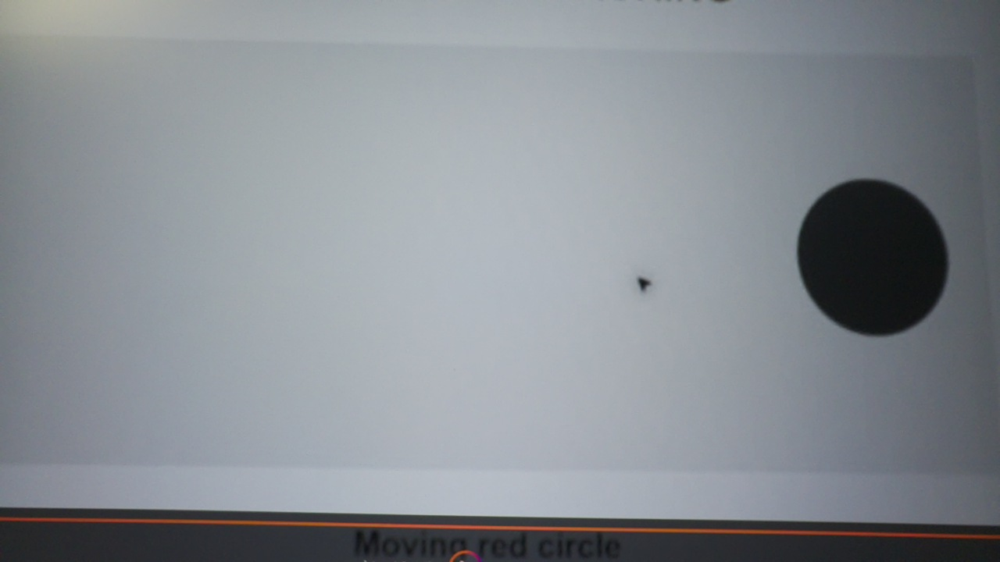
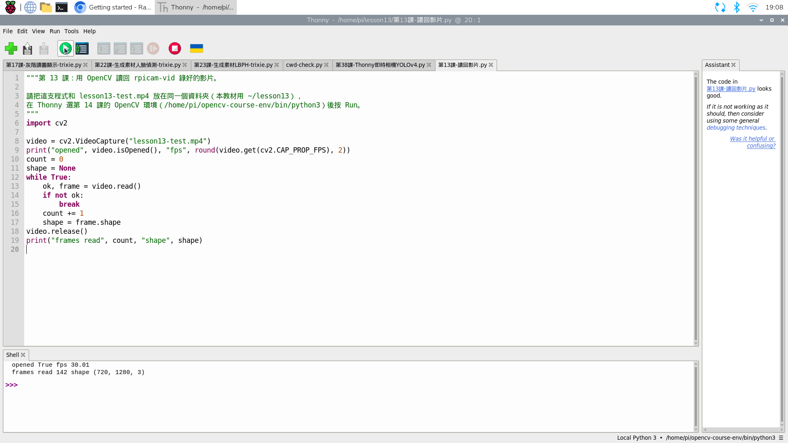

# 16｜兩種取像路線：rpicam-vid 錄影與 Picamera2 擷取

## [原課號：第 13 課｜Raspberry Pi 使用攝影機完整指南](https://github.com/Samuel-ncu/BA5077-RP5-compatibility/blob/main/%E6%95%99%E6%9D%90/%E7%AC%AC%2013%20%E8%AA%B2%EF%BD%9CRaspberry%20Pi%20%E4%BD%BF%E7%94%A8%E6%94%9D%E5%BD%B1%E6%A9%9F%E5%AE%8C%E6%95%B4%E6%8C%87%E5%8D%97.md)

digithouse.net 原文：[第 13 課｜Raspberry Pi 使用攝影機完整指南](https://digithouse.net/blog/ba5077-lesson-10-raspberry-pi-camera?locale=zh-TW)

> **本篇狀態**：終端機錄影（`rpicam-vid`）、用 `ffprobe` 檢查影片、在 Thonny 讀回影片，已在**目前 Trixie**實測（2026-11-11）；錄影那一步是從另一台電腦以 SSH 執行的。Picamera2 限時預覽也在目前 Trixie 的 Thonny 實測過（2026-11-10），但預覽畫面拍到含帳號資訊的螢幕，所以沒有公開。**尚未實測**：在桌面終端機不加 `-n` 的預覽視窗、用播放器播放的畫面、USB 攝影機。這些都不是全新安裝的系統。

有同學問我：「老師，原文說先跑 `libcamera-vid`，再用 `cv2.VideoCapture(0)` 開相機，可是我照做，程式說相機打開了，卻一張畫面都讀不到。」這不是你打錯字。在 Raspberry Pi 5 的相機上，這條路本來就走不太通。這篇我們把「拿到相機畫面」拆成兩條路來走：一條在**終端機**直接錄影，一條在 **Python** 裡跟相機要畫面，最後再說清楚 `VideoCapture(0)` 卡在哪裡。

## 這篇會學到什麼

- 用 `rpicam-vid` 在終端機錄一段 5 秒影片，看懂每個參數。
- 用 `ffprobe` 和 OpenCV 檢查影片是不是真的錄好。
- 為什麼 RP5 的 CSI 相機不要用 `cv2.VideoCapture(0)` 直接讀。
- 用 Picamera2 在 Thonny 開一個限時預覽，並確認結束後相機會被釋放。
- 什麼時候該選終端機錄影，什麼時候該選 Python 取像。

## 需要的東西

- 已接好、系統看得到的相機（[新 13](./13-%E6%8E%A5%E4%B8%8A%E7%9B%B8%E6%A9%9F%E6%A8%A1%E7%B5%84%E4%B8%A6%E7%A2%BA%E8%AA%8D%E5%AE%83%E6%B4%BB%E8%91%97%EF%BC%9Arpicam-hello.md)）。本機使用的是 IMX708 廣角相機。
- RP5 桌面上的終端機與 Thonny。
- [新 11](./11-%E5%9C%A8%20Thonny%20%E6%BA%96%E5%82%99%20OpenCV%20%E5%B7%A5%E5%85%B7%E7%AE%B1%EF%BC%9A%E8%99%9B%E6%93%AC%E7%92%B0%E5%A2%83%E8%88%87%E5%AE%89%E8%A3%9D.md) 建立的 OpenCV 環境（讀回影片用）。
- 一個能匯入 Picamera2 的 Python（預覽用）。本次使用系統的 `/usr/bin/python3`。

## 先懂幾個名詞

- **CSI 相機**：用排線插在 RP5 板子上的相機模組。它和插 USB 的網路攝影機走的是不同的路。
- **影格（frame）**：影片中的一張畫面。
- **FPS**：每秒有幾張影格。
- **編碼（codec）**：把一張張影格壓縮成影片檔的方法。本篇用 H.264，存成 MP4。
- **`rpicam-vid`**：系統內建的錄影指令。舊文章寫的 `libcamera-vid` 是它以前的名字。

## 一步一步操作

### 步驟 1：先確認相機被系統看見

**為什麼**：錄影失敗時，要先排除「相機根本沒被偵測到」這個最基本的原因。

在 RP5 桌面開啟**終端機**，輸入：

```bash
rpicam-hello --list-cameras
```

本次輸出的第一筆是 `0 : imx708_wide [4608x2592 10-bit RGGB]`，表示系統找到一台編號 0 的相機。完整說明和沒看到相機時的處理，請回到[新 13](./13-%E6%8E%A5%E4%B8%8A%E7%9B%B8%E6%A9%9F%E6%A8%A1%E7%B5%84%E4%B8%A6%E7%A2%BA%E8%AA%8D%E5%AE%83%E6%B4%BB%E8%91%97%EF%BC%9Arpicam-hello.md)。

### 步驟 2：路線一，用終端機錄 5 秒影片

**為什麼**：錄影不需要寫程式。先錄一段畫面，可以確認「相機本身沒問題」，之後再慢慢用 Python 分析。

先建立練習資料夾，再錄影：

```bash
mkdir -p ~/lesson13
cd ~/lesson13
rpicam-vid -n -t 5000 --width 1280 --height 720 --framerate 30 --codec libav -o lesson13-test.mp4
```

| 參數 | 意思 |
| --- | --- |
| `-n` | 不開預覽視窗。用 SSH 這種沒有桌面的連線時一定要加，不然會出錯。 |
| `-t 5000` | 錄 5000 毫秒，也就是 5 秒，時間到自動停止。 |
| `--width 1280 --height 720` | 影片寬 1280、高 720。 |
| `--framerate 30` | 請相機每秒給 30 張。 |
| `--codec libav -o lesson13-test.mp4` | 用軟體編碼成 H.264，存成 MP4。RP5 沒有硬體 H.264 編碼器，所以要指定 `libav`。 |

錄影前先看一下鏡頭對著什麼：**影片會存下鏡頭看到的一切**，不要對著帳號、訊息或別人的臉。資料夾裡如果已經有 `lesson13-test.mp4`，會被覆寫。

終端機會先印出許多以 `[` 開頭的相機日誌，本次最後幾行是：

```text
Output #0, mp4, to 'lesson13-test.mp4':
  Stream #0:0: Video: h264, yuv420p(tv, bt709), 1280x720, q=2-31, 30 fps, 30 tbr, 1000k tbn
Halting: reached timeout of 5000 milliseconds.
```

`Halting: reached timeout` 是「5 秒到了、正常停止」，不是錯誤。

### 步驟 3：用 `ffprobe` 檢查影片是不是真的錄好

**為什麼**：檔案存在，不代表裡面有畫面。我們要看到實際的影格數和尺寸。

```bash
ls -l lesson13-test.mp4
ffprobe -v error -show_entries stream=codec_name,width,height,avg_frame_rate,nb_frames:format=duration,size -of default=nw=1 lesson13-test.mp4
```

本次輸出：

```text
-rw-rw-r-- 1 pi pi 780793 Nov 11 17:48 lesson13-test.mp4
codec_name=h264
width=1280
height=720
avg_frame_rate=3550000/118281
nb_frames=142
duration=4.731239
size=780793
```

怎麼讀這些數字：

- 檔案約 0.78 MB、H.264 編碼、1280 × 720。
- `nb_frames=142` 是錄到 142 張。
- `avg_frame_rate` 是分數：3550000 ÷ 118281 ≈ 30.0，表示平均每秒約 30 張。
- `duration` 約 4.7 秒而不是剛好 5 秒，因為相機啟動和曝光穩定花了一點時間，前面那段沒有影格。

你的數字可能略有不同。只要 `nb_frames` 不是 0、寬高正確，就代表錄影成功。

### 步驟 4：在 Thonny 把影片讀回來

**為什麼**：之後要用 Python 分析影片，所以要確認 OpenCV 讀得到這個檔案，而且張數一樣。

下載[第13課-讀回影片.py](https://github.com/Samuel-ncu/BA5077-RP5-compatibility/blob/main/%E6%95%99%E6%9D%90/%E7%AF%84%E4%BE%8B%E7%A8%8B%E5%BC%8F/%E7%AC%AC13%E8%AA%B2-%E8%AE%80%E5%9B%9E%E5%BD%B1%E7%89%87.py)，和 `lesson13-test.mp4` 放在同一個資料夾（`~/lesson13`）。程式只寫了檔名，所以 Thonny 會到**程式所在的資料夾**找影片。

```python
import cv2

video = cv2.VideoCapture("lesson13-test.mp4")
print("opened", video.isOpened(), "fps", round(video.get(cv2.CAP_PROP_FPS), 2))
count = 0
shape = None
while True:
    ok, frame = video.read()
    if not ok:
        break
    count += 1
    shape = frame.shape
video.release()
print("frames read", count, "shape", shape)
```

操作順序：

1. Thonny 選 **File → Open**，開啟 `~/lesson13/第13課-讀回影片.py`。
2. 確認右下角是 `/home/pi/opencv-course-env/bin/python3`。不是的話點它，選 **Configure interpreter…**，再按 **…** 挑這個路徑。
3. 按綠色 **Run**。

本次 Shell 的輸出：

```text
opened True fps 30.01
frames read 142 shape (720, 1280, 3)
```

讀回 142 張，和 `ffprobe` 的 `nb_frames=142` 相同，代表 OpenCV 能完整讀取這支影片。`(720, 1280, 3)` 是「高 720、寬 1280、3 個顏色通道」。

### 步驟 5：為什麼不要用 `VideoCapture(0)` 直接開相機

**為什麼**：這就是開頭那位同學遇到的問題。知道原因，以後就不會在這裡卡很久。

原文的做法是先跑 `libcamera-vid`，再用 OpenCV 的 `cv2.VideoCapture(0)` 開相機。本次在 `opencv-course-env` 測試，它回報「已開啟」，但讀第一張就失敗：

```text
VideoCapture(0) opened True read False None
```

原因是 RP5 的 CSI 相機要先經過 libcamera 處理。系統裡的 `/dev/video0` 不是 OpenCV 能直接讀的一般攝影機。所以本系列的做法是：

- 讀**相機**：用 Picamera2（下一步，以及[新 15](./15-%E7%9B%B8%E6%A9%9F%E7%95%AB%E9%9D%A2%E8%AE%8A%E6%88%90%E6%95%B8%E5%AD%97%EF%BC%9APicamera2%20%E5%8A%A0%20OpenCV%20%E8%AE%80%E4%B8%80%E5%BC%B5%E5%BD%B1%E6%A0%BC.md)）。
- 讀**影片檔**：才用 `cv2.VideoCapture("檔名")`，就像步驟 4。

### 步驟 6：路線二，用 Picamera2 開一個限時預覽

**為什麼**：要即時處理畫面時，Python 必須自己跟相機要影格。我們先開一個 20 秒的預覽，順便確認程式結束後相機會被釋放，下一支程式才能再用。

1. 在 RP5 桌面啟動 Thonny，開啟 **Tools → Options → Interpreter**，選一個能匯入 Picamera2 的直譯器。本次選系統的 `/usr/bin/python3`（Python 3.13.5）。
2. 在 Shell 先試 `from picamera2 import Picamera2`。如果匯入失敗，先確認環境，不要在系統 Python 隨便執行 `pip`。也要注意：本次確認過，新 11 建立的 `opencv-course-env` **匯入不到** Picamera2。
3. 開啟[第13課-限時相機預覽.py](https://github.com/Samuel-ncu/BA5077-RP5-compatibility/blob/main/%E6%95%99%E6%9D%90/%E7%AF%84%E4%BE%8B%E7%A8%8B%E5%BC%8F/%E7%AC%AC13%E8%AA%B2-%E9%99%90%E6%99%82%E7%9B%B8%E6%A9%9F%E9%A0%90%E8%A6%BD.py)，或輸入下面的程式，按 F5。

```python
from picamera2 import Picamera2, Preview
from time import sleep

camera = Picamera2()
try:
    camera.configure(camera.create_preview_configuration(main={'size': (640, 480)}))
    camera.start_preview(Preview.QTGL)
    camera.start()
    print('Preview started for 20 seconds', flush=True)
    sleep(20)
finally:
    camera.stop()
    camera.stop_preview()
    camera.close()
print('Camera closed')
```

本次 Thonny 的程式輸出：

```text
Preview started for 20 seconds
Camera closed
```

預覽視窗出現，約 20 秒後自動關閉。再執行第二次，也印出同樣兩行並正常結束，表示第一次確實把相機釋放了。Shell 裡另外有相機程式庫的裝置資訊、V4L2 格式警告和 Qt 權限警告，這次都不影響預覽。`finally` 區塊會嘗試停止並釋放相機；如果初始化中途就失敗，清理時也可能再出錯，請保留完整錯誤訊息。

### 兩條路怎麼選

| | 路線一：`rpicam-vid` | 路線二：Picamera2 |
| --- | --- | --- |
| 在哪裡操作 | 終端機 | Python（Thonny） |
| 需要寫程式嗎 | 不用 | 要 |
| 適合 | 先錄起來之後再分析、確認相機本身正常 | 一邊拿畫面一邊即時處理 |
| 結果 | 影片檔 | 程式裡的影像陣列 |

## 成果圖



*相機實拍（2026-11-11）：錄影後緊接著用 `rpicam-still -n -t 1000 --width 1280 --height 720 -o lesson13-frame.jpg` 拍的照片。鏡頭對著另一個實體螢幕上的測試畫面，深色圓形當時是靜止的。影片本身沒有上傳。*



*操作截圖（目前 Trixie，2026-11-11）：步驟 4 在 Thonny 讀回影片，右下角狀態列是 `opencv-course-env`。同一天較早以 SSH 用同一個直譯器執行，得到完全相同的兩行輸出。*

## 常見問題

| 你看到的情況 | 可能原因 | 先試試看 |
| --- | --- | --- |
| 錯誤訊息提到 `in use`、`busy` 或無法取得相機 | Thonny 或其他程式正在用相機 | 先停止其他相機程式（Thonny 按紅色 Stop），再錄一次。 |
| 錯誤訊息提到 encoder 或 `h264` | 沒加 `--codec libav` | RP5 沒有硬體 H.264 編碼器，請加上 `--codec libav`。 |
| 用 SSH 時出現跟 display、預覽視窗有關的錯誤 | 沒加 `-n`，程式想開預覽視窗 | SSH 時加 `-n`；想看預覽請在 RP5 桌面的終端機執行。 |
| `nb_frames` 比預期少很多 | 解析度或每秒張數太高，軟體編碼跟不上 | 先改成 `--width 640 --height 480 --framerate 15` 比較。 |
| `VideoCapture(0)` 打開了但 `read` 是 `False` | RP5 的 CSI 相機不能這樣讀 | 相機改用 Picamera2；`VideoCapture` 只拿來讀影片檔。 |
| `No module named 'picamera2'` | 右下角選的環境沒有 Picamera2 | 換成能匯入 Picamera2 的直譯器，例如系統 Python。 |

以上前四列是常見錯誤類型的整理，本次沒有逐一重現。

## 小結

拿到相機畫面有兩條路：在終端機用 `rpicam-vid` 直接錄成影片，或在 Python 用 Picamera2 一張一張要。RP5 的 CSI 相機不要用 `cv2.VideoCapture(0)` 直接讀，它只適合讀影片檔。本次錄到 142 張、約每秒 30 張，Thonny 也完整讀回 142 張。

**練習**：

1. 把 `-t 5000` 改成 `-t 10000`。先預測 `nb_frames` 大約多少，再用 `ffprobe` 驗證。
2. 把 `--framerate 30` 改成 `--framerate 10`，比較檔案大小和 `nb_frames`。
3. 在 RP5 桌面的終端機拿掉 `-n` 錄一次，看看預覽視窗；確認畫面中沒有不能公開的內容。這一項本次尚未實測，請以你自己看到的結果為準。

## 下一篇預告

這篇我們不是「先錄完再分析」，就是「只開預覽」。下一篇[17｜邊看邊錄：即時預覽、錄影與讀回](./17-%E9%82%8A%E7%9C%8B%E9%82%8A%E9%8C%84%EF%BC%9A%E5%8D%B3%E6%99%82%E9%A0%90%E8%A6%BD%E3%80%81%E9%8C%84%E5%BD%B1%E8%88%87%E8%AE%80%E5%9B%9E.md)要把兩件事合在一起：一支 Python 程式同時開預覽、處理畫面、存成影片，最後再自己把影片讀回來檢查。
