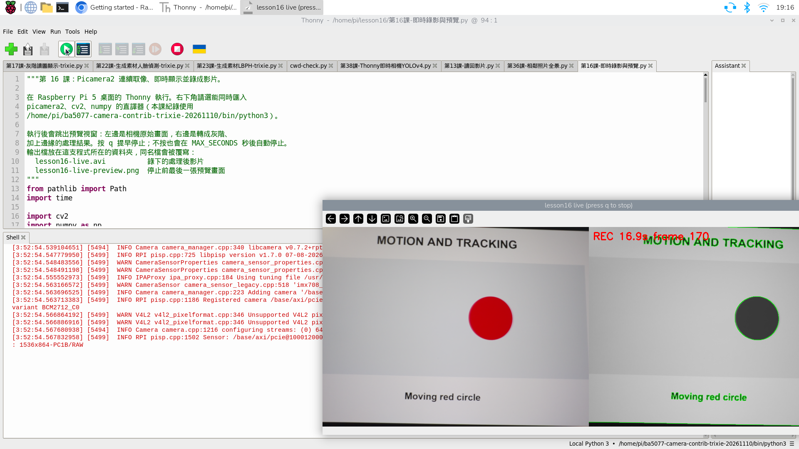
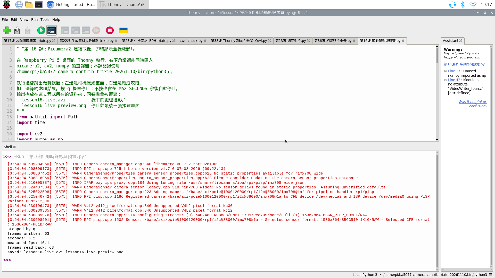
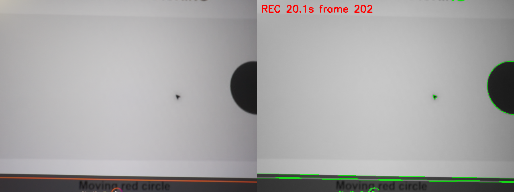

# 17｜邊看邊錄：即時預覽、錄影與讀回

## [原課號：第 16 課｜Python 結合 OpenCV 與 Picamera2：影片錄製與即時影像處理](https://github.com/Samuel-ncu/BA5077-RP5-compatibility/blob/main/%E6%95%99%E6%9D%90/%E7%AC%AC%2016%20%E8%AA%B2%EF%BD%9CPython%20%E7%B5%90%E5%90%88%20OpenCV%20%E8%88%87%20Picamera2%EF%BC%9A%E5%BD%B1%E7%89%87%E9%8C%84%E8%A3%BD%E8%88%87%E5%8D%B3%E6%99%82%E5%BD%B1%E5%83%8F%E8%99%95%E7%90%86.md)

digithouse.net 原文：[第 16 課｜Python 結合 OpenCV 與 Picamera2：影片錄製與即時影像處理](https://digithouse.net/blog/ba5077-lesson-13-video-recording?locale=zh-TW)

> **本篇狀態**：在**目前 Trixie** 的 Thonny 按 Run 實測（2026-11-11）：跑滿 20 秒寫入 202 張、實測每秒 10.1 張、讀回 202 張；按 `q` 提早停止寫入 63 張、讀回 63 張。相機拍的是另一個螢幕上播放的**生成動畫**，不是實物。**尚未實測**：用影片播放器播放錄好的檔案（沒有截圖）、長時間錄影、錄聲音。這不是全新安裝的系統。

監視器、行車記錄器、產線檢查，它們要的不是「一張」照片，而是一張接一張、不停進來的畫面。上一篇我們不是先錄完再分析，就是只開預覽看看。這一篇要讓 RP5 的相機連續工作：畫面一進來就處理，一邊顯示給你看，一邊存成影片，最後程式還會自己把影片讀回來，告訴你到底存了幾張。

## 這篇會學到什麼

- 「影片就是按時間排好的一串影格」，以及兩種 FPS 的差別：相機**實際**每秒給幾張，和影片檔**標示**的播放速度。
- 在 Thonny 執行一支程式：開相機、跳出即時預覽、把處理後的畫面錄成 `lesson16-live.avi`，按 `q` 或時間到就停。
- 看懂程式最後印出的四個數字，自己判斷錄影有沒有成功。

## 需要的東西

- 已接好、能拍照的相機（[新 13](./13-%E6%8E%A5%E4%B8%8A%E7%9B%B8%E6%A9%9F%E6%A8%A1%E7%B5%84%E4%B8%A6%E7%A2%BA%E8%AA%8D%E5%AE%83%E6%B4%BB%E8%91%97%EF%BC%9Arpicam-hello.md)、[新 15](./15-%E7%9B%B8%E6%A9%9F%E7%95%AB%E9%9D%A2%E8%AE%8A%E6%88%90%E6%95%B8%E5%AD%97%EF%BC%9APicamera2%20%E5%8A%A0%20OpenCV%20%E8%AE%80%E4%B8%80%E5%BC%B5%E5%BD%B1%E6%A0%BC.md)）。
- 一個**同時能用 Picamera2 和 OpenCV** 的 Thonny 環境，建法見[新 15](./15-%E7%9B%B8%E6%A9%9F%E7%95%AB%E9%9D%A2%E8%AE%8A%E6%88%90%E6%95%B8%E5%AD%97%EF%BC%9APicamera2%20%E5%8A%A0%20OpenCV%20%E8%AE%80%E4%B8%80%E5%BC%B5%E5%BD%B1%E6%A0%BC.md)的步驟 1。本次使用 `/home/pi/ba5077-camera-contrib-trixie-20261110/bin/python3`；你的路徑名稱可以不同，重點是這個環境能 `import picamera2` 和 `import cv2`。
- 鏡頭前一個**不含個人資料**的畫面。本次讓相機對著另一台螢幕上開啟的[相機測試畫面](https://github.com/Samuel-ncu/BA5077-RP5-compatibility/blob/main/%E6%95%99%E6%9D%90/%E7%B7%B4%E7%BF%92%E7%B4%A0%E6%9D%90/RP5%E7%9B%B8%E6%A9%9F%E6%B8%AC%E8%A9%A6.html)，選「移動追蹤」會有左右移動的紅色圓形。

## 先懂幾個名詞

- **影格（frame）**：影片中的一張畫面。程式裡的 `frame` 變數就是一張影格的數字陣列。
- **FPS（每秒影格數）**：一秒內有幾張影格。這篇會同時遇到「要求的速度」和「量到的速度」。
- **編碼器（fourcc）**：把影格壓縮成影片檔的方式。本篇用 `MJPG`，副檔名是 `.avi`，在 RP5 的 OpenCV 可以直接使用。
- **邊緣偵測（Canny）**：找出畫面中亮度變化很大的地方，通常就是物體的輪廓線。

## 一步一步操作

### 步驟 1：準備場景、環境與練習資料夾

**為什麼**：相機要拍得到東西，Python 要能同時找到相機工具和 OpenCV，程式才跑得起來。

1. 讓相機固定對著準備好的畫面。**錄影會存下鏡頭看到的一切**，不要對著帳號、訊息或別人的臉。
2. 在 Thonny 的 **Tools → Options → Interpreter** 選好相機加 OpenCV 的環境，回到主畫面看右下角路徑。
3. 在家目錄建立資料夾，例如 `/home/pi/lesson16`，把[本課主程式](https://github.com/Samuel-ncu/BA5077-RP5-compatibility/blob/main/%E6%95%99%E6%9D%90/%E7%AF%84%E4%BE%8B%E7%A8%8B%E5%BC%8F/%E7%AC%AC16%E8%AA%B2-%E5%8D%B3%E6%99%82%E9%8C%84%E5%BD%B1%E8%88%87%E9%A0%90%E8%A6%BD.py)下載進去。程式會把影片和截圖存在**程式所在的同一個資料夾**，已有同名檔會被覆寫。
4. 關掉其他正在用相機的程式。同一時間只能有一支程式使用相機。

### 步驟 2：先讀程式，找出四個關鍵動作

**為什麼**：每張影格都要走過同一條路：**取像 → 處理 → 寫進影片 → 顯示**。先看懂這條路，等一下速度不夠時才知道要改哪裡。

```python
from pathlib import Path
import time

import cv2
import numpy as np
from picamera2 import Picamera2

MAX_SECONDS = 20      # 最長錄影秒數；想錄久一點就改這個數字
FPS = 10              # 要求相機每秒給 10 張，也當作影片的播放速度
SIZE = (640, 480)     # 寬, 高

folder = Path(__file__).resolve().parent
video_path = folder / "lesson16-live.avi"
preview_path = folder / "lesson16-live-preview.png"

camera = Picamera2()
writer = None
written = 0
last_view = None
start = time.monotonic()
try:
    config = camera.create_video_configuration(
        main={"size": SIZE, "format": "RGB888"},
        controls={"FrameRate": FPS},
    )
    camera.configure(config)
    camera.start()
    time.sleep(1)  # 讓曝光與白平衡先穩定

    writer = cv2.VideoWriter(str(video_path), cv2.VideoWriter_fourcc(*"MJPG"), FPS, SIZE)
    if not writer.isOpened():
        raise RuntimeError("無法建立 MJPG 影片，請檢查資料夾權限與磁碟空間")

    start = time.monotonic()
    while True:
        frame = camera.capture_array()          # 等到下一張影格才回來
        gray = cv2.cvtColor(frame, cv2.COLOR_BGR2GRAY)
        edges = cv2.Canny(gray, 60, 150)
        processed = cv2.cvtColor(gray, cv2.COLOR_GRAY2BGR)
        processed[edges > 0] = (0, 255, 0)      # 邊緣畫成綠色

        elapsed = time.monotonic() - start
        cv2.putText(processed, f"REC {elapsed:4.1f}s frame {written + 1}", (10, 30),
                    cv2.FONT_HERSHEY_SIMPLEX, 0.8, (0, 0, 255), 2)
        writer.write(processed)
        written += 1

        last_view = cv2.hconcat([frame, processed])
        cv2.imshow("lesson16 live (press q to stop)", last_view)
        key = cv2.waitKey(1) & 0xFF
        if key == ord("q"):
            print("stopped by q")
            break
        if elapsed >= MAX_SECONDS:
            print("stopped by time limit")
            break
finally:
    elapsed = time.monotonic() - start
    if writer is not None:
        writer.release()
    camera.stop()
    camera.close()
    cv2.destroyAllWindows()

if last_view is not None:
    cv2.imwrite(str(preview_path), last_view)

reader = cv2.VideoCapture(str(video_path))
read_count = 0
while True:
    ok, _ = reader.read()
    if not ok:
        break
    read_count += 1
reader.release()

print("frames written:", written)
print("seconds:", round(elapsed, 1))
print("measured fps:", round(written / elapsed, 1) if elapsed > 0 else 0)
print("frames read back:", read_count)
print("saved:", video_path.name, preview_path.name)
```

先別急著執行，我們在程式裡找到這四個地方：

| 動作 | 找哪一行 | 它在做什麼 |
| --- | --- | --- |
| 設定相機 | `create_video_configuration(... FrameRate ...)` | 用適合錄影的設定，畫面 640 × 480，請相機每秒給 10 張。 |
| 準備影片檔 | `cv2.VideoWriter(..., "MJPG", FPS, SIZE)` | 開一個空的影片檔。這裡的 `FPS` 只是寫在檔案裡的**播放速度**，不會讓相機變快。尺寸必須和寫進去的影格一樣。 |
| 迴圈 | `while True:` 到 `break` | 每一圈取一張、處理、寫入、顯示。`capture_array()` 會等下一張影格來了才回來，所以相機的速度決定迴圈的節奏。 |
| 清理 | `finally:` 之後 | 不管正常結束還是出錯，都關閉影片檔、釋放相機、關視窗，下一支程式才能再用相機。 |

`cv2.waitKey(1)` 有兩個工作：讓預覽視窗有機會更新，以及檢查你有沒有按鍵。少了它，視窗通常會一片灰白、沒有反應。

### 步驟 3：在 Thonny 執行，讓它跑滿 20 秒

**為什麼**：先不按任何鍵，看程式自己在時間到時能不能正常收尾。

1. Thonny 選 **File → Open**，開啟練習資料夾中的 `第16課-即時錄影與預覽.py`。
2. 確認右下角是步驟 1 選好的環境，按綠色 **Run**。
3. 約 1 秒後會跳出標題為 `lesson16 live (press q to stop)` 的視窗：左半是相機原始畫面，右半是灰階加綠色邊緣，左上角紅字 `REC` 後的秒數和張數會一直增加。

Shell 中以 `[` 開頭、含 `INFO` 或 `WARN` 的行，多半是相機程式庫的日誌，不一定是錯誤。真正的錯誤通常以 `Traceback` 開頭。

本次跑滿 20 秒，Shell 印出：

```text
stopped by time limit
frames written: 202
seconds: 20.1
measured fps: 10.1
frames read back: 202
saved: lesson16-live.avi lesson16-live-preview.png
```

### 步驟 4：再跑一次，按 `q` 提早停止

**為什麼**：實際使用時，我們常常要自己決定什麼時候停。要確認提早停止也能把影片存完整。

再按一次 **Run**。預覽出現約 6 秒後，**先點一下預覽視窗的標題列**，讓它拿到鍵盤焦點，再按 `q`。視窗立刻關閉：

```text
stopped by q
frames written: 63
seconds: 6.2
measured fps: 10.1
frames read back: 63
saved: lesson16-live.avi lesson16-live-preview.png
```

第二次執行會覆寫第一次的 `lesson16-live.avi`。

### 步驟 5：讀懂這四個數字

**為什麼**：「看起來有錄」不算數，要用數字判斷。

- `frames written` 和 `frames read back` 相同：寫進去的每一張都讀得回來，影片檔沒有壞。兩次都相同。
- `measured fps: 10.1`：在「灰階＋邊緣＋顯示＋寫檔」的負擔下，RP5 仍跟得上每秒 10 張的節奏。影片標示的播放速度也是 10，所以 202 張播放起來約 20 秒，和真實時間一致。
- 如果你量到的 `measured fps` 明顯低於 10，例如 6，表示處理跟不上；影片仍用 10 FPS 播放，看起來就會比真實時間快。

你的數字不一定和這裡一樣，場景、光線、畫面大小和 RP5 同時在做的事都會影響速度。判斷成功的三個條件是：**有跳出會更新的視窗**、**寫入和讀回的張數相同**、**影片檔在資料夾裡、大小不是 0**。

## 成果圖



*操作截圖（目前 Trixie，2026-11-11）：上方是 Thonny 的程式，右下角狀態列是所選直譯器；預覽視窗左上角顯示錄到第 170 張、16.9 秒。相機拍的是螢幕上的生成動畫，紅色圓形會左右移動。*



*操作截圖：步驟 4 按 `q` 停止後。Shell 最上面的 `%Run '第16課-即時錄影與預覽.py'` 是按下 Run 時 Thonny 替你輸入的指令；紅色的 `INFO`／`WARN` 是相機程式庫日誌，不是錯誤。右側 Assistant 面板的 Warnings（例如 `Module has no attribute "VideoWriter_fourcc"`）是 Thonny 的靜態檢查提示，程式實際上正常執行完畢。*



*程式輸出：程式自動存下的 `lesson16-live-preview.png`。這一張來自同一天較早、以 SSH 在 RP5 桌面用同一個直譯器啟動的那一次（不是在 Thonny 按 Run），當時鏡頭前是**靜止**的深色圓形，結果同樣是 202 張、每秒 10.0 張、讀回 202 張。*

## 常見問題

| 你看到的情況 | 可能原因 | 先試試看 |
| --- | --- | --- |
| `Camera __init__ sequence did not complete` 或 `Device or resource busy` | 相機正被另一支程式使用 | 停止 Thonny 其他分頁或終端機中的相機程式，必要時重開 Thonny。 |
| `No module named 'picamera2'` 或 `'cv2'` | 右下角的直譯器選錯 | 改選能讀到系統 Picamera2、又裝了 OpenCV 的環境。 |
| `RuntimeError: 無法建立 MJPG 影片` | 資料夾不能寫入或磁碟滿了 | 把程式放在自己家目錄下的資料夾；用 `df -h` 查空間。 |
| 沒有視窗，出現 `could not connect to display` 或 `qt.qpa` 錯誤 | 不是在 RP5 桌面上執行，例如純 SSH 終端機 | 在 RP5 桌面（或 Raspberry Pi Connect 桌面分享）中的 Thonny 執行。 |
| 視窗出現但按 `q` 沒反應 | 鍵盤焦點在 Thonny，不在預覽視窗 | 先點一下預覽視窗再按 `q`，或等 20 秒自動停止。 |
| `measured fps` 遠低於 10 | 處理太重或畫面太大 | 先把 `SIZE` 改成 `(320, 240)` 再測，或拿掉 `Canny` 那兩行比較。 |
| 影片播放比真實時間快 | 實際張數少於標示的播放速度 | 把 `FPS` 改成接近你量到的 `measured fps` 再錄一次。 |

## 小結

連續取像的骨架就是一個迴圈：取一張、處理、寫入、顯示，最後一定要釋放相機。`VideoWriter` 裡的 FPS 只是播放速度，相機實際多快要自己量。本次在目前 Trixie 跑滿 20 秒寫入 202 張、每秒 10.1 張，按 `q` 停止也完整讀回 63 張。後面的背景差分、顏色追蹤、物件偵測，都是把迴圈中「灰階＋邊緣」那幾行換成別的處理。

**練習（一次只改一個地方）**：

1. 把 `MAX_SECONDS` 改成 `10`，先預測寫入張數大約多少，再執行驗證。
2. 把 `SIZE` 改成 `(320, 240)`，比較 `measured fps` 和影片檔大小。
3. 刪掉邊緣那兩行，只留灰階，看看速度有沒有改變。

每次都記下改了什麼、四個數字是多少，這樣才知道是哪個改變造成結果不同。這些是延伸練習，請以你實際得到的輸出為準。

## 下一篇預告

相機組到這裡告一段落。下一篇[18｜讀一張圖並轉成灰階](./18-%E8%AE%80%E4%B8%80%E5%BC%B5%E5%9C%96%E4%B8%A6%E8%BD%89%E6%88%90%E7%81%B0%E9%9A%8E.md)先把相機放一邊，回到最基本的「讀一張圖片檔」，看看彩色變成灰階之後，哪些資訊留下來、哪些不見了。
