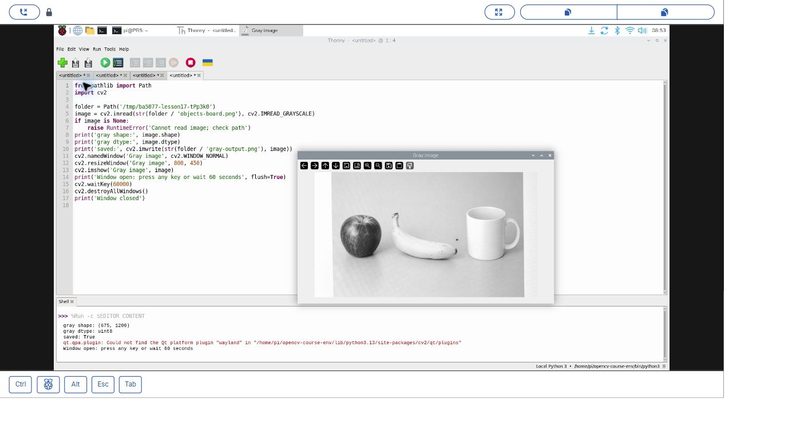
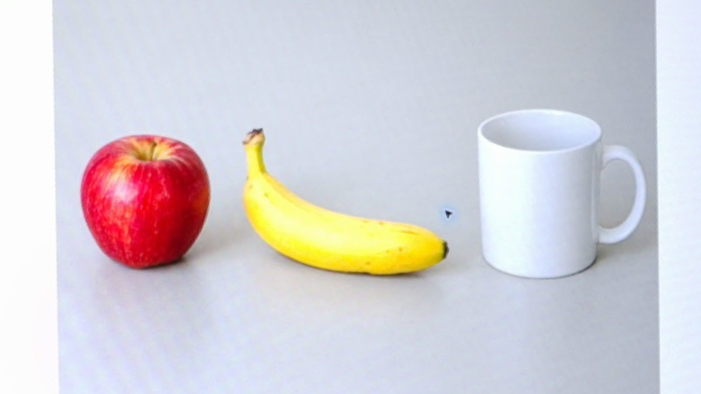
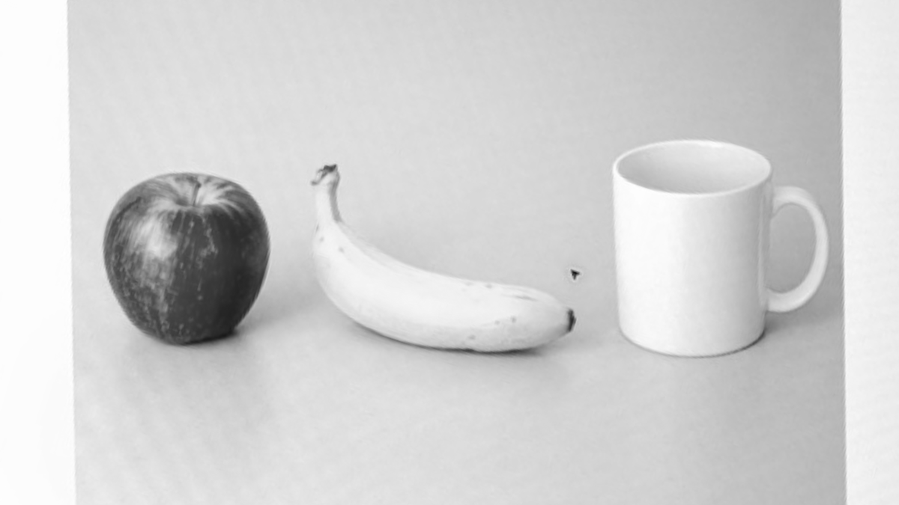

# 18｜讀一張圖並轉成灰階

## [原課號：第 17 課｜使用 OpenCV 讀取灰階圖檔](https://github.com/Samuel-ncu/BA5077-RP5-compatibility/blob/main/%E6%95%99%E6%9D%90/%E7%AC%AC%2017%20%E8%AA%B2%EF%BD%9C%E4%BD%BF%E7%94%A8%20OpenCV%20%E8%AE%80%E5%8F%96%E7%81%B0%E9%9A%8E%E5%9C%96%E6%AA%94.md)

digithouse.net 原文：[第 17 課｜使用 OpenCV 讀取灰階圖檔](https://digithouse.net/blog/ba5077-lesson-14-opencv-grayscale?locale=zh-TW)

> **本篇狀態**：讀圖、存檔、顯示視窗、按鍵關閉，已在**目前 Trixie** 的 Thonny 實測（2026-11-10，OpenCV 4.12.0），附操作截圖。2026-11-11 把程式改成「到程式所在的資料夾找圖片」後，又在 Thonny 重跑一次並按鍵關閉，但**那次沒有另存新截圖**。用自己的照片是延伸練習，尚未實測。這不是全新安裝的系統。

一張彩色照片變成黑白之後，你還認得出裡面是什麼嗎？大部分時候認得出來。形狀和明暗都還在，只是顏色不見了。電腦做影像處理時，常常先把圖轉成灰階，因為資料量只剩三分之一，找邊界也比較容易。這篇我們讀一張圖、轉成灰階、存成新檔，再把兩張圖放在一起比較，看看到底少了什麼。

## 這篇會學到什麼

- 用 `cv2.imread` 讀圖，並在讀取時就轉成灰階。
- 讓程式到「程式所在的資料夾」找圖片，不必知道老師電腦上的路徑。
- 看懂灰階影像的形狀為什麼只有兩個數字。
- 讀圖失敗時，讓程式停下來提示，而不是繼續處理空資料。

## 需要的東西

- [新 11](./11-%E5%9C%A8%20Thonny%20%E6%BA%96%E5%82%99%20OpenCV%20%E5%B7%A5%E5%85%B7%E7%AE%B1%EF%BC%9A%E8%99%9B%E6%93%AC%E7%92%B0%E5%A2%83%E8%88%87%E5%AE%89%E8%A3%9D.md) 建立的 OpenCV 環境（本次是 `opencv-course-env`）。這篇讀的是圖片檔，不需要相機。
- 一個新的練習資料夾，裡面放兩個檔案：
  - 彩色圖片 [objects-board.png](https://github.com/Samuel-ncu/BA5077-RP5-compatibility/blob/main/%E6%95%99%E6%9D%90/%E5%9C%96%E6%AA%94/objects-board.png)，**保留原檔名**。
  - [本課程式](https://github.com/Samuel-ncu/BA5077-RP5-compatibility/blob/main/%E6%95%99%E6%9D%90/%E7%AF%84%E4%BE%8B%E7%A8%8B%E5%BC%8F/%E7%AC%AC17%E8%AA%B2-%E7%81%B0%E9%9A%8E%E8%AE%80%E5%9C%96%E9%A1%AF%E7%A4%BA-trixie.py)。

這張圖片的來歷要說清楚：它是**先生成物件圖，再顯示在螢幕上，由 RP5 相機拍下並裁切校正**的練習素材。圖裡有水果和杯子，不是真實水果的照片。

## 先懂幾個名詞

- **灰階**：只保留亮度、沒有顏色的影像。每個點只有一個 0～255 的數字，0 是黑、255 是白。
- **形狀（shape）**：影像陣列的大小。彩色是「高 × 寬 × 3」，灰階是「高 × 寬」。
- **`uint8`**：每個數字用 0～255 的整數存放。
- **`__file__`**：Python 裡代表「這支程式檔案本身」的位置。

## 一步一步操作

### 步驟 1：看程式怎麼找到圖片

**為什麼**：原文寫 `cv2.imread('demo.jpeg', ...)`，只給檔名。這樣 Python 會到「目前的工作資料夾」找，換一台電腦或換個地方開 Thonny，就可能找不到。我們改成到程式旁邊找。

```python
from pathlib import Path
import cv2

folder = Path(__file__).resolve().parent
image = cv2.imread(str(folder / 'objects-board.png'), cv2.IMREAD_GRAYSCALE)
if image is None:
    raise RuntimeError('Cannot read image; check path')
print('gray shape:', image.shape)
print('gray dtype:', image.dtype)
print('saved:', cv2.imwrite(str(folder / 'gray-output.png'), image))
cv2.namedWindow('Gray image', cv2.WINDOW_NORMAL)
cv2.resizeWindow('Gray image', 800, 450)
cv2.imshow('Gray image', image)
print('Window open: press any key or wait 60 seconds', flush=True)
cv2.waitKey(60000)
cv2.destroyAllWindows()
print('Window closed')
```

重點有四個：

- `Path(__file__).resolve().parent`：這支程式所在的資料夾。所以只要圖片和程式放在一起就好。
- `cv2.IMREAD_GRAYSCALE`：告訴 OpenCV「讀進來的時候就變成灰階」。
- `if image is None`：讀不到圖時，`imread` 不會報錯，而是回傳 `None`。我們自己檢查，讀不到就停下來，提示你去看路徑。
- `cv2.waitKey(60000)`：原文用 `waitKey(0)` 無限等待；這裡最多等 60 秒，沒按鍵也會自己關掉視窗。

### 步驟 2：在 Thonny 執行

**為什麼**：實際看到灰階視窗，才知道讀圖和顯示都沒問題。

1. 確認練習資料夾裡沒有需要保留的 `gray-output.png`，程式會寫入這個檔名。
2. 在 Thonny 開啟程式，右下角選好新 11 的環境，按綠色 **Run**。
3. 灰階圖會出現在視窗裡。點一下圖片視窗再按任意鍵，或等 60 秒讓它自己關閉。

本次在目前 Trixie 的輸出：

```text
gray shape: (675, 1200)
gray dtype: uint8
saved: True
Window open: press any key or wait 60 seconds
Window closed
```

### 步驟 3：讀懂輸出

**為什麼**：數字會告訴你圖片有多大、存檔有沒有成功。

- `(675, 1200)`：高 675、寬 1200。灰階每個位置只需要一個亮度值，所以**沒有**彩色陣列最後那個 `3`。
- `uint8`：每個亮度是 0～255 的整數。
- `saved: True`：OpenCV 回報已經存好 `gray-output.png`。

### 步驟 4：回到資料夾，比較兩張圖

**為什麼**：灰階好不好用，要看你的任務是什麼。

在 RP5 的檔案管理員打開練習資料夾，把 `gray-output.png` 和原本的 `objects-board.png` 都打開，比較蘋果、香蕉和杯子。試著回答兩個問題：

1. 哪些形狀還看得出來？
2. 哪些顏色已經無法直接分辨？

灰階常能幫我們找邊界；但如果任務是「找出紅色的東西」，就需要保留顏色。後面的顏色追蹤會用到這個觀念。

## 成果圖



*操作截圖（目前 Trixie，2026-11-10）：Thonny 執行本課程式，灰階圖片顯示在 OpenCV 視窗中。這是**路徑修正前**的版本，程式第 4 行把圖片放在 `/tmp` 底下的暫存資料夾；其他程式碼和輸出與本文相同。改成 `Path(__file__)` 之後重跑的那一次沒有另存截圖。*



*練習素材：生成的物件圖顯示在螢幕上，由 RP5 相機拍攝並裁切校正。不是真實水果照片。*



*程式輸出：由同一張素材轉成的灰階圖。*

## 常見問題

| 你看到的情況 | 可能原因 | 先試試看 |
| --- | --- | --- |
| `Cannot read image; check path` | 圖片和程式不在同一個資料夾，或檔名不同 | 用檔案管理員確認兩個檔案放在一起，圖片真的叫 `objects-board.png`。 |
| `No module named 'cv2'` | Thonny 右下角選錯環境 | 改選新 11 建立的 OpenCV 環境。 |
| `saved: True` 但沒有出現視窗 | 不是在 RP5 的圖形桌面執行 | 在 RP5 桌面（或桌面分享）中的 Thonny 執行，並保留完整錯誤訊息。 |
| 視窗出現了，按鍵沒反應 | 鍵盤焦點在 Thonny | 先點一下圖片視窗再按鍵，或等 60 秒。 |

以上是常見情況的整理，本次沒有逐一重現。

## 小結

`cv2.imread(路徑, cv2.IMREAD_GRAYSCALE)` 一行就能把圖讀成灰階。灰階影像的形狀是「高 × 寬」，比彩色少了顏色通道。把路徑寫成「程式所在的資料夾」，換電腦也不容易找不到檔案；讀圖後檢查是不是 `None`，可以及早發現錯誤。

**練習**：把自己的照片另存到新的練習資料夾，修改程式裡的輸入和輸出檔名再跑一次。執行前先猜猜哪個部分在灰階下最難辨認，完成後用結果解釋。這是延伸練習，本次尚未實測，請記錄你自己的實際輸出。

## 下一篇預告

讀圖學會了，接下來換我們自己「畫」圖。下一篇[19｜在畫布上畫線、圓、橢圓與多邊形](./19-%E5%9C%A8%E7%95%AB%E5%B8%83%E4%B8%8A%E7%95%AB%E7%B7%9A%E3%80%81%E5%9C%93%E3%80%81%E6%A9%A2%E5%9C%93%E8%88%87%E5%A4%9A%E9%82%8A%E5%BD%A2.md)，我們把畫布當成方格紙，搞清楚座標、顏色和線寬的關係。
