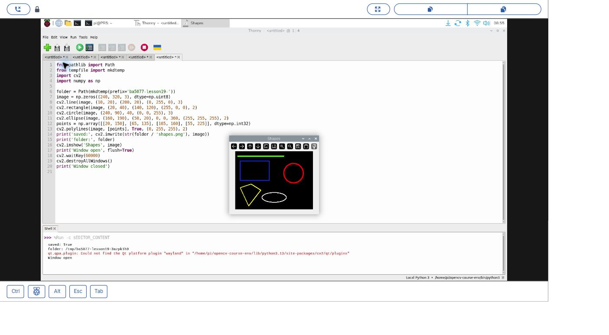
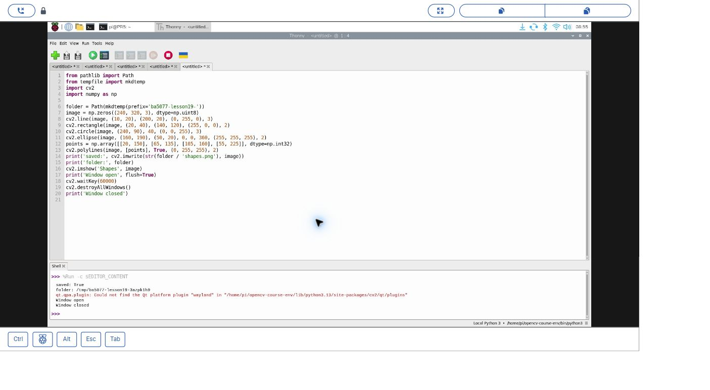
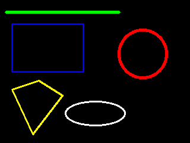

# 19｜在畫布上畫線、圓、橢圓與多邊形

## [原課號：第 19 課｜使用 OpenCV 繪製直線、圓形、橢圓與多邊形](https://github.com/Samuel-ncu/BA5077-RP5-compatibility/blob/main/%E6%95%99%E6%9D%90/%E7%AC%AC%2019%20%E8%AA%B2%EF%BD%9C%E4%BD%BF%E7%94%A8%20OpenCV%20%E7%B9%AA%E8%A3%BD%E7%9B%B4%E7%B7%9A%E3%80%81%E5%9C%93%E5%BD%A2%E3%80%81%E6%A9%A2%E5%9C%93%E8%88%87%E5%A4%9A%E9%82%8A%E5%BD%A2.md)

digithouse.net 原文：[第 19 課｜使用 OpenCV 繪製直線、圓形、橢圓與多邊形](https://digithouse.net/blog/ba5077-lesson-16-opencv-basic-shapes?locale=zh-TW)

> **本篇狀態**：畫圖、存檔、顯示視窗、按鍵關閉，已在**目前 Trixie** 的 Thonny 實測（2026-11-10，Python 3.13.5、OpenCV 4.12.0），附兩張操作截圖。下方的成果圖之一來自較早用 OpenCV 4.10.0 執行同一段繪圖程式的輸出。改頂點、改成不封閉的練習尚未實測。這不是全新安裝的系統。

之後我們會讓電腦在照片上「框出」它找到的東西：一個框住臉的方框、一個圈住球的圓。這些標記不是相機拍的，是程式畫上去的。要畫得準，得先知道畫布上的座標怎麼算。這篇我們不用相機，在一張黑色畫布上畫線、矩形、圓、橢圓和多邊形，把畫布當成一張方格紙來練習。

## 這篇會學到什麼

- OpenCV 畫布的座標：原點在左上角，x 向右、y **向下**。
- 線、矩形、圓、橢圓、多邊形各自需要哪些參數。
- OpenCV 的顏色順序是 **BGR**（藍、綠、紅），不是 RGB。
- 把結果存成圖片，也在視窗裡顯示出來。

## 需要的東西

- [新 11](./11-%E5%9C%A8%20Thonny%20%E6%BA%96%E5%82%99%20OpenCV%20%E5%B7%A5%E5%85%B7%E7%AE%B1%EF%BC%9A%E8%99%9B%E6%93%AC%E7%92%B0%E5%A2%83%E8%88%87%E5%AE%89%E8%A3%9D.md) 建立的 OpenCV 環境（本次是 `/home/pi/opencv-course-env/bin/python3`）。
- RP5 桌面上的 Thonny。不需要相機。
- [本課完整程式](https://github.com/Samuel-ncu/BA5077-RP5-compatibility/blob/main/%E6%95%99%E6%9D%90/%E7%AF%84%E4%BE%8B%E7%A8%8B%E5%BC%8F/%E7%AC%AC19%E8%AA%B2-%E7%B9%AA%E5%9C%96%E8%88%87%E8%A6%96%E7%AA%97-trixie.py)。

## 先懂幾個名詞

- **畫布**：一個全部是 0 的陣列，也就是一張全黑的圖。`np.zeros((240, 320, 3))` 是高 240、寬 320、3 個顏色通道的黑畫布。
- **像素**：畫布上的一個小點。畫圖其實就是改變某些像素的顏色。
- **BGR**：OpenCV 寫顏色的順序。`(255, 0, 0)` 是藍色，`(0, 0, 255)` 是紅色。
- **線寬**：線條粗細，單位是像素。

## 一步一步操作

### 步驟 1：認識畫布的座標

**為什麼**：後面每個函式都要給座標，座標想錯，圖就會畫到別的地方，甚至畫出畫布外被裁掉。

畫布形狀是 `(240, 320, 3)`：高 240、寬 320。左上角是 `(0, 0)`，往右 x 變大，往**下** y 變大。注意寫座標時是 `(x, y)`，也就是「先橫、後直」。

### 步驟 2：讀程式，看每個圖形要哪些參數

**為什麼**：知道每個參數的意思，才能自己改出想要的圖。

```python
from pathlib import Path
from tempfile import mkdtemp
import cv2
import numpy as np

folder = Path(mkdtemp(prefix='ba5077-lesson19-'))
image = np.zeros((240, 320, 3), dtype=np.uint8)
cv2.line(image, (10, 20), (200, 20), (0, 255, 0), 3)
cv2.rectangle(image, (20, 40), (140, 120), (255, 0, 0), 2)
cv2.circle(image, (240, 90), 40, (0, 0, 255), 3)
cv2.ellipse(image, (160, 190), (50, 20), 0, 0, 360, (255, 255, 255), 2)
points = np.array([[20, 150], [65, 135], [105, 160], [55, 225]], dtype=np.int32)
cv2.polylines(image, [points], True, (0, 255, 255), 2)
print('saved:', cv2.imwrite(str(folder / 'shapes.png'), image))
print('folder:', folder)
cv2.imshow('Shapes', image)
print('Window open', flush=True)
cv2.waitKey(60000)
cv2.destroyAllWindows()
print('Window closed')
```

| 函式 | 需要什麼 | 本例畫出 |
| --- | --- | --- |
| `line` | 起點、終點、顏色、線寬 | 從 (10, 20) 到 (200, 20) 的綠色橫線 |
| `rectangle` | 兩個對角、顏色、線寬 | 左上 (20, 40)、右下 (140, 120) 的藍色方框 |
| `circle` | 圓心、半徑、顏色、線寬 | 圓心 (240, 90)、半徑 40 的紅色圓 |
| `ellipse` | 中心、長短半軸、旋轉角、起訖角度、顏色、線寬 | 中心 (160, 190)、半軸 (50, 20) 的白色橢圓 |
| `polylines` | 頂點陣列、是否封閉、顏色、線寬 | 四個頂點連成的黃色四邊形 |

`polylines` 的 `True` 表示最後一點要連回第一點，形成封閉的形狀。`(0, 255, 255)` 在 BGR 裡是綠加紅，也就是黃色。

程式開頭的 `mkdtemp` 每次都建立一個新的暫存資料夾來存圖，避免覆寫你原本的檔案；資料夾位置會印在 Shell。要注意 `/tmp` 可能被系統清掉，想保留的作品請另存。

### 步驟 3：在 Thonny 執行

**為什麼**：親眼看到圖，才能核對每個圖形是不是畫在你預期的位置。

1. 在 Thonny 開啟程式，右下角選好含 OpenCV 和 NumPy 的環境，按 F5。
2. 出現 `Shapes` 視窗後，點一下視窗再按任意鍵關閉；不按的話最多等 60 秒。

本次輸出如下，暫存資料夾的名稱每次都不同：

```text
saved: True
folder: /tmp/ba5077-lesson19-3azpk1h9
Window open
Window closed
```

Shell 另外出現「找不到 Qt `wayland` 平台外掛」的訊息，但這次視窗仍正常顯示、正常關閉。`saved: True` 表示寫檔成功；另外用檔案工具確認過產出的是 320 × 240 的 PNG。

### 步驟 4：對照原文，比一比哪裡不一樣

**為什麼**：同一個函式，參數一改，樣子就差很多。看懂差異，就能自己變化。

原文用的是 512 × 512 的**白色**畫布（先 `np.zeros` 再 `fill(255)`），圓的線寬寫 `-1`，代表**填滿**的實心圓；橢圓轉了 45 度；多邊形頂點先 `reshape((-1, 1, 2))` 再畫。本篇改用較小的黑畫布、空心圖形，另外加了矩形。原文這些變化本次沒有在 RP5 上重跑，可以當作下面的練習。

## 成果圖



*操作截圖（目前 Trixie，2026-11-10）：Thonny 與 `Shapes` 視窗，圖形是程式畫的。*



*操作截圖：按鍵關閉視窗後，Shell 印出 `Window closed`。*



*程式輸出：較早以 OpenCV 4.10.0 在 RP5 執行同一段繪圖程式存下的圖。*

## 常見問題

| 你看到的情況 | 可能原因 | 先試試看 |
| --- | --- | --- |
| 圖形只出現一半 | 座標超出畫布，被裁掉了 | 確認 x 在 0～319、y 在 0～239 之間。 |
| 顏色和預期相反（想要紅卻變藍） | 把顏色當成 RGB 寫 | OpenCV 是 BGR：紅色寫 `(0, 0, 255)`。 |
| `saved: True` 但沒有視窗 | 不是在 RP5 圖形桌面執行，或環境不支援視窗 | 在 RP5 桌面的 Thonny 執行，確認所選環境，保留完整錯誤。 |
| 找不到存好的圖 | 圖存在 `/tmp` 底下的暫存資料夾 | 看 Shell 印出的 `folder:` 路徑，需要保留就另存。 |

以上是常見情況的整理，本次沒有逐一重現。

## 小結

OpenCV 的畫布左上角是原點，x 向右、y 向下，座標寫成 `(x, y)`；顏色是 BGR。`line`、`rectangle`、`circle`、`ellipse`、`polylines` 分別需要起終點、對角、圓心半徑、中心半軸角度和頂點陣列。畫圖只是改變像素，標記本身不代表電腦真的「看懂」了什麼。

**練習**：

1. 把多邊形其中一個頂點改掉，先預測形狀會怎麼變，再執行比較。
2. 把 `polylines` 的 `True` 改成 `False`，看起點和終點還有沒有連起來。
3. 把圓的線寬改成 `-1`，看看是不是變成實心圓。

這些是延伸練習，本次尚未實測，請以你實際看到的結果為準。

## 下一篇預告

圖形會畫了，下一步是在圖上寫字。下一篇[20｜把字寫上去：OpenCV 的八種字型](./20-%E6%8A%8A%E5%AD%97%E5%AF%AB%E4%B8%8A%E5%8E%BB%EF%BC%9AOpenCV%20%E7%9A%84%E5%85%AB%E7%A8%AE%E5%AD%97%E5%9E%8B.md)，我們一次比較 OpenCV 內建的八種英文字型，也會說明為什麼不要假設它能直接寫中文。
