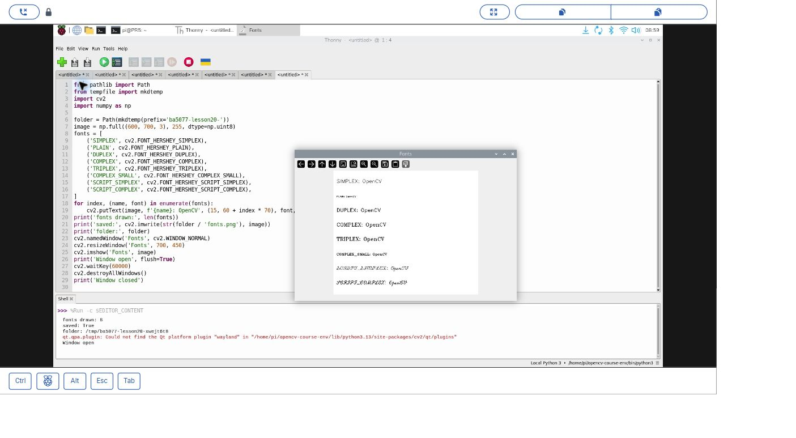
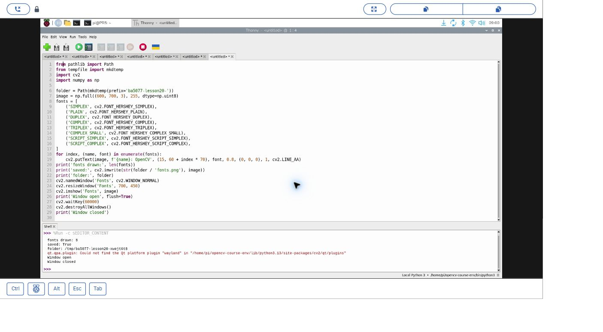
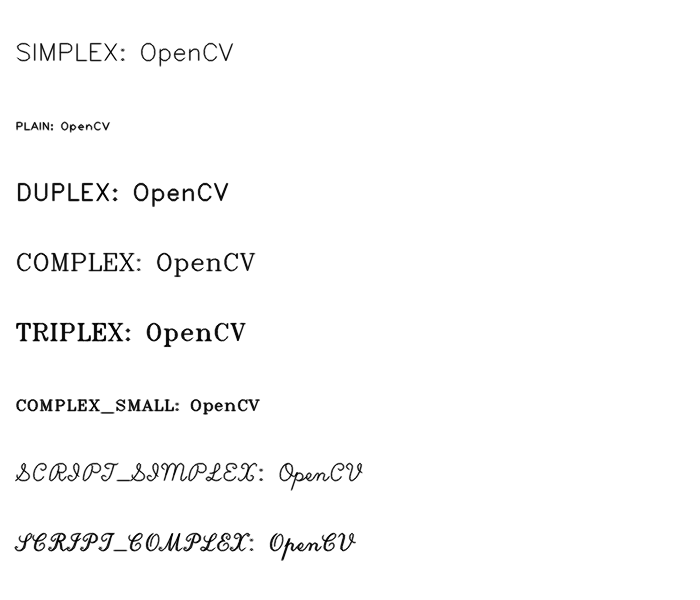

# 20｜把字寫上去：OpenCV 的八種字型

## [原課號：第 20 課｜使用 OpenCV 測試不同字體樣式](https://github.com/Samuel-ncu/BA5077-RP5-compatibility/blob/main/%E6%95%99%E6%9D%90/%E7%AC%AC%2020%20%E8%AA%B2%EF%BD%9C%E4%BD%BF%E7%94%A8%20OpenCV%20%E6%B8%AC%E8%A9%A6%E4%B8%8D%E5%90%8C%E5%AD%97%E9%AB%94%E6%A8%A3%E5%BC%8F.md)

digithouse.net 原文：[第 20 課｜使用 OpenCV 測試不同字體樣式](https://digithouse.net/blog/ba5077-lesson-17-opencv-fonts?locale=zh-TW)

> **本篇狀態**：八種英文 Hershey 字型的繪製、存檔、顯示視窗、按鍵關閉，已在**目前 Trixie** 的 Thonny 實測（2026-11-10，Python 3.13.5、OpenCV 4.12.0），附兩張操作截圖。**繁體中文字的繪製尚未實測**。改線寬、改大小的練習尚未實測。這不是全新安裝的系統。

物件偵測的結果圖上，常常會在框框旁邊寫一行小字，例如「cup 0.87」，告訴你電腦認為那是什麼、有多確定。這行字也是程式「畫」上去的。這篇我們把同一句英文用 OpenCV 內建的八種字型各寫一次，比較它們的樣子，也順便搞懂文字的座標是怎麼算的。

## 這篇會學到什麼

- 用 `cv2.putText` 在圖上寫字，看懂每個參數。
- OpenCV 內建的八種 Hershey 字型長什麼樣子。
- 文字的座標是「基準線」的位置，不是左上角。
- 用 `enumerate` 讓每一行字自動往下排。
- 為什麼視窗太大時要改成可調整大小的視窗。

## 需要的東西

- [新 11](./11-%E5%9C%A8%20Thonny%20%E6%BA%96%E5%82%99%20OpenCV%20%E5%B7%A5%E5%85%B7%E7%AE%B1%EF%BC%9A%E8%99%9B%E6%93%AC%E7%92%B0%E5%A2%83%E8%88%87%E5%AE%89%E8%A3%9D.md) 建立的 OpenCV 環境（本次是 `/home/pi/opencv-course-env/bin/python3`）。
- RP5 桌面上的 Thonny。不需要相機。
- [本課完整程式](https://github.com/Samuel-ncu/BA5077-RP5-compatibility/blob/main/%E6%95%99%E6%9D%90/%E7%AF%84%E4%BE%8B%E7%A8%8B%E5%BC%8F/%E7%AC%AC20%E8%AA%B2-%E5%AD%97%E5%9E%8B%E8%88%87%E8%A6%96%E7%AA%97-trixie.py)。

## 先懂幾個名詞

- **Hershey 字型**：OpenCV 內建、用線條畫成的字型，主要用來寫英文字母和數字。
- **基準線**：英文字母「站」的那條線。`g`、`y` 的尾巴會掉到基準線下面。
- **縮放（fontScale）**：字的大小倍率。
- **抗鋸齒（`cv2.LINE_AA`）**：讓斜線和曲線邊緣比較平滑，不會一格一格的。

## 一步一步操作

### 步驟 1：讀程式，看字是怎麼排的

**為什麼**：八行字要自動往下排，不用一行一行手動算位置。

```python
from pathlib import Path
from tempfile import mkdtemp
import cv2
import numpy as np

folder = Path(mkdtemp(prefix='ba5077-lesson20-'))
image = np.full((600, 700, 3), 255, dtype=np.uint8)
fonts = [
    ('SIMPLEX', cv2.FONT_HERSHEY_SIMPLEX),
    ('PLAIN', cv2.FONT_HERSHEY_PLAIN),
    ('DUPLEX', cv2.FONT_HERSHEY_DUPLEX),
    ('COMPLEX', cv2.FONT_HERSHEY_COMPLEX),
    ('TRIPLEX', cv2.FONT_HERSHEY_TRIPLEX),
    ('COMPLEX_SMALL', cv2.FONT_HERSHEY_COMPLEX_SMALL),
    ('SCRIPT_SIMPLEX', cv2.FONT_HERSHEY_SCRIPT_SIMPLEX),
    ('SCRIPT_COMPLEX', cv2.FONT_HERSHEY_SCRIPT_COMPLEX),
]
for index, (name, font) in enumerate(fonts):
    cv2.putText(image, f'{name}: OpenCV', (15, 60 + index * 70), font, 0.8, (0, 0, 0), 1, cv2.LINE_AA)
print('fonts drawn:', len(fonts))
print('saved:', cv2.imwrite(str(folder / 'fonts.png'), image))
print('folder:', folder)
cv2.namedWindow('Fonts', cv2.WINDOW_NORMAL)
cv2.resizeWindow('Fonts', 700, 450)
cv2.imshow('Fonts', image)
print('Window open', flush=True)
cv2.waitKey(60000)
cv2.destroyAllWindows()
print('Window closed')
```

- `np.full((600, 700, 3), 255, ...)`：建立一張高 600、寬 700 的**白色**畫布。
- `fonts` 把「顯示用的名字」和「OpenCV 的字型代號」配成一對。
- `enumerate` 同時給你序號 `index` 和內容，所以第 0 行在 y = 60，第 1 行在 y = 130，每行往下 70。
- `putText` 的參數依序是：畫布、文字、基準線左端座標、字型、縮放 0.8、黑色、線寬 1、抗鋸齒。

### 步驟 2：在 Thonny 執行

**為什麼**：八種字型放在一起看，差異最明顯。

1. 在 Thonny 開啟程式，右下角選好環境，按 F5。
2. 出現 `Fonts` 視窗後，點一下視窗再按任意鍵關閉；不按的話最多等 60 秒。

本次輸出如下，暫存資料夾的名稱每次都不同：

```text
fonts drawn: 8
saved: True
folder: /tmp/ba5077-lesson20-xwejt6t8
Window open
Window closed
```

Shell 另外出現「找不到 Qt `wayland` 平台外掛」的訊息，但這次視窗仍正常顯示、可以按鍵關閉。另外用檔案工具確認過寫出的 PNG 是 700 × 600 像素。

### 步驟 3：為什麼要加 `namedWindow` 和 `resizeWindow`

**為什麼**：這是實測時真的遇到的問題。

第一次測試時，預設的視窗在遠端桌面上超出可以看到的範圍，下面幾行字看不到。改成 `cv2.WINDOW_NORMAL`（可以調整大小的視窗），再用 `resizeWindow` 設成 700 × 450 之後，八行字都看得到了。原圖還是 700 × 600，只是視窗把它縮小顯示，存下來的檔案不受影響。

### 步驟 4：觀察八種字型

**為什麼**：同樣的縮放和線寬，不同字型的實際大小和粗細並不一樣。

打開視窗或存下的 `fonts.png`，比較：

- `PLAIN` 最小，`COMPLEX_SMALL` 也明顯比其他字型小。
- `DUPLEX`、`TRIPLEX` 的筆畫比較粗；`COMPLEX`、`TRIPLEX` 的字母帶有襯線（筆畫末端的小腳）。
- `SCRIPT_SIMPLEX`、`SCRIPT_COMPLEX` 是手寫風格。

以上是看下方成果圖中的程式輸出得到的觀察。

原文把每種字型都寫成縮放 2、線寬 2 的「OpenCV」，字很大；本篇改成縮放 0.8、線寬 1，並在前面加上字型名稱，方便對照。

### 關於中文

Hershey 字型主要是英文字母和數字，**不要假設它能直接寫繁體中文**。本次只測了英文，沒有驗證中文繪製。如果需要在圖上寫中文，要另外選用支援中文字型的繪圖工具，並先自己測試。

## 成果圖



*操作截圖（目前 Trixie，2026-11-10）：從 RP5 桌面分享畫面看到的 Thonny 與 `Fonts` 視窗。*



*操作截圖：按鍵關閉視窗後 Shell 的輸出。*



*程式輸出：較早以 OpenCV 4.10.0 在 RP5 執行同一段字型程式存下的圖。*

## 常見問題

| 你看到的情況 | 可能原因 | 先試試看 |
| --- | --- | --- |
| 視窗太大，下面幾行看不到 | 預設視窗用原圖大小，超出螢幕 | 用 `cv2.namedWindow(..., cv2.WINDOW_NORMAL)` 和 `resizeWindow`。 |
| 中文變成問號或亂碼 | Hershey 字型不是用來寫中文的 | 改用支援中文字型的工具，先自己測試。 |
| 字的底部被切掉 | y 座標是基準線，太靠近底部時尾巴超出畫布 | 把 y 往上調，或把畫布加高。 |
| `saved: True` 但沒有視窗 | 不是在 RP5 圖形桌面執行 | 在 RP5 桌面的 Thonny 執行，保留完整錯誤。 |

第一列是本次實際遇到的情況；其他是常見情況的整理，本次沒有逐一重現。

## 小結

`cv2.putText` 在圖上寫字，座標是基準線左端；字型、縮放、顏色、線寬和抗鋸齒決定字的樣子。OpenCV 內建八種 Hershey 字型，同樣的縮放下實際大小並不相同。圖片上的字是像素，不能像文件裡的字一樣被搜尋或複製。

**練習**：

1. 挑兩種字型，比較同樣縮放 0.8 下的實際大小。
2. 把線寬從 1 改成 2，看看可讀性有沒有變好，字有沒有擠在一起。

這些是延伸練習，本次尚未實測，請以你實際看到的結果為準。

## 下一篇預告

圖形和文字都會了，下一篇[21｜綜合練習：圖形加文字](./21-%E7%B6%9C%E5%90%88%E7%B7%B4%E7%BF%92%EF%BC%9A%E5%9C%96%E5%BD%A2%E5%8A%A0%E6%96%87%E5%AD%97.md)要把它們放在同一張圖上，做一個簡單的標示，也想一想先畫什麼、後畫什麼會有什麼不同。
