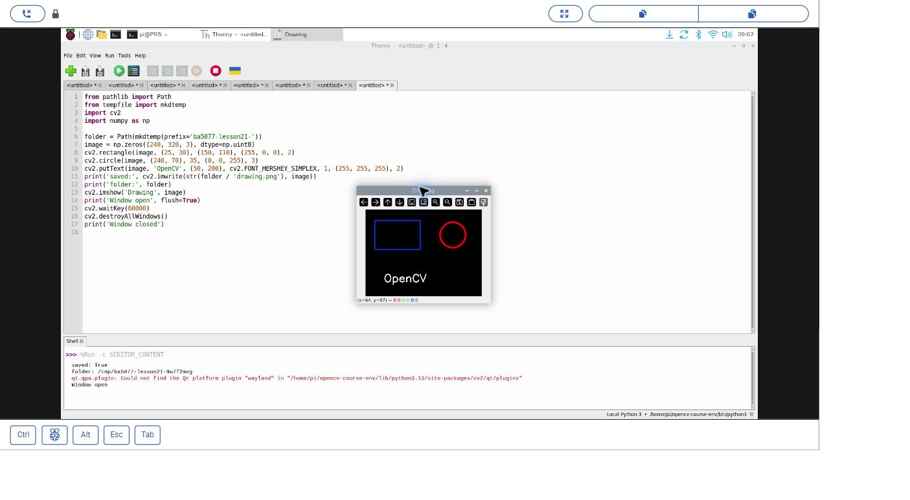
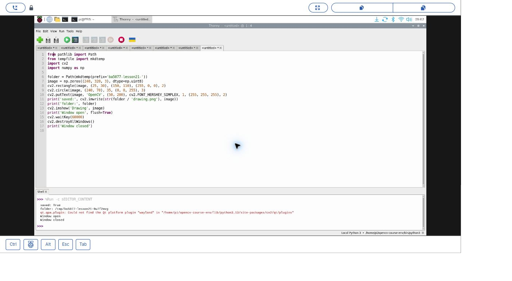
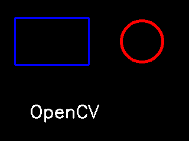

# 21｜綜合練習：圖形加文字

## [原課號：第 21 課｜使用 OpenCV 繪製基本圖形與文字](https://github.com/Samuel-ncu/BA5077-RP5-compatibility/blob/main/%E6%95%99%E6%9D%90/%E7%AC%AC%2021%20%E8%AA%B2%EF%BD%9C%E4%BD%BF%E7%94%A8%20OpenCV%20%E7%B9%AA%E8%A3%BD%E5%9F%BA%E6%9C%AC%E5%9C%96%E5%BD%A2%E8%88%87%E6%96%87%E5%AD%97.md)

digithouse.net 原文：[第 21 課｜使用 OpenCV 繪製基本圖形與文字](https://digithouse.net/blog/ba5077-lesson-18-opencv-shapes-text?locale=zh-TW)

> **本篇狀態**：在同一張圖上畫矩形、圓形和文字，存檔、顯示視窗、按鍵關閉，已在**目前 Trixie** 的 Thonny 實測（2026-11-10，Python 3.13.5、OpenCV 4.12.0），附兩張操作截圖。調換繪製順序、改文字位置的練習尚未實測。這不是全新安裝的系統。

前兩篇我們分別學了畫圖形和寫字。真正用的時候，它們幾乎都一起出現：一個框框加一行說明，告訴看的人「這裡有什麼」。這篇是綜合練習，我們在同一張圖上畫一個方框、一個圓，再寫上一行字。重點不在於畫得多複雜，而在於想清楚：**怎麼排，別人才看得懂？**

## 這篇會學到什麼

- 把矩形、圓形和文字組合在同一張圖上。
- 繪製的**先後順序**會影響誰蓋住誰。
- 文字和背景的**對比**會影響能不能看清楚。
- 確認視窗裡的內容和存下來的圖片一致。

## 需要的東西

- [新 11](./11-%E5%9C%A8%20Thonny%20%E6%BA%96%E5%82%99%20OpenCV%20%E5%B7%A5%E5%85%B7%E7%AE%B1%EF%BC%9A%E8%99%9B%E6%93%AC%E7%92%B0%E5%A2%83%E8%88%87%E5%AE%89%E8%A3%9D.md) 建立的 OpenCV 環境（本次是 `/home/pi/opencv-course-env/bin/python3`）。
- RP5 桌面上的 Thonny。不需要相機。
- [本課完整程式](https://github.com/Samuel-ncu/BA5077-RP5-compatibility/blob/main/%E6%95%99%E6%9D%90/%E7%AF%84%E4%BE%8B%E7%A8%8B%E5%BC%8F/%E7%AC%AC21%E8%AA%B2-%E5%9C%96%E5%BD%A2%E6%96%87%E5%AD%97%E8%88%87%E8%A6%96%E7%AA%97-trixie.py)。
- 已經讀過[新 19](./19-%E5%9C%A8%E7%95%AB%E5%B8%83%E4%B8%8A%E7%95%AB%E7%B7%9A%E3%80%81%E5%9C%93%E3%80%81%E6%A9%A2%E5%9C%93%E8%88%87%E5%A4%9A%E9%82%8A%E5%BD%A2.md)（座標與 BGR）和[新 20](./20-%E6%8A%8A%E5%AD%97%E5%AF%AB%E4%B8%8A%E5%8E%BB%EF%BC%9AOpenCV%20%E7%9A%84%E5%85%AB%E7%A8%AE%E5%AD%97%E5%9E%8B.md)（`putText`）。

## 先懂幾個名詞

- **圖層順序**：後畫的東西會蓋在先畫的東西上面，就像在紙上用不同顏色的筆疊著畫。
- **對比**：文字顏色和背景顏色差多少。黑底白字、白底黑字對比高，容易讀。
- **標註**：在影像上加框、加字，幫人讀懂畫面。

## 一步一步操作

### 步驟 1：讀程式

**為什麼**：這支程式短到可以一眼看完，每一行都對應畫面上的一個東西。

```python
from pathlib import Path
from tempfile import mkdtemp
import cv2
import numpy as np

folder = Path(mkdtemp(prefix='ba5077-lesson21-'))
image = np.zeros((240, 320, 3), dtype=np.uint8)
cv2.rectangle(image, (25, 30), (150, 110), (255, 0, 0), 2)
cv2.circle(image, (240, 70), 35, (0, 0, 255), 3)
cv2.putText(image, 'OpenCV', (50, 200), cv2.FONT_HERSHEY_SIMPLEX, 1, (255, 255, 255), 2)
print('saved:', cv2.imwrite(str(folder / 'drawing.png'), image))
print('folder:', folder)
cv2.imshow('Drawing', image)
print('Window open', flush=True)
cv2.waitKey(60000)
cv2.destroyAllWindows()
print('Window closed')
```

| 這一行 | 畫面上的東西 |
| --- | --- |
| `np.zeros((240, 320, 3), ...)` | 高 240、寬 320 的黑色畫布 |
| `cv2.rectangle(..., (25, 30), (150, 110), (255, 0, 0), 2)` | 左上方一個藍色方框 |
| `cv2.circle(..., (240, 70), 35, (0, 0, 255), 3)` | 右上方一個紅色圓圈 |
| `cv2.putText(..., 'OpenCV', (50, 200), ..., (255, 255, 255), 2)` | 下方一行白色的「OpenCV」 |

三樣東西彼此沒有重疊，所以這次先畫誰都一樣。等一下的練習會故意讓它們重疊。

### 步驟 2：在 Thonny 執行

**為什麼**：在視窗裡確認三樣東西都出現了、位置也對。

1. 在 Thonny 開啟程式，右下角選好含 OpenCV 和 NumPy 的環境，按 F5。
2. 確認 `Drawing` 視窗裡有藍色方框、紅色圓和白色文字。
3. 點一下視窗再按任意鍵關閉，或等 60 秒。

本次輸出如下，暫存資料夾的名稱每次都不同：

```text
saved: True
folder: /tmp/ba5077-lesson21-9w7f2mvg
Window open
Window closed
```

Shell 另外出現「找不到 Qt `wayland` 平台外掛」的訊息，但這次視窗仍正常出現並可以關閉。另外用檔案工具確認過 PNG 是 320 × 240 像素。視窗一開始會蓋到程式，這次是用滑鼠把它拖到旁邊再截圖的。

### 步驟 3：和原文比一比

**為什麼**：原文和本篇用了不同的畫布顏色和文字設定，比較之後更能體會「對比」的意思。

原文是 512 × 512 的**白色**畫布，只寫一行很大的黑色「OpenCV」（縮放 4、線寬 2、加抗鋸齒），其他圖形放在註解裡讓讀者自己打開。本篇改成黑色畫布、白色文字，並且真的畫上方框和圓。兩種都是高對比：白底黑字、黑底白字，都容易讀。

## 成果圖



*操作截圖（目前 Trixie，2026-11-10）：RP5 上的 Thonny 與 `Drawing` 視窗；視窗被拖到旁邊以免蓋住程式。圖形和文字是程式畫的。*



*操作截圖：按鍵關閉視窗後 Shell 的輸出。*



*程式輸出：較早在 RP5 執行同一段繪圖程式存下的圖（藍框、紅圓、白字）。*

## 常見問題

| 你看到的情況 | 可能原因 | 先試試看 |
| --- | --- | --- |
| `saved: False` | 寫入的資料夾不存在或不能寫 | 看 Shell 印出的 `folder:`，確認那個資料夾存在。 |
| 視窗沒出現 | 不是在 RP5 圖形桌面執行，或環境不支援視窗 | 在 RP5 桌面的 Thonny 執行，確認所選環境，保留完整錯誤。 |
| 字被圖形蓋住了 | 圖形比文字晚畫 | 把 `putText` 移到最後一行再畫。 |
| 字看不太清楚 | 字的顏色和背景太接近 | 換對比高的顏色，或先在字後面畫一個實心底框。 |

以上是常見情況的整理，本次沒有逐一重現。

## 小結

圖形和文字都是在改變像素，後畫的會蓋住先畫的，所以標註文字通常最後畫。版面要讓人看得懂：位置不要互相遮擋、文字和背景要有足夠的對比。之後顯示偵測結果時，也要記得同時給數字和文字，不要只靠顏色傳達資訊。

**練習**：

1. 把文字的位置改成 `(50, 80)`，讓它和方框重疊。先畫字再畫框，和先畫框再畫字，各試一次並比較。
2. 把畫布改成白色（`np.full((240, 320, 3), 255, dtype=np.uint8)`），白色文字還看得到嗎？要改成什麼顏色？

這些是延伸練習，本次尚未實測，請以你實際看到的結果為準。

## 下一篇預告

OpenCV 基礎到這裡告一段落。下一篇[22｜只處理畫面的一塊：ROI](./22-%E5%8F%AA%E8%99%95%E7%90%86%E7%95%AB%E9%9D%A2%E7%9A%84%E4%B8%80%E5%A1%8A%EF%BC%9AROI.md)開始進入影像處理：如果只關心畫面中央的一小塊，就不必整張圖都處理。我們先在合成圖上裁出一塊，再把同樣的想法放進即時相機畫面。
