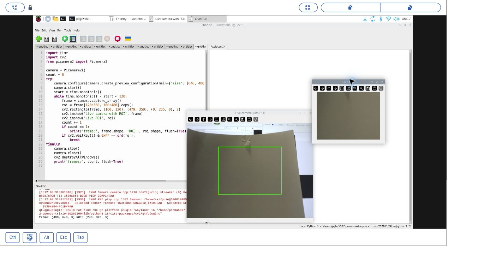
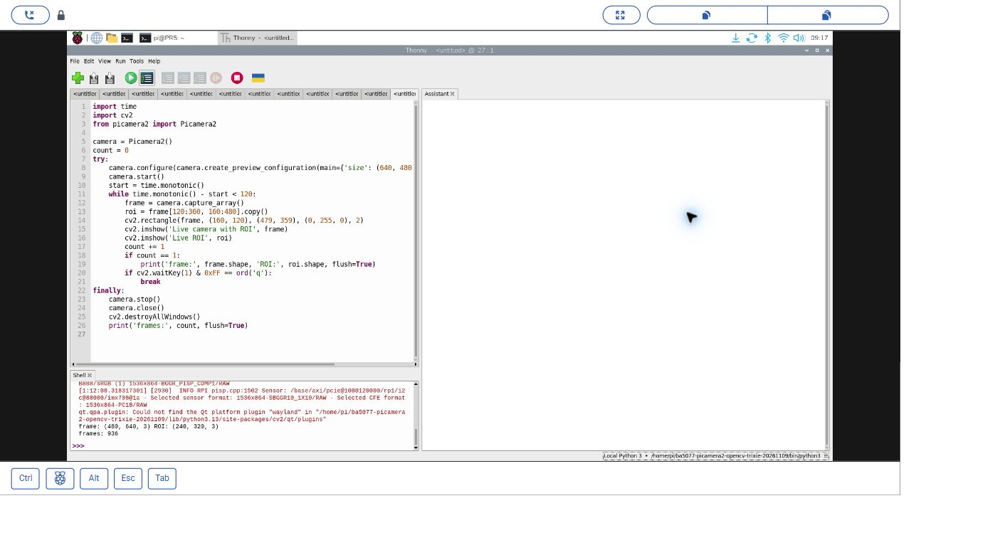
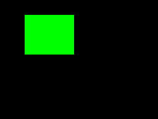
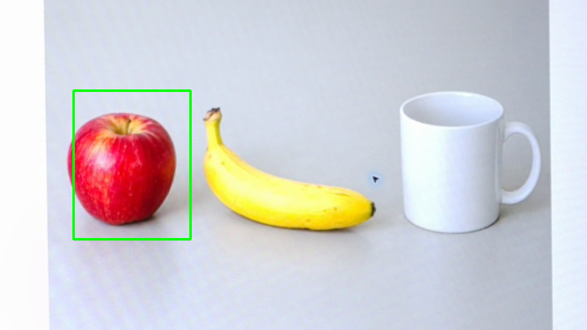
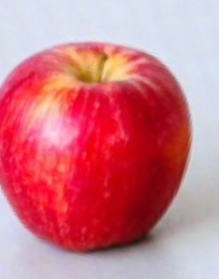

# 22｜只處理畫面的一塊：ROI

## [原課號：第 24 課｜OpenCV 即時影像處理與特定區域（ROI）處理](https://github.com/Samuel-ncu/BA5077-RP5-compatibility/blob/main/%E6%95%99%E6%9D%90/%E7%AC%AC%2024%20%E8%AA%B2%EF%BD%9COpenCV%20%E5%8D%B3%E6%99%82%E5%BD%B1%E5%83%8F%E8%99%95%E7%90%86%E8%88%87%E7%89%B9%E5%AE%9A%E5%8D%80%E5%9F%9F%EF%BC%88ROI%EF%BC%89%E8%99%95%E7%90%86.md)

digithouse.net 原文：[第 24 課｜OpenCV 即時影像處理與特定區域（ROI）處理](https://digithouse.net/blog/ba5077-lesson-21-realtime-roi?locale=zh-TW)

> **本篇狀態**：即時相機的固定 ROI 已在**目前 Trixie** 的 Thonny 實測（2026-11-10）：相機對著實體白紙，顯示 936 張後按 `q` 結束，附兩張操作截圖。合成圖的 ROI 是在**舊環境**（`/home/pi/myenv`）的 Thonny 執行；照片 ROI 是較早用終端機 `python3` 執行的。**尚未實測**：原文「把 ROI 轉成 HSV 再貼回原圖」的做法、用滑鼠選區、全新安裝的系統。

想像一台相機架在輸送帶上方，你只在乎輸送帶中間那一段有沒有東西經過。旁邊的牆壁、地板、路過的人，一點都不重要。既然如此，何必每一張都把整個畫面處理一遍？只處理中間那一塊，速度快，也比較不會被背景干擾。這一塊「你感興趣的區域」，就叫做 ROI。這篇我們先在合成圖上裁一塊，搞懂座標，再拿一張照片來裁，最後放進即時相機畫面。

## 這篇會學到什麼

- ROI（感興趣區域）是什麼，什麼時候用得到。
- 用 NumPy 切片 `image[y1:y2, x1:x2]` 取出一塊，順序是**先 y 再 x**，而且上界不包含。
- 為什麼裁切時常常要加 `.copy()`。
- 在即時相機畫面上框出固定的 ROI，並另開一個視窗顯示裁切結果。
- 固定 ROI 的缺點：目標移出框外就看不到了。

## 需要的東西

- [新 11](./11-%E5%9C%A8%20Thonny%20%E6%BA%96%E5%82%99%20OpenCV%20%E5%B7%A5%E5%85%B7%E7%AE%B1%EF%BC%9A%E8%99%9B%E6%93%AC%E7%92%B0%E5%A2%83%E8%88%87%E5%AE%89%E8%A3%9D.md) 建立的 OpenCV 環境（前兩個練習用）。
- 一個**同時能用 Picamera2 和 OpenCV** 的環境（即時相機用），建法見[新 15](./15-%E7%9B%B8%E6%A9%9F%E7%95%AB%E9%9D%A2%E8%AE%8A%E6%88%90%E6%95%B8%E5%AD%97%EF%BC%9APicamera2%20%E5%8A%A0%20OpenCV%20%E8%AE%80%E4%B8%80%E5%BC%B5%E5%BD%B1%E6%A0%BC.md)。本次即時測試用的是 `/home/pi/ba5077-picamera2-opencv-trixie-20261109/bin/python3`，你的路徑可以不同。
- 已接好、沒有被其他程式佔用的相機，鏡頭對著白紙這類不含個資的東西。
- [相機拍攝的物件圖 objects-board.png](https://github.com/Samuel-ncu/BA5077-RP5-compatibility/blob/main/%E6%95%99%E6%9D%90/%E5%9C%96%E6%AA%94/objects-board.png)（照片 ROI 用）。

## 先懂幾個名詞

- **ROI（Region of Interest）**：感興趣區域，也就是你只想處理的那一塊。
- **切片（slicing）**：用 `[起點:終點]` 從陣列裡取一段。`a[2:5]` 取第 2、3、4 個，**不含** 5。
- **影像陣列的順序**：先列（y，高度）、再欄（x，寬度）、最後才是顏色通道。
- **`.copy()`**：複製一份新的陣列。沒有複製時，改 ROI 會連原圖一起改到。

## 一步一步操作

### 步驟 1：在合成圖上裁一塊，搞懂座標

**為什麼**：不用相機、不用照片，最容易看清楚切片的規則。

把下面的程式存成 `第24課.py`，或下載[範例程式](https://github.com/Samuel-ncu/BA5077-RP5-compatibility/blob/main/%E6%95%99%E6%9D%90/%E7%AF%84%E4%BE%8B%E7%A8%8B%E5%BC%8F/%E7%AC%AC24%E8%AA%B2.py)：

```python
import numpy as np
import cv2
image = np.zeros((240, 320, 3), dtype=np.uint8)
roi = image[30:110, 50:150]
roi[:] = (0, 255, 0)
if not cv2.imwrite('lesson24-roi.png', image):
    raise RuntimeError('image save failed')
print('image', image.shape)
print('ROI', roi.shape)
```

在 Thonny 開啟並按綠色 Run。本次輸出（舊環境 `/home/pi/myenv`）：

```text
image (240, 320, 3)
ROI (80, 100, 3)
```

怎麼算出 `(80, 100, 3)`：y 從 30 到 110，高 110 − 30 = 80；x 從 50 到 150，寬 150 − 50 = 100；顏色通道 3 個。

注意這裡**沒有** `.copy()`：`roi[:] = (0, 255, 0)` 把 ROI 塗成綠色，原圖 `image` 的同一塊也跟著變綠，所以存下來的 `lesson24-roi.png` 上會看到一塊綠色方塊。這正好說明 ROI 只是「看著原圖的一扇窗」。

### 步驟 2：從照片裁出一塊，看看固定座標的問題

**為什麼**：真實畫面裡，目標不一定剛好在你設定的框內。

下載[照片 ROI 程式](https://github.com/Samuel-ncu/BA5077-RP5-compatibility/blob/main/%E6%95%99%E6%9D%90/%E7%AF%84%E4%BE%8B%E7%A8%8B%E5%BC%8F/%E7%AC%AC24%E8%AA%B2-%E7%9B%B8%E6%A9%9FROI.py)，和 `objects-board.png` 放在同一個資料夾。這張圖是 RP5 相機拍攝螢幕上的**生成物件圖**，不是真實水果照片。

```python
import cv2

image = cv2.imread('objects-board.png')
if image is None:
    raise RuntimeError('找不到 objects-board.png')
# 固定座標只適用本次 1200 x 675 圖片，換圖時需重新選取。
x1, y1, x2, y2 = 150, 185, 390, 490
roi = image[y1:y2, x1:x2].copy()
if roi.size == 0:
    raise RuntimeError('ROI 為空，請檢查座標')
marked = image.copy()
cv2.rectangle(marked, (x1, y1), (x2-1, y2-1), (0, 255, 0), 3)
if not cv2.imwrite('lesson24-camera-roi.png', roi) or not cv2.imwrite('lesson24-camera-marked.png', marked):
    raise RuntimeError('圖片儲存失敗')
print('image shape:', image.shape)
print('ROI shape:', roi.shape)
print('saved: lesson24-camera-roi.png, lesson24-camera-marked.png')
```

這次的輸出（較早用終端機 `python3` 執行，不是 Thonny）：

```text
image shape: (675, 1200, 3)
ROI shape: (305, 240, 3)
saved: lesson24-camera-roi.png, lesson24-camera-marked.png
```

高 490 − 185 = 305，寬 390 − 150 = 240。這次加了 `.copy()`，之後改 ROI 就不會動到原圖。畫框時右下角用 `(x2-1, y2-1)`，因為切片不包含 `x2`、`y2` 這兩條界線。

仔細看結果圖：**蘋果左邊緣有一小部分落在綠框外**。這就是固定座標的風險：框訂死了，目標稍微偏一點就會被切掉。換圖或相機移動後，都要重新設定座標。

### 步驟 3：放進即時相機畫面

**為什麼**：前兩步是單張圖，這一步把同樣的切片放進迴圈，每張影格都裁一次。

1. 在 Thonny 選 **Run → Configure interpreter**，選同時能匯入 `cv2` 和 `picamera2` 的直譯器。本次一開始選的環境就缺少 Picamera2，出現 `No module named 'picamera2'`，換成上面那個環境後才成功。
2. 開啟[即時 ROI 完整程式](https://github.com/Samuel-ncu/BA5077-RP5-compatibility/blob/main/%E6%95%99%E6%9D%90/%E7%AF%84%E4%BE%8B%E7%A8%8B%E5%BC%8F/%E7%AC%AC24%E8%AA%B2-Thonny%E5%8D%B3%E6%99%82ROI.py)，或貼上下面的程式，按 F5。

```python
import time
import cv2
from picamera2 import Picamera2

camera = Picamera2()
count = 0
try:
    camera.configure(camera.create_preview_configuration(main={'size': (640, 480), 'format': 'RGB888'}))
    camera.start()
    start = time.monotonic()
    while time.monotonic() - start < 120:
        frame = camera.capture_array()
        roi = frame[120:360, 160:480].copy()
        cv2.rectangle(frame, (160, 120), (479, 359), (0, 255, 0), 2)
        cv2.imshow('Live camera with ROI', frame)
        cv2.imshow('Live ROI', roi)
        count += 1
        if count == 1:
            print('frame:', frame.shape, 'ROI:', roi.shape, flush=True)
        if cv2.waitKey(1) & 0xFF == ord('q'):
            break
finally:
    camera.stop()
    camera.close()
    cv2.destroyAllWindows()
    print('frames:', count, flush=True)
```

3. 會出現兩個視窗：一個是畫上綠框的完整畫面，一個只有框內的部分。點一下任一個影像視窗再按 `q` 結束；不按的話 120 秒後自動停止。程式結束時一定會釋放相機。

本次輸出（張數會隨時間和設備不同）：

```text
frame: (480, 640, 3) ROI: (240, 320, 3)
frames: 936
```

ROI 是 `frame[120:360, 160:480]`：高 360 − 120 = 240、寬 480 − 160 = 320，剛好是畫面正中央的四分之一。注意這裡要先 `.copy()` 再畫框：如果先在 `frame` 上畫綠框再裁切，框線就會跑進 ROI 裡（這是從程式順序推得的，本次沒有實際對照）。

Shell 當時另外出現「找不到 Qt `wayland` 平台外掛」的訊息，但兩個視窗都正常顯示，按 `q` 後正常關閉。

### 步驟 4：原文還做了什麼

**為什麼**：知道原文的完整想法，可以當作下一步的挑戰。

原文先把影像縮成 400 × 300、水平翻轉，再把 ROI 轉成 HSV 色彩空間，**貼回原圖**同一個位置，最後用紅框標出範圍，按 Esc 結束。本篇只做到「固定位置裁切與顯示」，**原文的 HSV 轉換和貼回本次尚未實測**。HSV 是另一種表示顏色的方式，後面的顏色追蹤會再詳細介紹。

## 成果圖



*操作截圖（目前 Trixie，2026-11-10）：相機對著實體白紙，兩個視窗分別是加了綠框的即時畫面和裁切出來的 ROI。*



*操作截圖：按 `q` 結束後，Shell 印出 ROI 尺寸和總張數 936。*



*程式輸出：步驟 1 的合成圖，綠色區域就是 ROI。*



*程式輸出：步驟 2 在照片上標出 ROI，可以看到蘋果左邊緣有一點落在框外。*



*程式輸出：步驟 2 裁出來的 ROI。*

## 常見問題

| 你看到的情況 | 可能原因 | 先試試看 |
| --- | --- | --- |
| `No module named 'picamera2'` | 選的環境沒有 Picamera2 | 換成同時能匯入 `cv2` 和 `picamera2` 的直譯器。本次實際遇到。 |
| ROI 的形狀和你算的不一樣 | 把 x、y 的順序弄反了 | 切片是 `[y1:y2, x1:x2]`，先高度、再寬度。 |
| `ROI 為空` | 座標超出圖片範圍，或起點大於終點 | 確認座標在圖片大小之內。 |
| 改了 ROI，原圖也跟著變了 | 沒有 `.copy()` | 需要獨立的 ROI 時，裁切後加 `.copy()`。 |
| 看不到視窗 | 不是在 RP5 桌面執行，或環境不支援視窗 | 在 RP5 桌面的 Thonny 執行，保留完整錯誤。 |
| 相機打不開 | 相機正被其他程式使用 | 先關閉其他相機程式再試。 |

除了第一列，其他是常見情況的整理，本次沒有逐一重現。

## 小結

ROI 就是用切片取出畫面的一塊：`image[y1:y2, x1:x2]`，先 y 後 x、上界不包含，形狀是「高 × 寬 × 通道」。不加 `.copy()` 時 ROI 和原圖共用資料。固定的 ROI 簡單又快，但目標一移出框外就看不到，相機移動或改解析度後都要重新設定。本次即時測試在目前 Trixie 顯示了 936 張影格。

**練習**：

1. 把即時 ROI 改成畫面左上角 160 × 120。先寫出切片和預期的形狀，再執行核對。
2. 讓白紙慢慢移出綠框，觀察 ROI 視窗的變化。
3. 挑戰：依照原文，把 ROI 轉成 HSV 再貼回原圖。

這些是延伸練習，本次尚未實測，請以你實際看到的結果為準。

## 下一篇預告

ROI 讓我們只看一塊，但怎麼知道物體到底在哪裡、形狀是什麼？下一篇[23｜找出物體的外框：輪廓偵測](./23-%E6%89%BE%E5%87%BA%E7%89%A9%E9%AB%94%E7%9A%84%E5%A4%96%E6%A1%86%EF%BC%9A%E8%BC%AA%E5%BB%93%E5%81%B5%E6%B8%AC.md)，我們讓電腦自己沿著物體的邊緣描出外框。
