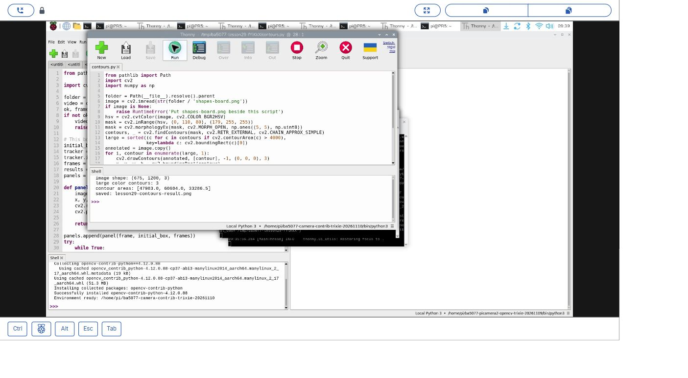
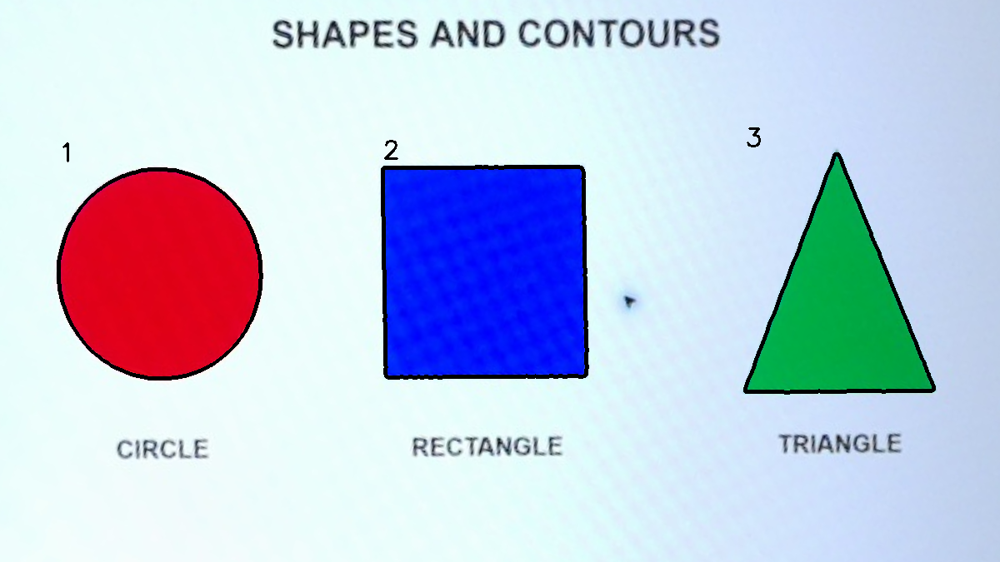

# 23｜找出物體的外框：輪廓偵測

## [原課號：第 29 課｜使用 OpenCV 進行輪廓檢測與繪製](https://github.com/Samuel-ncu/BA5077-RP5-compatibility/blob/main/%E6%95%99%E6%9D%90/%E7%AC%AC%2029%20%E8%AA%B2%EF%BD%9C%E4%BD%BF%E7%94%A8%20OpenCV%20%E9%80%B2%E8%A1%8C%E8%BC%AA%E5%BB%93%E6%AA%A2%E6%B8%AC%E8%88%87%E7%B9%AA%E8%A3%BD.md)

digithouse.net 原文：[第 29 課｜使用 OpenCV 進行輪廓檢測與繪製](https://digithouse.net/blog/ba5077-lesson-25-opencv-contours?locale=zh-TW)

> **本篇狀態**：用可下載的校正素材找輪廓，已在**目前 Trixie** 的 Thonny 實測（2026-11-10，Python 3.13.5、OpenCV 4.12.0），附操作截圖與結果圖。「自己拍照再透視校正」那一段是**舊環境**（Python 3.11、OpenCV 4.11）的紀錄，原始照片因為拍到現場環境沒有公開。**尚未實測**：用 Thonny 從拍照一路做到校正的完整流程、從 GitHub 下載 ZIP 的步驟、全新安裝的系統。

產線上的相機要判斷「這個零件到底從哪裡開始、在哪裡結束」。人一眼就看得出來，電腦卻只看到一堆數字。這時候我們需要**輪廓**：把物體的邊界描成一圈點，電腦就能算出它有多大、在什麼位置、有幾個。這篇我們拿一張有三個彩色圖形的測試圖，讓 OpenCV 自己把三個外框找出來。

## 這篇會學到什麼

- 輪廓是什麼，和「二值遮罩」有什麼關係。
- 用 HSV 把有顏色的地方挑出來，做成黑白遮罩。
- 用 `findContours` 找外框、`drawContours` 畫出來、`contourArea` 算面積。
- 為什麼要用面積門檻過濾掉小雜點。
- 「透視校正」在做什麼，以及它的座標為什麼不能直接照抄。

## 需要的東西

- 一個裝有 OpenCV 和 NumPy 的 Thonny 環境。本次用的是 `/home/pi/ba5077-camera-contrib-trixie-20261110/bin/python3`，建法見[新 15](./15-%E7%9B%B8%E6%A9%9F%E7%95%AB%E9%9D%A2%E8%AE%8A%E6%88%90%E6%95%B8%E5%AD%97%EF%BC%9APicamera2%20%E5%8A%A0%20OpenCV%20%E8%AE%80%E4%B8%80%E5%BC%B5%E5%BD%B1%E6%A0%BC.md)；只做這篇的話，[新 11](./11-%E5%9C%A8%20Thonny%20%E6%BA%96%E5%82%99%20OpenCV%20%E5%B7%A5%E5%85%B7%E7%AE%B1%EF%BC%9A%E8%99%9B%E6%93%AC%E7%92%B0%E5%A2%83%E8%88%87%E5%AE%89%E8%A3%9D.md) 的環境也有 OpenCV 和 NumPy。
- 一個新的練習資料夾，放兩個檔案：
  - 校正後的測試圖 [shapes-board.png](https://github.com/Samuel-ncu/BA5077-RP5-compatibility/blob/main/%E6%95%99%E6%9D%90/%E5%9C%96%E6%AA%94/shapes-board.png)。
  - [本篇程式](https://github.com/Samuel-ncu/BA5077-RP5-compatibility/blob/main/%E6%95%99%E6%9D%90/%E7%AF%84%E4%BE%8B%E7%A8%8B%E5%BC%8F/%E7%AC%AC29%E8%AA%B2-%E5%85%AC%E9%96%8B%E7%B4%A0%E6%9D%90%E8%BC%AA%E5%BB%93.py)。

這張測試圖的來歷：先前用 RP5 相機拍下螢幕上的三個彩色圖形，再把斜拍的畫面裁切、校正成正面的矩形。它是**相機拍攝後處理過的圖**，不是這次重新拍的。

## 先懂幾個名詞

- **輪廓（contour）**：沿著物體邊界排好的一串點。
- **二值遮罩（mask）**：只有黑和白的圖。白色代表「我們要的東西」，黑色代表背景。`findContours` 就是在找白色區域的邊界。
- **HSV**：另一種描述顏色的方式。H 是色相（什麼顏色）、S 是飽和度（多鮮豔）、V 是亮度。用 S 很容易把「有顏色」和「白色背景」分開。
- **形態學開運算（opening）**：先縮小再放大白色區域，可以把零星的小白點清掉。

## 一步一步操作

### 步驟 1：讀程式，看四個關鍵動作

**為什麼**：輪廓偵測不是一個函式就好，而是「挑顏色 → 清雜點 → 找邊界 → 過濾」一串步驟，順序很重要。

```python
from pathlib import Path
import cv2
import numpy as np

folder = Path(__file__).resolve().parent
image = cv2.imread(str(folder / 'shapes-board.png'))
if image is None:
    raise RuntimeError('Put shapes-board.png beside this script')
hsv = cv2.cvtColor(image, cv2.COLOR_BGR2HSV)
mask = cv2.inRange(hsv, (0, 110, 80), (179, 255, 255))
mask = cv2.morphologyEx(mask, cv2.MORPH_OPEN, np.ones((5, 5), np.uint8))
contours, _ = cv2.findContours(mask, cv2.RETR_EXTERNAL, cv2.CHAIN_APPROX_SIMPLE)
large = sorted((c for c in contours if cv2.contourArea(c) > 4000),
               key=lambda c: cv2.boundingRect(c)[0])
annotated = image.copy()
for i, contour in enumerate(large, 1):
    cv2.drawContours(annotated, [contour], -1, (0, 0, 0), 3)
    x, y, w, h = cv2.boundingRect(contour)
    cv2.putText(annotated, str(i), (x, max(30, y - 10)),
                cv2.FONT_HERSHEY_SIMPLEX, 1, (0, 0, 0), 2)
output = folder / 'lesson29-contours-result.png'
if not cv2.imwrite(str(output), annotated):
    raise RuntimeError('Cannot save result')
print('image shape:', image.shape)
print('large color contours:', len(large))
print('contour areas:', [round(cv2.contourArea(c), 1) for c in large])
print('saved:', output.name)
```

| 動作 | 程式 | 為什麼 |
| --- | --- | --- |
| 挑出有顏色的地方 | `inRange(hsv, (0, 110, 80), (179, 255, 255))` | 色相不限（0～179），但飽和度至少 110、亮度至少 80。白色背景飽和度很低，就被排除了。 |
| 清掉小雜點 | `morphologyEx(..., MORPH_OPEN, ...)` | 用 5 × 5 的方塊做開運算，去掉零星的白點。 |
| 找外框 | `findContours(mask, RETR_EXTERNAL, CHAIN_APPROX_SIMPLE)` | `RETR_EXTERNAL` 只取最外層的輪廓；`CHAIN_APPROX_SIMPLE` 把直線上多餘的點省掉。 |
| 只留大的 | `contourArea(c) > 4000` | 面積小於 4000 的多半是雜訊，丟掉；留下的再依 x 座標由左到右排序、編號。 |

程式會在同一個資料夾寫出 `lesson29-contours-result.png`，已有同名檔會被覆寫。

### 步驟 2：在 Thonny 執行

**為什麼**：看到三個外框真的被描出來，才知道每一步都接上了。

1. 在 Thonny 開啟程式，右下角選好含 OpenCV 和 NumPy 的環境，按 **Run**。
2. 到練習資料夾打開 `lesson29-contours-result.png`。

本次 Shell 的輸出：

```text
image shape: (675, 1200, 3)
large color contours: 3
contour areas: [47983.0, 60604.0, 33286.5]
saved: lesson29-contours-result.png
```

三個大輪廓，分別標上 1、2、3。面積是「依邊界算出的幾何面積」，不一定等於白色像素的個數。換素材、版本或門檻，數字都可能不同。

### 步驟 3：這張測試圖是怎麼來的（透視校正）

**為什麼**：實際用相機拍的時候，鏡頭通常是斜的，要先把畫面「拉正」，面積和位置才有意義。

在舊環境的紀錄裡，流程是：

1. 在 Thonny 用 Picamera2 拍一張 1920 × 1080 的照片 `shapes-camera.jpg`（拍照方法見[新 14](./14-%E7%94%A8%20Picamera2%20%E6%8B%8D%E4%B8%80%E5%BC%B5%E7%85%A7%E7%89%87%E4%B8%A6%E5%AD%98%E6%AA%94.md)）。
2. 在照片上量出測試圖四個角的座標，用 `getPerspectiveTransform` 和 `warpPerspective` 把斜拍的四邊形轉成 1200 × 675 的矩形。
3. 再接上步驟 1 的遮罩與輪廓。

當時程式裡寫的四個角是：

```python
source = np.float32([[755, 270], [1385, 65], [1484, 412], [856, 604]])
target = np.float32([[0, 0], [1199, 0], [1199, 674], [0, 674]])
```

**這四組座標只對應那一次的相機位置，不是通用設定。** 你的相機一移動、畫面一改大小，就要在自己的照片上重新量。當時的輸出：

```text
camera image: (1080, 1920, 3)
rectified board: (675, 1200, 3)
large color contours: 3
contour areas: [47983.0, 60604.0, 33286.5]
saved: shapes-board.png, shapes-contours.png
```

結果和步驟 2 完全一樣，因為步驟 2 用的就是這一次校正出來的圖。完整程式在[第29課-相機輪廓.py](https://github.com/Samuel-ncu/BA5077-RP5-compatibility/blob/main/%E6%95%99%E6%9D%90/%E7%AF%84%E4%BE%8B%E7%A8%8B%E5%BC%8F/%E7%AC%AC29%E8%AA%B2-%E7%9B%B8%E6%A9%9F%E8%BC%AA%E5%BB%93.py)。用 Thonny 從拍照做到校正的完整流程，本次尚未在目前 Trixie 重測。

### 步驟 4：和原文比一比

**為什麼**：找輪廓有不只一種前處理方法，知道差別才會挑。

原文讀一張 `coin.jpg`（用 `VideoCapture` 讀圖片），轉灰階、高斯模糊，再用 `Canny` 找邊緣，然後在邊緣圖上找輪廓，最後把原圖和結果左右並排顯示。本篇改用 HSV 顏色遮罩，因為測試圖上的圖形顏色鮮豔、背景是白色，用飽和度分最直接。repo 裡沒有 `coin.jpg`，原文的 Canny 做法本次沒有重跑。

## 成果圖



*操作截圖（目前 Trixie，2026-11-10）：Thonny 讀取 `shapes-board.png`，Shell 印出三個輪廓的面積。*


*程式輸出：黑色線條是程式描出的輪廓，數字依由左到右排序。*



*程式輸出（舊環境）：步驟 3 從相機照片校正後找到的輪廓。原始照片沒有公開。*

## 常見問題

| 你看到的情況 | 可能原因 | 先試試看 |
| --- | --- | --- |
| `Put shapes-board.png beside this script` | 圖片和程式不在同一個資料夾，或檔名不同 | 用檔案管理員確認兩個檔案放在一起。 |
| 找到的輪廓比 3 個多 | 門檻太小，陰影或反光也被當成物體 | 把 `4000` 調大，或把 `inRange` 的飽和度下限調高。 |
| 一個也沒找到 | 顏色範圍不對，遮罩全黑 | 先 `cv2.imwrite` 存下 `mask` 看看，白色區域是不是你要的物體。 |
| 用自己的照片，框的位置全錯 | 照抄了步驟 3 的四個角座標 | 在自己的照片上重新量測四個角。 |

以上是常見情況的整理，本次沒有逐一重現。

## 小結

輪廓偵測的流程是：先做出「物體是白、背景是黑」的遮罩，再用 `findContours` 沿著白色區域描邊，最後用面積門檻過濾雜訊。本次在目前 Trixie 從校正素材找到 3 個輪廓，面積 47983.0、60604.0、33286.5。實際用相機時，還要先做透視校正，而校正座標要依自己的相機位置重新量。

**練習**：

1. 把面積門檻 `4000` 改成 `10000`，先預測還剩幾個輪廓，再執行驗證。
2. 想一想：如果測試圖放大一倍，面積門檻需要怎麼改？為什麼以像素為單位的門檻要跟著畫面大小調整？

這些是延伸練習，本次尚未實測，請以你實際得到的輸出為準。

## 下一篇預告

輪廓是一圈很多點。下一篇[24｜把輪廓簡化成多邊形](./24-%E6%8A%8A%E8%BC%AA%E5%BB%93%E7%B0%A1%E5%8C%96%E6%88%90%E5%A4%9A%E9%82%8A%E5%BD%A2.md)，我們把這一圈點簡化成少數幾個頂點，讓電腦分得出三角形、四邊形和圓形。
