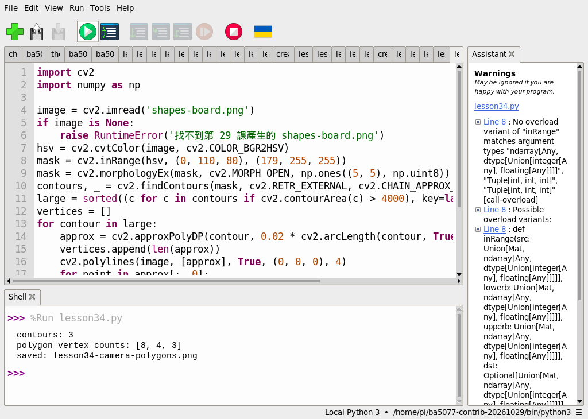
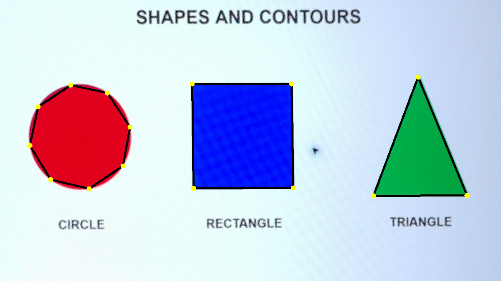
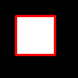

# 24｜把輪廓簡化成多邊形

## [原課號：第 34 課｜使用 OpenCV 檢測與簡化多邊形輪廓](https://github.com/Samuel-ncu/BA5077-RP5-compatibility/blob/main/%E6%95%99%E6%9D%90/%E7%AC%AC%2034%20%E8%AA%B2%EF%BD%9C%E4%BD%BF%E7%94%A8%20OpenCV%20%E6%AA%A2%E6%B8%AC%E8%88%87%E7%B0%A1%E5%8C%96%E5%A4%9A%E9%82%8A%E5%BD%A2%E8%BC%AA%E5%BB%93.md)

digithouse.net 原文：[第 34 課｜使用 OpenCV 檢測與簡化多邊形輪廓](https://digithouse.net/blog/ba5077-lesson-30-opencv-polygon-contours?locale=zh-TW)

> **本篇狀態**：用校正素材做多邊形近似，已在 Thonny 實測，但用的是**舊環境**（Python 3.11、NumPy 1.26.4、opencv-contrib-python 4.11.0.86）；**目前 Trixie 尚未重跑**。合成矩形的入門範例是較早用終端機執行的。**尚未實測**：原文的 `poly.png` 範例、改變誤差參數的練習、全新安裝的系統。

上一篇我們找到了三個輪廓，可是每個輪廓都是一長串點。如果想問電腦「這個是三角形還是四邊形？」，一長串點沒辦法直接回答。我們需要把它**簡化**：只留下幾個關鍵的頂點。三角形剩 3 個、四邊形剩 4 個，形狀就一目了然了。這篇我們用 `approxPolyDP` 把輪廓簡化成多邊形，看看三個圖形各留下幾個頂點。

## 這篇會學到什麼

- 為什麼要把輪廓簡化成多邊形。
- `approxPolyDP` 的「允許誤差」怎麼設：用周長的百分比。
- 從頂點數判斷形狀，以及這個判斷的限制（圓形不是真的八邊形）。

## 需要的東西

- 一個裝有 OpenCV 和 NumPy 的 Thonny 環境（[新 11](./11-%E5%9C%A8%20Thonny%20%E6%BA%96%E5%82%99%20OpenCV%20%E5%B7%A5%E5%85%B7%E7%AE%B1%EF%BC%9A%E8%99%9B%E6%93%AC%E7%92%B0%E5%A2%83%E8%88%87%E5%AE%89%E8%A3%9D.md)）。
- 一個新的練習資料夾，放兩個檔案：
  - [新 23](./23-%E6%89%BE%E5%87%BA%E7%89%A9%E9%AB%94%E7%9A%84%E5%A4%96%E6%A1%86%EF%BC%9A%E8%BC%AA%E5%BB%93%E5%81%B5%E6%B8%AC.md) 用過的校正測試圖 [shapes-board.png](https://github.com/Samuel-ncu/BA5077-RP5-compatibility/blob/main/%E6%95%99%E6%9D%90/%E5%9C%96%E6%AA%94/shapes-board.png)，檔名不要改。
  - [本篇程式](https://github.com/Samuel-ncu/BA5077-RP5-compatibility/blob/main/%E6%95%99%E6%9D%90/%E7%AF%84%E4%BE%8B%E7%A8%8B%E5%BC%8F/%E7%AC%AC34%E8%AA%B2-%E7%9B%B8%E6%A9%9F%E5%A4%9A%E9%82%8A%E5%BD%A2.py)。

測試圖是 RP5 相機拍下螢幕上的圓形、矩形、三角形，再裁切校正後的圖。

## 先懂幾個名詞

- **多邊形近似**：用較少的點，畫出和原本輪廓「差不多」的形狀。
- **允許誤差（epsilon）**：簡化後的線，最多可以偏離原本輪廓多少像素。誤差越大，留下的點越少。
- **周長（arcLength）**：輪廓一圈的長度。用它的百分比當誤差，大圖形和小圖形就能用同一個標準。

## 一步一步操作

### 步驟 1：先用一個方塊試試看

**為什麼**：先用一個答案很明確的例子（方塊應該剩 4 個點），確認自己懂這個函式。

```python
import cv2
import numpy as np
image = np.zeros((100, 100), dtype=np.uint8)
cv2.rectangle(image, (20, 20), (70, 70), 255, -1)
contours, _ = cv2.findContours(image, cv2.RETR_EXTERNAL, cv2.CHAIN_APPROX_SIMPLE)
approx = cv2.approxPolyDP(contours[0], 0.02 * cv2.arcLength(contours[0], True), True)
result = cv2.cvtColor(image, cv2.COLOR_GRAY2BGR)
cv2.polylines(result, [approx], True, (0, 0, 255), 2)
if not cv2.imwrite('lesson34-polygon.png', result):
    raise RuntimeError('image save failed')
print('polygon vertices', len(approx))
```

較早用終端機執行的輸出：

```text
polygon vertices 4
```

`0.02 * cv2.arcLength(...)` 就是「允許誤差 = 周長的 2%」。最後一個 `True` 表示這是封閉的形狀。這個入門例本次尚未在 Thonny 重跑。

### 步驟 2：分析相機拍的三個圖形

**為什麼**：真實照片的邊界不會那麼整齊，看看近似在實際影像上的表現。

```python
import cv2
import numpy as np

image = cv2.imread('shapes-board.png')
if image is None:
    raise RuntimeError('找不到第 29 課產生的 shapes-board.png')
hsv = cv2.cvtColor(image, cv2.COLOR_BGR2HSV)
mask = cv2.inRange(hsv, (0, 110, 80), (179, 255, 255))
mask = cv2.morphologyEx(mask, cv2.MORPH_OPEN, np.ones((5, 5), np.uint8))
contours, _ = cv2.findContours(mask, cv2.RETR_EXTERNAL, cv2.CHAIN_APPROX_SIMPLE)
large = sorted((c for c in contours if cv2.contourArea(c) > 4000), key=lambda c: cv2.boundingRect(c)[0])
vertices = []
for contour in large:
    approx = cv2.approxPolyDP(contour, 0.02 * cv2.arcLength(contour, True), True)
    vertices.append(len(approx))
    cv2.polylines(image, [approx], True, (0, 0, 0), 4)
    for point in approx[:, 0]:
        cv2.circle(image, tuple(int(x) for x in point), 6, (0, 255, 255), -1)
if not cv2.imwrite('lesson34-camera-polygons.png', image):
    raise RuntimeError('無法儲存結果')
print('contours:', len(large))
print('polygon vertex counts:', vertices)
print('saved: lesson34-camera-polygons.png')
```

前半段和新 23 一樣（顏色遮罩 → 清雜點 → 找輪廓 → 過濾），差別在 `for` 迴圈裡：每個輪廓都做一次 `approxPolyDP`，把簡化後的多邊形畫成黑線，每個頂點畫一個黃色圓點。

這支程式只寫了檔名，所以請在 Thonny 用 **File → Open** 開啟練習資料夾裡的程式，再按 **Run**。輸出 `lesson34-camera-polygons.png` 會覆寫同名檔。

舊環境的 Thonny 輸出：

```text
contours: 3
polygon vertex counts: [8, 4, 3]
saved: lesson34-camera-polygons.png
```

### 步驟 3：讀懂 `[8, 4, 3]`

**為什麼**：頂點數不等於「真正的形狀」，要知道它代表什麼、不代表什麼。

由左到右：圓形 8 點、矩形 4 點、三角形 3 點。矩形和三角形符合預期。圓形得到 8 點，**不是因為它是八邊形**，而是在「誤差 2%」這個設定下，用 8 個點就能貼近一個圓。把誤差調小，點會變多；調大，點會變少。

所以「4 個頂點」只能說明「在這個誤差下可以用 4 個點描述」，不能保證物體是完美的矩形。

### 步驟 4：和原文比一比

**為什麼**：誤差的設法有兩種，各有優缺點。

原文讀一張 `poly.png`，用 Canny 找邊緣、膨脹後找輪廓，並把誤差**直接設成 30 像素**，印出矩形與六邊形簡化前後的點數。本篇改用「周長的 2%」，好處是圖形大小改變時不必重新調數字。repo 裡沒有 `poly.png`，原文範例本次沒有重跑。

## 成果圖



*操作截圖（舊環境）：Thonny 執行步驟 2 的程式。截圖中的 `lesson34.py` 是本課程式的測試副本，內容相同。右下角是舊環境 `ba5077-contrib-20261029`；右側 Assistant 面板的 Warnings 是 Thonny 的型別檢查提示，程式實際正常執行完畢。*



*程式輸出：黑線是簡化後的多邊形，黃點是頂點。由左到右是 8、4、3 個頂點。原始照片的周圍環境沒有公開。*



*程式輸出：步驟 1 的合成方塊與近似出的 4 點多邊形。*

## 常見問題

| 你看到的情況 | 可能原因 | 先試試看 |
| --- | --- | --- |
| `找不到第 29 課產生的 shapes-board.png` | 圖片不在程式旁邊，或 Thonny 的工作資料夾不同 | 用 **File → Open** 從練習資料夾開程式再執行。 |
| 每個圖形的頂點都很多 | 誤差太小 | 把 `0.02` 改大一點，例如 `0.04`。 |
| 三角形只剩 2 點或形狀走樣 | 誤差太大 | 把 `0.02` 改小一點。 |
| 用自己的照片找不到圖形 | 顏色範圍或面積門檻不適合 | 回到新 23 調整遮罩和門檻。 |

以上是常見情況的整理，本次沒有逐一重現。

## 小結

`approxPolyDP` 用「允許誤差」把輪廓簡化成幾個頂點；用周長的百分比當誤差，大小不同的圖形可以共用同一個設定。在舊環境的實測中，圓形、矩形、三角形分別得到 8、4、3 個頂點。頂點數可以幫忙分辨形狀，但它是「在這個誤差下的近似」，不是物體真正的幾何形狀。

**練習**：把 `0.02` 分別改成 `0.01` 和 `0.05`。執行前先預測三個圖形的頂點數，執行後記錄實際結果並解釋差異。這是延伸練習，本次尚未實測，請以你實際得到的輸出為準。

## 下一篇預告

多邊形描述的是「外框長什麼樣子」。下一篇[25｜凸包與凹缺點](./25-%E5%87%B8%E5%8C%85%E8%88%87%E5%87%B9%E7%BC%BA%E9%BB%9E.md)，我們用一條橡皮筋套住整個輪廓，找出輪廓往內凹進去的地方。
