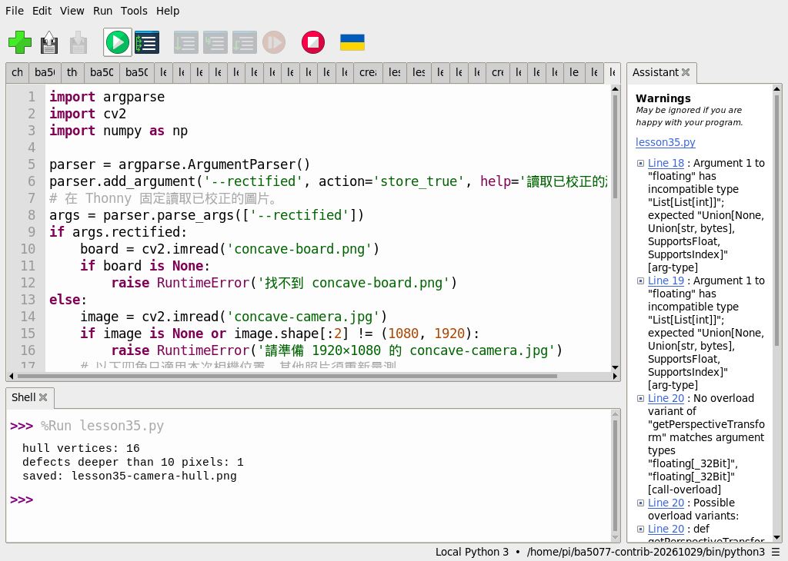
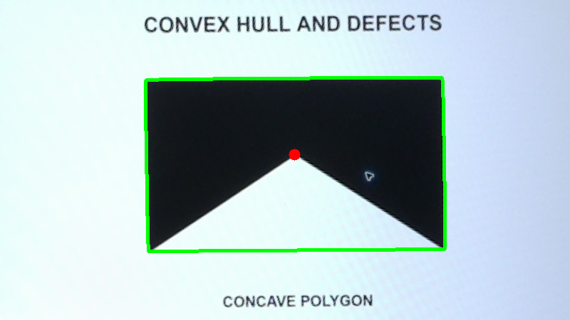
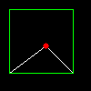

# 25｜凸包與凹缺點

## [原課號：第 35 課｜使用 OpenCV 檢測凸包與凹缺點](https://github.com/Samuel-ncu/BA5077-RP5-compatibility/blob/main/%E6%95%99%E6%9D%90/%E7%AC%AC%2035%20%E8%AA%B2%EF%BD%9C%E4%BD%BF%E7%94%A8%20OpenCV%20%E6%AA%A2%E6%B8%AC%E5%87%B8%E5%8C%85%E8%88%87%E5%87%B9%E7%BC%BA%E9%BB%9E.md)

digithouse.net 原文：[第 35 課｜使用 OpenCV 檢測凸包與凹缺點](https://digithouse.net/blog/ba5077-lesson-31-opencv-convex-hull?locale=zh-TW)

> **本篇狀態**：用校正素材找凸包與凹缺點，已在 Thonny 實測，但用的是**舊環境**（Python 3.11、NumPy 1.26.4、opencv-contrib-python 4.11.0.86）；**目前 Trixie 尚未重跑**。合成凹多邊形的入門範例，以及「自己拍照再校正」的模式，都是較早用終端機執行的。**尚未實測**：原文的 `star.png` 範例、改變深度門檻的練習、全新安裝的系統。

拿一條橡皮筋套住一個星星形狀的紙板，橡皮筋會繃在每個尖角上，而星星凹進去的地方，橡皮筋跟紙板之間就會空出一塊。那條橡皮筋圍出來的形狀，叫做**凸包**；空出來那幾塊最深的點，叫做**凹缺點**。手勢辨識常用這個想法：張開的手指之間就是凹缺點。這篇我們先用一個簡單的凹形練習，再分析相機拍下的測試圖。

## 這篇會學到什麼

- 凸包是什麼：用橡皮筋套住輪廓的形狀。
- 凹缺點是什麼：輪廓相對凸包往內凹最深的位置。
- 用 `convexHull` 和 `convexityDefects` 算出來，並把深度換成像素。
- 為什麼凸包的點數不等於「物體有幾個角」。

## 需要的東西

- 一個裝有 OpenCV 和 NumPy 的 Thonny 環境（[新 11](./11-%E5%9C%A8%20Thonny%20%E6%BA%96%E5%82%99%20OpenCV%20%E5%B7%A5%E5%85%B7%E7%AE%B1%EF%BC%9A%E8%99%9B%E6%93%AC%E7%92%B0%E5%A2%83%E8%88%87%E5%AE%89%E8%A3%9D.md)）。
- 一個新的練習資料夾，放兩個檔案：
  - 校正後的凹形測試圖 [concave-board.png](https://github.com/Samuel-ncu/BA5077-RP5-compatibility/blob/main/%E6%95%99%E6%9D%90/%E5%9C%96%E6%AA%94/concave-board.png)，檔名不要改。
  - [Thonny 版程式](https://github.com/Samuel-ncu/BA5077-RP5-compatibility/blob/main/%E6%95%99%E6%9D%90/%E7%AF%84%E4%BE%8B%E7%A8%8B%E5%BC%8F/%E7%AC%AC35%E8%AA%B2-Thonny%E6%A0%A1%E6%AD%A3%E5%9C%96%E5%87%B8%E5%8C%85.py)。

測試圖是 RP5 相機拍下螢幕上的凹形圖案，再裁切校正後的圖。

## 先懂幾個名詞

- **凸形**：任兩點連成的線都在形狀裡面，沒有凹進去的地方，例如圓、矩形。
- **凸包（convex hull）**：能包住整個輪廓的最小凸形。
- **凹缺點（convexity defect）**：輪廓和凸包之間的一塊空隙。OpenCV 會給你這塊空隙的起點、終點、最深的點，以及深度。
- **深度**：最深點離凸包邊有多遠。

## 一步一步操作

### 步驟 1：先用五個點的凹形試試看

**為什麼**：先用一個看得出答案的形狀（只有一個凹口），確認自己懂這兩個函式。

```python
import cv2
import numpy as np
points = np.array([[10, 10], [80, 10], [80, 80], [50, 50], [10, 80]], dtype=np.int32).reshape(-1, 1, 2)
hull = cv2.convexHull(points, returnPoints=False)
defects = cv2.convexityDefects(points, hull)
image = np.zeros((100, 100, 3), dtype=np.uint8)
cv2.polylines(image, [points], True, (255, 255, 255), 1)
cv2.polylines(image, [cv2.convexHull(points)], True, (0, 255, 0), 1)
if defects is not None:
    for defect in defects:
        far = tuple(int(v) for v in points[defect[0][2], 0])
        cv2.circle(image, far, 3, (0, 0, 255), -1)
if not cv2.imwrite('lesson35-hull.png', image):
    raise RuntimeError('image save failed')
print('hull indices', len(hull))
print('defect count', 0 if defects is None else len(defects))
```

這五個點圍出一個方塊，但底邊從 `[80, 80]` 往內折到 `[50, 50]` 再回到 `[10, 80]`，凹成一個 V 形。較早用終端機執行的輸出：

```text
hull indices 4
defect count 1
```

凸包用 4 個點就能包住（凹進去的那點不在凸包上），凹缺點有 1 個，正好是那個凹口。注意 `convexityDefects` 需要的是凸包的**索引**，所以算凸包時要加 `returnPoints=False`。這個入門例本次尚未在 Thonny 重跑。

### 步驟 2：分析相機拍的凹形

**為什麼**：真實影像的輪廓有很多細小的點，要學會用深度門檻挑出「真正的」凹口。

Thonny 版程式固定讀取 `concave-board.png`。核心部分是：

```python
gray = cv2.cvtColor(board, cv2.COLOR_BGR2GRAY)
_, mask = cv2.threshold(gray, 90, 255, cv2.THRESH_BINARY_INV)
contours, _ = cv2.findContours(mask, cv2.RETR_EXTERNAL, cv2.CHAIN_APPROX_SIMPLE)
if not contours:
    raise RuntimeError('找不到輪廓，請檢查相機畫面、座標及閾值')
contour = max(contours, key=cv2.contourArea)
hull = cv2.convexHull(contour, returnPoints=False)
defects = cv2.convexityDefects(contour, hull)
deep = [] if defects is None else [d for d in defects if d[0][3] / 256.0 > 10]
cv2.drawContours(board, [cv2.convexHull(contour)], -1, (0, 255, 0), 3)
for defect in deep:
    far_index = defect[0][2]
    x, y = (int(v) for v in contour[far_index, 0])
    cv2.circle(board, (x, y), 8, (0, 0, 255), -1)
```

- `threshold(..., 90, 255, THRESH_BINARY_INV)`：灰階小於 90 的深色圖形變白，背景變黑。
- `max(contours, key=cv2.contourArea)`：只取最大的那個輪廓。
- `d[0][3] / 256.0 > 10`：OpenCV 回傳的深度是「乘以 256 的整數」，要除以 256 才是像素。只留下深度超過 10 像素的凹口。
- 綠線畫凸包，紅點畫凹缺點的最深處。

完整程式還保留了「從相機照片自己校正」的模式，但在 Thonny 版裡固定讀已校正的圖，不必輸入參數。用 **File → Open** 開啟程式再按 **Run**，輸出 `lesson35-camera-hull.png` 會覆寫同名檔。

舊環境的 Thonny 輸出：

```text
hull vertices: 16
defects deeper than 10 pixels: 1
saved: lesson35-camera-hull.png
```

### 步驟 3：讀懂 16 和 1

**為什麼**：凸包的點數很容易被誤解。

凸包有 16 個點，**不代表**這個圖形有 16 個角。相機拍攝、二值化、縮放，都會讓輪廓的邊界變得有點鋸齒，凸包就會多出很多點。真正有意義的是凹缺點：深度超過 10 像素的只有 1 個，就是測試圖上那個凹口。

### 步驟 4：和原文比一比

**為什麼**：原文多做了一步簡化，可以和新 24 連起來看。

原文讀一張 `star.png`，用 Canny 找邊緣、膨脹後找輪廓，先用 `approxPolyDP`（誤差 30 像素）把輪廓簡化，再算凸包和凹缺點，最後把每個凹口的起點到終點畫成綠線、最深點畫成紅點。先簡化再算凸包，點數會少很多。repo 裡沒有 `star.png`，原文範例本次沒有重跑。

## 成果圖



*操作截圖（舊環境）：Thonny 執行步驟 2 的程式。截圖中的 `lesson35.py` 是本課程式的測試副本。右下角是舊環境 `ba5077-contrib-20261029`；右側 Assistant 面板的 Warnings 是 Thonny 的型別檢查提示，程式實際正常執行完畢。*



*程式輸出：綠線是凸包，紅點是深度大於 10 像素的凹缺點。原始照片的周圍環境沒有公開。*



*程式輸出：步驟 1 的合成凹形。白色是輪廓、綠色是凸包、紅色是凹缺點。*

## 常見問題

| 你看到的情況 | 可能原因 | 先試試看 |
| --- | --- | --- |
| `convexityDefects` 出錯 | 算凸包時沒加 `returnPoints=False` | 傳給 `convexityDefects` 的要是索引。 |
| 紅點非常多 | 深度門檻太小，把邊緣的小鋸齒也算進去 | 把 `10` 調大。 |
| `找不到輪廓` | 二值化門檻不適合你的圖 | 調整 `threshold` 的 `90`，或先存下 `mask` 看看。 |
| 深度數字大得很奇怪 | 忘了除以 256 | 深度要 `/ 256.0` 才是像素。 |

以上是常見情況的整理，本次沒有逐一重現。

## 小結

凸包是套住輪廓的「橡皮筋」，凹缺點是輪廓往內凹最深的地方。`convexHull(..., returnPoints=False)` 給索引，`convexityDefects` 用這些索引算出每個凹口和深度，深度要除以 256 換成像素。舊環境實測找到凸包 16 點、深度超過 10 像素的凹缺點 1 個；凸包點數會受拍攝與二值化影響，凹缺點配上深度門檻才是比較可靠的特徵。

**練習**：把深度門檻 `10` 改成 `3` 和 `30`，先預測紅點數量，再執行比較。這是延伸練習，本次尚未實測，請以你實際得到的輸出為準。

## 下一篇預告

到這裡我們都是先找輪廓、再分析形狀。下一篇[26｜找圓形：霍夫圓偵測](./26-%E6%89%BE%E5%9C%93%E5%BD%A2%EF%BC%9A%E9%9C%8D%E5%A4%AB%E5%9C%93%E5%81%B5%E6%B8%AC.md)換一種方法：不找輪廓，直接讓電腦在畫面裡「投票」找出圓。
