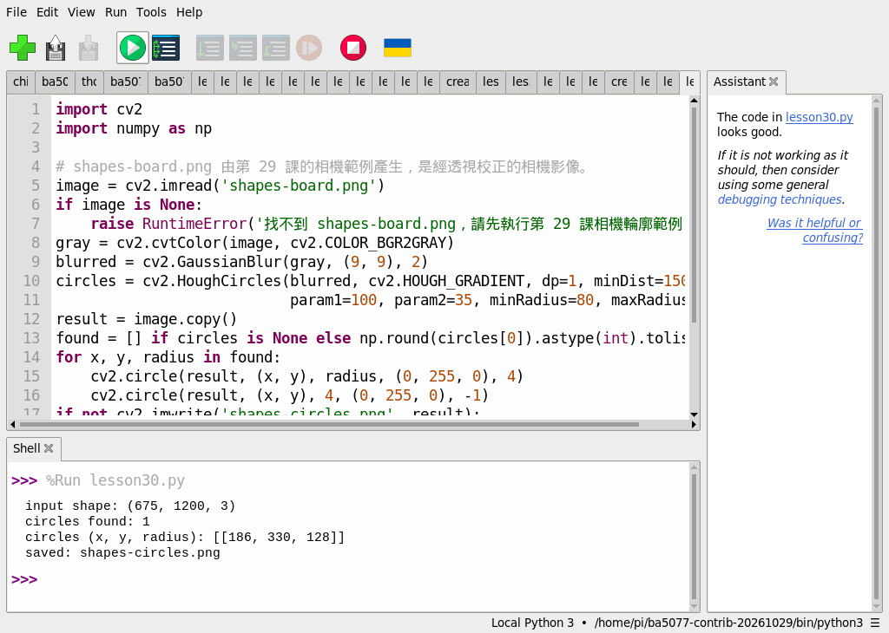
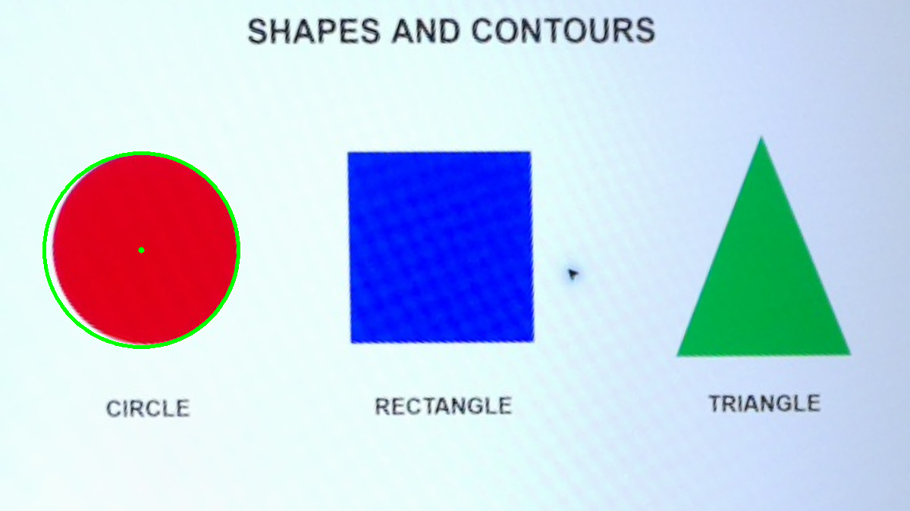

# 26｜找圓形：霍夫圓偵測

## [原課號：第 30 課｜使用 OpenCV 進行圓形檢測與繪製](https://github.com/Samuel-ncu/BA5077-RP5-compatibility/blob/main/%E6%95%99%E6%9D%90/%E7%AC%AC%2030%20%E8%AA%B2%EF%BD%9C%E4%BD%BF%E7%94%A8%20OpenCV%20%E9%80%B2%E8%A1%8C%E5%9C%93%E5%BD%A2%E6%AA%A2%E6%B8%AC%E8%88%87%E7%B9%AA%E8%A3%BD.md)

digithouse.net 原文：[第 30 課｜使用 OpenCV 進行圓形檢測與繪製](https://digithouse.net/blog/ba5077-lesson-26-opencv-circle-detection?locale=zh-TW)

> **本篇狀態**：用校正素材找圓，已在 Thonny 實測，但用的是**舊環境**（Python 3.11、NumPy 1.26.4、opencv-contrib-python 4.11.0.86）；**目前 Trixie 尚未重跑**。**尚未實測**：原文的 `cup.jpg` 範例、改半徑範圍的練習、其他照片與即時相機、全新安裝的系統。

瓶蓋、按鈕、硬幣，從正上方看都是圓的。如果相機能告訴我們「這裡有一個圓，圓心在哪、半徑多大」，就能拿來數數量、找位置。前幾篇我們都是先找輪廓再分析形狀；這篇換一個專門找圓的方法：**霍夫圓偵測**。它不需要先描出輪廓，而是讓畫面上的邊緣點一起「投票」，票數夠多的地方就是圓。

## 這篇會學到什麼

- 一個圓只要三個數字就能描述：圓心 `(x, y)` 和半徑 `r`。
- `HoughCircles` 的參數各自管什麼。
- 為什麼找圓之前要先模糊。
- 參數設錯時會「漏抓」或「亂抓」，以及怎麼調。

## 需要的東西

- 一個裝有 OpenCV 和 NumPy 的 Thonny 環境（[新 11](./11-%E5%9C%A8%20Thonny%20%E6%BA%96%E5%82%99%20OpenCV%20%E5%B7%A5%E5%85%B7%E7%AE%B1%EF%BC%9A%E8%99%9B%E6%93%AC%E7%92%B0%E5%A2%83%E8%88%87%E5%AE%89%E8%A3%9D.md)）。
- 一個新的練習資料夾，放兩個檔案：
  - [新 23](./23-%E6%89%BE%E5%87%BA%E7%89%A9%E9%AB%94%E7%9A%84%E5%A4%96%E6%A1%86%EF%BC%9A%E8%BC%AA%E5%BB%93%E5%81%B5%E6%B8%AC.md) 用過的校正測試圖 [shapes-board.png](https://github.com/Samuel-ncu/BA5077-RP5-compatibility/blob/main/%E6%95%99%E6%9D%90/%E5%9C%96%E6%AA%94/shapes-board.png)。
  - [本篇程式](https://github.com/Samuel-ncu/BA5077-RP5-compatibility/blob/main/%E6%95%99%E6%9D%90/%E7%AF%84%E4%BE%8B%E7%A8%8B%E5%BC%8F/%E7%AC%AC30%E8%AA%B2-%E7%9B%B8%E6%A9%9F%E5%9C%93%E5%BD%A2.py)。

測試圖上有一個圓形、一個矩形、一個三角形，是 RP5 相機拍下螢幕後校正的圖。

## 先懂幾個名詞

- **霍夫轉換（Hough transform）**：讓每個邊緣點替「可能經過它的圓」投票，票數最多的圓就是答案。
- **累加器**：記錄投票結果的表格。
- **高斯模糊（GaussianBlur）**：把影像稍微糊開，減少雜訊，避免小雜點也來投票。

## 一步一步操作

### 步驟 1：讀程式，看懂每個參數

**為什麼**：`HoughCircles` 的參數很多，結果好不好幾乎都取決於這些數字。

```python
import cv2
import numpy as np

# shapes-board.png 由第 29 課的相機範例產生，是經透視校正的相機影像。
image = cv2.imread('shapes-board.png')
if image is None:
    raise RuntimeError('找不到 shapes-board.png，請先執行第 29 課相機輪廓範例')
gray = cv2.cvtColor(image, cv2.COLOR_BGR2GRAY)
blurred = cv2.GaussianBlur(gray, (9, 9), 2)
circles = cv2.HoughCircles(blurred, cv2.HOUGH_GRADIENT, dp=1, minDist=150,
                           param1=100, param2=35, minRadius=80, maxRadius=160)
result = image.copy()
found = [] if circles is None else np.round(circles[0]).astype(int).tolist()
for x, y, radius in found:
    cv2.circle(result, (x, y), radius, (0, 255, 0), 4)
    cv2.circle(result, (x, y), 4, (0, 255, 0), -1)
if not cv2.imwrite('shapes-circles.png', result):
    raise RuntimeError('無法儲存影像')
print('input shape:', image.shape)
print('circles found:', len(found))
print('circles (x, y, radius):', found)
print('saved: shapes-circles.png')
```

| 參數 | 本篇的值 | 它管什麼 |
| --- | --- | --- |
| `dp` | 1 | 投票表格的解析度；1 表示和原圖一樣細。 |
| `minDist` | 150 | 兩個圓心至少要隔多遠，避免同一個圓被抓好幾次。 |
| `param1` | 100 | 找邊緣時的門檻（內部用的 Canny 高門檻）。 |
| `param2` | 35 | 投票門檻：越小越容易抓到圓，也越容易抓錯。 |
| `minRadius`、`maxRadius` | 80、160 | 只找這個半徑範圍內的圓。 |

注意 `found = [] if circles is None else ...` 這一行：一個圓都沒找到時，`HoughCircles` 會回傳 `None`，要先檢查，不然下一行就會出錯。

### 步驟 2：在 Thonny 執行

**為什麼**：看看三個圖形裡，電腦是不是只挑出那個圓。

用 **File → Open** 開啟練習資料夾裡的程式，選好環境後按 **Run**。輸出 `shapes-circles.png` 會覆寫同名檔。

舊環境的 Thonny 輸出：

```text
input shape: (675, 1200, 3)
circles found: 1
circles (x, y, radius): [[186, 330, 128]]
saved: shapes-circles.png
```

找到 1 個圓，圓心約在 (186, 330)、半徑約 128 像素，就是測試圖最左邊那個圓形。矩形和三角形沒有被誤認成圓。這些座標是在校正後的 1200 × 675 圖上，不是原始相機照片的座標。

### 步驟 3：想一想參數設錯會怎樣

**為什麼**：換一張圖時，你一定會需要自己調參數。

- 半徑範圍設成 80～100：這個半徑 128 的圓就不在範圍內，預期會**漏抓**。
- `param2` 調很小：投票門檻變低，矩形的角或雜訊也可能被當成圓，預期會**亂抓**。
- 斜著拍：圓會變成橢圓，可能抓不到或抓到大小不對的圓。

這些是依參數意義推得的預期，本次沒有逐一實測。

### 步驟 4：和原文比一比

**為什麼**：原文的參數和本篇差很多，正好說明參數要依畫面調整。

原文讀一張 `cup.jpg`，先縮成 403 × 302，`minDist` 20、Canny 高門檻 10、投票門檻 75、半徑 3～75，並把原圖和結果左右並排顯示。圖比較小、杯子也比較小，所以半徑範圍跟著變小。另外原文直接對結果做 `circles.astype(int)`，如果一個圓都沒找到（回傳 `None`）會出錯；本篇先檢查 `None`。repo 裡沒有 `cup.jpg`，原文範例本次沒有重跑。

## 成果圖



*操作截圖（舊環境）：Thonny 執行本篇程式。截圖中的 `lesson30.py` 是本課程式的測試副本，內容相同。*



*程式輸出：綠色圓與圓心是程式找到的圓。底圖是 RP5 相機拍攝螢幕後校正的圖。*

## 常見問題

| 你看到的情況 | 可能原因 | 先試試看 |
| --- | --- | --- |
| `circles found: 0` | 半徑範圍不對，或投票門檻太高 | 先放寬 `minRadius`、`maxRadius`，再把 `param2` 調小一點。 |
| 抓到很多不是圓的東西 | `param2` 太小，或雜訊太多 | 把 `param2` 調大、模糊加強一點。 |
| 同一個圓被抓好幾次 | `minDist` 太小 | 把 `minDist` 調大。 |
| `'NoneType' object has no attribute ...` | 沒找到圓卻直接處理結果 | 先檢查 `circles is None`。 |

以上是常見情況的整理，本次沒有逐一重現。

## 小結

`HoughCircles` 讓邊緣點投票找圓，回傳每個圓的圓心和半徑；先模糊可以減少雜訊。舊環境實測在校正圖上找到 1 個圓：(186, 330)，半徑 128。參數要依畫面大小與物體大小調整，沒找到圓時記得處理 `None`。

**練習**：把 `maxRadius` 改成 `100`，先預測會不會漏抓，再執行驗證；接著把 `param2` 改成 `15`，看看有沒有多抓到不是圓的東西。這是延伸練習，本次尚未實測，請以你實際得到的輸出為準。

## 下一篇預告

形狀分析告一段落。下一篇[27｜跟著顏色走：HSV 紅色偵測與框選](./27-%E8%B7%9F%E8%91%97%E9%A1%8F%E8%89%B2%E8%B5%B0%EF%BC%9AHSV%20%E7%B4%85%E8%89%B2%E5%81%B5%E6%B8%AC%E8%88%87%E6%A1%86%E9%81%B8.md)回到相機：用顏色把紅色物體挑出來，再用輪廓把它框住，讓框跟著物體移動。
