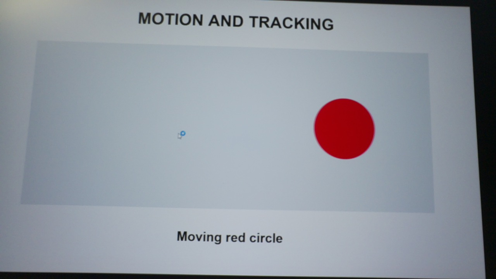
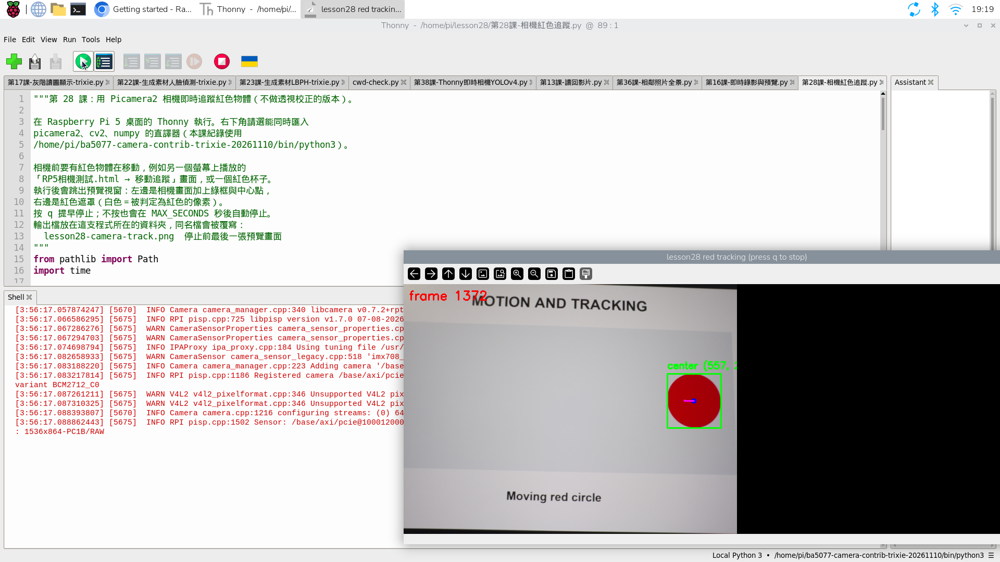
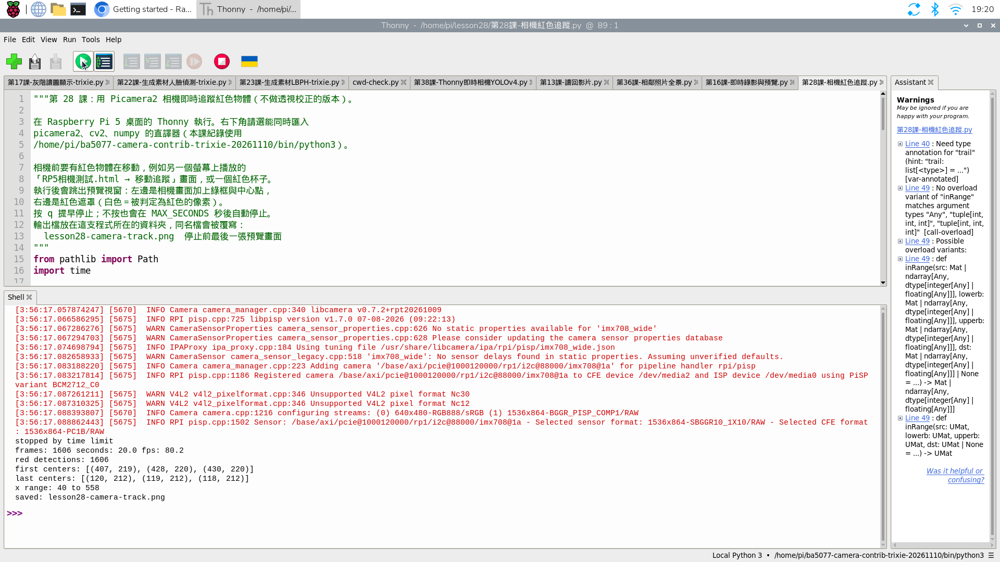
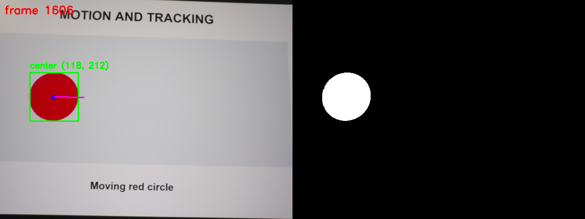

# 27｜跟著顏色走：HSV 紅色偵測與框選

## [原課號：第 28 課｜使用 Picamera2 和 OpenCV 實現顏色檢測與物體追蹤](https://github.com/Samuel-ncu/BA5077-RP5-compatibility/blob/main/%E6%95%99%E6%9D%90/%E7%AC%AC%2028%20%E8%AA%B2%EF%BD%9C%E4%BD%BF%E7%94%A8%20Picamera2%20%E5%92%8C%20OpenCV%20%E5%AF%A6%E7%8F%BE%E9%A1%8F%E8%89%B2%E6%AA%A2%E6%B8%AC%E8%88%87%E7%89%A9%E9%AB%94%E8%BF%BD%E8%B9%A4.md)

digithouse.net 原文：[第 28 課｜使用 Picamera2 和 OpenCV 實現顏色檢測與物體追蹤](https://digithouse.net/blog/ba5077-lesson-24-color-tracking?locale=zh-TW)

> **本篇狀態**：在**目前 Trixie** 的 Thonny 按 Run 實測（2026-11-11，Python 3.13.5、OpenCV 4.12.0）：相機拍螢幕上移動的紅色圓形，20.0 秒 1606 張影格、1606 次偵測，中心 x 從 40 移到 558。相機拍的是**生成動畫**，不是實物。**尚未實測**：按 `q` 停止（寫法與新 17 相同，新 17 已實測）、實體紅色物品、多個同色目標、長時間執行、全新安裝的系統。

輸送帶上只有紅色的零件是我們要的。電腦能不能「看顏色」就把它挑出來，還能一路跟著它？這篇我們讓相機連續拍攝，每一張畫面都把紅色挑出來、框起來、算出中心，畫面上就會出現一個跟著紅色物體跑的綠框，後面還拖著一小段軌跡。

## 這篇會學到什麼

- 為什麼找顏色要先把 BGR 轉成 **HSV**。
- 紅色為什麼要用**兩段**範圍再合併。
- 把「顏色遮罩 → 輪廓 → 外接矩形 → 中心」接成一個即時迴圈。
- 「偵測」和「追蹤」差在哪裡。
- 看懂影格數、偵測次數、中心座標，判斷追蹤有沒有成功。

## 需要的東西

- 能拍照的相機（[新 13](./13-%E6%8E%A5%E4%B8%8A%E7%9B%B8%E6%A9%9F%E6%A8%A1%E7%B5%84%E4%B8%A6%E7%A2%BA%E8%AA%8D%E5%AE%83%E6%B4%BB%E8%91%97%EF%BC%9Arpicam-hello.md)、[新 15](./15-%E7%9B%B8%E6%A9%9F%E7%95%AB%E9%9D%A2%E8%AE%8A%E6%88%90%E6%95%B8%E5%AD%97%EF%BC%9APicamera2%20%E5%8A%A0%20OpenCV%20%E8%AE%80%E4%B8%80%E5%BC%B5%E5%BD%B1%E6%A0%BC.md)），以及同時能用 Picamera2 和 OpenCV 的環境（建法見新 15）。本次使用 `/home/pi/ba5077-camera-contrib-trixie-20261110/bin/python3`。
- 一個會動的紅色目標。本次在另一台電腦的螢幕上開啟[相機測試畫面](https://github.com/Samuel-ncu/BA5077-RP5-compatibility/blob/main/%E6%95%99%E6%9D%90/%E7%B7%B4%E7%BF%92%E7%B4%A0%E6%9D%90/RP5%E7%9B%B8%E6%A9%9F%E6%B8%AC%E8%A9%A6.html)，「畫面」選**移動追蹤**、按**全螢幕**、大小約 80%，會有一個左右來回移動的紅色圓形。也可以用桌上的紅色杯子，用手慢慢移動。
- [本篇主程式](https://github.com/Samuel-ncu/BA5077-RP5-compatibility/blob/main/%E6%95%99%E6%9D%90/%E7%AF%84%E4%BE%8B%E7%A8%8B%E5%BC%8F/%E7%AC%AC28%E8%AA%B2-%E7%9B%B8%E6%A9%9F%E7%B4%85%E8%89%B2%E8%BF%BD%E8%B9%A4.py)，存到 `~/lesson28/`。

**相機畫面裡不要有其他紅色的東西，也不要拍到帳號、訊息或別人的臉。**

## 先懂幾個名詞

- **HSV**：用「色相 H（哪一種顏色）、飽和度 S（多鮮豔）、亮度 V（多亮）」描述顏色。OpenCV 裡 H 是 0～179，S、V 是 0～255。光線變暗時 BGR 三個數字都會變，H 卻大致不變，所以用 H 挑顏色比較穩。
- **紅色的兩段範圍**：色相是一個環，紅色剛好在 0 和 179 的接縫兩側，所以要挑 0～10 和 170～179 兩段再合併。
- **遮罩**：黑白圖，落在顏色範圍內的像素變白、其他變黑。
- **外接矩形**：剛好包住一塊輪廓的矩形 `(x, y, w, h)`，中心就是 `(x + w/2, y + h/2)`。
- **偵測 vs. 追蹤**：只看一張畫面找位置叫偵測；在連續畫面中記錄同一個目標的位置變化才叫追蹤。本篇用最簡單的方式：每張都找最大的紅色區塊，把最近的中心連成軌跡。

## 一步一步操作

### 步驟 1：先確認相機看得到紅圓

**為什麼**：追蹤失敗時，要先排除「相機根本沒拍到目標」。

在 RP5 終端機拍一張照片，用檔案管理員打開看看：

```bash
rpicam-still -n -t 500 --width 1280 --height 720 -o check.jpg
```

只要紅圓完整出現在畫面中就可以往下做。畫面略為傾斜沒關係，這篇不做透視校正。

### 步驟 2：讀程式，找出四個關鍵動作

**為什麼**：這支程式是新 17 的「連續取像」骨架，加上新 23 的「遮罩找輪廓」。看懂它們怎麼接起來，以後換成別的顏色或別的處理都會改。

```python
from pathlib import Path
import time

import cv2
import numpy as np
from picamera2 import Picamera2

MAX_SECONDS = 20          # 最多執行幾秒
SIZE = (640, 480)         # 相機影像寬、高
MIN_AREA = 500            # 小於這個面積（像素）的紅色區塊當作雜訊

# 紅色在 HSV 的色相（H）橫跨 0 和 179 兩端，所以要用兩段範圍再合併
LOWER_RED_1, UPPER_RED_1 = (0, 120, 80), (10, 255, 255)
LOWER_RED_2, UPPER_RED_2 = (170, 120, 80), (179, 255, 255)

folder = Path(__file__).resolve().parent
result_path = folder / "lesson28-camera-track.png"

camera = Picamera2()
camera.configure(camera.create_preview_configuration(main={"size": SIZE, "format": "RGB888"}))
camera.start()
time.sleep(1)             # 讓相機先調好曝光

frames = 0
centers = []              # 每張偵測到的中心 (x, y)
trail = []                # 最近 30 個中心，用來畫移動軌跡
last_view = None
stopped_by = "time limit"
start = time.monotonic()
try:
    while time.monotonic() - start < MAX_SECONDS:
        frame = camera.capture_array()          # 這個設定下的陣列是 OpenCV 用的 BGR 順序
        frames += 1
        hsv = cv2.cvtColor(frame, cv2.COLOR_BGR2HSV)
        mask = cv2.inRange(hsv, LOWER_RED_1, UPPER_RED_1) | cv2.inRange(hsv, LOWER_RED_2, UPPER_RED_2)
        mask = cv2.morphologyEx(mask, cv2.MORPH_OPEN, np.ones((5, 5), np.uint8))

        contours, _ = cv2.findContours(mask, cv2.RETR_EXTERNAL, cv2.CHAIN_APPROX_SIMPLE)
        big = [c for c in contours if cv2.contourArea(c) > MIN_AREA]
        if big:
            x, y, w, h = cv2.boundingRect(max(big, key=cv2.contourArea))
            center = (x + w // 2, y + h // 2)
            centers.append(center)
            trail = (trail + [center])[-30:]
            cv2.rectangle(frame, (x, y), (x + w, y + h), (0, 255, 0), 2)
            cv2.circle(frame, center, 5, (255, 0, 0), -1)
            cv2.putText(frame, f"center {center}", (x, max(20, y - 10)),
                        cv2.FONT_HERSHEY_SIMPLEX, 0.6, (0, 255, 0), 2)
        for a, b in zip(trail, trail[1:]):
            cv2.line(frame, a, b, (255, 0, 255), 2)
        cv2.putText(frame, f"frame {frames}", (10, 30), cv2.FONT_HERSHEY_SIMPLEX, 0.8, (0, 0, 255), 2)

        last_view = cv2.hconcat([frame, cv2.cvtColor(mask, cv2.COLOR_GRAY2BGR)])
        cv2.imshow("lesson28 red tracking (press q to stop)", last_view)
        if cv2.waitKey(1) & 0xFF == ord("q"):
            stopped_by = "q"
            break
finally:
    seconds = time.monotonic() - start
    camera.stop()
    camera.close()
    cv2.destroyAllWindows()

if last_view is not None:
    cv2.imwrite(str(result_path), last_view)
print("stopped by", stopped_by)
print("frames:", frames, "seconds:", round(seconds, 1), "fps:", round(frames / seconds, 1))
print("red detections:", len(centers))
if centers:
    xs = [c[0] for c in centers]
    print("first centers:", centers[:3])
    print("last centers:", centers[-3:])
    print("x range:", min(xs), "to", max(xs))
print("saved:", result_path.name)
```

| 動作 | 找哪一行 | 它在做什麼 |
| --- | --- | --- |
| 設定紅色範圍 | `LOWER_RED_1` 到 `UPPER_RED_2` | 兩段 H 範圍；S 至少 120、V 至少 80，太淡或太暗的紅色不算。 |
| 做遮罩 | 兩個 `cv2.inRange` 用 `\|` 合併 | 兩段遮罩用「或」合併，再用開運算擦掉小白點。 |
| 找目標 | `findContours` → `MIN_AREA` → `max(...)` | 找出所有白色區塊，丟掉小於 500 像素的雜訊，留下最大的一塊。 |
| 顯示與停止 | `imshow`、`waitKey(1)`、`finally:` | 左邊是加框的相機畫面、右邊是遮罩；按 `q` 跳出；不管怎麼結束都會釋放相機、關視窗。 |

`capture_array()` 在 `"format": "RGB888"` 的設定下，給的陣列已經是 OpenCV 習慣的 BGR 順序，所以可以直接 `COLOR_BGR2HSV`。

### 步驟 3：在 Thonny 執行

**為什麼**：看綠框是不是真的跟著紅圓跑。

1. Thonny 選 **File → Open**，開啟 `~/lesson28/第28課-相機紅色追蹤.py`，右下角選好環境，按 **Run**。
2. 約 1 秒後跳出 `lesson28 red tracking (press q to stop)` 視窗。紅圓移動時，綠框和藍色中心點會跟著跑，後面拖著紫色軌跡。
3. 想提早停止就先點一下預覽視窗再按 `q`；不按的話 20 秒後自動停止。練習資料夾會多一張 `lesson28-camera-track.png`（再次執行會覆寫）。

本次跑滿 20 秒，Shell 印出：

```text
stopped by time limit
frames: 1606 seconds: 20.0 fps: 80.2
red detections: 1606
first centers: [(407, 219), (428, 220), (430, 220)]
last centers: [(120, 212), (119, 212), (118, 212)]
x range: 40 to 558
saved: lesson28-camera-track.png
```

### 步驟 4：讀懂這些數字

**為什麼**：「看起來有框到」不夠，要用數字確認每一張都追到了。

- `frames: 1606` 和 `red detections: 1606` 相同：20 秒內每一張畫面都找到了紅色目標。
- `x range: 40 to 558`：中心 x 在 640 寬的畫面中從 40 移到 558，代表紅圓幾乎從最左跑到最右；y 一直在 212～220 附近，符合「左右來回」的動畫。
- `fps: 80.2`：這支程式只判斷顏色、不寫影片，每秒能處理約 80 張，比新 17（要寫影片）快很多。這是迴圈的處理速度，不是相機的規格。

判斷成功的方法：**綠框一直跟著紅色目標**、**偵測次數接近影格數**、**中心 x 會隨移動變化**。

### 步驟 5：和原文比一比

**為什麼**：原文的做法有幾個地方值得注意。

原文的顏色範圍是 H 16～47，其實是**黃色**附近，不是紅色；它還會縮小畫面、左右翻轉、先模糊 HSV，再用侵蝕加膨脹清雜點，並把原圖、HSV、遮罩結果三張並排，按 Esc 結束。另外，原文在輪廓太小時用 `continue` 跳過，會連同 `imshow` 和 `waitKey` 一起跳過，那段時間畫面不更新、按鍵也沒反應；只有找到目標時才把三張圖並排，視窗寬度會忽大忽小。本篇改成固定兩張並排，並一律更新畫面。原文程式本次沒有重跑。

## 成果圖



*相機實拍：步驟 1 用 `rpicam-still` 拍到的畫面（螢幕上的生成動畫，不是實物）。*



*操作截圖（目前 Trixie，2026-11-11）：預覽視窗顯示第 1372 張，綠框跟著紅圓。視窗比螢幕寬，右半的遮罩只露出一部分。*



*操作截圖：停止後的 Thonny。右側 Assistant 面板的型別提醒是 Thonny 的靜態檢查，不影響執行。*



*程式輸出：程式自動存下的 `lesson28-camera-track.png`。*

## 常見問題

| 你看到的情況 | 可能原因 | 先試試看 |
| --- | --- | --- |
| `red detections: 0`，遮罩一片黑 | 相機沒拍到紅色、太暗，或 S／V 下限太高 | 先用 `rpicam-still` 確認畫面；把 `(0, 120, 80)` 的 120 改成 100 再試。 |
| 遮罩到處是白點，框亂跳 | 背景有其他紅色或偏紅的東西 | 移走紅色雜物；把 S 下限調高，或把 `MIN_AREA` 改大。 |
| 紅色物體被當成藍色 | 顏色順序弄反（RGB 與 BGR） | 確認設定是 `"format": "RGB888"` 並用 `COLOR_BGR2HSV`。 |
| `Device or resource busy` | 相機正被其他程式使用 | 停止其他相機程式再執行。 |
| `No module named 'picamera2'` 或 `'cv2'` | 直譯器選錯 | 改選同時有 Picamera2 和 OpenCV 的環境。 |
| 沒有視窗，出現 `qt.qpa` 錯誤 | 不是在 RP5 桌面執行 | 在 RP5 桌面（或桌面分享）中的 Thonny 執行。 |

以上是常見情況的整理，本次沒有逐一重現。

## 小結

顏色追蹤的流程是：BGR 轉 HSV → 用顏色範圍做遮罩（紅色要兩段）→ 找最大的輪廓 → 算外接矩形和中心 → 每張重複。本次在目前 Trixie 的 Thonny 追蹤螢幕上的移動紅圓，20 秒 1606 張全部偵測到，中心 x 從 40 移到 558。它的限制也很明顯：光線一變、出現另一個同色物體、目標被遮住，框就可能跳走或消失。

**練習（一次只改一個地方）**：

1. 把 `MIN_AREA` 改成 `20000`（比紅圓還大），預測 `red detections` 會變成多少，再執行驗證；最後改回 500。
2. 在測試頁按**暫停動畫**讓紅圓停住，再執行一次。`x range` 會變成什麼樣子？為什麼？
3. 進階：測試頁改選**色彩偵測**，把紅色範圍改成綠色（H 約 40～80），讓程式改找綠色方塊。

這些是延伸練習，本次尚未實測，請以你實際得到的輸出為準。

## 下一篇預告

這篇靠「顏色」找目標。如果目標不是特定顏色，只是「會動」呢？下一篇[28｜前後兩張哪裡不一樣：影格差分找移動物體](./28-%E5%89%8D%E5%BE%8C%E5%85%A9%E5%BC%B5%E5%93%AA%E8%A3%A1%E4%B8%8D%E4%B8%80%E6%A8%A3%EF%BC%9A%E5%BD%B1%E6%A0%BC%E5%B7%AE%E5%88%86%E6%89%BE%E7%A7%BB%E5%8B%95%E7%89%A9%E9%AB%94.md)，我們比較前後兩張畫面，把變動的地方框出來。
