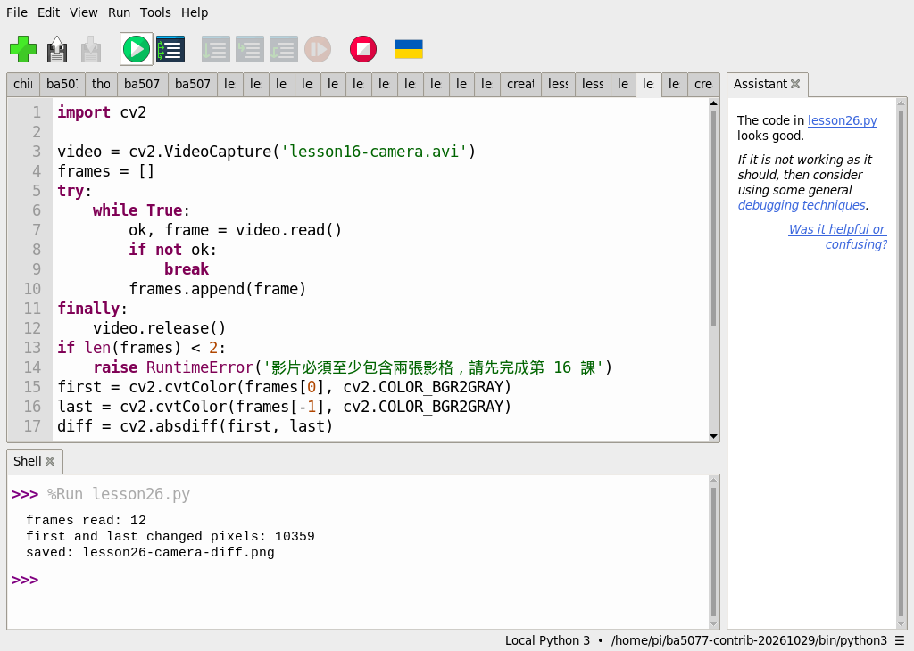
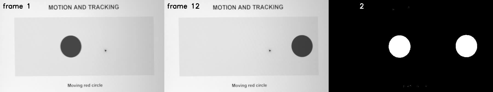
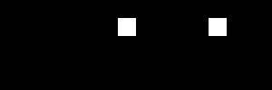

# 28｜前後兩張哪裡不一樣：影格差分找移動物體

## [原課號：第 26 課｜使用 OpenCV 進行背景差分與運動物體檢測](https://github.com/Samuel-ncu/BA5077-RP5-compatibility/blob/main/%E6%95%99%E6%9D%90/%E7%AC%AC%2026%20%E8%AA%B2%EF%BD%9C%E4%BD%BF%E7%94%A8%20OpenCV%20%E9%80%B2%E8%A1%8C%E8%83%8C%E6%99%AF%E5%B7%AE%E5%88%86%E8%88%87%E9%81%8B%E5%8B%95%E7%89%A9%E9%AB%94%E6%AA%A2%E6%B8%AC.md)

digithouse.net 原文：[第 26 課｜使用 OpenCV 進行背景差分與運動物體檢測](https://digithouse.net/blog/ba5077-lesson-21-background-difference?locale=zh-TW)

> **本篇狀態**：用相機短影片做首末影格差分，已在 Thonny 實測，但用的是 2026-10-29 建立的**舊環境**（`/home/pi/ba5077-contrib-20261029`）；**目前 Trixie 尚未重跑**。合成方塊的入門範例是較早用終端機執行的。**尚未實測**：原文的 `vtest.avi` 逐張框選、即時相機、長時間或真實場景的準確率、全新安裝的系統。

上一篇我們靠「顏色」找目標。可是如果你要看的是「有沒有東西在動」，不管它是什麼顏色呢？最直接的想法是：把前後兩張畫面相減。沒變的地方相減是 0，有變的地方就會留下差異。固定在門口的監視器、檢查機台有沒有動作，都可以從這個想法開始。這篇我們先用一個方塊看懂相減，再拿相機錄的短影片，比較第一張和最後一張哪裡不一樣。

## 這篇會學到什麼

- 影格差分：把兩張灰階影像相減取絕對值。
- 用門檻把差異變成黑白遮罩。
- 為什麼移動的物體會在「舊位置」和「新位置」都留下白色。
- 差分的限制：光線變化、文字變化也會被當成「有變」。

## 需要的東西

- 一個裝有 OpenCV 和 NumPy 的 Thonny 環境（[新 11](./11-%E5%9C%A8%20Thonny%20%E6%BA%96%E5%82%99%20OpenCV%20%E5%B7%A5%E5%85%B7%E7%AE%B1%EF%BC%9A%E8%99%9B%E6%93%AC%E7%92%B0%E5%A2%83%E8%88%87%E5%AE%89%E8%A3%9D.md)）。這篇不需要擴充模組。
- 一個新的練習資料夾，放兩個檔案：
  - 相機短影片 [lesson16-camera.avi](https://github.com/Samuel-ncu/BA5077-RP5-compatibility/blob/main/%E6%95%99%E6%9D%90/%E7%B7%B4%E7%BF%92%E7%B4%A0%E6%9D%90/lesson16-camera.avi)，檔名不要改。
  - [影片差分程式](https://github.com/Samuel-ncu/BA5077-RP5-compatibility/blob/main/%E6%95%99%E6%9D%90/%E7%AF%84%E4%BE%8B%E7%A8%8B%E5%BC%8F/%E7%AC%AC26%E8%AA%B2-%E5%BD%B1%E7%89%87%E5%BD%B1%E6%A0%BC%E5%B7%AE%E5%88%86.py)。

這支影片是 RP5 相機拍下螢幕上的移動圓形，經裁切、透視校正、轉灰階後的 12 張影格。

## 先懂幾個名詞

- **影格差分**：兩張影像同一個位置的亮度相減，取絕對值。
- **門檻（threshold）**：差值大於門檻就算「有變」，標成白色；否則黑色。
- **背景差分**：如果拿來比的是一張「沒有東西的背景」，就叫背景差分。原文就是把第一張當背景。

## 一步一步操作

### 步驟 1：先用一個方塊看懂相減

**為什麼**：先用答案明確的例子，確認「變了幾個像素」怎麼算。

```python
import cv2
import numpy as np
background = np.zeros((100, 100), dtype=np.uint8)
current = background.copy()
current[20:40, 30:50] = 255
diff = cv2.absdiff(background, current)
_, mask = cv2.threshold(diff, 30, 255, cv2.THRESH_BINARY)
if not cv2.imwrite('lesson26-difference.png', np.hstack((background, current, mask))):
    raise RuntimeError('image save failed')
print('changed pixels', cv2.countNonZero(mask))
```

背景全黑，目前影格多了一塊 20 × 20 的白色方塊。較早用終端機執行的輸出：

```text
changed pixels 400
```

20 × 20 = 400，剛好就是方塊的大小。這個例子沒有雜訊，真實畫面不會這麼整齊。這個入門例本次尚未在 Thonny 重跑。

### 步驟 2：比較相機影片的第一張和最後一張

**為什麼**：看看真實影像相減後長什麼樣子。

```python
import cv2

video = cv2.VideoCapture('lesson16-camera.avi')
frames = []
try:
    while True:
        ok, frame = video.read()
        if not ok:
            break
        frames.append(frame)
finally:
    video.release()
if len(frames) < 2:
    raise RuntimeError('影片必須至少包含兩張影格，請先完成第 16 課')
first = cv2.cvtColor(frames[0], cv2.COLOR_BGR2GRAY)
last = cv2.cvtColor(frames[-1], cv2.COLOR_BGR2GRAY)
diff = cv2.absdiff(first, last)
_, mask = cv2.threshold(diff, 25, 255, cv2.THRESH_BINARY)
panels = cv2.hconcat([frames[0], frames[-1], cv2.cvtColor(mask, cv2.COLOR_GRAY2BGR)])
if not cv2.imwrite('lesson26-camera-diff.png', panels):
    raise RuntimeError('無法儲存結果圖')
print('frames read:', len(frames))
print('first and last changed pixels:', cv2.countNonZero(mask))
print('saved: lesson26-camera-diff.png')
```

- 先用 `VideoCapture` 把影片的每一張讀進一個串列（讀影片檔用 `VideoCapture` 沒問題，見[新 16](./16-%E5%85%A9%E7%A8%AE%E5%8F%96%E5%83%8F%E8%B7%AF%E7%B7%9A%EF%BC%9Arpicam-vid%20%E9%8C%84%E5%BD%B1%E8%88%87%20Picamera2%20%E6%93%B7%E5%8F%96.md)）。
- 第一張和最後一張轉灰階、相減、用門檻 25 做成遮罩。
- 把第一張、最後一張、遮罩左右並排存成一張圖。

用 **File → Open** 開啟練習資料夾裡的程式，再按 **Run**。舊環境的 Thonny 輸出：

```text
frames read: 12
first and last changed pixels: 10359
saved: lesson26-camera-diff.png
```

### 步驟 3：看懂結果圖上的白色

**為什麼**：白色不一定都是「移動的物體」，要分得出來。

打開 `lesson26-camera-diff.png`：左邊是第一張、中間是最後一張、右邊是遮罩。

- **圓形的舊位置和新位置都是白的**：舊位置原本有圓、現在沒有；新位置原本沒有、現在有。兩處的亮度都變了。
- **左上角的影格編號也是白的**：每張影格的編號文字不同，相減後也留下差異。

所以 10359 個「有變」的像素，不全是物體。實際使用時還要面對陰影、光線變化、相機晃動，偵測到變化不代表一定有東西在動。

### 步驟 4：和原文比一比

**為什麼**：原文多做了框選，正好可以接到前幾篇學的輪廓。

原文讀 `vtest.avi`，每一張都先轉灰階、模糊，把**第一張當背景**，之後每一張都和背景相減、二值化、侵蝕加膨脹，再找輪廓，把面積大於 500 的區域框起來，逐張顯示，按 Esc 結束。本篇只比較首末兩張、不框選。把新 23 的輪廓和新 27 的框選接上來，就是原文的完整流程。repo 裡沒有 `vtest.avi`，原文範例本次沒有重跑。

## 成果圖



*操作截圖（舊環境 `ba5077-contrib-20261029`）：Thonny 執行步驟 2，Shell 印出 12 張與 10359 個變化像素。截圖中的 `lesson26.py` 是本課程式的測試副本。*



*程式輸出：左是第一張、中是最後一張、右是差分遮罩。圓形的舊、新位置和左上角的影格編號都變成白色。原始相機全景沒有上傳。*



*程式輸出：步驟 1 由左到右是背景、目前影格、差分遮罩。*

## 常見問題

| 你看到的情況 | 可能原因 | 先試試看 |
| --- | --- | --- |
| `影片必須至少包含兩張影格` | 影片不在程式旁邊，或檔名不同 | 確認 `lesson16-camera.avi` 和程式放在一起。 |
| 遮罩到處是白點 | 門檻太低，雜訊也被算進去 | 把 `25` 調大，或先模糊再相減。 |
| 動的東西沒變白 | 門檻太高，或物體和背景亮度差不多 | 把門檻調小一點。 |
| 整個畫面都變白 | 光線突然改變，或相機被碰到 | 差分需要固定的相機和穩定的光線。 |

以上是常見情況的整理，本次沒有逐一重現。

## 小結

影格差分就是兩張灰階影像相減，再用門檻做成遮罩：變了的地方是白色。舊環境實測中，相機短影片的首末兩張有 10359 個像素變化，其中包含圓形的舊位置、新位置，以及影格編號。差分簡單又快，但它只知道「哪裡變了」，不知道「是什麼在動」，光線和雜訊都會造成誤報。

**練習**：

1. 找出結果圖上除了圓形以外變白的地方，說明它為什麼會變。
2. 把門檻 `25` 改成 `10` 和 `60`，比較變化像素的數量。
3. 改成比較第一張和第六張，預測白色區域會怎麼變。

這些是延伸練習，本次尚未實測，請以你實際得到的輸出為準。

## 下一篇預告

固定拿第一張當背景，光線一變就全錯了。下一篇[29｜讓背景自己學：MOG 背景減法](./29-%E8%AE%93%E8%83%8C%E6%99%AF%E8%87%AA%E5%B7%B1%E5%AD%B8%EF%BC%9AMOG%20%E8%83%8C%E6%99%AF%E6%B8%9B%E6%B3%95.md)，我們讓程式自己慢慢學習背景長什麼樣子。
