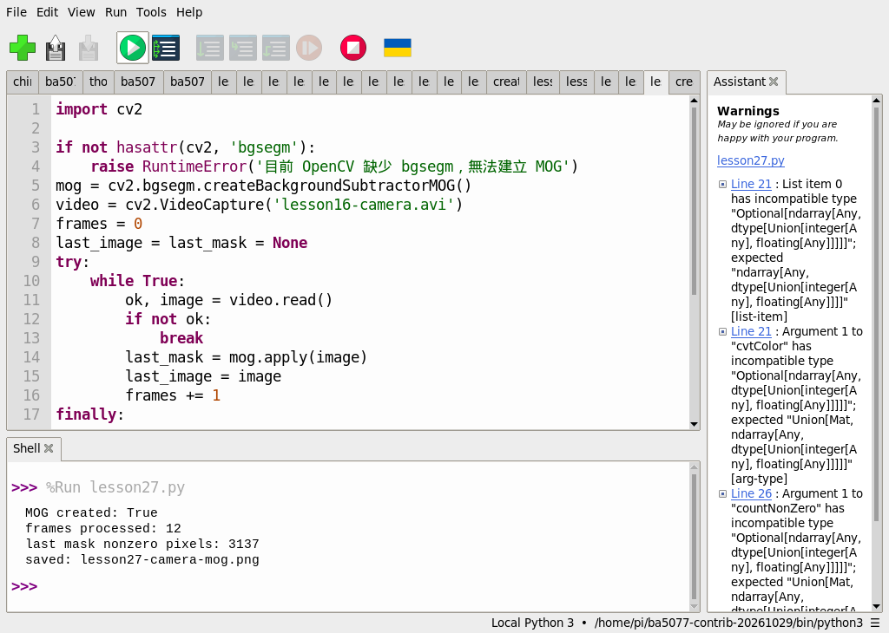
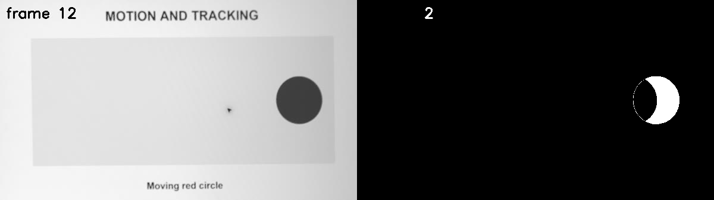

# 29｜讓背景自己學：MOG 背景減法

## [原課號：第 27 課｜使用背景減法與 MOG 進行運動物體檢測](https://github.com/Samuel-ncu/BA5077-RP5-compatibility/blob/main/%E6%95%99%E6%9D%90/%E7%AC%AC%2027%20%E8%AA%B2%EF%BD%9C%E4%BD%BF%E7%94%A8%E8%83%8C%E6%99%AF%E6%B8%9B%E6%B3%95%E8%88%87%20MOG%20%E9%80%B2%E8%A1%8C%E9%81%8B%E5%8B%95%E7%89%A9%E9%AB%94%E6%AA%A2%E6%B8%AC.md)

digithouse.net 原文：[第 27 課｜使用背景減法與 MOG 進行運動物體檢測](https://digithouse.net/blog/ba5077-lesson-23-background-subtraction-mog?locale=zh-TW)

> **本篇狀態**：用相機短影片跑 MOG，已在 Thonny 實測，但用的是 2026-10-29 建立的**舊環境**（`/home/pi/ba5077-contrib-20261029`）；**目前 Trixie 尚未重跑**。GMG 的單張黑圖範例是較早用終端機執行的。**尚未實測**：原文的即時相機版本、長時間學習效果、改 `history` 參數的練習、全新安裝的系統。

上一篇我們拿第一張畫面當背景，和最後一張相減。問題是：天色變暗、燈打開、窗簾飄動，第一張「背景」很快就不準了。如果程式能**一邊看一邊學**，把常常出現的畫面記成背景，偶爾出現的才算前景，就能適應慢慢變化的環境。這就是背景減法模型。這篇我們用 OpenCV 的 MOG 模型處理一段相機短影片，看看它最後把哪些地方判斷成「在動」。

## 這篇會學到什麼

- 背景模型和「固定一張背景」差在哪裡。
- 用 `cv2.bgsegm.createBackgroundSubtractorMOG()` 建立模型，每張影格呼叫 `apply`。
- 為什麼模型一開始需要時間「學習」，以及停太久的物體會被當成背景。
- MOG 和 GMG 是不同的方法，結果不能互相代替。

## 需要的東西

- 一個有 **OpenCV 擴充模組**（`opencv-contrib-python`，含 `cv2.bgsegm`）的 Thonny 環境。[新 15](./15-%E7%9B%B8%E6%A9%9F%E7%95%AB%E9%9D%A2%E8%AE%8A%E6%88%90%E6%95%B8%E5%AD%97%EF%BC%9APicamera2%20%E5%8A%A0%20OpenCV%20%E8%AE%80%E4%B8%80%E5%BC%B5%E5%BD%B1%E6%A0%BC.md) 建的相機加 OpenCV 擴充環境就有；新 11 的一般 OpenCV 環境沒有 `bgsegm`。
- 一個新的練習資料夾，放兩個檔案：
  - 相機短影片 [lesson16-camera.avi](https://github.com/Samuel-ncu/BA5077-RP5-compatibility/blob/main/%E6%95%99%E6%9D%90/%E7%B7%B4%E7%BF%92%E7%B4%A0%E6%9D%90/lesson16-camera.avi)（和新 28 同一支），檔名不要改。
  - [MOG 影片程式](https://github.com/Samuel-ncu/BA5077-RP5-compatibility/blob/main/%E6%95%99%E6%9D%90/%E7%AF%84%E4%BE%8B%E7%A8%8B%E5%BC%8F/%E7%AC%AC27%E8%AA%B2-%E5%BD%B1%E7%89%87MOG.py)。

## 先懂幾個名詞

- **背景模型**：程式記住的「平常畫面長什麼樣子」，會隨新影格慢慢更新。
- **前景**：和背景模型不一樣的地方，通常就是移動的東西。
- **MOG（Mixture of Gaussians）**：用好幾個常態分布描述每個像素「平常」的顏色，落在這些分布外的就算前景。
- **擴充模組（contrib）**：OpenCV 有一部分功能放在額外的套件裡，`bgsegm` 就是其中之一。

## 一步一步操作

### 步驟 1：先確認環境有 `bgsegm`

**為什麼**：沒有擴充模組，連模型都建不起來。

在 Thonny 的 Shell 輸入：

```python
import cv2
print(hasattr(cv2, 'bgsegm'))
```

印出 `True` 才能往下做。印出 `False` 就是選到沒有擴充模組的環境，回到[新 15](./15-%E7%9B%B8%E6%A9%9F%E7%95%AB%E9%9D%A2%E8%AE%8A%E6%88%90%E6%95%B8%E5%AD%97%EF%BC%9APicamera2%20%E5%8A%A0%20OpenCV%20%E8%AE%80%E4%B8%80%E5%BC%B5%E5%BD%B1%E6%A0%BC.md) 換環境。

### 步驟 2：讀程式

**為什麼**：和新 28 比，最大的差別是「每一張都要交給模型」，而不是只比兩張。

```python
import cv2

if not hasattr(cv2, 'bgsegm'):
    raise RuntimeError('目前 OpenCV 缺少 bgsegm，無法建立 MOG')
mog = cv2.bgsegm.createBackgroundSubtractorMOG()
video = cv2.VideoCapture('lesson16-camera.avi')
frames = 0
last_image = last_mask = None
try:
    while True:
        ok, image = video.read()
        if not ok:
            break
        last_mask = mog.apply(image)
        last_image = image
        frames += 1
finally:
    video.release()
if frames == 0:
    raise RuntimeError('影片沒有可讀取的影格，請先完成第 16 課')
panels = cv2.hconcat([last_image, cv2.cvtColor(last_mask, cv2.COLOR_GRAY2BGR)])
if not cv2.imwrite('lesson27-camera-mog.png', panels):
    raise RuntimeError('無法儲存結果圖')
print('MOG created:', True)
print('frames processed:', frames)
print('last mask nonzero pixels:', cv2.countNonZero(last_mask))
print('saved: lesson27-camera-mog.png')
```

- `mog.apply(image)` 做兩件事：用這一張更新背景模型，並回傳這一張的前景遮罩。
- 12 張依序交給模型，最後把最後一張和它的遮罩並排存檔。

### 步驟 3：在 Thonny 執行

**為什麼**：看模型在 12 張之後，把哪些地方當成前景。

用 **File → Open** 開啟練習資料夾裡的程式，再按 **Run**。舊環境的 Thonny 輸出：

```text
MOG created: True
frames processed: 12
last mask nonzero pixels: 3137
saved: lesson27-camera-mog.png
```

### 步驟 4：看懂結果

**為什麼**：遮罩上的白色是「模型覺得不像背景」的地方，不等於完整的物體。

打開 `lesson27-camera-mog.png`：左邊是最後一張影格，右邊是 MOG 的遮罩。

- 圓形的位置變成白色的**新月形**，而不是整個圓：圓和前幾張重疊的部分，模型已經「看慣了」。
- 左上角的影格編號每張都不同，也被當成前景。
- 3137 是最後一張遮罩的白色像素數，**不是物體數量，也不是準確率**。

12 張影格太少，看不出模型長時間學習的效果。實際用在固定相機時，還要測白天、晚上、陰影，以及物體停太久會不會被「學」成背景。

### 步驟 5：和原文比一比

**為什麼**：原文有一個名稱和程式對不上的地方。

原文的標題和說明都是 MOG，但程式裡建立的其實是 **GMG**（`createBackgroundSubtractorGMG()`）。GMG 和 MOG 是兩種不同的方法。原文用 Picamera2 即時取像、縮小、翻轉，把遮罩二值化、侵蝕、大幅膨脹，再找輪廓、框出面積大於 200 的區域，按 Esc 結束。本篇改用影片檔、確實使用 MOG，但沒有做框選；原文的即時相機版本本次沒有重跑。

repo 另外保留了一個 GMG 的小實驗：對一張 40 × 40 的黑圖呼叫一次 `apply`，只確認 GMG 建得起來、遮罩是 40 × 40。那只是第一張影格，模型還沒開始學，不能拿來說明偵測效果。

## 成果圖



*操作截圖（舊環境 `ba5077-contrib-20261029`）：Thonny 執行 MOG 程式，Shell 印出 12 張、3137 個前景像素。截圖中的 `lesson27.py` 是本課程式的測試副本；右側 Assistant 面板的 Warnings 是 Thonny 的型別檢查提示，程式實際正常執行完畢。*



*程式輸出：左是最後一張影格，右是 MOG 的前景遮罩。圓形呈白色新月狀，影格編號也被偵測到。原始相機全景沒有上傳。*

## 常見問題

| 你看到的情況 | 可能原因 | 先試試看 |
| --- | --- | --- |
| `目前 OpenCV 缺少 bgsegm` | 環境裝的是一般 OpenCV，不是含擴充模組的版本 | 改選有 `opencv-contrib-python` 的環境。 |
| `AttributeError: module 'cv2' has no attribute 'bgsegm'` | 同上 | 同上；不要在同一個環境同時裝兩種 OpenCV。 |
| `影片沒有可讀取的影格` | 影片不在程式旁邊，或檔名不同 | 確認 `lesson16-camera.avi` 和程式放在一起。 |
| 遮罩幾乎全白 | 模型才剛開始學，影格太少 | 用更長的影片，或看後面幾張的遮罩。 |

以上是常見情況的整理，本次沒有逐一重現。

## 小結

背景減法模型會隨著影格更新「背景」，比固定一張背景更能適應慢慢變化的環境。`mog.apply()` 每呼叫一次就學一次、回傳一張前景遮罩。舊環境實測中，12 張相機影格後最後一張有 3137 個前景像素，圓形呈新月狀。模型需要時間學習，停太久的物體也可能被當成背景；另外，原文程式實際用的是 GMG，不是 MOG。

**練習**：

1. 找出結果圖上除了圓形以外變白的地方，說明它為什麼被當成前景。
2. 改用 `createBackgroundSubtractorMOG(history=5)`，比較最後一張遮罩的白色像素數。

這些是延伸練習，本次尚未實測，請以你實際得到的輸出為準。

## 下一篇預告

背景減法只告訴我們「哪裡在動」，分不出是哪一個東西。下一篇[30｜框住一個目標一路跟：CSRT 追蹤器](./30-%E6%A1%86%E4%BD%8F%E4%B8%80%E5%80%8B%E7%9B%AE%E6%A8%99%E4%B8%80%E8%B7%AF%E8%B7%9F%EF%BC%9ACSRT%20%E8%BF%BD%E8%B9%A4%E5%99%A8.md)，我們先框住一個目標，讓追蹤器一張一張跟著它。
