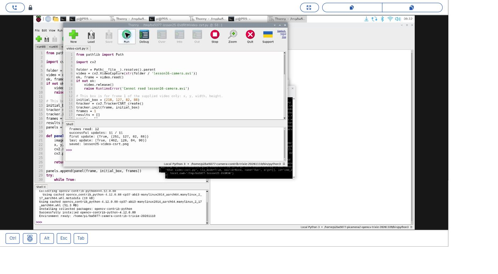
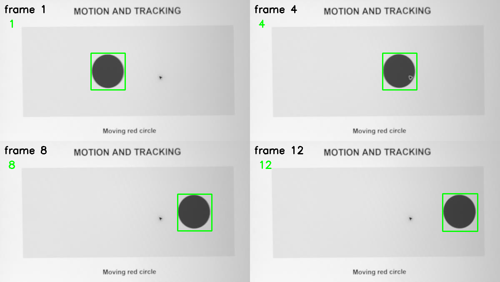
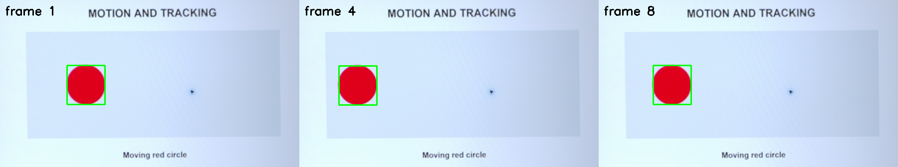

# 30｜框住一個目標一路跟：CSRT 追蹤器

## [原課號：第 25 課｜使用 OpenCV 進行目標追蹤](https://github.com/Samuel-ncu/BA5077-RP5-compatibility/blob/main/%E6%95%99%E6%9D%90/%E7%AC%AC%2025%20%E8%AA%B2%EF%BD%9C%E4%BD%BF%E7%94%A8%20OpenCV%20%E9%80%B2%E8%A1%8C%E7%9B%AE%E6%A8%99%E8%BF%BD%E8%B9%A4.md)

digithouse.net 原文：[第 25 課｜使用 OpenCV 進行目標追蹤](https://digithouse.net/blog/ba5077-lesson-21-object-tracking?locale=zh-TW)

> **本篇狀態**：用可下載的相機短影片做 CSRT 追蹤，已在**目前 Trixie** 的 Thonny 實測（2026-11-10，Python 3.13.5、OpenCV 4.12.0）：12 張影格、11 次更新全部回報成功。即時相機拍 8 張的版本是較早用終端機執行的。**尚未實測**：原文的滑鼠框選目標（`selectROI`）、遮擋與目標離開畫面、多個相似物體、長時間影片、全新安裝的系統。

新 27 的顏色追蹤，其實每一張都是重新「找」一次紅色。如果畫面裡有兩個紅色的東西，框就可能跳來跳去。**追蹤器**的想法不一樣：你在第一張畫面告訴它「就是這個」，之後它會記住這塊區域的樣子，在下一張畫面附近找最像的地方。這篇我們用 OpenCV 的 CSRT 追蹤器，在一段相機短影片裡框住圓形，看它能不能一路跟到最後一張。

## 這篇會學到什麼

- 偵測和追蹤的差別。
- 追蹤框 `(x, y, 寬, 高)` 怎麼表示。
- 用 `TrackerCSRT_create()` 建立追蹤器、`init` 指定目標、`update` 逐張更新。
- 「回報成功」不等於「框得準」，要自己看圖確認。

## 需要的東西

- 一個有 **OpenCV 擴充模組**的 Thonny 環境（CSRT 在擴充模組裡）。本次使用 `/home/pi/ba5077-camera-contrib-trixie-20261110/bin/python3`，建法見[新 15](./15-%E7%9B%B8%E6%A9%9F%E7%95%AB%E9%9D%A2%E8%AE%8A%E6%88%90%E6%95%B8%E5%AD%97%EF%BC%9APicamera2%20%E5%8A%A0%20OpenCV%20%E8%AE%80%E4%B8%80%E5%BC%B5%E5%BD%B1%E6%A0%BC.md)。
- 一個新的練習資料夾，放兩個檔案：
  - 相機短影片 [lesson16-camera.avi](https://github.com/Samuel-ncu/BA5077-RP5-compatibility/blob/main/%E6%95%99%E6%9D%90/%E7%B7%B4%E7%BF%92%E7%B4%A0%E6%9D%90/lesson16-camera.avi)（新 28、29 用過的同一支）。
  - [影片追蹤程式](https://github.com/Samuel-ncu/BA5077-RP5-compatibility/blob/main/%E6%95%99%E6%9D%90/%E7%AF%84%E4%BE%8B%E7%A8%8B%E5%BC%8F/%E7%AC%AC25%E8%AA%B2-%E5%BD%B1%E7%89%87CSRT.py)。

## 先懂幾個名詞

- **偵測**：在一張畫面裡找出目標在哪裡。
- **追蹤**：已經知道目標在上一張的位置，在下一張找出它移到哪裡。
- **追蹤框**：`(x, y, w, h)`，依序是左上角的 x、y，以及框的寬和高。注意後兩個是寬高，**不是右下角座標**。
- **CSRT**：OpenCV 的一種追蹤器，比較準、比較慢。

## 一步一步操作

### 步驟 1：讀程式

**為什麼**：追蹤器的用法只有兩步：`init` 一次、`update` 很多次。

```python
from pathlib import Path
import cv2

folder = Path(__file__).resolve().parent
video = cv2.VideoCapture(str(folder / 'lesson16-camera.avi'))
ok, frame = video.read()
if not ok:
    video.release()
    raise RuntimeError('Cannot read lesson16-camera.avi')

# This box is for frame 1 of the supplied video only: x, y, width, height.
initial_box = (218, 127, 82, 88)
tracker = cv2.TrackerCSRT_create()
tracker.init(frame, initial_box)
frames = 1
results = []
panels = []

def panel(image, box, number):
    image = image.copy()
    x, y, w, h = (int(value) for value in box)
    cv2.rectangle(image, (x, y), (x + w, y + h), (0, 255, 0), 2)
    cv2.putText(image, str(number), (20, 65), cv2.FONT_HERSHEY_SIMPLEX,
                0.8, (0, 255, 0), 2)
    return image

panels.append(panel(frame, initial_box, frames))
try:
    while True:
        ok, frame = video.read()
        if not ok:
            break
        frames += 1
        found, box = tracker.update(frame)
        box = tuple(int(value) for value in box)
        results.append((bool(found), box))
        if frames in (4, 8, 12) and found:
            panels.append(panel(frame, box, frames))
finally:
    video.release()

if len(panels) != 4:
    raise RuntimeError('Could not collect all four tracking panels')
output = folder / 'lesson25-video-csrt.png'
if not cv2.imwrite(str(output), cv2.vconcat([cv2.hconcat(panels[:2]), cv2.hconcat(panels[2:])])):
    raise RuntimeError('Could not save tracking result')
print('frames read:', frames)
print('successful updates:', sum(found for found, _ in results), '/', len(results))
print('first update:', results[0])
print('last update:', results[-1])
print('saved:', output.name)
```

- `initial_box = (218, 127, 82, 88)`：第一張影格裡圓形的位置，是事先量好的。**這個框只適用這支影片的第一張**，換影片就要重新量。
- `tracker.init(frame, initial_box)`：告訴追蹤器要跟哪一塊。
- `tracker.update(frame)`：每讀一張就更新一次，回傳「有沒有找到」和新的框。
- 把第 1、4、8、12 張加上綠框，拼成 2 × 2 的結果圖。

### 步驟 2：在 Thonny 執行

**為什麼**：看追蹤框是不是真的跟著圓形移動。

用 **File → Open** 開啟練習資料夾裡的程式，選好有擴充模組的環境，按 **Run**。輸出 `lesson25-video-csrt.png` 會覆寫同名檔。

本次 Thonny 輸出：

```text
frames read: 12
successful updates: 11 / 11
first update: (True, (251, 127, 82, 88))
last update: (True, (462, 126, 84, 90))
saved: lesson25-video-csrt.png
```

### 步驟 3：讀懂這些數字

**為什麼**：要分清楚「追蹤器說成功」和「真的框對了」。

- 為什麼是 11 次更新：第一張用來 `init`，後面 11 張才各 `update` 一次。
- 框的 x 從 218（初始）→ 251（第一次更新）→ 462（最後一次），表示框一路往右移，和影片中圓形從左往右移一致。
- `True` 只是追蹤器自己的回報。要確認框得準，得打開結果圖看綠框有沒有套在圓上。

這段影片只有 12 張、一個目標、沒有遮擋，**不能**代表追蹤器在遮擋、多個相似物體、真人或即時相機下的表現。

### 步驟 4：從相機直接追蹤（較早的終端機紀錄）

**為什麼**：實際使用時，第一個框要由程式自己找出來。

較早的版本用 Picamera2 拍 8 張 1920 × 1080 的照片，先做透視校正，第一張用紅色遮罩自動找出圓形當初始框，後面 7 張交給 CSRT。當時用終端機執行的輸出：

```text
frames captured: 8
initial target found: True
update results: [True, True, True, True, True, True, True]
saved: lesson25-csrt.png
```

程式在[第25課-相機CSRT.py](https://github.com/Samuel-ncu/BA5077-RP5-compatibility/blob/main/%E6%95%99%E6%9D%90/%E7%AF%84%E4%BE%8B%E7%A8%8B%E5%BC%8F/%E7%AC%AC25%E8%AA%B2-%E7%9B%B8%E6%A9%9FCSRT.py)。它的透視校正四個角只適用當時的相機位置；這個相機版本本次尚未在 Thonny 重跑。

### 步驟 5：和原文比一比

**為什麼**：原文讓使用者自己框目標，是更實用的做法。

原文讀 `vtest.avi`，第一張用 `cv2.selectROI` 讓使用者用滑鼠拉出目標，之後逐張 `update` 並畫框，按 Esc 結束。原文的迴圈沒有檢查 `ret`：影片讀完時 `frame` 會是 `None`，接著呼叫 `update` 就會出錯。本篇改用事先量好的框，並在讀不到影格時離開迴圈。repo 裡沒有 `vtest.avi`，滑鼠框選本次沒有實測。

## 成果圖



*操作截圖（目前 Trixie，2026-11-10）：Thonny 執行影片追蹤程式，Shell 印出 11 / 11 次更新成功。*



*程式輸出：第 1、4、8、12 張的追蹤框，可以看到框隨著圓形從左往右移。*



*程式輸出（較早的終端機紀錄）：步驟 4 從相機拍 8 張、校正後追蹤的結果。照片不含螢幕外的環境。*

## 常見問題

| 你看到的情況 | 可能原因 | 先試試看 |
| --- | --- | --- |
| `module 'cv2' has no attribute 'TrackerCSRT_create'` | 環境沒有擴充模組 | 改選有 `opencv-contrib-python` 的環境。 |
| `Cannot read lesson16-camera.avi` | 影片不在程式旁邊 | 確認影片和程式放在同一個資料夾。 |
| 框一開始就不在目標上 | 初始框量錯，或換了影片 | 在第一張影格上重新量出目標的 `(x, y, w, h)`。 |
| 回報 `True` 但框跑掉了 | 追蹤器跟到了相似的東西 | 看結果圖確認；目標太小、太快或被遮住都會這樣。 |

以上是常見情況的整理，本次沒有逐一重現。

## 小結

追蹤器先用 `init` 記住目標，再用 `update` 逐張找出它的新位置；框是 `(x, y, 寬, 高)`。本次在目前 Trixie 的 Thonny 追蹤短影片，11 次更新都回報成功，框的 x 從 218 移到 462。回報成功不代表框得準，要看圖確認；遮擋、離開畫面、相似物體都需要另外測試。

**練習**：

1. 比較第一次和最後一次更新的 x 座標，說明框移動了多少，和影片中的圓形是否一致。
2. 把初始框故意偏移 30 像素，預測追蹤結果會怎麼變，再執行比較。

這些是延伸練習，本次尚未實測，請以你實際得到的輸出為準。

## 下一篇預告

追蹤器靠的是「這塊區域長什麼樣子」。下一篇[31｜影像的指紋：SIFT、SURF、ORB 比一比](./31-%E5%BD%B1%E5%83%8F%E7%9A%84%E6%8C%87%E7%B4%8B%EF%BC%9ASIFT%E3%80%81SURF%E3%80%81ORB%20%E6%AF%94%E4%B8%80%E6%AF%94.md)，我們來看電腦怎麼把影像的特徵點變成一組可以比對的「指紋」。
