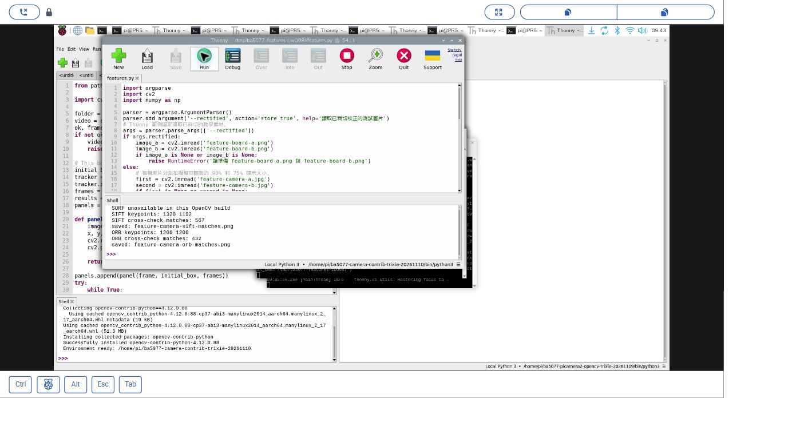
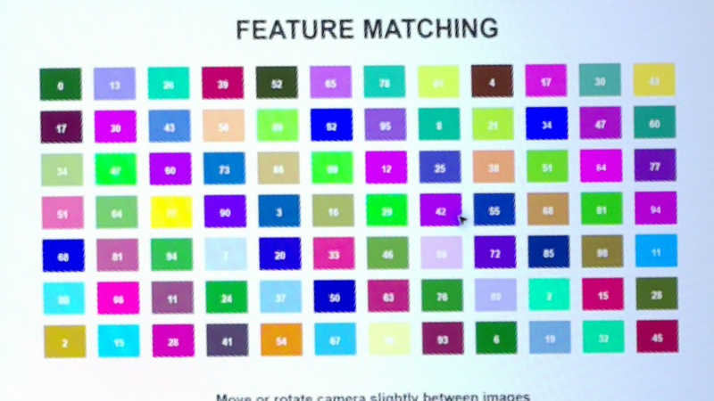
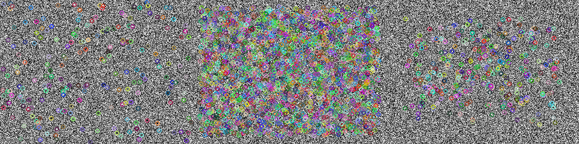

# 31｜影像的指紋：SIFT、SURF、ORB 比一比

## [原課號：第 31 課｜使用 OpenCV 比較 SIFT、SURF 與 ORB 特徵檢測](https://github.com/Samuel-ncu/BA5077-RP5-compatibility/blob/main/%E6%95%99%E6%9D%90/%E7%AC%AC%2031%20%E8%AA%B2%EF%BD%9C%E4%BD%BF%E7%94%A8%20OpenCV%20%E6%AF%94%E8%BC%83%20SIFT%E3%80%81SURF%20%E8%88%87%20ORB%20%E7%89%B9%E5%BE%B5%E6%AA%A2%E6%B8%AC.md)

digithouse.net 原文：[第 31 課｜使用 OpenCV 比較 SIFT、SURF 與 ORB 特徵檢測](https://digithouse.net/blog/ba5077-lesson-27-opencv-feature-detectors?locale=zh-TW)

> **本篇狀態**：兩張校正圖的 SIFT、ORB 特徵點，已在**目前 Trixie** 的 Thonny 實測（2026-11-10，Python 3.13.5、opencv-contrib-python 4.12.0.88）。**目前 Trixie 的 OpenCV 不能用 SURF**（2026-11-12 實際執行確認）。SURF 的數字來自較早另一套有啟用 nonfree 的環境，是終端機紀錄。**尚未實測**：原文的 `blox.jpg`、自己拍照再校正、在目前 Trixie 啟用 SURF 的方法、全新安裝的系統。

兩張照片拍的是同一個東西，但一張近一張遠、角度也不一樣，電腦要怎麼知道它們是同一個？人會注意一些「有特色」的地方：角落、花紋、文字的轉折。電腦也一樣，它會在影像裡找出很多這樣的**特徵點**，替每一點算出一串數字當作「指紋」，之後就能拿指紋去比對。這篇我們用三種有名的方法找特徵點：SIFT、SURF、ORB，看看它們在同一組圖上各找到多少，也會遇到「有一種方法在新系統上不能用」的狀況。

## 這篇會學到什麼

- 特徵點和描述子是什麼。
- SIFT、SURF、ORB 各自的特性，以及 SURF 為什麼常常不能用。
- 用 `detectAndCompute` 一次取得特徵點和描述子。
- 為什麼程式要能「優雅地」跳過不可用的方法。

## 需要的東西

- 一個有 **OpenCV 擴充模組**的 Thonny 環境。本次使用 `/home/pi/ba5077-camera-contrib-trixie-20261110/bin/python3`，建法見[新 15](./15-%E7%9B%B8%E6%A9%9F%E7%95%AB%E9%9D%A2%E8%AE%8A%E6%88%90%E6%95%B8%E5%AD%97%EF%BC%9APicamera2%20%E5%8A%A0%20OpenCV%20%E8%AE%80%E4%B8%80%E5%BC%B5%E5%BD%B1%E6%A0%BC.md)。
- 一個新的練習資料夾，放三個檔案（新 31～33 都用這一組）：
  - [第一張校正圖 feature-board-a.png](https://github.com/Samuel-ncu/BA5077-RP5-compatibility/blob/main/%E6%95%99%E6%9D%90/%E5%9C%96%E6%AA%94/feature-board-a.png)
  - [第二張校正圖 feature-board-b.png](https://github.com/Samuel-ncu/BA5077-RP5-compatibility/blob/main/%E6%95%99%E6%9D%90/%E5%9C%96%E6%AA%94/feature-board-b.png)
  - [共同比對程式](https://github.com/Samuel-ncu/BA5077-RP5-compatibility/blob/main/%E6%95%99%E6%9D%90/%E7%AF%84%E4%BE%8B%E7%A8%8B%E5%BC%8F/%E7%AC%AC31%E8%87%B333%E8%AA%B2-Thonny%E6%A0%A1%E6%AD%A3%E5%9C%96%E6%AF%94%E5%B0%8D.py)

這兩張圖是 RP5 在不同時間拍攝**同一個螢幕圖案**（一次顯示 90% 大小、一次 75%），再裁切校正的結果。它們是兩次拍攝螢幕，不是兩個真實場景。

## 先懂幾個名詞

- **特徵點（keypoint）**：影像中有特色、容易再次找到的位置，常在角落或紋理附近。
- **描述子（descriptor）**：描述特徵點周圍長什麼樣子的一串數字，就是它的「指紋」。
- **SIFT**：很經典的方法，影像放大縮小、旋轉後還認得出來。專利已經過期，現在放在 OpenCV 主套件裡。
- **SURF**：比 SIFT 快的改良版，但**受專利保護**，OpenCV 預設不提供，要另外編譯並啟用 nonfree 選項。
- **ORB**：免授權、速度快，描述子是一串 0 和 1，適合即時應用。

## 一步一步操作

### 步驟 1：讀程式

**為什麼**：這支程式新 31～33 都會用，先看懂它在做什麼。

```python
import argparse
import cv2
import numpy as np

parser = argparse.ArgumentParser()
parser.add_argument('--rectified', action='store_true', help='讀取已裁切校正的測試圖片')
# Thonny 範例固定讀取已裁切的教學素材。
args = parser.parse_args(['--rectified'])
if args.rectified:
    image_a = cv2.imread('feature-board-a.png')
    image_b = cv2.imread('feature-board-b.png')
    if image_a is None or image_b is None:
        raise RuntimeError('請準備 feature-board-a.png 與 feature-board-b.png')
else:
    # 相機照片分別拍攝相同圖案的 90% 和 75% 顯示大小。
    first = cv2.imread('feature-camera-a.jpg')
    second = cv2.imread('feature-camera-b.jpg')
    if first is None or second is None:
        raise RuntimeError('請準備 feature-camera-a.jpg 與 feature-camera-b.jpg')
    if first.shape[:2] != (1080, 1920) or second.shape[:2] != (1080, 1920):
        raise RuntimeError('照片尺寸與本次設定不同，請重新量測座標')
    # 本次相機位置的四角；改變位置時應重新量測。
    source = np.float32([[755, 270], [1385, 65], [1484, 412], [856, 604]])
    target = np.float32([[0, 0], [799, 0], [799, 449], [0, 449]])
    matrix = cv2.getPerspectiveTransform(source, target)
    image_a = cv2.warpPerspective(first, matrix, (800, 450))
    image_b = cv2.warpPerspective(second, matrix, (800, 450))
    if not cv2.imwrite('feature-board-a.png', image_a) or not cv2.imwrite('feature-board-b.png', image_b):
        raise RuntimeError('無法儲存校正圖片')
gray_a = cv2.cvtColor(image_a, cv2.COLOR_BGR2GRAY)
gray_b = cv2.cvtColor(image_b, cv2.COLOR_BGR2GRAY)

detectors = [('SIFT', cv2.SIFT_create(), cv2.NORM_L2),
             ('ORB', cv2.ORB_create(nfeatures=1200), cv2.NORM_HAMMING)]
try:
    detectors.insert(1, ('SURF', cv2.xfeatures2d.SURF_create(), cv2.NORM_L2))
except (AttributeError, cv2.error):
    print('SURF unavailable in this OpenCV build')
for name, detector, norm in detectors:
    keys_a, desc_a = detector.detectAndCompute(gray_a, None)
    keys_b, desc_b = detector.detectAndCompute(gray_b, None)
    if desc_a is None or desc_b is None:
        raise RuntimeError(f'{name} 找不到描述子')
    matches = cv2.BFMatcher(norm, crossCheck=True).match(desc_a, desc_b)
    matches = sorted(matches, key=lambda item: item.distance)
    result = cv2.drawMatches(image_a, keys_a, image_b, keys_b, matches[:30], None,
                             flags=cv2.DrawMatchesFlags_NOT_DRAW_SINGLE_POINTS)
    output = f'feature-camera-{name.lower()}-matches.png'
    if not cv2.imwrite(output, result):
        raise RuntimeError('無法儲存結果')
    print(name, 'keypoints:', len(keys_a), len(keys_b))
    print(name, 'cross-check matches:', len(matches))
    print('saved:', output)
```

這篇先看前半：

- 開頭固定讀已校正的兩張圖（`parse_args(['--rectified'])`），在 Thonny 不用輸入參數。後半「從相機照片校正」的部分，四個角只適用當時的相機位置。
- `detectors` 是一個清單，每一項是「名字、偵測器、比較距離的方法」。
- SURF 用 `try ... except` 包起來：能建立就加進清單，不能就印一行提示、繼續做其他方法。
- `detectAndCompute` 一次回傳特徵點和描述子。

後半的「比對」（`BFMatcher`）留到[新 32](./32-%E5%85%A9%E5%BC%B5%E5%9C%96%E6%80%8E%E9%BA%BC%E5%B0%8D%E8%B5%B7%E4%BE%86%EF%BC%9A%E7%89%B9%E5%BE%B5%E5%8C%B9%E9%85%8D.md) 再講。

### 步驟 2：在 Thonny 執行

**為什麼**：看三種方法在目前的系統上能用哪幾種、各找到多少點。

用 **File → Open** 開啟練習資料夾裡的程式，選好有擴充模組的環境，按 **Run**。程式會寫出 SIFT、ORB 的比對圖，已有同名檔會被覆寫。

本次 Thonny 輸出：

```text
SURF unavailable in this OpenCV build
SIFT keypoints: 1320 1192
SIFT cross-check matches: 567
saved: feature-camera-sift-matches.png
ORB keypoints: 1200 1200
ORB cross-check matches: 432
saved: feature-camera-orb-matches.png
```

### 步驟 3：讀懂特徵點數

**為什麼**：點數多不代表比較好，要知道它們從哪裡來。

- **SURF 不能用**：目前的 `opencv-contrib-python` 沒有啟用 nonfree，建立 SURF 時會出現 `This algorithm is patented and is excluded in this configuration`。程式接住這個錯誤，繼續做 SIFT 和 ORB。
- **SIFT**：第一張找到 1320 點、第二張 1192 點。第二張是 75% 大小拍的，細節比較少，點也少一些。
- **ORB**：兩張都是 1200 點，因為程式設定 `nfeatures=1200`，最多只留 1200 點。

較早在另一套**有啟用 nonfree** 的環境，SURF 在同兩張圖上找到 2108 和 2372 點（終端機紀錄）。這只能說明「那一套環境」可以用 SURF，不代表目前的安裝方式也可以。

### 步驟 4：舊範例在目前 Trixie 會停住

**為什麼**：你可能會在網路上看到直接建立 SURF 的程式，要知道為什麼它跑不完。

repo 裡較早的入門範例[第31課.py](https://github.com/Samuel-ncu/BA5077-RP5-compatibility/blob/main/%E6%95%99%E6%9D%90/%E7%AF%84%E4%BE%8B%E7%A8%8B%E5%BC%8F/%E7%AC%AC31%E8%AA%B2.py)直接寫 `cv2.xfeatures2d.SURF_create()`。2026-11-12 在目前 Trixie 的擴充環境實際執行，第 4 行就停住並出現專利錯誤。它在當時有 nonfree 的舊環境可以跑完，結果是 `SIFT created True`、`SURF created True`、`ORB created True`。所以本篇改用會跳過 SURF 的共同程式。

### 步驟 5：和原文比一比

**為什麼**：原文的 SIFT 寫法在新版 OpenCV 已經改了。

原文讀一張 `blox.jpg`，用 `cv2.xfeatures2d.SIFT_create()`、`cv2.xfeatures2d.SURF_create()`、`cv2.ORB_create()` 各找一次特徵點，畫在圖上並拼成 2 × 2 比較。SIFT 現在已經移到主套件，要寫 `cv2.SIFT_create()`；SURF 則需要有 nonfree 的建置。repo 裡沒有 `blox.jpg`，原文範例本次沒有重跑。

## 成果圖



*操作截圖（目前 Trixie，2026-11-10）：Thonny 執行共同程式，Shell 第一行是 `SURF unavailable in this OpenCV build`。截圖中的程式名稱 `features.py` 是共同程式的測試副本。*



*練習素材：第一張校正圖（螢幕顯示 90% 時拍攝）。*



*程式輸出（舊的 nonfree 環境）：一張合成的隨機紋理圖，由左到右是 SIFT、SURF、ORB 找到的特徵點。目前 Trixie 跑這個舊範例會在建立 SURF 時停住。*

## 常見問題

| 你看到的情況 | 可能原因 | 先試試看 |
| --- | --- | --- |
| `This algorithm is patented and is excluded in this configuration` | 直接建立 SURF，但 OpenCV 沒有啟用 nonfree | 改用共同程式，讓它自動跳過 SURF。 |
| `module 'cv2' has no attribute 'xfeatures2d'` | 環境沒有擴充模組 | 改選有 `opencv-contrib-python` 的環境。 |
| `module 'cv2.xfeatures2d' has no attribute 'SIFT_create'` | 用了舊寫法 | SIFT 改寫成 `cv2.SIFT_create()`。 |
| `請準備 feature-board-a.png 與 feature-board-b.png` | 圖片不在程式旁邊 | 用 **File → Open** 從練習資料夾開程式再執行。 |

第一列是 2026-11-12 實際遇到的錯誤；其他是常見情況的整理，本次沒有逐一重現。

## 小結

特徵點是影像中有特色的位置，描述子是它的「指紋」。SIFT、ORB 在目前 Trixie 都能用，SURF 因為專利，在目前的安裝方式下不能用，程式要能跳過它。本次 SIFT 在兩張圖上找到 1320、1192 點，ORB 受設定限制各 1200 點。點數多少不等於好壞，下一步要看這些點能不能正確地對起來。

**練習**：把 `ORB_create(nfeatures=1200)` 改成 `nfeatures=500`，預測 ORB 的點數會變成多少，再執行驗證。這是延伸練習，本次尚未實測，請以你實際得到的輸出為準。

## 下一篇預告

兩張圖各有一千多個特徵點，哪些是同一個位置？下一篇[32｜兩張圖怎麼對起來：特徵匹配](./32-%E5%85%A9%E5%BC%B5%E5%9C%96%E6%80%8E%E9%BA%BC%E5%B0%8D%E8%B5%B7%E4%BE%86%EF%BC%9A%E7%89%B9%E5%BE%B5%E5%8C%B9%E9%85%8D.md)，我們用描述子把兩張圖的特徵點配對起來，也會看到「配錯」長什麼樣子。
