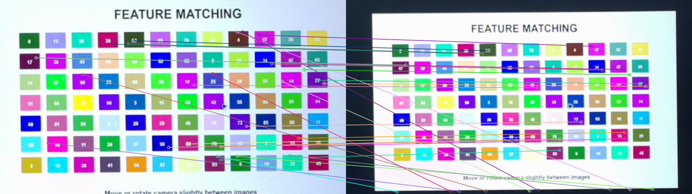
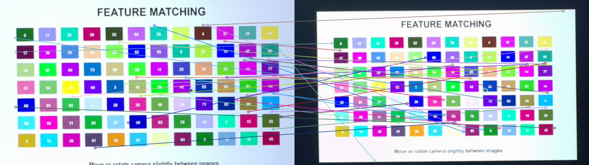
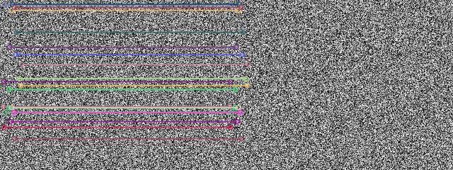

# 32｜兩張圖怎麼對起來：特徵匹配

## [原課號：第 32 課｜使用 OpenCV 比較兩張圖片的特徵匹配（SURF 與 SIFT）](https://github.com/Samuel-ncu/BA5077-RP5-compatibility/blob/main/%E6%95%99%E6%9D%90/%E7%AC%AC%2032%20%E8%AA%B2%EF%BD%9C%E4%BD%BF%E7%94%A8%20OpenCV%20%E6%AF%94%E8%BC%83%E5%85%A9%E5%BC%B5%E5%9C%96%E7%89%87%E7%9A%84%E7%89%B9%E5%BE%B5%E5%8C%B9%E9%85%8D%EF%BC%88SURF%20%E8%88%87%20SIFT%EF%BC%89.md)

digithouse.net 原文：[第 32 課｜使用 OpenCV 比較兩張圖片的特徵匹配（SURF 與 SIFT）](https://digithouse.net/blog/ba5077-lesson-28-opencv-feature-matching?locale=zh-TW)

> **本篇狀態**：兩張校正圖的 SIFT 匹配，已在**目前 Trixie** 的 Thonny 實測（2026-11-10，Python 3.13.5、opencv-contrib-python 4.12.0.88）：567 組候選配對。SURF 匹配的結果來自較早有 nonfree 的環境（終端機紀錄），目前 Trixie 不能用 SURF。合成圖自我配對的範例是較早用終端機執行的。**尚未實測**：原文的 `box.png`／`box_in_scene.png` 與比例測試（ratio test）、用幾何方法篩掉錯誤配對、全新安裝的系統。

上一篇我們在兩張圖上各找到一千多個特徵點。現在要回答真正的問題：**左圖的這一點，是右圖的哪一點？**做法很直覺：拿左圖每一點的「指紋」（描述子），去右圖找最像的那一個。這叫特徵匹配。這篇我們用 SIFT 的描述子做匹配，把最好的 30 組配對畫成連線，你會看到很多線對得很漂亮，也會看到一些明顯配錯的線。

## 這篇會學到什麼

- 特徵匹配：用描述子之間的「距離」找出最像的點。
- `BFMatcher` 和 `crossCheck`（雙向檢查）在做什麼。
- SIFT 的描述子為什麼用 L2 距離。
- 「候選配對數」不等於「正確配對數」，以及怎麼從圖上看出配錯。

## 需要的東西

- 和[新 31](./31-%E5%BD%B1%E5%83%8F%E7%9A%84%E6%8C%87%E7%B4%8B%EF%BC%9ASIFT%E3%80%81SURF%E3%80%81ORB%20%E6%AF%94%E4%B8%80%E6%AF%94.md) 相同的環境與三個檔案：兩張校正圖 `feature-board-a.png`、`feature-board-b.png`，以及[共同比對程式](https://github.com/Samuel-ncu/BA5077-RP5-compatibility/blob/main/%E6%95%99%E6%9D%90/%E7%AF%84%E4%BE%8B%E7%A8%8B%E5%BC%8F/%E7%AC%AC31%E8%87%B333%E8%AA%B2-Thonny%E6%A0%A1%E6%AD%A3%E5%9C%96%E6%AF%94%E5%B0%8D.py)。

## 先懂幾個名詞

- **匹配（match）**：一組「左圖某一點 ↔ 右圖某一點」的配對。
- **距離**：兩個描述子有多不像。距離越小越像。
- **L2 距離**：把兩串數字逐項相減、平方、加總再開根號，就是一般的直線距離。SIFT、SURF 的描述子是小數，用 L2。
- **暴力匹配（BFMatcher）**：每一點都跟對方所有點比一次，挑距離最小的。
- **雙向檢查（crossCheck）**：A 最像 B、而且 B 也最像 A，才算一組配對。可以先去掉一部分單方面的錯配。

## 一步一步操作

### 步驟 1：看程式的比對部分

**為什麼**：新 31 看了「找特徵點」，這篇看「把點對起來」。

共同程式的迴圈裡，比對只有這幾行：

```python
matches = cv2.BFMatcher(norm, crossCheck=True).match(desc_a, desc_b)
matches = sorted(matches, key=lambda item: item.distance)
result = cv2.drawMatches(image_a, keys_a, image_b, keys_b, matches[:30], None,
                         flags=cv2.DrawMatchesFlags_NOT_DRAW_SINGLE_POINTS)
```

- `BFMatcher(norm, crossCheck=True)`：SIFT 的 `norm` 是 `cv2.NORM_L2`；開啟雙向檢查。
- `sorted(..., key=distance)`：依距離由小到大排，最像的在前面。
- `drawMatches(..., matches[:30], ...)`：只畫前 30 組，左右兩張圖並排、用線連起來。

### 步驟 2：執行並看數字

**為什麼**：先知道配出多少組，再去看它們對不對。

用 **File → Open** 開啟共同程式，按 **Run**（新 31 跑過的話，結果是同一份）。和匹配有關的輸出：

```text
SIFT keypoints: 1320 1192
SIFT cross-check matches: 567
saved: feature-camera-sift-matches.png
```

左圖 1320 點、右圖 1192 點，通過雙向檢查的有 567 組。

### 步驟 3：打開結果圖，找出配錯的線

**為什麼**：567 只是「候選」，不是「正確」。這一步最重要。

打開 `feature-camera-sift-matches.png`：

- 有不少線幾乎是**水平**的，從左圖某個色塊連到右圖同一個色塊，這些多半配對正確（右圖比較小，所以線會稍微往內收）。
- 也有一些**斜線**，從左圖上方連到右圖下方、甚至連到畫面外的黑邊，這些明顯配錯了。
- 測試圖上有很多顏色、大小都相近的方塊和數字，重複的圖案特別容易配錯。

所以 567 組是演算法給的候選數，**不是準確率**。實際用在拼接或定位時，還要再用幾何方法（例如找出兩張圖之間的對應關係）把不合理的配對篩掉，下一篇[新 34](./34-%E6%8A%8A%E7%9B%B8%E9%84%B0%E7%85%A7%E7%89%87%E6%8E%A5%E6%88%90%E5%85%A8%E6%99%AF.md) 的全景拼接就會用到。

### 步驟 4：先拿同一張圖自己配自己

**為什麼**：這是確認流程有沒有接通的最小測試，但它證明不了什麼。

較早的入門範例[第32課.py](https://github.com/Samuel-ncu/BA5077-RP5-compatibility/blob/main/%E6%95%99%E6%9D%90/%E7%AF%84%E4%BE%8B%E7%A8%8B%E5%BC%8F/%E7%AC%AC32%E8%AA%B2.py)在一張合成的隨機紋理圖上找 SIFT 特徵，再拿描述子和**自己**比對。終端機輸出：

```text
descriptors found True
same-image matches 318
```

自己配自己，每一點當然都找得到自己，所以這只能說明「函式能跑」，不能代表兩張不同照片的匹配品質。這個範例本次尚未在 Thonny 重跑。

### 步驟 5：和原文比一比

**為什麼**：原文用了另一種篩選方法，值得認識。

原文用 **SURF** 讀 `box.png` 和 `box_in_scene.png`，用 `knnMatch(k=2)` 替每一點找最像的兩個，再用**比例測試**：最像的距離要小於第二像的 0.55 倍才保留，最後畫出通過的配對。比例測試和雙向檢查都是在篩掉不可靠的配對，做法不同。目前 Trixie 不能用 SURF；repo 也沒有這兩張圖，原文範例和比例測試本次都沒有重跑。

## 成果圖



*程式輸出（目前 Trixie，2026-11-10）：SIFT 距離最小的 30 組候選配對。水平的線多半正確，斜線明顯配錯。*



*程式輸出（較早有 nonfree 的環境，終端機紀錄）：同兩張圖的 SURF 前 30 組配對，當時有 579 組候選。目前 Trixie 不能用 SURF。*



*程式輸出：步驟 4 的合成圖自我配對，畫出前 30 組。*

## 常見問題

| 你看到的情況 | 可能原因 | 先試試看 |
| --- | --- | --- |
| 配對數很少 | 兩張圖差太多，或特徵點太少 | 先確認兩張圖拍的是同一個東西、光線差不多。 |
| 很多斜線、配錯很多 | 圖上有很多重複的圖案 | 用比例測試或幾何方法再篩一次。 |
| `error: ... (-215:Assertion failed)` 出現在 `match` | 描述子型別和距離方法不合 | SIFT、SURF 用 `NORM_L2`；ORB 用 `NORM_HAMMING`。 |
| `找不到描述子` | 圖片太平、沒有紋理 | 換有細節的圖片。 |

以上是常見情況的整理，本次沒有逐一重現。

## 小結

特徵匹配是拿描述子去對方找最像的點，`BFMatcher` 加上雙向檢查可以先去掉一部分錯配。本次在目前 Trixie 的 SIFT 匹配得到 567 組候選，但從圖上看得到明顯配錯的斜線。候選配對數不是準確率，重複圖案特別容易配錯，實際應用還要再用幾何方法篩選。

**練習**：

1. 在結果圖上數一數 30 條線裡有幾條是明顯配錯的。
2. 把 `matches[:30]` 改成 `matches[:100]`，看看排在後面的配對是不是錯得更多。

這些是延伸練習，本次尚未實測，請以你實際得到的輸出為準。

## 下一篇預告

SIFT 很準，但描述子是一長串小數，算起來比較慢。下一篇[33｜免授權的選擇：ORB 偵測與匹配](./33-%E5%85%8D%E6%8E%88%E6%AC%8A%E7%9A%84%E9%81%B8%E6%93%87%EF%BC%9AORB%20%E5%81%B5%E6%B8%AC%E8%88%87%E5%8C%B9%E9%85%8D.md)，我們看看用一串 0 和 1 當指紋的 ORB，在同一組圖上表現如何。
