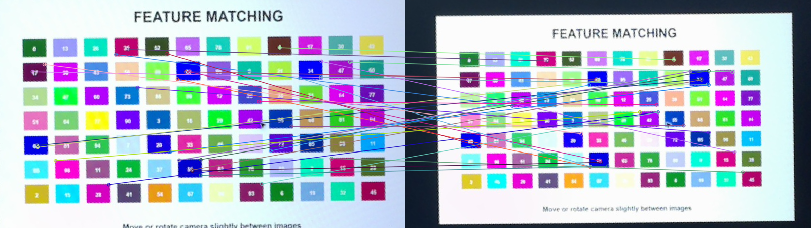
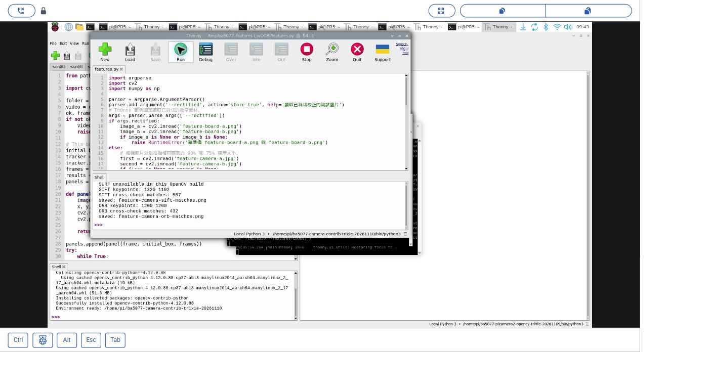
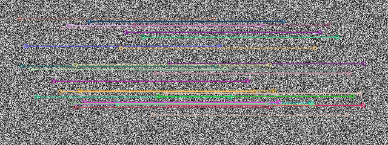

# 33｜免授權的選擇：ORB 偵測與匹配

## [原課號：第 33 課｜使用 OpenCV ORB 特徵檢測與匹配](https://github.com/Samuel-ncu/BA5077-RP5-compatibility/blob/main/%E6%95%99%E6%9D%90/%E7%AC%AC%2033%20%E8%AA%B2%EF%BD%9C%E4%BD%BF%E7%94%A8%20OpenCV%20ORB%20%E7%89%B9%E5%BE%B5%E6%AA%A2%E6%B8%AC%E8%88%87%E5%8C%B9%E9%85%8D.md)

digithouse.net 原文：[第 33 課｜使用 OpenCV ORB 特徵檢測與匹配](https://digithouse.net/blog/ba5077-lesson-29-opencv-orb?locale=zh-TW)

> **本篇狀態**：兩張校正圖的 ORB 偵測與匹配，已在**目前 Trixie** 的 Thonny 實測（2026-11-10，Python 3.13.5、opencv-contrib-python 4.12.0.88）：兩張各 1200 點、432 組候選配對。合成圖自我配對的範例是較早用終端機執行的。**尚未實測**：原文的 `box.png`／`box_in_scene.png`、ORB 的速度量測、改 `nfeatures` 的練習、全新安裝的系統。

上一篇的 SIFT 很準，但它的描述子是一長串小數，在 Raspberry Pi 這種小電腦上算起來比較吃力；SURF 更快，卻有專利、目前的環境根本不能用。有沒有又快又免授權的選擇？有，就是 **ORB**。它的指紋是一串 0 和 1，比對時只要數「有幾個位元不一樣」，非常快。這篇我們用 ORB 在同一組圖上做偵測與匹配，和上一篇的 SIFT 比較看看。

## 這篇會學到什麼

- ORB 的描述子為什麼是「二進位」的。
- Hamming 距離：數有幾個位元不同。
- 為什麼 ORB 一定要配 `NORM_HAMMING`，不能用 L2。
- 比較 ORB 和 SIFT 的結果時，要注意什麼。

## 需要的東西

- 和[新 31](./31-%E5%BD%B1%E5%83%8F%E7%9A%84%E6%8C%87%E7%B4%8B%EF%BC%9ASIFT%E3%80%81SURF%E3%80%81ORB%20%E6%AF%94%E4%B8%80%E6%AF%94.md) 相同的環境與三個檔案：兩張校正圖和[共同比對程式](https://github.com/Samuel-ncu/BA5077-RP5-compatibility/blob/main/%E6%95%99%E6%9D%90/%E7%AF%84%E4%BE%8B%E7%A8%8B%E5%BC%8F/%E7%AC%AC31%E8%87%B333%E8%AA%B2-Thonny%E6%A0%A1%E6%AD%A3%E5%9C%96%E6%AF%94%E5%B0%8D.py)。ORB 在一般 OpenCV 也有，但共同程式還會試 SIFT、SURF，所以沿用有擴充模組的環境。

## 先懂幾個名詞

- **ORB（Oriented FAST and Rotated BRIEF）**：用 FAST 方法找角點、用 BRIEF 方法產生描述子，並加上方向資訊，讓旋轉後也認得出來。
- **二進位描述子**：每個特徵點用一串 0 和 1 描述，例如 256 個位元。
- **Hamming 距離**：兩串位元有幾個位置不一樣。`10110` 和 `10011` 有 2 個位置不同，距離就是 2。

## 一步一步操作

### 步驟 1：看程式裡和 ORB 有關的兩個地方

**為什麼**：ORB 的用法和 SIFT 幾乎一樣，只有兩個地方要特別注意。

共同程式中：

```python
detectors = [('SIFT', cv2.SIFT_create(), cv2.NORM_L2),
             ('ORB', cv2.ORB_create(nfeatures=1200), cv2.NORM_HAMMING)]
```

- `ORB_create(nfeatures=1200)`：最多保留 1200 個特徵點。預設是 500。
- `cv2.NORM_HAMMING`：ORB 的描述子是位元，比較距離要用 Hamming。SIFT 則用 `NORM_L2`。

接下來的偵測與匹配（`detectAndCompute`、`BFMatcher(..., crossCheck=True)`、依距離排序、畫前 30 組）和新 32 完全一樣。

### 步驟 2：執行並看數字

**為什麼**：和 SIFT 放在一起比。

用 **File → Open** 開啟共同程式，按 **Run**（新 31、32 跑過的話，結果是同一份）。和 ORB 有關的輸出：

```text
ORB keypoints: 1200 1200
ORB cross-check matches: 432
saved: feature-camera-orb-matches.png
```

同一次執行裡，SIFT 是 1320、1192 點，567 組候選配對。

### 步驟 3：比較 ORB 和 SIFT 時要小心

**為什麼**：數字不同，不代表誰比較好。

- ORB 兩張都是 1200 點，是因為設了上限；SIFT 沒有設上限。點數不能直接比。
- ORB 的候選配對 432 組、SIFT 567 組，這只是「通過雙向檢查的數量」，**不是準確率，也不是速度排名**。
- 打開 `feature-camera-orb-matches.png`，前 30 組裡斜線比 SIFT 那張多，不少是把左圖一個深藍色方塊連到右圖**另一個位置**的深藍色方塊。測試圖上重複的色塊很多，這種「長得一樣但位置不同」的情況特別容易配錯。

要真的比較兩種方法，需要更多不同的圖、光線和角度，並且用標註好的正確答案來算準確率；這次的一組圖做不到。

### 步驟 4：先拿同一張圖自己配自己

**為什麼**：最小的流程測試，但同樣證明不了品質。

較早的入門範例[第33課.py](https://github.com/Samuel-ncu/BA5077-RP5-compatibility/blob/main/%E6%95%99%E6%9D%90/%E7%AF%84%E4%BE%8B%E7%A8%8B%E5%BC%8F/%E7%AC%AC33%E8%AA%B2.py)在合成的隨機紋理圖上用 ORB 找特徵，再和自己比對。終端機輸出：

```text
descriptors found True
same-image matches 453
```

自己配自己只說明「函式能跑」，不能代表兩張不同照片的匹配品質。這個範例本次尚未在 Thonny 重跑。

### 步驟 5：和原文比一比

**為什麼**：原文和本篇的做法其實很接近。

原文讀 `box.png` 和 `box_in_scene.png`，`ORB_create()` 用預設值，同樣用 `NORM_HAMMING` 加雙向檢查、依距離排序，畫出前 10 組並縮放顯示。原文的說明提到「用 argparse 取得兩張輸入圖片的路徑」，但程式裡其實是直接寫死檔名，沒有用到 argparse。repo 裡沒有這兩張圖，原文範例本次沒有重跑。

## 成果圖



*程式輸出（目前 Trixie，2026-11-10）：ORB 距離最小的 30 組候選配對。可以看到不少斜線把同色的方塊配到不同位置。*



*操作截圖：同一次執行的 Thonny 畫面，Shell 最後是 ORB 的點數與 432 組配對。*



*程式輸出：步驟 4 的合成圖自我配對，畫出前 30 組。*

## 常見問題

| 你看到的情況 | 可能原因 | 先試試看 |
| --- | --- | --- |
| ORB 配對結果很怪，或 `match` 出錯 | 用了 `NORM_L2` | ORB 一定要用 `NORM_HAMMING`。 |
| ORB 點數只有 500 | 用了預設的 `nfeatures` | 改成 `ORB_create(nfeatures=1200)` 之類的值。 |
| 配錯很多 | 圖上有很多重複圖案 | 換紋理比較不重複的圖，或再用幾何方法篩選。 |
| `找不到描述子` | 圖片太平、沒有角點 | 換有細節的圖片。 |

以上是常見情況的整理，本次沒有逐一重現。

## 小結

ORB 用一串 0 和 1 當描述子，用 Hamming 距離比較，免授權又快，適合 Raspberry Pi。本次在目前 Trixie 上，ORB 兩張各 1200 點、432 組候選配對；同一次 SIFT 是 567 組。這些數字不是準確率或速度排名，而且在重複圖案多的測試圖上，ORB 的前 30 組裡有不少明顯配錯。

**練習**：

1. 把 `nfeatures` 改成 `500` 和 `3000`，比較點數和候選配對數。
2. 數一數 ORB 和 SIFT 結果圖的前 30 組裡，各有幾條明顯配錯。

這些是延伸練習，本次尚未實測，請以你實際得到的輸出為準。

## 下一篇預告

特徵匹配最常見的應用之一，就是把好幾張照片接起來。下一篇[34｜把相鄰照片接成全景](./34-%E6%8A%8A%E7%9B%B8%E9%84%B0%E7%85%A7%E7%89%87%E6%8E%A5%E6%88%90%E5%85%A8%E6%99%AF.md)，我們讓 OpenCV 自動找出重疊的地方，把三張照片拼成一張寬幅全景。
