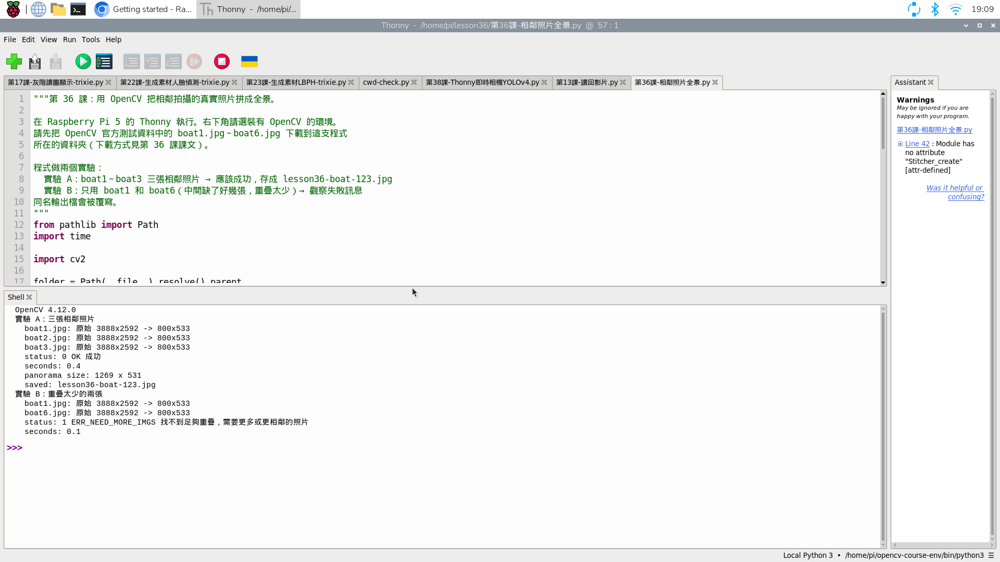
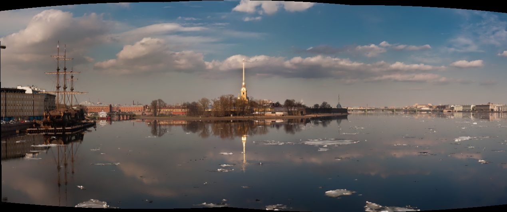

# 34｜把相鄰照片接成全景

## [原課號：第 36 課｜使用 OpenCV 進行全景拼接](https://github.com/Samuel-ncu/BA5077-RP5-compatibility/blob/main/%E6%95%99%E6%9D%90/%E7%AC%AC%2036%20%E8%AA%B2%EF%BD%9C%E4%BD%BF%E7%94%A8%20OpenCV%20%E9%80%B2%E8%A1%8C%E5%85%A8%E6%99%AF%E6%8B%BC%E6%8E%A5.md)

digithouse.net 原文：[第 36 課｜使用 OpenCV 進行全景拼接](https://digithouse.net/blog/ba5077-lesson-32-opencv-panorama?locale=zh-TW)

> **本篇狀態**：在**目前 Trixie** 的 Thonny 按 Run 實測（2026-11-11，Python 3.13.5、OpenCV 4.12.0）：三張相鄰的港口照片拼接成功（`status 0`，1269 × 531），重疊太少的兩張回報 `status 1`。照片來自 OpenCV 官方測試資料，**不是 RP5 相機拍的**。**尚未實測**：用 RP5 相機自己拍相鄰照片再拼接、原文用命令列傳入照片的寫法、全新安裝的系統。

手機的「全景模式」會要你一邊拍、一邊慢慢轉身。為什麼不能隨便拍幾張？因為電腦要在相鄰兩張照片裡找到**同一棟房子、同一朵雲**，才知道它們該怎麼接。這就是前三篇學的特徵點和匹配派上用場的地方。這篇我們拿三張真的相鄰拍攝的港口照片，在 RP5 上接成一張寬廣的全景，再故意拿兩張重疊太少的照片，看看失敗時 OpenCV 怎麼告訴我們。

## 這篇會學到什麼

- 全景拼接的三個步驟：找共同特徵、估計照片之間的對應關係、變形後接在一起。
- 用 `cv2.Stitcher_create()` 和 `stitch()` 一次完成拼接。
- 看懂 `status`：0 是成功，1 是重疊不夠。
- 失敗時該補照片，而不是調程式。

## 需要的東西

- [新 11](./11-%E5%9C%A8%20Thonny%20%E6%BA%96%E5%82%99%20OpenCV%20%E5%B7%A5%E5%85%B7%E7%AE%B1%EF%BC%9A%E8%99%9B%E6%93%AC%E7%92%B0%E5%A2%83%E8%88%87%E5%AE%89%E8%A3%9D.md) 的 OpenCV 環境就夠了，拼接器屬於一般 OpenCV，不需要擴充模組。本次使用 `/home/pi/opencv-course-env/bin/python3`。
- 一個練習資料夾，例如 `/home/pi/lesson36`，放[本篇程式](https://github.com/Samuel-ncu/BA5077-RP5-compatibility/blob/main/%E6%95%99%E6%9D%90/%E7%AF%84%E4%BE%8B%E7%A8%8B%E5%BC%8F/%E7%AC%AC36%E8%AA%B2-%E7%9B%B8%E9%84%B0%E7%85%A7%E7%89%87%E5%85%A8%E6%99%AF.py)。
- 四張照片 `boat1.jpg`、`boat2.jpg`、`boat3.jpg`、`boat6.jpg`，來自 OpenCV 官方的[測試資料](https://github.com/opencv/opencv_extra/tree/4.x/testdata/stitching)，是在同一個位置轉向拍攝的港口景色。下一步會說明怎麼下載。

## 先懂幾個名詞

- **重疊**：兩張照片拍到同一塊區域。一般建議相鄰照片重疊約三成以上。
- **對應關係**：一張照片要怎麼旋轉、變形，才能疊到另一張上。拼接器會從配對到的特徵點把它算出來。
- **`cv2.Stitcher`**：OpenCV 內建的拼接器，把找特徵、配對、估計、變形、接合全部包成一個 `stitch()`。
- **全景模式（`Stitcher_PANORAMA`）**：適合站在原地轉動相機拍的照片。

## 一步一步操作

### 步驟 1：下載照片

**為什麼**：拼接需要真的相鄰拍攝的照片。這篇不用相機，也就不必擔心相機被占用。

在 RP5 開啟**終端機**，貼上下面整段後按 Enter：

```bash
cd ~/lesson36
for n in 1 2 3 6; do
  curl -fL -o boat$n.jpg https://raw.githubusercontent.com/opencv/opencv_extra/4.x/testdata/stitching/boat$n.jpg
done
ls -l boat*.jpg
```

`ls -l` 應該列出四個檔案，每個約 0.6～0.8 MB。出現 `Could not resolve host` 表示 RP5 沒有連上網路；也可以用瀏覽器開上面的 GitHub 連結逐一下載。資料夾名稱不同的話，把第一行改成你的資料夾。

### 步驟 2：讀程式，找到兩個實驗

**為什麼**：程式做了一個成功的實驗和一個失敗的實驗，對照起來最容易理解。

```python
from pathlib import Path
import time

import cv2

folder = Path(__file__).resolve().parent
WIDTH = 800  # 先縮小到 800 像素寬，RP5 算得比較快

STATUS_TEXT = {
    cv2.Stitcher_OK: "OK 成功",
    cv2.Stitcher_ERR_NEED_MORE_IMGS: "ERR_NEED_MORE_IMGS 找不到足夠重疊，需要更多或更相鄰的照片",
    cv2.Stitcher_ERR_HOMOGRAPHY_EST_FAIL: "ERR_HOMOGRAPHY_EST_FAIL 無法估計照片間的對應關係",
    cv2.Stitcher_ERR_CAMERA_PARAMS_ADJUST_FAIL: "ERR_CAMERA_PARAMS_ADJUST_FAIL 相機參數調整失敗",
}


def load(name):
    path = folder / name
    image = cv2.imread(str(path))
    if image is None:
        raise FileNotFoundError(f"讀不到 {path}，請確認檔名與資料夾")
    scale = WIDTH / image.shape[1]
    small = cv2.resize(image, None, fx=scale, fy=scale, interpolation=cv2.INTER_AREA)
    print(f"  {name}: 原始 {image.shape[1]}x{image.shape[0]} -> {small.shape[1]}x{small.shape[0]}")
    return small


def experiment(title, names, output_name):
    print(title)
    images = [load(name) for name in names]
    stitcher = cv2.Stitcher_create(cv2.Stitcher_PANORAMA)
    started = time.monotonic()
    status, panorama = stitcher.stitch(images)
    seconds = time.monotonic() - started
    print("  status:", status, STATUS_TEXT.get(status, "其他錯誤"))
    print("  seconds:", round(seconds, 1))
    if status == cv2.Stitcher_OK:
        cv2.imwrite(str(folder / output_name), panorama)
        print("  panorama size:", panorama.shape[1], "x", panorama.shape[0])
        print("  saved:", output_name)


print("OpenCV", cv2.__version__)
experiment("實驗 A：三張相鄰照片", ["boat1.jpg", "boat2.jpg", "boat3.jpg"], "lesson36-boat-123.jpg")
experiment("實驗 B：重疊太少的兩張", ["boat1.jpg", "boat6.jpg"], "lesson36-boat-16.jpg")
```

- `load()`：讀照片並縮小到 800 像素寬。原圖是 3888 × 2592，縮小後 RP5 算得快，特徵也夠用。讀不到檔案會告訴你是哪一個。
- `stitcher.stitch(images)`：一次完成所有步驟，回傳 `status` 和結果圖。**先看 `status`**，只有 0 才有可用的全景。
- 實驗 A 用三張緊鄰的照片；實驗 B 跳過中間四張，只拿第一張和第六張。

### 步驟 3：在 Thonny 執行

**為什麼**：看成功和失敗各長什麼樣子。

1. Thonny 選 **File → Open**，開啟 `~/lesson36/第36課-相鄰照片全景.py`。
2. 確認右下角是 OpenCV 環境，按 **Run**。幾秒內兩個實驗都會跑完，練習資料夾會多一張 `lesson36-boat-123.jpg`（再次執行會覆寫）。

本次 Thonny 輸出：

```text
OpenCV 4.12.0
實驗 A：三張相鄰照片
  boat1.jpg: 原始 3888x2592 -> 800x533
  boat2.jpg: 原始 3888x2592 -> 800x533
  boat3.jpg: 原始 3888x2592 -> 800x533
  status: 0 OK 成功
  seconds: 0.4
  panorama size: 1269 x 531
  saved: lesson36-boat-123.jpg
實驗 B：重疊太少的兩張
  boat1.jpg: 原始 3888x2592 -> 800x533
  boat6.jpg: 原始 3888x2592 -> 800x533
  status: 1 ERR_NEED_MORE_IMGS 找不到足夠重疊，需要更多或更相鄰的照片
  seconds: 0.1
```

### 步驟 4：讀懂結果

**為什麼**：成功和失敗都要會判讀。

- **實驗 A `status: 0`**：三張之間找到足夠的共同特徵，接成一張。寬度從單張 800 變成 1269，視野確實變寬了。
- **四周彎曲的黑邊**：拼接器把照片投影到曲面上再攤平，邊緣會彎。這是全景的正常現象，需要的話可以自己裁掉。
- **實驗 B `status: 1`**：boat1 和 boat6 中間差了四張，幾乎沒有共同區域，拼接器直接拒絕，也不會存出 `lesson36-boat-16.jpg`。解決方法不是調程式，而是**補上中間的照片**。
- `seconds` 會隨 RP5 當下的負擔改變；判斷成功看 `status` 和結果圖，不是秒數。

### 步驟 5：和原文比一比

**為什麼**：原文的寫法在 Thonny 裡不好用。

原文用 `argparse` 從命令列讀入多張照片的檔名，`Stitcher_create()` 用預設模式，成功就顯示並存成 `final.jpg`，失敗就印出狀態碼。在 Thonny 按 Run 沒辦法直接帶命令列參數，所以本篇把檔名寫在程式裡，並把狀態碼翻成看得懂的說明。原文用的照片沒有附上，本次沒有重跑。

## 成果圖



*操作截圖（目前 Trixie，2026-11-11）：右下角狀態列是 `/home/pi/opencv-course-env/bin/python3`。右側 Assistant 面板的「Module has no attribute "Stitcher_create"」是 Thonny 靜態檢查看不懂 OpenCV 的寫法，程式實際上執行成功。*



*程式輸出：boat1～boat3 拼成的 `lesson36-boat-123.jpg`。輸入照片來自 OpenCV 官方測試資料，不是 RP5 相機拍攝。*

## 常見問題

| 你看到的情況 | 可能原因 | 先試試看 |
| --- | --- | --- |
| `FileNotFoundError: 讀不到 ...boat1.jpg` | 照片不在程式同一個資料夾，或檔名打錯 | 在終端機 `ls ~/lesson36` 確認；檔名全部小寫。 |
| `No module named 'cv2'` | Thonny 右下角選錯環境 | 改選新 11 的 OpenCV 環境。 |
| `curl: (6) Could not resolve host` | RP5 沒有網路 | 檢查網路，或用另一台電腦下載後複製過來。 |
| `status: 1` | 照片之間重疊太少，或拍的是不同地方 | 加入中間的照片；自己拍時讓相鄰照片重疊約三成以上。 |
| `status: 2` 或 `3` | 配對到的點不一致，例如畫面中有大量重複圖案或移動的人車 | 換一組照片；站在原地只轉動相機。 |
| 很久沒有反應 | 照片太大或太多 | 確認有縮小（`WIDTH`）；先試三張再增加。 |

以上是常見情況的整理，本次沒有逐一重現。

## 小結

全景拼接就是「找共同特徵 → 估計對應關係 → 變形接合」，OpenCV 的 `Stitcher` 一個 `stitch()` 就做完。本次在目前 Trixie 的 Thonny 上，三張相鄰的港口照片拼成 1269 × 531 的全景（`status 0`）；重疊太少的兩張回報 `status 1`。失敗時要補中間的照片；拍攝時站在原地轉動、讓相鄰照片重疊，並在公開前確認沒有拍到別人的臉、車牌或私人資料。

**練習（一次只改一個地方）**：

1. 把實驗 A 改成 boat1～boat6 全部六張（要先把 boat4、boat5 也下載下來），預測全景會變多寬，再執行驗證。
2. 把實驗 A 的順序打亂，例如 `boat3, boat1, boat2`，看看是否仍然成功。
3. 把 `WIDTH` 改成 `400` 和 `1600`，比較秒數和結果圖的細節。

這些是延伸練習，本次尚未實測，請以你實際得到的輸出為準。

## 下一篇預告

從找特徵點、配對到拼接，我們都在處理「物體的局部特徵」。下一篇[35｜找出臉在哪裡：Haar 臉部偵測](./35-%E6%89%BE%E5%87%BA%E8%87%89%E5%9C%A8%E5%93%AA%E8%A3%A1%EF%BC%9AHaar%20%E8%87%89%E9%83%A8%E5%81%B5%E6%B8%AC.md)換一個大家最熟悉的目標：讓電腦在畫面中找出人臉的位置。
