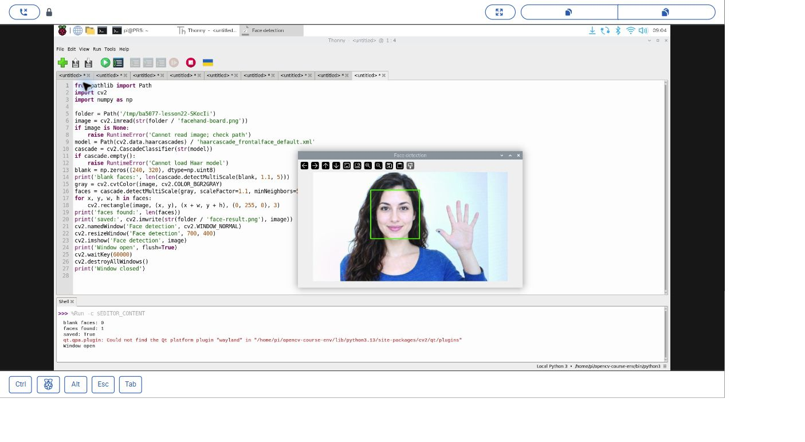
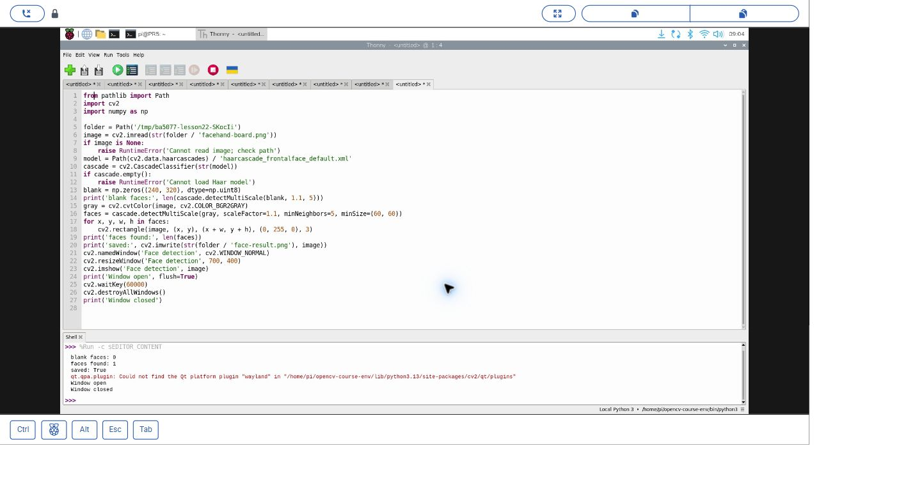
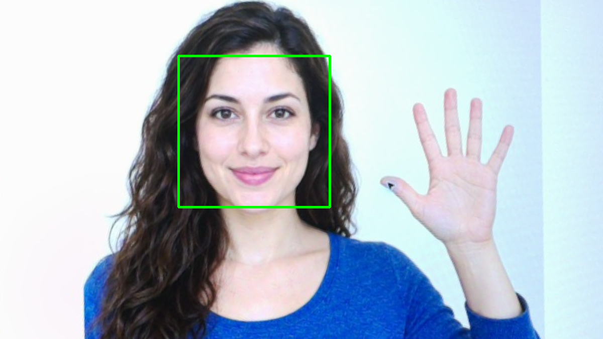

# 35｜找出臉在哪裡：Haar 臉部偵測

## [原課號：第 22 課｜使用 OpenCV 進行臉部檢測](https://github.com/Samuel-ncu/BA5077-RP5-compatibility/blob/main/%E6%95%99%E6%9D%90/%E7%AC%AC%2022%20%E8%AA%B2%EF%BD%9C%E4%BD%BF%E7%94%A8%20OpenCV%20%E9%80%B2%E8%A1%8C%E8%87%89%E9%83%A8%E6%AA%A2%E6%B8%AC.md)

digithouse.net 原文：[第 22 課｜使用 OpenCV 進行臉部檢測](https://digithouse.net/blog/ba5077-lesson-19-face-detection?locale=zh-TW)

> **本篇狀態**：用相機拍下的 **AI 生成虛構人物**素材做 Haar 臉部偵測，已在**目前 Trixie** 的 Thonny 實測（2026-11-10，Python 3.13.5、OpenCV 4.12.0）：黑圖 0 張臉、素材 1 張臉。2026-11-11 把讀圖位置改成程式所在資料夾後又重跑一次，**那次沒有另存截圖**。**尚未實測**：真人、即時相機、不同角度與光線、全新安裝的系統。

手機相機在你按快門前，常會在臉上畫一個小框。它還不知道你是誰，只知道「這裡有一張臉」。這就是**臉部偵測**：回答「臉在哪裡」，而不是「這是誰」。這篇我們用 OpenCV 內建、很經典的 Haar 方法，先確認在一張全黑的圖上不會亂找，再讓它在一張相機拍下的人物素材上把臉框出來。

## 這篇會學到什麼

- 臉部**偵測**和臉部**辨識**的差別。
- 用 `cv2.data.haarcascades` 找到 OpenCV 附帶的 Haar 模型檔。
- `detectMultiScale` 的三個常用參數。
- 為什麼「找到 1 張臉」不能代表在真人身上也一樣準。

## 需要的東西

- [新 11](./11-%E5%9C%A8%20Thonny%20%E6%BA%96%E5%82%99%20OpenCV%20%E5%B7%A5%E5%85%B7%E7%AE%B1%EF%BC%9A%E8%99%9B%E6%93%AC%E7%92%B0%E5%A2%83%E8%88%87%E5%AE%89%E8%A3%9D.md) 的 OpenCV 環境（本次是 `/home/pi/opencv-course-env/bin/python3`）。
- 一個新的練習資料夾，放兩個檔案：
  - [練習素材 facehand-board.png](https://github.com/Samuel-ncu/BA5077-RP5-compatibility/blob/main/%E6%95%99%E6%9D%90/%E5%9C%96%E6%AA%94/facehand-board.png)。這是 **AI 生成的虛構人物**，顯示在螢幕上後由 RP5 相機拍下、再裁切校正的圖，不是真人照片。
  - [本篇程式](https://github.com/Samuel-ncu/BA5077-RP5-compatibility/blob/main/%E6%95%99%E6%9D%90/%E7%AF%84%E4%BE%8B%E7%A8%8B%E5%BC%8F/%E7%AC%AC22%E8%AA%B2-%E7%94%9F%E6%88%90%E7%B4%A0%E6%9D%90%E4%BA%BA%E8%87%89%E5%81%B5%E6%B8%AC-trixie.py)。

## 先懂幾個名詞

- **臉部偵測**：找出影像中可能是臉的位置，畫成方框。
- **臉部辨識**：判斷這張臉是誰。下一篇才會碰到。
- **Haar 特徵**：用一塊塊明暗對比（例如眼睛比臉頰暗）來描述臉的樣子。
- **級聯分類器（cascade）**：一層一層篩選，先用簡單的特徵快速排除明顯不是臉的區域，再用更細的特徵確認。

## 一步一步操作

### 步驟 1：讀程式

**為什麼**：Haar 偵測只要「載入模型、轉灰階、偵測」三步。

```python
from pathlib import Path
import cv2
import numpy as np

folder = Path(__file__).resolve().parent
image = cv2.imread(str(folder / 'facehand-board.png'))
if image is None:
    raise RuntimeError('Cannot read image; check path')
model = Path(cv2.data.haarcascades) / 'haarcascade_frontalface_default.xml'
cascade = cv2.CascadeClassifier(str(model))
if cascade.empty():
    raise RuntimeError('Cannot load Haar model')
blank = np.zeros((240, 320), dtype=np.uint8)
print('blank faces:', len(cascade.detectMultiScale(blank, 1.1, 5)))
gray = cv2.cvtColor(image, cv2.COLOR_BGR2GRAY)
faces = cascade.detectMultiScale(gray, scaleFactor=1.1, minNeighbors=5, minSize=(60, 60))
for x, y, w, h in faces:
    cv2.rectangle(image, (x, y), (x + w, y + h), (0, 255, 0), 3)
print('faces found:', len(faces))
print('saved:', cv2.imwrite(str(folder / 'face-result.png'), image))
cv2.namedWindow('Face detection', cv2.WINDOW_NORMAL)
cv2.resizeWindow('Face detection', 700, 400)
cv2.imshow('Face detection', image)
print('Window open', flush=True)
cv2.waitKey(60000)
cv2.destroyAllWindows()
print('Window closed')
```

- `cv2.data.haarcascades`：pip 安裝的 OpenCV 會附帶 Haar 模型，這個變數就是它們所在的資料夾，不用自己找路徑。
- `cascade.empty()`：模型沒載入成功時是 `True`，要先檢查。
- 先拿一張全黑的圖測試：上面沒有臉，應該找到 0 個。
- `detectMultiScale` 的參數：
  - `scaleFactor=1.1`：每次把影像縮小 10% 再找一次，才能找到大小不同的臉。
  - `minNeighbors=5`：同一個位置至少要有 5 個候選框重疊才算數，數字越大越嚴格。
  - `minSize=(60, 60)`：小於 60 × 60 的不算。

### 步驟 2：在 Thonny 執行

**為什麼**：看黑圖是不是 0、素材上的臉有沒有被框到。

在 Thonny 開啟程式，右下角選好 OpenCV 環境，按 **F5**。出現 `Face detection` 視窗後，點一下視窗再按任意鍵關閉，或等 60 秒。輸出 `face-result.png` 會覆寫同名檔。

本次輸出：

```text
blank faces: 0
faces found: 1
saved: True
Window open
Window closed
```

Shell 另外出現 Qt 找不到 `wayland` 平台外掛的訊息，但視窗正常顯示、正常關閉。另外用檔案工具確認輸出 PNG 是 1200 × 675。

### 步驟 3：讀懂結果

**為什麼**：要分清楚這次結果能證明什麼、不能證明什麼。

- 黑圖 0 張臉：沒有臉的地方不會亂框，符合預期。
- 素材 1 張臉：綠框套在素材人物的臉上。
- 這只是一張 AI 生成素材的結果，**不能**證明在真人、不同角度、不同光線或即時相機下也一樣。

臉部影像屬於敏感的個人資料。拍攝真人前要先取得同意，也不要把別人的照片上傳到公開的地方。

### 步驟 4：和原文比一比

**為什麼**：原文的模型路徑寫法在很多電腦上會找不到。

原文寫 `CascadeClassifier('haarcascade_frontalface_alt2.xml')`，只給檔名，必須先把這個檔案複製到工作資料夾才讀得到；讀不到時也不會報錯，只是什麼都找不到。原文的參數是 `1.05` 和 `20`，比本篇更細、更嚴格。原文的 `demo.jpeg` 和 `alt2` 模型本次沒有重跑。

## 成果圖



*操作截圖（目前 Trixie，2026-11-10）：Thonny 與 `Face detection` 視窗，綠框是本次偵測結果。素材是相機拍下螢幕上的 AI 生成虛構人物。截圖是讀圖位置修正前的版本，偵測程式相同。*



*操作截圖：按鍵關閉視窗後的 Shell。*



*程式輸出（較早的環境）：同一張素材的 Haar 偵測結果。原始相機全景含螢幕外的環境，沒有公開。*

## 常見問題

| 你看到的情況 | 可能原因 | 先試試看 |
| --- | --- | --- |
| `Cannot load Haar model` | 模型路徑不對 | 用 `cv2.data.haarcascades` 找路徑；印出 `model` 確認檔案存在。 |
| `faces found: 0`，但圖上明明有臉 | 臉太小、太斜，或參數太嚴格 | 把 `minNeighbors` 調小、`minSize` 調小。 |
| 找到很多不是臉的框 | 參數太寬鬆 | 把 `minNeighbors` 調大。 |
| `Cannot read image` | 圖片不在程式旁邊 | 把圖片和程式放在同一個資料夾。 |

以上是常見情況的整理，本次沒有逐一重現。

## 小結

臉部偵測回答「臉在哪裡」，不回答「是誰」。Haar 方法用明暗特徵加上級聯篩選，OpenCV 附帶的模型可以用 `cv2.data.haarcascades` 找到。本次在目前 Trixie 上，黑圖 0 張、AI 生成素材 1 張。這不代表真人或即時相機的表現，而且臉部影像要謹慎處理。

**練習**：把 `minNeighbors` 改成 `2` 和 `10`，先預測框的數量會怎麼變，再執行比較。這是延伸練習，本次尚未實測，請以你實際得到的輸出為準。

## 下一篇預告

找到臉之後，下一步是「這是誰」。下一篇[36｜認出是誰的臉：LBPH 臉部辨識](./36-%E8%AA%8D%E5%87%BA%E6%98%AF%E8%AA%B0%E7%9A%84%E8%87%89%EF%BC%9ALBPH%20%E8%87%89%E9%83%A8%E8%BE%A8%E8%AD%98.md)，我們用 LBPH 方法學習幾張臉，再讓它猜猜看。
