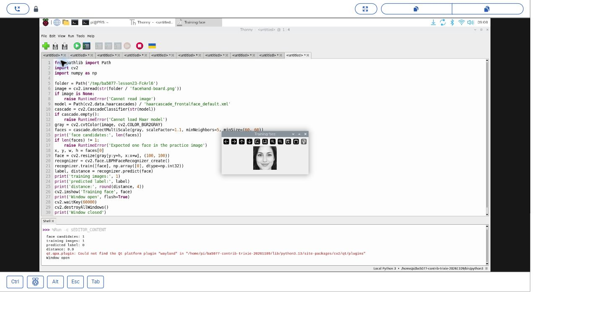
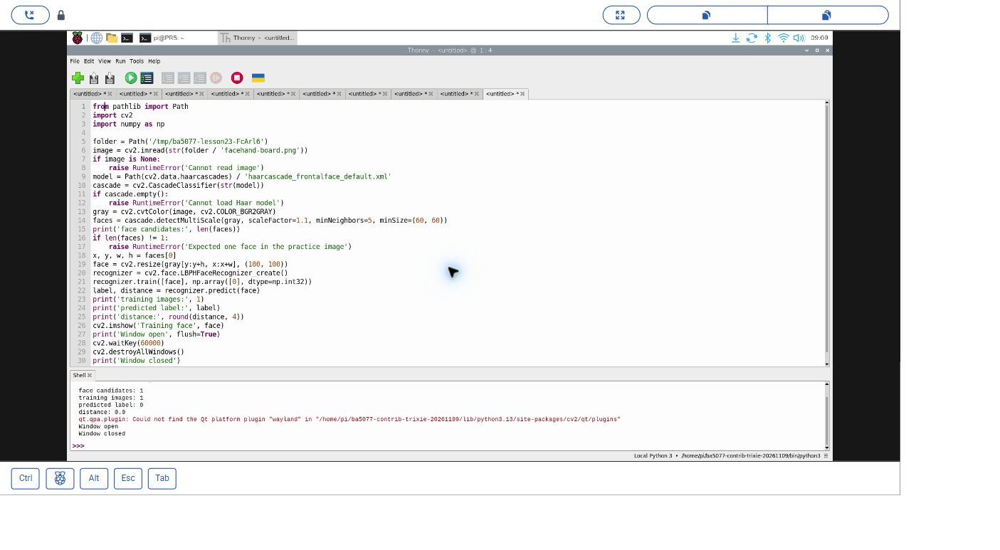

# 36｜認出是誰的臉：LBPH 臉部辨識

## [原課號：第 23 課｜使用 Picamera2 和 OpenCV 進行臉部識別](https://github.com/Samuel-ncu/BA5077-RP5-compatibility/blob/main/%E6%95%99%E6%9D%90/%E7%AC%AC%2023%20%E8%AA%B2%EF%BD%9C%E4%BD%BF%E7%94%A8%20Picamera2%20%E5%92%8C%20OpenCV%20%E9%80%B2%E8%A1%8C%E8%87%89%E9%83%A8%E8%AD%98%E5%88%A5.md)

digithouse.net 原文：[第 23 課｜使用 Picamera2 和 OpenCV 進行臉部識別](https://digithouse.net/blog/ba5077-lesson-20-face-recognition?locale=zh-TW)

> **本篇狀態**：用 AI 生成虛構人物素材跑「偵測 → 訓練 → 預測」流程，已在**目前 Trixie** 的 Thonny 實測（2026-11-10，Python 3.13.5、OpenCV 4.12.0）。**這次訓練和預測用的是同一張臉，只驗證程式能跑，不是辨識效果。** 2026-11-11 修正讀圖位置後重跑，沒有另存截圖。**尚未實測**：真人資料、沒看過的照片、多個人、Picamera2 即時辨識、全新安裝的系統。

上一篇我們找到了臉在哪裡。下一個問題更難：**這是誰？**電腦要先「看過」每個人的幾張臉，記住他們的特徵，之後遇到一張新的臉，才能猜是哪一個人。這叫臉部辨識。這篇我們用 OpenCV 的 LBPH 辨識器走一次完整流程：偵測臉、訓練、預測。也要先說清楚：這次的資料太少，只能確認程式怎麼寫，還談不上準不準。

## 這篇會學到什麼

- 臉部辨識的流程：準備有標籤的臉 → 訓練 → 預測新的臉。
- LBPH 辨識器怎麼建立、`train` 和 `predict` 怎麼用。
- `predict` 回傳的距離值代表什麼。
- 為什麼「用訓練過的那張臉來測」不能說明辨識效果。

## 需要的東西

- 一個支援 `cv2.face` 的環境，也就是有 **OpenCV 擴充模組**（`opencv-contrib-python`）的環境。本次使用 `/home/pi/ba5077-contrib-trixie-20261109/bin/python3`；建法同[新 15](./15-%E7%9B%B8%E6%A9%9F%E7%95%AB%E9%9D%A2%E8%AE%8A%E6%88%90%E6%95%B8%E5%AD%97%EF%BC%9APicamera2%20%E5%8A%A0%20OpenCV%20%E8%AE%80%E4%B8%80%E5%BC%B5%E5%BD%B1%E6%A0%BC.md) 的擴充環境。新 11 的一般 OpenCV 沒有 `cv2.face`。
- 一個新的練習資料夾，放兩個檔案：
  - 和[新 35](./35-%E6%89%BE%E5%87%BA%E8%87%89%E5%9C%A8%E5%93%AA%E8%A3%A1%EF%BC%9AHaar%20%E8%87%89%E9%83%A8%E5%81%B5%E6%B8%AC.md) 相同的素材 [facehand-board.png](https://github.com/Samuel-ncu/BA5077-RP5-compatibility/blob/main/%E6%95%99%E6%9D%90/%E5%9C%96%E6%AA%94/facehand-board.png)（AI 生成虛構人物，相機拍下後校正）。
  - [本篇程式](https://github.com/Samuel-ncu/BA5077-RP5-compatibility/blob/main/%E6%95%99%E6%9D%90/%E7%AF%84%E4%BE%8B%E7%A8%8B%E5%BC%8F/%E7%AC%AC23%E8%AA%B2-%E7%94%9F%E6%88%90%E7%B4%A0%E6%9D%90LBPH-trixie.py)。

## 先懂幾個名詞

- **標籤（label）**：每個人的編號，例如 0 代表小明、1 代表小華。
- **訓練**：把很多張「已知是誰」的臉交給辨識器，讓它記住每個人的特徵。
- **LBPH（Local Binary Patterns Histograms）**：把臉切成小格子，記錄每一格的紋理分布，用這些分布來比較兩張臉像不像。
- **距離**：新的臉和記憶中最像的那個人差多少。**越小越像**，它不是百分比，也不是正確率。

## 一步一步操作

### 步驟 1：讀程式

**為什麼**：辨識之前一定要先偵測，而且臉要縮成一樣的大小。

```python
from pathlib import Path
import cv2
import numpy as np

folder = Path(__file__).resolve().parent
image = cv2.imread(str(folder / 'facehand-board.png'))
if image is None:
    raise RuntimeError('Cannot read image')
model = Path(cv2.data.haarcascades) / 'haarcascade_frontalface_default.xml'
cascade = cv2.CascadeClassifier(str(model))
if cascade.empty():
    raise RuntimeError('Cannot load Haar model')
gray = cv2.cvtColor(image, cv2.COLOR_BGR2GRAY)
faces = cascade.detectMultiScale(gray, scaleFactor=1.1, minNeighbors=5, minSize=(60, 60))
print('face candidates:', len(faces))
if len(faces) != 1:
    raise RuntimeError('Expected one face in the practice image')
x, y, w, h = faces[0]
face = cv2.resize(gray[y:y+h, x:x+w], (100, 100))
recognizer = cv2.face.LBPHFaceRecognizer_create()
recognizer.train([face], np.array([0], dtype=np.int32))
label, distance = recognizer.predict(face)
print('training images:', 1)
print('predicted label:', label)
print('distance:', round(distance, 4))
cv2.imshow('Training face', face)
print('Window open', flush=True)
cv2.waitKey(60000)
cv2.destroyAllWindows()
print('Window closed')
```

- 前半和新 35 一樣，用 Haar 找到臉。如果不是剛好找到 1 張，程式就停下來，不會亂訓練。
- `gray[y:y+h, x:x+w]` 把臉裁出來，再縮成 100 × 100。**訓練和預測的臉要用同樣的大小**。
- `train([face], [0])`：只用一張臉、標籤 0 訓練。
- `predict(face)`：拿**同一張臉**來預測，回傳標籤和距離。

### 步驟 2：在 Thonny 執行

**為什麼**：確認整個流程能跑通。

在 Thonny 的 **Tools → Options → Interpreter** 選有 `cv2.face` 的環境，開啟程式按 **F5**。視窗會顯示裁切出來、用來訓練的灰階臉；點視窗按任意鍵關閉，或等 60 秒。

本次輸出：

```text
face candidates: 1
training images: 1
predicted label: 0
distance: 0.0
Window open
Window closed
```

Shell 另外出現 Qt 找不到 `wayland` 平台外掛的訊息，視窗仍正常顯示並關閉。

### 步驟 3：為什麼 `distance: 0.0` 不代表很準

**為什麼**：這是最容易被誤解的地方。

訓練用的是這張臉、預測用的也是這張臉，完全一樣，距離當然是 0。這就像考試考的是剛剛背過的那一題，答對不代表真的學會。要知道辨識器準不準，需要：

- 每個人準備**很多張**不同角度、光線的臉來訓練。
- 用**沒有參與訓練**的照片來測試。
- 至少有兩個以上的人，才知道它分不分得出來。

本次只訓練一個標籤，也不能證明它認得出陌生人。真人臉部資料屬於敏感個資，使用前要取得當事人同意，並想清楚資料怎麼保存、誤判會造成什麼影響。

### 步驟 4：和原文比一比

**為什麼**：原文是完整的即時辨識系統，有幾個地方要注意。

原文先讀 100 張 `images/h0/000.pgm`～`099.pgm`，縮成 100 × 100 訓練並存成 `faces.data`；再用 Picamera2 即時取像、Haar 偵測，把每張臉縮成 **400 × 400** 預測，距離小於 50 就在畫面上寫出名字，按 Esc 結束。兩個值得注意的地方：

- 訓練用 100 × 100、預測卻用 400 × 400，大小不一致。本篇訓練和預測都用 100 × 100。
- 相機設定沒有指定格式，預設會給 4 個通道的影像，接著直接用 `COLOR_BGR2GRAY` 轉灰階可能會出錯。新 17、27 都在設定裡寫明 `"format": "RGB888"`。

原文的訓練照片沒有附上，即時辨識本次沒有重跑。

## 成果圖



*操作截圖（目前 Trixie，2026-11-10）：Thonny 執行本篇程式，視窗是裁切後的 AI 生成虛構人物臉部。截圖是讀圖位置修正前的版本，訓練與預測程式相同。*



*操作截圖：按鍵關閉視窗後，Shell 印出標籤 0、距離 0.0。*

## 常見問題

| 你看到的情況 | 可能原因 | 先試試看 |
| --- | --- | --- |
| `module 'cv2' has no attribute 'face'` | 環境沒有擴充模組 | 改選有 `opencv-contrib-python` 的環境。 |
| `Expected one face in the practice image` | Haar 找到 0 張或超過 1 張 | 回到新 35 調整參數，或換一張只有一個人的圖。 |
| `setting an array element with a sequence` | 訓練用的臉大小不一 | 全部縮成同樣大小，例如 100 × 100。 |
| 每張臉都被認成同一個人 | 只訓練了一個人 | 至少準備兩個人、每人多張照片。 |

以上是常見情況的整理，本次沒有逐一重現；第三列是原文提到的錯誤。

## 小結

臉部辨識是「偵測 → 裁切成同樣大小 → 訓練 → 預測」。LBPH 用局部紋理比較兩張臉，`predict` 回傳標籤和距離，距離越小越像。本次在目前 Trixie 上流程跑通，但訓練和預測是同一張 AI 生成的臉，距離 0.0 只說明程式能跑，不能代表辨識效果。真正的評估需要多人、多張、沒看過的照片，而且要謹慎處理臉部資料。

**練習**：想一想，如果要測試這個辨識器準不準，你會怎麼準備訓練資料和測試資料？各需要幾個人、每人幾張？寫下你的計畫。這是思考練習，不需要實際拍攝真人。

## 下一篇預告

Haar 和 LBPH 都是傳統方法。下一篇[37｜改用神經網路找臉：OpenCV DNN](./37-%E6%94%B9%E7%94%A8%E7%A5%9E%E7%B6%93%E7%B6%B2%E8%B7%AF%E6%89%BE%E8%87%89%EF%BC%9AOpenCV%20DNN.md)，我們改用訓練好的神經網路模型找臉，看看和 Haar 有什麼不同。
