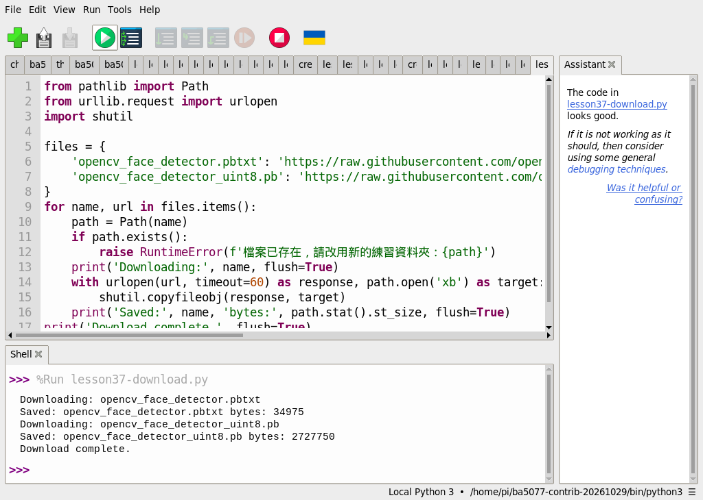
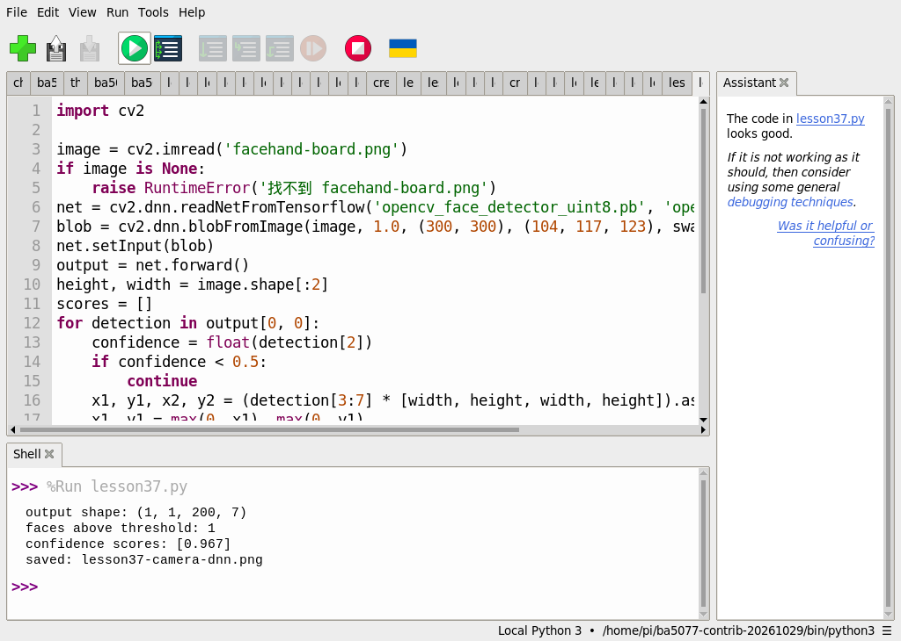
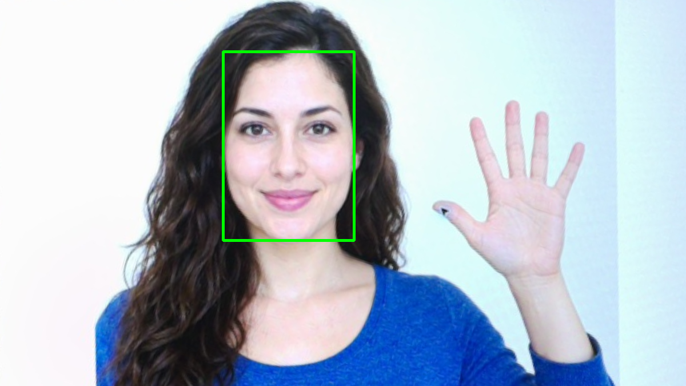

# 37｜改用神經網路找臉：OpenCV DNN

## [原課號：第 37 課｜使用 OpenCV DNN 模型進行人臉檢測](https://github.com/Samuel-ncu/BA5077-RP5-compatibility/blob/main/%E6%95%99%E6%9D%90/%E7%AC%AC%2037%20%E8%AA%B2%EF%BD%9C%E4%BD%BF%E7%94%A8%20OpenCV%20DNN%20%E6%A8%A1%E5%9E%8B%E9%80%B2%E8%A1%8C%E4%BA%BA%E8%87%89%E6%AA%A2%E6%B8%AC.md)

digithouse.net 原文：[第 37 課｜使用 OpenCV DNN 模型進行人臉檢測](https://digithouse.net/blog/ba5077-lesson-33-opencv-dnn-face?locale=zh-TW)

> **本篇狀態**：在 Thonny 下載 OpenCV 人臉模型、對 AI 生成虛構人物素材做單張偵測，已實測，但用的是**舊環境**（Python 3.11、NumPy 1.26.4、opencv-contrib-python 4.11.0.86）；**目前 Trixie 尚未重跑**。空白圖的模型載入測試是較早用終端機執行的。**尚未實測**：原文的即時相機版本、真人、不同光線與角度、全新安裝的系統。

新 35 的 Haar 方法是工程師事先設計好「臉應該長怎樣」的明暗特徵。另一種做法是：準備大量的臉部照片，讓**神經網路**自己學出什麼樣子是臉。學好的模型存成檔案，我們只要載入它、把圖片丟進去，就能得到候選的臉部位置和信心分數。這篇我們用 OpenCV 的 DNN 模組載入一個訓練好的人臉模型，在和新 35 相同的素材上找臉。

## 這篇會學到什麼

- 「訓練好的模型」是什麼：結構檔加權重檔。
- 用 `cv2.dnn.readNetFromTensorflow` 載入模型。
- `blobFromImage` 把圖片轉成模型要的格式、`forward` 做一次推論。
- 怎麼從輸出張量讀出臉的位置和信心分數。

## 需要的東西

- 一個裝有 OpenCV 和 NumPy 的 Thonny 環境，以及網路（第一次要下載模型）。
- 一個**新的**練習資料夾，放三個檔案：
  - [模型下載程式](https://github.com/Samuel-ncu/BA5077-RP5-compatibility/blob/main/%E6%95%99%E6%9D%90/%E7%AF%84%E4%BE%8B%E7%A8%8B%E5%BC%8F/%E7%AC%AC37%E8%AA%B2-Thonny%E4%B8%8B%E8%BC%89DNN%E6%A8%A1%E5%9E%8B.py)
  - [單張人臉偵測程式](https://github.com/Samuel-ncu/BA5077-RP5-compatibility/blob/main/%E6%95%99%E6%9D%90/%E7%AF%84%E4%BE%8B%E7%A8%8B%E5%BC%8F/%E7%AC%AC37%E8%AA%B2-%E7%9B%B8%E6%A9%9FDNN%E4%BA%BA%E8%87%89.py)
  - 和新 35 相同的素材 [facehand-board.png](https://github.com/Samuel-ncu/BA5077-RP5-compatibility/blob/main/%E6%95%99%E6%9D%90/%E5%9C%96%E6%AA%94/facehand-board.png)（AI 生成虛構人物，相機拍下後校正）。

## 先懂幾個名詞

- **深度神經網路（DNN）**：由很多層計算組成的模型，從大量資料學出規則。
- **模型檔**：本篇有兩個：`opencv_face_detector.pbtxt` 描述網路的結構，`opencv_face_detector_uint8.pb` 存訓練好的權重。它們是資料檔，不是 Python 套件。
- **推論（inference）**：把輸入送過模型得到輸出。這裡只推論，不重新訓練。
- **信心分數**：模型覺得「這裡是臉」的程度，0～1。

## 一步一步操作

### 步驟 1：下載模型

**為什麼**：沒有模型檔就沒有東西可以載入。

在 Thonny 開啟模型下載程式，先看一下裡面的來源網址，再按 **Run**。它會從 OpenCV 在 GitHub 上的來源下載兩個檔案。資料夾裡已有同名檔時程式會停下來、不覆寫，所以請用新的練習資料夾。舊環境的輸出：

```text
Downloading: opencv_face_detector.pbtxt
Saved: opencv_face_detector.pbtxt bytes: 34975
Downloading: opencv_face_detector_uint8.pb
Saved: opencv_face_detector_uint8.pb bytes: 2727750
Download complete.
```

權重檔約 2.7 MB。其中一個來源用的是 `master` 分支，日後內容可能改變；repo 第 37 課記下了這次兩個檔案的 SHA-256，可以用來比對。網路中斷可能留下不完整的檔案，請換一個新資料夾重試。

### 步驟 2：讀偵測程式

**為什麼**：DNN 的輸出是一個多維陣列，要知道怎麼從裡面取出方框。

```python
import cv2

image = cv2.imread('facehand-board.png')
if image is None:
    raise RuntimeError('找不到 facehand-board.png')
net = cv2.dnn.readNetFromTensorflow('opencv_face_detector_uint8.pb', 'opencv_face_detector.pbtxt')
blob = cv2.dnn.blobFromImage(image, 1.0, (300, 300), (104, 117, 123), swapRB=False, crop=False)
net.setInput(blob)
output = net.forward()
height, width = image.shape[:2]
scores = []
for detection in output[0, 0]:
    confidence = float(detection[2])
    if confidence < 0.5:
        continue
    x1, y1, x2, y2 = (detection[3:7] * [width, height, width, height]).astype(int)
    x1, y1 = max(0, x1), max(0, y1)
    x2, y2 = min(width-1, x2), min(height-1, y2)
    cv2.rectangle(image, (x1, y1), (x2, y2), (0, 255, 0), 3)
    scores.append(round(confidence, 3))
if not cv2.imwrite('lesson37-camera-dnn.png', image):
    raise RuntimeError('無法儲存結果')
print('output shape:', output.shape)
print('faces above threshold:', len(scores))
print('confidence scores:', scores)
print('saved: lesson37-camera-dnn.png')
```

- `blobFromImage(image, 1.0, (300, 300), (104, 117, 123), ...)`：把圖片縮成模型要的 300 × 300，並減去訓練時用的平均顏色。
- `net.forward()`：做一次推論，輸出形狀是 `(1, 1, 200, 7)`，代表最多 200 個候選，每個候選有 7 個數字。
- 每個候選的第 3 個數字（`detection[2]`）是信心分數；第 4～7 個是方框的左上、右下，用 0～1 的比例表示，所以要乘上圖片的寬高。
- 只畫信心分數至少 0.5 的框。

### 步驟 3：在 Thonny 執行

**為什麼**：看模型在素材上找到幾張臉、分數多少。

在同一個資料夾用 Thonny 開啟偵測程式，按 **Run**。輸出 `lesson37-camera-dnn.png` 會覆寫同名檔。舊環境的輸出：

```text
output shape: (1, 1, 200, 7)
faces above threshold: 1
confidence scores: [0.967]
saved: lesson37-camera-dnn.png
```

找到 1 張臉，信心分數 0.967。這是**這一個候選**的分數，不是模型在所有人臉上的準確率，也不代表知道這個人是誰。

### 步驟 4：和 Haar 比一比

**為什麼**：兩種方法回答的是同一個問題，做法不同。

| | Haar（新 35） | DNN（本篇） |
| --- | --- | --- |
| 怎麼知道什麼是臉 | 人設計的明暗特徵 | 神經網路從資料學出來 |
| 需要的檔案 | OpenCV 附帶的 XML | 另外下載的模型檔 |
| 輸出 | 方框 | 方框加信心分數 |
| 本次素材結果 | 1 張 | 1 張（0.967） |

只靠一張生成素材，看不出哪個比較好。要比較，得用經過授權、角度和光線多樣的測試資料。

### 步驟 5：和原文比一比

**為什麼**：原文是即時版本，寫法也不一樣。

原文用 Picamera2 即時取像，以 `cv2.dnn.readNet` 載入模型並包成 `dnn_DetectionModel`，用 `model.detect(frame, 0.5)` 直接拿到方框，影像是 4 個通道時先轉成 BGR，畫面上同時顯示 FPS 和信心分數，按 Esc 結束。本篇改成單張圖片、自己解析輸出。原文的即時版本本次沒有重跑。

## 成果圖



*操作截圖（舊環境）：步驟 1 在 Thonny 下載兩個模型檔。*



*操作截圖（舊環境）：步驟 3 的偵測程式與輸出。截圖中的 `lesson37.py` 是偵測程式的測試副本。*



*程式輸出：綠框是信心分數 0.967 的候選位置。素材是相機拍下螢幕上的 AI 生成虛構人物。*

## 常見問題

| 你看到的情況 | 可能原因 | 先試試看 |
| --- | --- | --- |
| 下載程式停下來，說檔案已存在 | 資料夾裡已有同名模型檔 | 換一個新的練習資料夾。 |
| `readNetFromTensorflow` 出錯 | 模型檔不完整或放錯資料夾 | 確認兩個檔案都在、大小和上面差不多。 |
| `faces above threshold: 0` | 門檻太高，或臉太小 | 把 `0.5` 調低一點試試。 |
| 方框位置很奇怪 | 忘了把比例座標乘上寬高 | 確認有 `* [width, height, width, height]`。 |

以上是常見情況的整理，本次沒有逐一重現。

## 小結

DNN 人臉偵測用的是神經網路從資料學出來的模型：下載結構檔和權重檔、用 `blobFromImage` 準備輸入、`forward` 推論，再從 `(1, 1, 200, 7)` 的輸出取出信心分數和方框。舊環境實測在 AI 生成素材上找到 1 張臉、分數 0.967。單張素材不能代表真人表現，臉部影像也要謹慎處理。

**練習**：把信心門檻從 `0.5` 改成 `0.9` 和 `0.2`，先預測框的數量會怎麼變，再執行比較。這是延伸練習，本次尚未實測，請以你實際得到的輸出為準。

## 下一篇預告

DNN 不只能找臉。下一篇[38｜第一個物件偵測器：YOLOv4-tiny](./38-%E7%AC%AC%E4%B8%80%E5%80%8B%E7%89%A9%E4%BB%B6%E5%81%B5%E6%B8%AC%E5%99%A8%EF%BC%9AYOLOv4-tiny.md)，我們用一個能同時認出杯子、蘋果、香蕉等 80 種東西的模型，接上相機做即時偵測。
