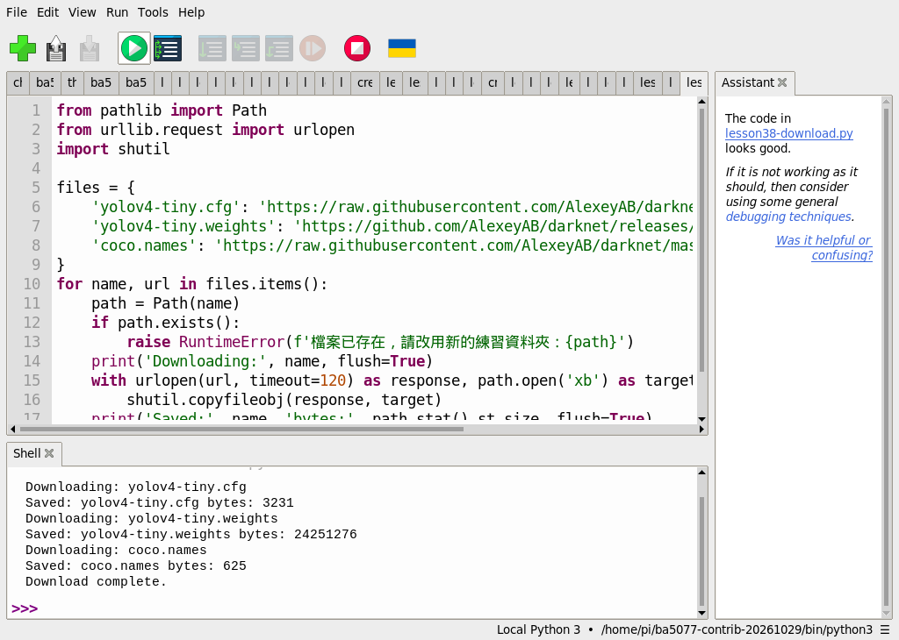
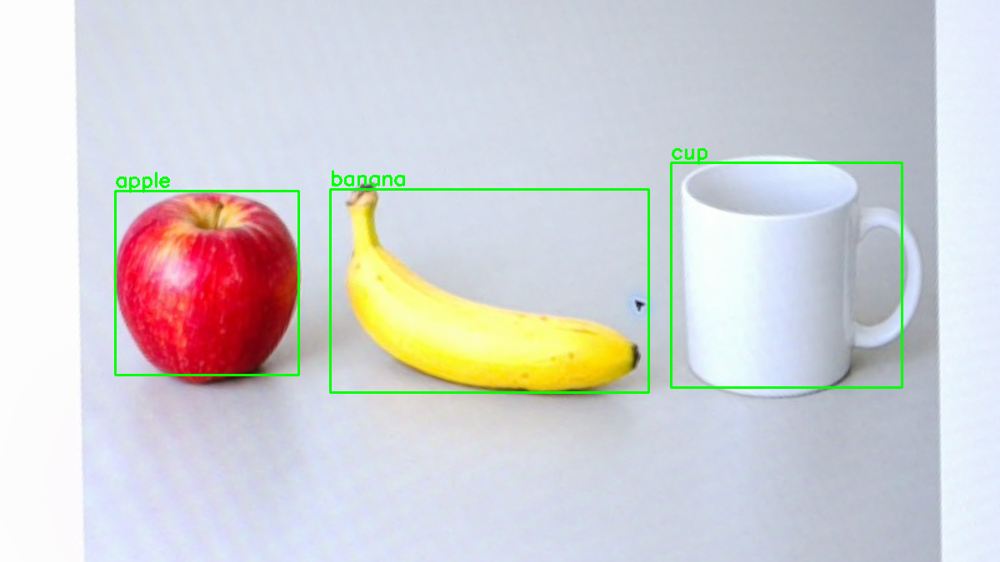
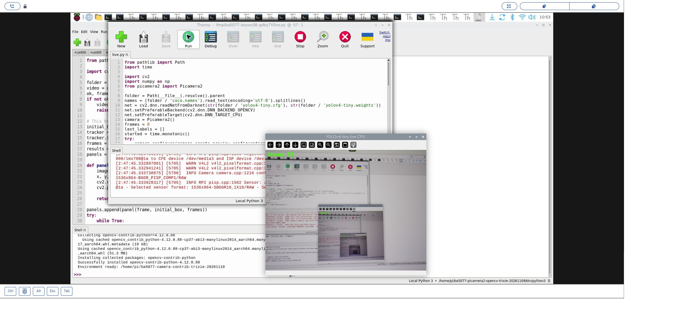
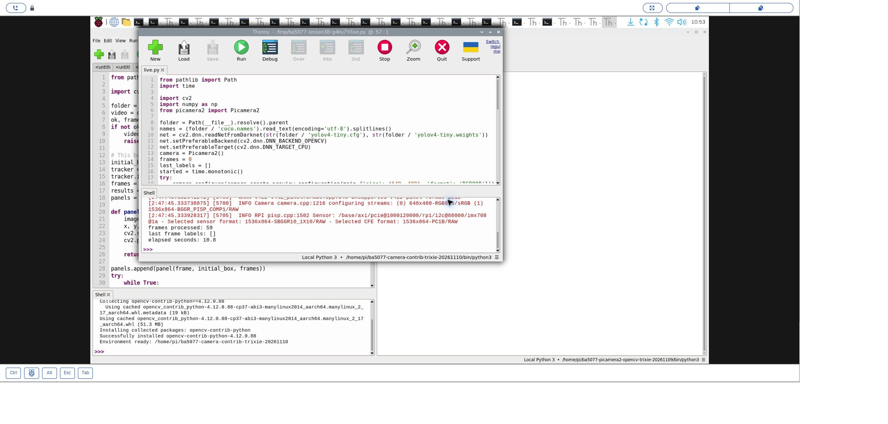

# 38｜第一個物件偵測器：YOLOv4-tiny

## [原課號：第 38 課｜使用 YOLOv4-tiny 與 OpenCV 進行即時物件檢測](https://github.com/Samuel-ncu/BA5077-RP5-compatibility/blob/main/%E6%95%99%E6%9D%90/%E7%AC%AC%2038%20%E8%AA%B2%EF%BD%9C%E4%BD%BF%E7%94%A8%20YOLOv4-tiny%20%E8%88%87%20OpenCV%20%E9%80%B2%E8%A1%8C%E5%8D%B3%E6%99%82%E7%89%A9%E4%BB%B6%E6%AA%A2%E6%B8%AC.md)

digithouse.net 原文：[第 38 課｜使用 YOLOv4-tiny 與 OpenCV 進行即時物件檢測](https://digithouse.net/blog/ba5077-lesson-34-yolov4-tiny?locale=zh-TW)

> **本篇狀態**：
> - **單張圖偵測**：AI 生成物件圖找到香蕉、杯子、蘋果，Thonny 實測在**舊環境**（Python 3.11、OpenCV 4.11）。
> - **即時相機**：在**目前 Trixie** 的 Thonny 實測（2026-11-10～11）。對著電腦螢幕跑 70 張、59 張，最後一張都沒有標籤；2026-11-11 對著螢幕上的生成物件圖跑 109 張，最後一張是 cup、apple、banana，**那次沒有另存截圖**。
> - **尚未實測**：實體物品、移動中的物體、速度與準確率評估、全新安裝的系統。

前一篇的模型只會找臉。如果想讓電腦同時認出杯子、蘋果、香蕉、人、車……呢？這就是**物件偵測**：在一張圖裡找出每個東西的位置，再說出它是什麼。YOLO 是很有名的一系列物件偵測模型，名字的意思是「只看一次（You Only Look Once）」：整張圖丟進去一次，就同時得到所有物體的框和類別。這篇我們用比較小、適合 Raspberry Pi 的 YOLOv4-tiny，先在一張圖上試，再接上相機。

## 這篇會學到什麼

- 物件偵測的輸出：類別、分數、方框。
- YOLOv4-tiny 需要的三個檔案：設定檔、權重、類別名稱。
- 怎麼從 YOLO 的輸出解碼出方框，以及「非極大值抑制」在做什麼。
- 即時相機版本要注意的地方。

## 需要的東西

- 一個裝有 OpenCV 和 NumPy 的 Thonny 環境，以及網路（下載約 24 MB 的模型）。即時相機版本另外需要 Picamera2，本次使用 `/home/pi/ba5077-camera-contrib-trixie-20261110/bin/python3`（建法見[新 15](./15-%E7%9B%B8%E6%A9%9F%E7%95%AB%E9%9D%A2%E8%AE%8A%E6%88%90%E6%95%B8%E5%AD%97%EF%BC%9APicamera2%20%E5%8A%A0%20OpenCV%20%E8%AE%80%E4%B8%80%E5%BC%B5%E5%BD%B1%E6%A0%BC.md)）。
- 一個**新的**練習資料夾，放這些檔案：
  - [模型下載程式](https://github.com/Samuel-ncu/BA5077-RP5-compatibility/blob/main/%E6%95%99%E6%9D%90/%E7%AF%84%E4%BE%8B%E7%A8%8B%E5%BC%8F/%E7%AC%AC38%E8%AA%B2-Thonny%E4%B8%8B%E8%BC%89YOLOv4%E6%A8%A1%E5%9E%8B.py)
  - [單張偵測程式](https://github.com/Samuel-ncu/BA5077-RP5-compatibility/blob/main/%E6%95%99%E6%9D%90/%E7%AF%84%E4%BE%8B%E7%A8%8B%E5%BC%8F/%E7%AC%AC38%E8%AA%B2-%E7%9B%B8%E6%A9%9FYOLOv4-tiny.py)
  - [即時相機程式](https://github.com/Samuel-ncu/BA5077-RP5-compatibility/blob/main/%E6%95%99%E6%9D%90/%E7%AF%84%E4%BE%8B%E7%A8%8B%E5%BC%8F/%E7%AC%AC38%E8%AA%B2-Thonny%E5%8D%B3%E6%99%82%E7%9B%B8%E6%A9%9FYOLOv4.py)
  - 和[新 18](./18-%E8%AE%80%E4%B8%80%E5%BC%B5%E5%9C%96%E4%B8%A6%E8%BD%89%E6%88%90%E7%81%B0%E9%9A%8E.md) 相同的 [objects-board.png](https://github.com/Samuel-ncu/BA5077-RP5-compatibility/blob/main/%E6%95%99%E6%9D%90/%E5%9C%96%E6%AA%94/objects-board.png)：AI 生成的蘋果、香蕉、杯子，顯示在螢幕上由 RP5 相機拍下校正，不是真實物品。

## 先懂幾個名詞

- **物件偵測**：找出圖中每個物體的位置和類別。
- **COCO**：一個常用的資料集，有 80 種類別（人、車、杯子、香蕉……）。`coco.names` 就是這 80 個名稱。
- **類別分數**：模型覺得「這個框是某一類」的程度。
- **非極大值抑制（NMS）**：同一個物體常常被好幾個重疊的框抓到，NMS 只留下分數最高的那一個。

## 一步一步操作

### 步驟 1：下載模型

**為什麼**：YOLOv4-tiny 要三個檔案才能用。

在 Thonny 開啟模型下載程式，先看一下來源網址，再按 **Run**。它從 Darknet 專案下載設定檔、權重和類別名稱。已有同名檔時會停下來不覆寫，所以請用新資料夾。輸出：

```text
Downloading: yolov4-tiny.cfg
Saved: yolov4-tiny.cfg bytes: 3231
Downloading: yolov4-tiny.weights
Saved: yolov4-tiny.weights bytes: 24251276
Downloading: coco.names
Saved: coco.names bytes: 625
Download complete.
```

repo 第 38 課記下了三個檔案的 SHA-256，目前 Trixie 下載的也和它一致。部分來源用的是 `master` 分支，日後內容可能改變。

### 步驟 2：讀單張偵測程式

**為什麼**：YOLO 的輸出要自己解碼，看懂這一段，以後換別的模型也知道怎麼讀。

```python
import cv2
import numpy as np

image = cv2.imread('objects-board.png')
if image is None:
    raise RuntimeError('找不到 objects-board.png')
with open('coco.names', encoding='utf-8') as file:
    names = [line.strip() for line in file if line.strip()]
net = cv2.dnn.readNetFromDarknet('yolov4-tiny.cfg', 'yolov4-tiny.weights')
blob = cv2.dnn.blobFromImage(image, 1/255, (416, 416), swapRB=True, crop=False)
net.setInput(blob)
outputs = net.forward(net.getUnconnectedOutLayersNames())
height, width = image.shape[:2]
boxes, scores, classes = [], [], []
for output in outputs:
    for row in output:
        class_scores = row[5:]
        class_id = int(np.argmax(class_scores))
        score = float(class_scores[class_id])
        if score < 0.4:
            continue
        center_x, center_y, w, h = row[:4] * [width, height, width, height]
        x, y = int(center_x-w/2), int(center_y-h/2)
        boxes.append([x, y, int(w), int(h)])
        scores.append(score)
        classes.append(class_id)
indices = cv2.dnn.NMSBoxes(boxes, scores, 0.4, 0.45)
selected = np.array(indices).reshape(-1).tolist() if len(indices) else []
for i in selected:
    x, y, w, h = boxes[i]
    cv2.rectangle(image, (x, y), (x+w, y+h), (0, 255, 0), 2)
    cv2.putText(image, names[classes[i]], (x, max(25, y-5)), cv2.FONT_HERSHEY_SIMPLEX, 0.8, (0, 255, 0), 2)
if not cv2.imwrite('lesson38-camera-yolov4.png', image):
    raise RuntimeError('無法儲存結果')
print('detections:', len(selected))
print('classes:', [names[classes[i]] for i in selected])
print('scores:', [round(scores[i], 3) for i in selected])
print('saved: lesson38-camera-yolov4.png')
```

- `blobFromImage(image, 1/255, (416, 416), swapRB=True)`：縮成 416 × 416、數值縮到 0～1、把 BGR 換成模型要的 RGB。
- `forward(net.getUnconnectedOutLayersNames())`：YOLOv4-tiny 有 2 個輸出層，都要拿。
- 每一列（`row`）的前 4 個數字是方框的**中心**和寬高（0～1 的比例），第 6 個以後是 80 類各自的分數。取分數最高的那一類，至少 0.4 才保留。
- `NMSBoxes(boxes, scores, 0.4, 0.45)`：把重疊太多的框去掉，只留最好的。

### 步驟 3：單張圖的結果

**為什麼**：先在固定的圖上確認解碼正確，再接相機。

在同一個資料夾開啟單張偵測程式，按 **Run**。舊環境的 Thonny 輸出：

```text
detections: 3
classes: ['banana', 'cup', 'apple']
scores: [0.993, 0.991, 0.941]
saved: lesson38-camera-yolov4.png
```

三樣東西都被找到。這些分數是**這張圖上**的結果，不是模型的整體準確率；而且圖中是 AI 生成的物品，不是真實的水果和杯子。

### 步驟 4：接上相機

**為什麼**：即時偵測就是把步驟 2 放進新 17 的連續取像迴圈。

即時相機程式在目前 Trixie 的 Thonny 執行：用 Picamera2 以 640 × 480 取像、每張都做步驟 2 的推論和解碼、顯示視窗，按 `q` 或約 30 秒後停止。它會印出處理了幾張、最後一張的標籤、花了幾秒。三次實測：

| 日期 | 鏡頭前 | 結果 |
| --- | --- | --- |
| 2026-11-10 | 電腦螢幕 | 按 `q` 停止：70 張、11.5 秒，最後一張沒有標籤 |
| 2026-11-10 | 顯示 Thonny 的螢幕（畫面遞迴） | 按 `q` 停止：59 張、10.8 秒，最後一張沒有標籤；有可公開的預覽截圖 |
| 2026-11-11 | 螢幕上的 AI 生成物件圖 | 按 `q` 停止：109 張、17.0 秒，最後一張是 `['cup', 'apple', 'banana']`；沒有另存截圖 |

前兩次只證明「取像、推論、顯示、停止」整條流程能跑；第三次才看到即時框出三類物件。`last frame labels` 只描述**最後一張**，不代表每一張都一樣。由這幾個數字大約可以看出，在 RP5 的 CPU 上每秒能處理 6 張左右，但會隨畫面和負載變化，不能當成保證的速度。

### 步驟 5：和原文比一比

**為什麼**：原文用了一個更簡潔的寫法。

原文用 `cv2.dnn.readNet` 載入後包成 `dnn_DetectionModel`，設定輸入大小 416、縮放 1/255、交換 RB，`model.detect(image, 0.6, 0.3)` 直接回傳類別、分數、方框，不用自己解碼；每一類隨機配一個顏色，接上 Picamera2 即時顯示。本篇自己解碼，是為了看清楚 YOLO 輸出的結構。原文的即時版本本次沒有重跑。

## 成果圖



*操作截圖（舊環境）：步驟 1 下載三個檔案。*



*程式輸出（舊環境）：步驟 3 的偵測結果，綠框標出香蕉、杯子、蘋果。物品是 AI 生成圖，不是實物。*



*操作截圖（目前 Trixie，2026-11-10）：即時相機視窗。相機拍的是顯示 Thonny 的螢幕，形成畫面遞迴，這次沒有偵測到物件。*



*操作截圖：按 `q` 停止後，Shell 印出 59 張、最後一張沒有標籤。*

## 常見問題

| 你看到的情況 | 可能原因 | 先試試看 |
| --- | --- | --- |
| `readNetFromDarknet` 出錯 | 三個檔案缺少或不完整 | 確認檔名、大小；換新資料夾重新下載。 |
| `No module named 'picamera2'` | 即時版本選錯環境 | 改選同時有 Picamera2 和 OpenCV 的環境。 |
| 同一個物體有好幾個框 | 沒做 NMS 或門檻太鬆 | 確認有呼叫 `NMSBoxes`。 |
| 標籤明顯錯誤 | 物體不在 COCO 的 80 類，或太小、太模糊 | 換 COCO 有的物品，靠近一點拍。 |
| 即時畫面很卡 | CPU 推論本來就慢 | 這是正常的；可以縮小輸入或改用更小的模型比較。 |

以上是常見情況的整理，本次沒有逐一重現。

## 小結

物件偵測同時回答「在哪裡」和「是什麼」。YOLOv4-tiny 要設定檔、權重、類別名稱三個檔案；輸出要依「中心、寬高、各類分數」解碼，再用 NMS 去掉重疊的框。單張生成物件圖上找到香蕉、杯子、蘋果；目前 Trixie 的即時相機流程能跑，對著生成物件圖時最後一張是 cup、apple、banana。這些都不是實物或準確率測試。

**練習**：把類別分數門檻從 `0.4` 改成 `0.8`，先預測還會剩幾個框，再執行驗證。這是延伸練習，本次尚未實測，請以你實際得到的輸出為準。

## 下一篇預告

YOLOv4-tiny 是用 OpenCV 讀進來的舊格式模型。下一篇[39｜YOLOv8 與 COCO：建立環境、訓練一回合](./39-YOLOv8%20%E8%88%87%20COCO%EF%BC%9A%E5%BB%BA%E7%AB%8B%E7%92%B0%E5%A2%83%E3%80%81%E8%A8%93%E7%B7%B4%E4%B8%80%E5%9B%9E%E5%90%88.md)，我們改用新一代的 YOLOv8，從建立環境開始，還會親手訓練一回合。
