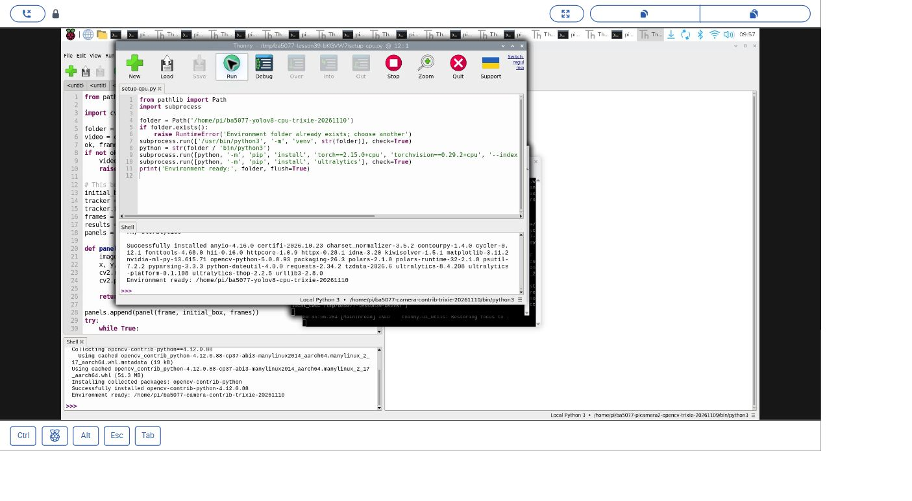
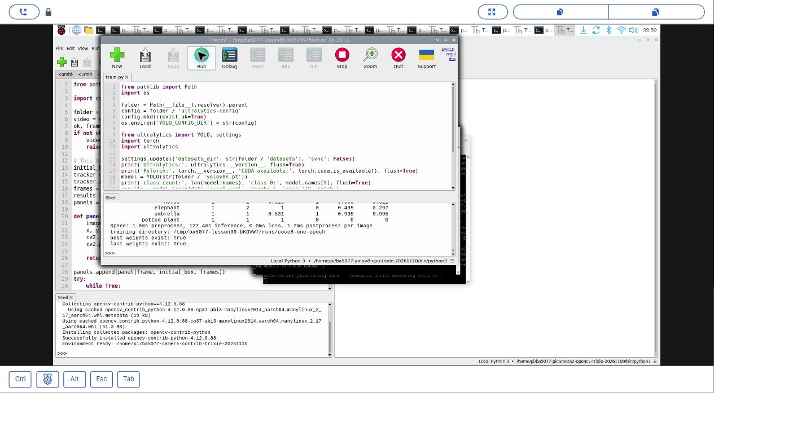
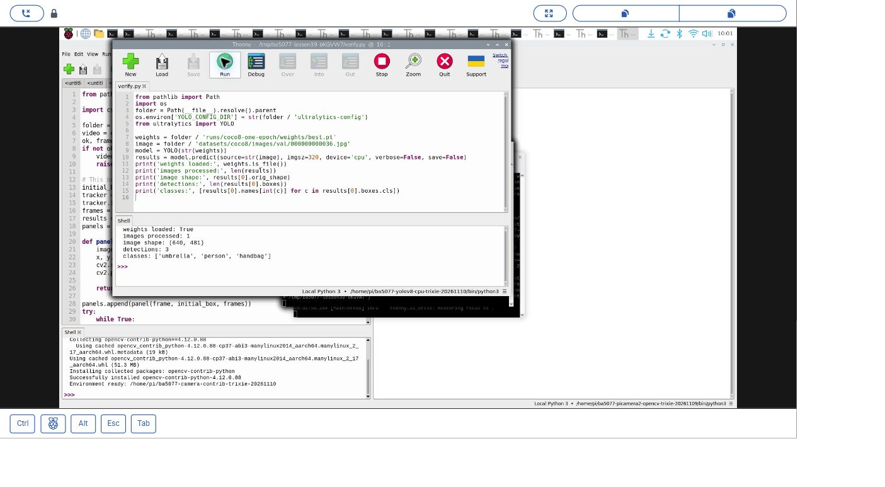

# 39｜YOLOv8 與 COCO：建立環境、訓練一回合

## [原課號：第 39 課｜YOLOv8 與 COCO 資料集完整教學](https://github.com/Samuel-ncu/BA5077-RP5-compatibility/blob/main/%E6%95%99%E6%9D%90/%E7%AC%AC%2039%20%E8%AA%B2%EF%BD%9CYOLOv8%20%E8%88%87%20COCO%20%E8%B3%87%E6%96%99%E9%9B%86%E5%AE%8C%E6%95%B4%E6%95%99%E5%AD%B8.md)

digithouse.net 原文：[第 39 課｜YOLOv8 與 COCO 資料集完整教學](https://digithouse.net/blog/ba5077-lesson-35-yolov8-coco?locale=zh-TW)

> **本篇狀態**：在**目前 Trixie** 的 Thonny 實測（2026-11-10，Python 3.13.5）：另建 CPU 專用環境、用 COCO8 小資料集訓練 **1 回合**、重新載入權重推論一張圖。下載 `yolov8n.pt` 並列出類別名稱是在**舊環境**（Python 3.11、Ultralytics 8.3.50）實測。**尚未實測**：完整 COCO 下載與長時間訓練、自己的資料集、全新安裝的系統。

上一篇的 YOLOv4-tiny 是別人訓練好、我們拿來用。這篇我們往前一步，看看模型是怎麼「學會」認東西的：準備一批**標註好的圖片**（哪裡有什麼東西），讓模型一邊看一邊調整自己。新一代的 YOLOv8 由 Ultralytics 套件提供，訓練、驗證、推論都只要幾行程式。在 Raspberry Pi 的 CPU 上，完整訓練要好幾天，所以這篇只用一個 8 張圖的小資料集訓練一回合，把整個流程走一次。

## 這篇會學到什麼

- 資料集、標註、模型檔三者的關係。
- 為什麼要在獨立環境裝 YOLOv8，以及為什麼要指定 CPU 版本的 PyTorch。
- 用 `model.train()` 訓練一回合，再用訓練出的權重推論。
- 為什麼這次的訓練結果不能當成準確率。

## 需要的東西

- 網路和足夠的儲存空間（PyTorch 和 Ultralytics 都不小）。
- [建立 CPU 環境的程式](https://github.com/Samuel-ncu/BA5077-RP5-compatibility/blob/main/%E6%95%99%E6%9D%90/%E7%AF%84%E4%BE%8B%E7%A8%8B%E5%BC%8F/Thonny%E5%BB%BA%E7%AB%8BTrixieYOLOCPU%E7%92%B0%E5%A2%83.py)、[單回合訓練程式](https://github.com/Samuel-ncu/BA5077-RP5-compatibility/blob/main/%E6%95%99%E6%9D%90/%E7%AF%84%E4%BE%8B%E7%A8%8B%E5%BC%8F/%E7%AC%AC39%E8%AA%B2-ThonnyCOCO8%E5%96%AE%E5%9B%9E%E5%90%88.py)、[權重驗證程式](https://github.com/Samuel-ncu/BA5077-RP5-compatibility/blob/main/%E6%95%99%E6%9D%90/%E7%AF%84%E4%BE%8B%E7%A8%8B%E5%BC%8F/%E7%AC%AC39%E8%AA%B2-ThonnyCOCO8%E6%AC%8A%E9%87%8D%E9%A9%97%E8%AD%89.py)。
- 一個新的練習資料夾。模型、資料集和訓練結果都會放在這裡，**不會**上傳到公開的 repo。

## 先懂幾個名詞

- **資料集**：一批圖片加上標註。標註記錄每張圖裡每個物體的類別和方框。
- **COCO**：大型的公開資料集，有 80 類物體。**COCO8** 是 Ultralytics 準備的迷你版：4 張訓練圖、4 張驗證圖，只用來測試流程。
- **預訓練模型**：已經在 COCO 上訓練好的模型，例如 `yolov8n.pt`（n 是 nano，最小的版本）。
- **epoch（回合）**：把所有訓練圖都看過一次。
- **權重檔**：訓練後存下來的模型，`best.pt` 是驗證成績最好的那一次，`last.pt` 是最後一次。

## 一步一步操作

### 步驟 1：建立 YOLOv8 專用的 CPU 環境

**為什麼**：YOLOv8 需要 PyTorch，而 PyTorch 預設會想裝 GPU（CUDA）版本，Raspberry Pi 沒有 NVIDIA 顯示卡，裝了只是白白下載一大堆用不到的東西。

在 Thonny 開啟環境建立程式，把 `folder` 改成你家目錄下**還不存在**的資料夾，按 **Run**：

```python
from pathlib import Path
import subprocess

folder = Path('/home/pi/ba5077-yolov8-cpu-trixie-20261110')
if folder.exists():
    raise RuntimeError('Environment folder already exists; choose another')
subprocess.run(['/usr/bin/python3', '-m', 'venv', str(folder)], check=True)
python = str(folder / 'bin/python3')
subprocess.run([python, '-m', 'pip', 'install', 'torch==2.15.0+cpu', 'torchvision==0.29.2+cpu', '--index-url', 'https://download.pytorch.org/whl/cpu'], check=True)
subprocess.run([python, '-m', 'pip', 'install', 'ultralytics'], check=True)
print('Environment ready:', folder, flush=True)
```

- 先用系統 Python 建一個獨立的虛擬環境。
- 從 [PyTorch 官方的 CPU 套件來源](https://pytorch.org/get-started/locally/)安裝 CPU 版的 PyTorch。
- 再裝 Ultralytics。

下載要花一些時間，Shell 出現 `Environment ready` 才算完成。本次得到 Ultralytics 8.4.208、PyTorch 2.15.0+cpu、torchvision 0.29.2+cpu。`ultralytics` 沒有固定版本，你裝到的可能不一樣，請記下實際版本。

實測時第一次沒有指定 CPU 來源，安裝程式開始解析 CUDA 相關套件，所以中止重來；成功的是後來新建的 CPU 環境。

完成後在 Thonny 選 **Run → Configure interpreter**，選新環境的 `bin/python3`。

### 步驟 2：用 COCO8 訓練一回合

**為什麼**：親手跑一次「下載資料 → 訓練 → 驗證 → 存權重」，才知道每一步在做什麼。

把單回合訓練程式放進練習資料夾，用新環境按 **Run**：

```python
from pathlib import Path
import os

folder = Path(__file__).resolve().parent
config = folder / 'ultralytics-config'
config.mkdir(exist_ok=True)
os.environ['YOLO_CONFIG_DIR'] = str(config)

from ultralytics import YOLO, settings
import torch
import ultralytics

settings.update({'datasets_dir': str(folder / 'datasets'), 'sync': False})
print('Ultralytics:', ultralytics.__version__, flush=True)
print('PyTorch:', torch.__version__, 'CUDA available:', torch.cuda.is_available(), flush=True)
model = YOLO(str(folder / 'yolov8n.pt'))
print('class count:', len(model.names), 'class 0:', model.names[0], flush=True)
results = model.train(data='coco8.yaml', epochs=1, imgsz=320, batch=1,
                      workers=0, device='cpu', amp=False, plots=False,
                      project=str(folder / 'runs'), name='coco8-one-epoch', exist_ok=False)
save_dir = Path(model.trainer.save_dir)
print('training directory:', save_dir, flush=True)
print('best weights exist:', (save_dir / 'weights' / 'best.pt').is_file(), flush=True)
print('last weights exist:', (save_dir / 'weights' / 'last.pt').is_file(), flush=True)
```

- `YOLO_CONFIG_DIR` 和 `datasets_dir`：讓設定、資料集都放在練習資料夾裡，不會散到家目錄各處。`sync: False` 關掉資料回傳。
- 第一次執行會自動下載 `yolov8n.pt` 和 COCO8。
- `train(..., epochs=1, imgsz=320, batch=1, device='cpu')`：只跑一回合、用小圖、一次一張、指定 CPU，讓 RP5 跑得動。

本次輸出最後幾行：

```text
training directory: /tmp/ba5077-lesson39-bKGVW7/runs/coco8-one-epoch
best weights exist: True
last weights exist: True
```

訓練完會在 `runs/coco8-one-epoch/` 下產生權重和驗證統計（`results.csv`）。**樣本只有 8 張、只跑一回合，這些數字不能當成正式評估。**再執行一次時，Ultralytics 可能自動建立帶編號的新資料夾。

### 步驟 3：重新載入權重並推論

**為什麼**：確認訓練出的檔案真的能用。

權重驗證程式讀取上一步的 `best.pt`，對 COCO8 的一張驗證圖推論：

```python
from pathlib import Path
import os

folder = Path(__file__).resolve().parent
os.environ['YOLO_CONFIG_DIR'] = str(folder / 'ultralytics-config')

from ultralytics import YOLO

weights = folder / 'runs/coco8-one-epoch/weights/best.pt'
image = folder / 'datasets/coco8/images/val/000000000036.jpg'
model = YOLO(str(weights))
results = model.predict(source=str(image), imgsz=320, device='cpu', verbose=False, save=False)
print('weights loaded:', weights.is_file())
print('images processed:', len(results))
print('image shape:', results[0].orig_shape)
print('detections:', len(results[0].boxes))
print('classes:', [results[0].names[int(c)] for c in results[0].boxes.cls])
```

本次輸出：

```text
weights loaded: True
images processed: 1
image shape: (640, 481)
detections: 3
classes: ['umbrella', 'person', 'handbag']
```

權重能重新載入、能推論。不過這張圖也在 COCO8 的驗證集裡，不是另外準備的測試圖，所以這只證明檔案可用，不是準確率。如果你的結果資料夾被自動加了編號，記得改 `weights` 的路徑。

### 步驟 4：只想看看模型認得哪些東西

**為什麼**：最簡單的確認方法，也是下一篇的起點。

舊環境的入門範例只載入模型、印出類別：

```python
from ultralytics import YOLO
model = YOLO('yolov8n.pt')
print('class count', len(model.names))
print('class 0', model.names[0])
```

輸出 `class count 80`、`class 0 person`。這只證明模型能載入，還沒對任何圖片推論。

### 步驟 5：和原文比一比

**為什麼**：原文的安裝方式在目前的系統上會被擋下來。

原文用 `pip install ultralytics opencv-python matplotlib` 直接安裝，並用完整 COCO 以 `epochs=50, batch=16, imgsz=640` 訓練，再用 `model.val()` 評估。在目前的 Raspberry Pi OS 上，直接對系統 Python 用 pip 會被系統套件保護擋下，所以本篇改用獨立環境；完整 COCO 有十幾萬張圖，在 RP5 的 CPU 上訓練 50 回合不實際，本篇改用 COCO8 跑一回合。原文的完整訓練本次沒有重做。

資料集和預訓練權重由上游下載，本系列不重新散布；要使用或分享，請先查看 COCO 圖片各自的授權和 [Ultralytics 的授權](https://www.ultralytics.com/license)。

## 成果圖



*操作截圖（目前 Trixie，2026-11-10）：步驟 1 建立 CPU 環境，Shell 最後顯示 `Environment ready`。*



*操作截圖：步驟 2 訓練一回合後，確認 `best.pt`、`last.pt` 都存在。*



*操作截圖：步驟 3 重新載入權重，找到 umbrella、person、handbag。*

## 常見問題

| 你看到的情況 | 可能原因 | 先試試看 |
| --- | --- | --- |
| `externally-managed-environment` | 直接對系統 Python 用 pip | 改用步驟 1 的獨立環境。 |
| 安裝時開始下載一大堆 `nvidia-...` 套件 | 沒有指定 CPU 版 PyTorch | 中止，換新資料夾，用 `--index-url https://download.pytorch.org/whl/cpu` 重裝。 |
| `Environment folder already exists` | 資料夾已存在 | 換一個新的資料夾名稱，不要刪別人的環境。 |
| 找不到 `best.pt` | 結果資料夾被加了編號 | 看訓練程式印出的 `training directory`，改成那個路徑。 |
| 訓練非常慢 | RP5 只用 CPU | 這是正常的；保持 `epochs=1`、`imgsz=320`、`batch=1`。 |

第二列是本次實際遇到的情況；其他是常見情況的整理，本次沒有逐一重現。

## 小結

訓練物件偵測模型需要「圖片加標註」的資料集；YOLOv8 用 Ultralytics 的 `train()` 就能訓練，用 `predict()` 推論。在 Raspberry Pi 上要另建獨立環境、指定 CPU 版 PyTorch。本次在目前 Trixie 上用 COCO8 訓練一回合、重新載入權重推論成功。8 張圖、一回合只是走過流程，不能代表模型的準確率。

**練習**：

1. 把 `model.names[0]` 改成其他編號，看看是哪一類；如果編號超過 79 會發生什麼事？
2. 用自己的話說明：訓練資料、模型檔、推論結果三者有什麼不同？為什麼驗證資料要和訓練資料分開？

這些是延伸練習，本次尚未實測，請以你實際得到的輸出為準。

## 下一篇預告

環境建好、模型也懂了。下一篇[40｜用 YOLOv8 偵測一張圖](./40-%E7%94%A8%20YOLOv8%20%E5%81%B5%E6%B8%AC%E4%B8%80%E5%BC%B5%E5%9C%96.md)，我們拿預訓練的 YOLOv8n 偵測新 38 用過的那張物件圖，看看新一代模型的結果。
