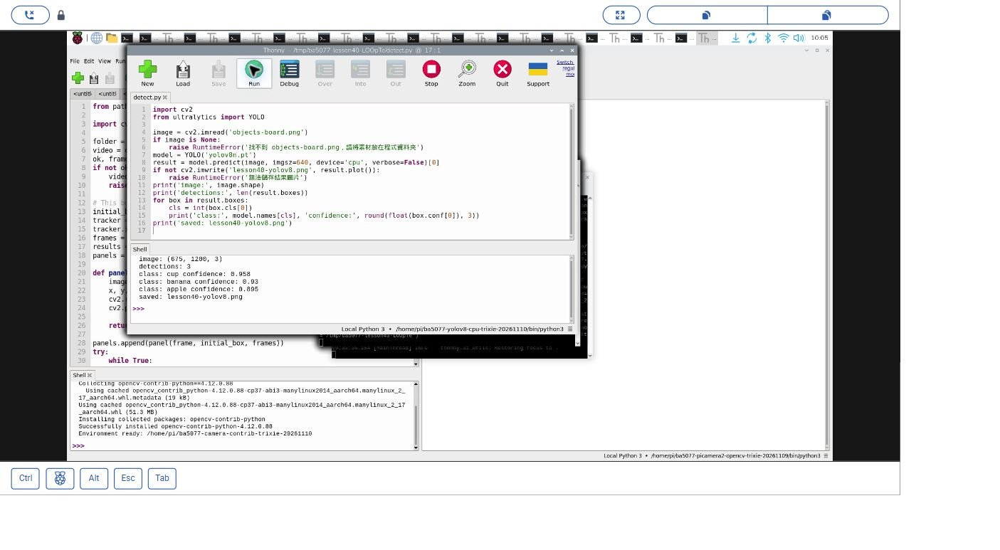
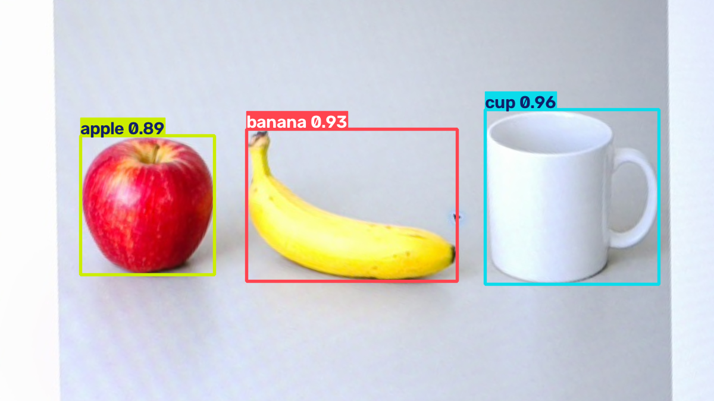

# 40｜用 YOLOv8 偵測一張圖

## [原課號：第 40 課｜YOLOv8 圖像目標檢測教學（使用 COCO 資料集）](https://github.com/Samuel-ncu/BA5077-RP5-compatibility/blob/main/%E6%95%99%E6%9D%90/%E7%AC%AC%2040%20%E8%AA%B2%EF%BD%9CYOLOv8%20%E5%9C%96%E5%83%8F%E7%9B%AE%E6%A8%99%E6%AA%A2%E6%B8%AC%E6%95%99%E5%AD%B8%EF%BC%88%E4%BD%BF%E7%94%A8%20COCO%20%E8%B3%87%E6%96%99%E9%9B%86%EF%BC%89.md)

digithouse.net 原文：[第 40 課｜YOLOv8 圖像目標檢測教學（使用 COCO 資料集）](https://digithouse.net/blog/ba5077-lesson-36-yolov8-image?locale=zh-TW)

> **本篇狀態**：用**預訓練**的 `yolov8n.pt` 偵測一張相機拍下的 AI 生成物件圖，已在**目前 Trixie** 的 Thonny 實測（2026-11-10，Python 3.13.5、Ultralytics 8.4.208、PyTorch 2.15.0+cpu、OpenCV 5.0.0）：找到 cup、banana、apple。較早在**舊環境**也跑過同一支程式，結果幾乎一樣。**尚未實測**：自己新拍的照片、真實物品、多張圖片、全新安裝的系統。

上一篇把 YOLOv8 的環境建好了。這篇做最單純、也最常用的事：給模型一張照片，讓它把看到的東西框出來、說出名稱和分數。和新 38 的 YOLOv4-tiny 比起來，YOLOv8 不用自己解碼輸出，一行 `predict` 就拿到整理好的結果，一行 `plot` 就畫好框。我們用新 38 同一張物件圖，順便比較兩代模型。

## 這篇會學到什麼

- 用 `model.predict` 對一張圖推論。
- 從 `result.boxes` 讀出類別和信心值。
- 用 `result.plot()` 畫出偵測框並存檔。
- 信心值代表什麼、不代表什麼。

## 需要的東西

- [新 39](./39-YOLOv8%20%E8%88%87%20COCO%EF%BC%9A%E5%BB%BA%E7%AB%8B%E7%92%B0%E5%A2%83%E3%80%81%E8%A8%93%E7%B7%B4%E4%B8%80%E5%9B%9E%E5%90%88.md) 建好的 YOLOv8 CPU 環境（本次是 `/home/pi/ba5077-yolov8-cpu-trixie-20261110/bin/python3`）。
- 一個**新的**練習資料夾，放三個檔案：
  - [本篇程式](https://github.com/Samuel-ncu/BA5077-RP5-compatibility/blob/main/%E6%95%99%E6%9D%90/%E7%AF%84%E4%BE%8B%E7%A8%8B%E5%BC%8F/%E7%AC%AC40%E8%AA%B2-Thonny%E6%A0%A1%E6%AD%A3%E5%9C%96YOLO.py)
  - 和新 38 相同的 [objects-board.png](https://github.com/Samuel-ncu/BA5077-RP5-compatibility/blob/main/%E6%95%99%E6%9D%90/%E5%9C%96%E6%AA%94/objects-board.png)：AI 生成的蘋果、香蕉、杯子，顯示在螢幕上由 RP5 相機拍下校正，不是真實物品。
  - 預訓練的 `yolov8n.pt`：用新 39 的[下載程式](https://github.com/Samuel-ncu/BA5077-RP5-compatibility/blob/main/%E6%95%99%E6%9D%90/%E7%AF%84%E4%BE%8B%E7%A8%8B%E5%BC%8F/%E7%AC%AC39%E8%AA%B2-Thonny%E4%B8%8B%E8%BC%89YOLOv8%E6%A8%A1%E5%9E%8B.py)取得。注意是**原始的預訓練模型**，不是新 39 訓練一回合得到的 `best.pt`。

## 先懂幾個名詞

- **偵測框**：圍住物體的方框。
- **類別**：模型認為框裡是什麼，例如 cup。YOLOv8n 認得 COCO 的 80 類。
- **信心值**：模型對這個框、這個類別的分數，0～1。**不是**「答對的機率」，也不是模型的整體準確率。

## 一步一步操作

### 步驟 1：讀程式

**為什麼**：YOLOv8 把新 38 那一大段解碼包好了，程式短很多。

```python
import cv2
from ultralytics import YOLO

image = cv2.imread('objects-board.png')
if image is None:
    raise RuntimeError('找不到 objects-board.png，請將素材放在程式資料夾')
model = YOLO('yolov8n.pt')
result = model.predict(image, imgsz=640, device='cpu', verbose=False)[0]
if not cv2.imwrite('lesson40-yolov8.png', result.plot()):
    raise RuntimeError('無法儲存結果圖片')
print('image:', image.shape)
print('detections:', len(result.boxes))
for box in result.boxes:
    cls = int(box.cls[0])
    print('class:', model.names[cls], 'confidence:', round(float(box.conf[0]), 3))
print('saved: lesson40-yolov8.png')
```

- `YOLO('yolov8n.pt')`：載入預訓練模型。
- `predict(image, imgsz=640, device='cpu')`：推論一張圖。它回傳一個串列（因為也可以一次給很多張），`[0]` 取第一張的結果。
- `result.boxes`：所有偵測框；每個框有 `cls`（類別編號）和 `conf`（信心值）。`model.names` 把編號換成名稱。
- `result.plot()`：回傳一張已經畫好框和標籤的圖，交給 `cv2.imwrite` 存檔。

### 步驟 2：在 Thonny 執行

**為什麼**：看模型在這張圖上找到什麼。

在 Thonny 選新 39 的 CPU 環境，開啟程式按 **Run**。程式會寫入 `lesson40-yolov8.png`，同名檔會被覆寫。本次輸出：

```text
image: (675, 1200, 3)
detections: 3
class: cup confidence: 0.958
class: banana confidence: 0.93
class: apple confidence: 0.895
saved: lesson40-yolov8.png
```

- `(675, 1200, 3)`：圖片的高、寬、色彩通道數。
- 找到 3 個框：杯子、香蕉、蘋果。

較早在舊環境（Ultralytics 8.3.50）跑同一支程式，蘋果是 0.894，其他相同。套件版本不同，分數可能有很小的差異。

### 步驟 3：和 YOLOv4-tiny 比一比

**為什麼**：同一張圖，兩代模型的結果放在一起看。

| | YOLOv4-tiny（新 38） | YOLOv8n（本篇） |
| --- | --- | --- |
| 載入方式 | OpenCV DNN，三個檔案 | Ultralytics，一個 `.pt` 檔 |
| 輸出 | 要自己解碼、做 NMS | 直接是整理好的框 |
| 本次結果 | banana 0.993、cup 0.991、apple 0.941 | cup 0.958、banana 0.93、apple 0.895 |

兩個模型都找到三樣東西。YOLOv4-tiny 的分數比較高，但兩個模型計算分數的方式不同，**不能**因此說哪一個比較準。要比較，得用很多張有人工標註的照片。

### 步驟 4：和原文比一比

**為什麼**：原文的顯示方式在 Thonny 裡不太一樣。

原文用 `pip install ultralytics opencv-python matplotlib` 安裝；推論後用 Matplotlib 的 `plt.imshow`、`plt.show` 顯示結果，存到 `results/detected_image.jpg`，再用集合列出不重複的類別；進階部分還有一次處理多張圖片的迴圈。本篇改用新 39 的獨立環境、不用 Matplotlib，直接把結果圖存檔，並印出每個框的信心值。多張圖片的版本本次沒有重跑。

## 成果圖



*操作截圖（目前 Trixie，2026-11-10）：步驟 2 的程式與輸出。截圖中的 `detect.py` 是本篇程式的測試副本，內容相同。*



*程式輸出：`lesson40-yolov8.png`，標出 cup、banana、apple 和信心值。物品是 AI 生成圖，不是實物。*

## 常見問題

| 你看到的情況 | 可能原因 | 先試試看 |
| --- | --- | --- |
| `No module named 'ultralytics'` | Thonny 選錯環境 | 改選新 39 建立的 CPU 環境。 |
| 找不到 `objects-board.png` | 圖片不在程式旁邊 | 把程式、圖片、模型放在同一個資料夾。 |
| 第一次執行很久 | 找不到 `yolov8n.pt`，正在下載 | 先依新 39 下載模型。 |
| `detections: 0` | 物品不在 80 類裡，或太小、太暗 | 換 COCO 有的物品，拍近一點、亮一點。 |

以上是常見情況的整理，本次沒有逐一重現。

## 小結

YOLOv8 推論一張圖只要 `predict`；結果裡的 `boxes` 有類別和信心值，`plot()` 直接畫好框。本次在目前 Trixie 上，對一張相機拍下的 AI 生成物件圖找到 cup、banana、apple。信心值不等於正確率，單張生成圖也不能代表真實場景的準確率。

**練習**：

1. 用紙把圖上其中一個物品遮住一部分，再拍一張來偵測，觀察框和分數怎麼變，記下你自己的結果。
2. 準備「有物品」和「沒有物品」的照片各幾張，先自己標記答案，再和模型的結果比較。

這些是延伸練習，本次尚未實測，請以你實際得到的輸出為準。

## 下一篇預告

一張圖做得到，影片其實就是很多張圖。下一篇[41｜用 YOLOv8 偵測一段影片](./41-%E7%94%A8%20YOLOv8%20%E5%81%B5%E6%B8%AC%E4%B8%80%E6%AE%B5%E5%BD%B1%E7%89%87.md)，我們讓 YOLOv8 一張一張處理影片，並存出標好框的新影片。
