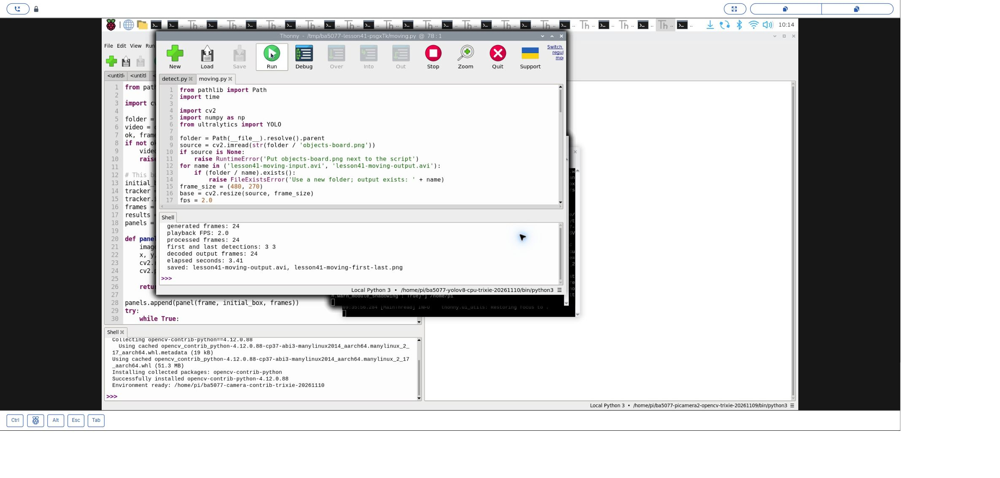
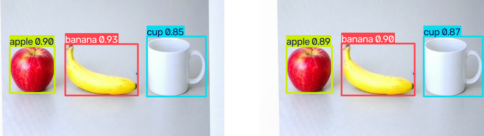
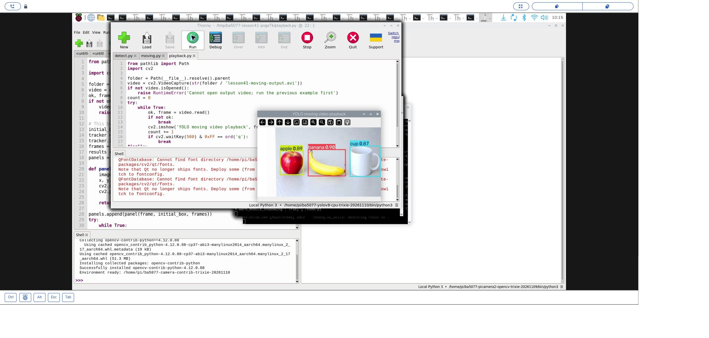
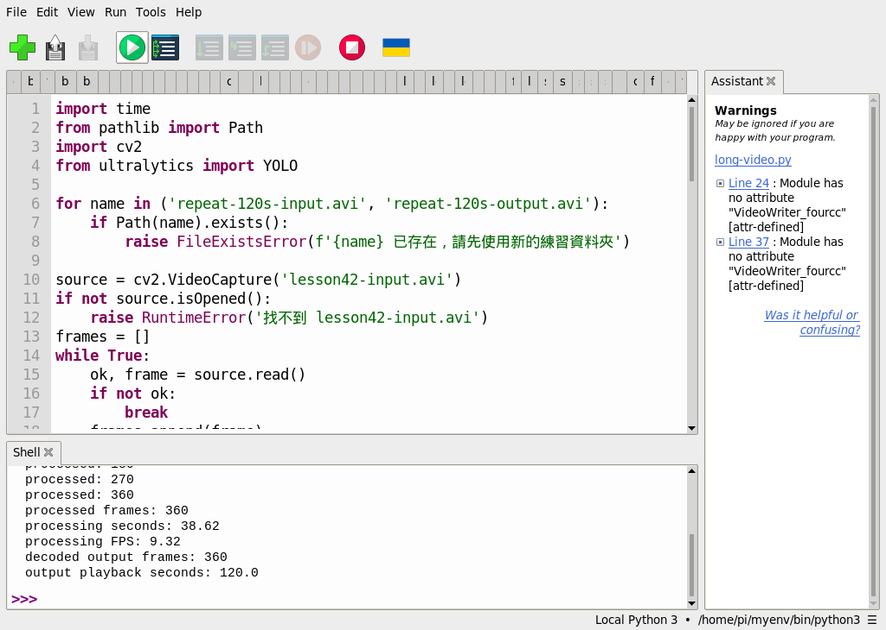

# 41｜用 YOLOv8 偵測一段影片

## [原課號：第 41 課｜YOLOv8 影片目標檢測完整教學](https://github.com/Samuel-ncu/BA5077-RP5-compatibility/blob/main/%E6%95%99%E6%9D%90/%E7%AC%AC%2041%20%E8%AA%B2%EF%BD%9CYOLOv8%20%E5%BD%B1%E7%89%87%E7%9B%AE%E6%A8%99%E6%AA%A2%E6%B8%AC%E5%AE%8C%E6%95%B4%E6%95%99%E5%AD%B8.md)

digithouse.net 原文：[第 41 課｜YOLOv8 影片目標檢測完整教學](https://digithouse.net/blog/ba5077-lesson-37-yolov8-video?locale=zh-TW)

> **本篇狀態**：在**目前 Trixie** 的 Thonny 實測（2026-11-10，Python 3.13.5、Ultralytics 8.4.208、OpenCV 5.0.0）：用程式把一張物件圖一點一點平移，做成 24 張的影片，逐格偵測、存成新影片、讀回、播放。**影片裡的移動是程式合成的，不是真實拍攝的動態影片。** 較早在**舊環境**（Python 3.11、Ultralytics 8.3.50）跑過 4 張影格的短片和 360 張的重複影格長片。**尚未實測**：真實拍攝的動態影片、較長的實景影片、全新安裝的系統。

影片其實就是很多張照片依序排好、快速播放。所以「偵測一段影片」就是：把影片一張一張拆開，每一張都像上一篇那樣交給 YOLOv8，畫好框，再一張一張寫回成新影片。這篇我們先自己做一段小影片，再讓 YOLOv8 處理它，最後在 Thonny 裡播放成果。過程中你會發現兩個很容易混在一起的數字：影片「每秒播幾張」和電腦「每秒算得完幾張」。

## 這篇會學到什麼

- 用 `cv2.VideoCapture` 一張一張讀影片、用 `cv2.VideoWriter` 寫影片。
- 逐格推論：把新 40 的 `predict` 放進迴圈。
- 播放 FPS 和處理速度的差別。
- 怎麼確認輸出影片真的寫好了：讀回來數一數。

## 需要的東西

- [新 39](./39-YOLOv8%20%E8%88%87%20COCO%EF%BC%9A%E5%BB%BA%E7%AB%8B%E7%92%B0%E5%A2%83%E3%80%81%E8%A8%93%E7%B7%B4%E4%B8%80%E5%9B%9E%E5%90%88.md) 建好的 YOLOv8 CPU 環境，以及預訓練的 `yolov8n.pt`（不是新 39 訓練一回合得到的 `best.pt`）。
- 一個**新的**練習資料夾，放這些檔案：
  - 和[新 40](./40-%E7%94%A8%20YOLOv8%20%E5%81%B5%E6%B8%AC%E4%B8%80%E5%BC%B5%E5%9C%96.md) 相同的 [objects-board.png](https://github.com/Samuel-ncu/BA5077-RP5-compatibility/blob/main/%E6%95%99%E6%9D%90/%E5%9C%96%E6%AA%94/objects-board.png)（相機拍下螢幕上的 AI 生成物件圖，不是實物）。
  - [合成影片與偵測程式](https://github.com/Samuel-ncu/BA5077-RP5-compatibility/blob/main/%E6%95%99%E6%9D%90/%E7%AF%84%E4%BE%8B%E7%A8%8B%E5%BC%8F/%E7%AC%AC41%E8%AA%B2-Thonny%E5%90%88%E6%88%90%E5%8B%95%E6%85%8B%E5%BD%B1%E7%89%87.py)
  - [播放程式](https://github.com/Samuel-ncu/BA5077-RP5-compatibility/blob/main/%E6%95%99%E6%9D%90/%E7%AF%84%E4%BE%8B%E7%A8%8B%E5%BC%8F/%E7%AC%AC41%E8%AA%B2-Thonny%E5%90%88%E6%88%90%E5%BD%B1%E7%89%87%E6%92%AD%E6%94%BE.py)

## 先懂幾個名詞

- **影格（frame）**：影片中的一張畫面。
- **播放 FPS**：影片檔裡記錄的「每秒播幾張」，決定影片看起來多快。
- **處理速度**：電腦每秒能讀取、推論、寫出幾張。這次是 CPU 推論，速度和播放 FPS 沒有關係。
- **編碼格式（fourcc）**：影片怎麼壓縮。本篇用 `MJPG`，存成 `.avi`。

## 一步一步操作

### 步驟 1：讀程式

**為什麼**：這支程式做了三件事：做出輸入影片、逐格偵測、讀回檢查。

```python
from pathlib import Path
import time
import cv2
import numpy as np
from ultralytics import YOLO

folder = Path(__file__).resolve().parent
source = cv2.imread(str(folder / 'objects-board.png'))
if source is None:
    raise RuntimeError('Put objects-board.png next to the script')
for name in ('lesson41-moving-input.avi', 'lesson41-moving-output.avi'):
    if (folder / name).exists():
        raise FileExistsError('Use a new folder; output exists: ' + name)
frame_size = (480, 270)
base = cv2.resize(source, frame_size)
fps = 2.0
writer = cv2.VideoWriter(str(folder / 'lesson41-moving-input.avi'), cv2.VideoWriter_fourcc(*'MJPG'), fps, frame_size)
if not writer.isOpened():
    raise RuntimeError('Cannot create input video')
try:
    for i in range(24):
        shift = -35 + 3 * i
        matrix = np.float32([[1, 0, shift], [0, 1, 0]])
        writer.write(cv2.warpAffine(base, matrix, frame_size, borderValue=(255, 255, 255)))
finally:
    writer.release()
model = YOLO(str(folder / 'yolov8n.pt'))
video = cv2.VideoCapture(str(folder / 'lesson41-moving-input.avi'))
output = cv2.VideoWriter(str(folder / 'lesson41-moving-output.avi'), cv2.VideoWriter_fourcc(*'MJPG'), fps, frame_size)
if not video.isOpened() or not output.isOpened():
    video.release()
    output.release()
    raise RuntimeError('Cannot open video input or output')
count = 0
counts = []
first = last = None
start = time.monotonic()
try:
    while True:
        ok, frame = video.read()
        if not ok:
            break
        result = model.predict(frame, imgsz=320, device='cpu', verbose=False)[0]
        annotated = result.plot()
        output.write(annotated)
        counts.append(len(result.boxes))
        count += 1
        if first is None:
            first = annotated.copy()
        last = annotated.copy()
finally:
    video.release()
    output.release()
elapsed = time.monotonic() - start
if count != 24 or first is None or last is None:
    raise RuntimeError(f'Expected 24 frames, got {count}')
if not cv2.imwrite(str(folder / 'lesson41-moving-first-last.png'), cv2.hconcat([first, last])):
    raise RuntimeError('Cannot save comparison image')
check = cv2.VideoCapture(str(folder / 'lesson41-moving-output.avi'))
readback = 0
try:
    while True:
        ok, _ = check.read()
        if not ok:
            break
        readback += 1
finally:
    check.release()
print('generated frames:', 24)
print('playback FPS:', fps)
print('processed frames:', count)
print('first and last detections:', counts[0], counts[-1])
print('decoded output frames:', readback)
print('elapsed seconds:', round(elapsed, 2))
print('saved: lesson41-moving-output.avi, lesson41-moving-first-last.png')
```

- **做影片**：把圖縮成 480 × 270，用 `warpAffine` 每張往右多移 3 像素，共 24 張，以 2 FPS 寫成 `lesson41-moving-input.avi`。
- **逐格偵測**：`video.read()` 讀到沒有影格（`ok` 是 `False`）就停；每一張都 `predict`、`plot`，再 `output.write` 寫進輸出影片。
- `try ... finally`：不管中間有沒有出錯，都會 `release`，影片檔才會正確收尾。
- **讀回檢查**：重新開啟輸出影片數影格。寫進去 24 張、讀回也是 24 張，才代表影片完整。
- 程式先檢查輸入、輸出影片是否已存在，避免覆蓋舊結果；首尾比較圖則會覆寫同名檔。

### 步驟 2：在 Thonny 執行

**為什麼**：看處理了幾張、花了多久。

在 Thonny 選新 39 的 CPU 環境，開啟程式按 **Run**。本次輸出：

```text
generated frames: 24
playback FPS: 2.0
processed frames: 24
first and last detections: 3 3
decoded output frames: 24
elapsed seconds: 3.41
saved: lesson41-moving-output.avi, lesson41-moving-first-last.png
```

- 24 張都處理完，讀回也是 24 張。
- 第一張和最後一張都找到 3 個框；中間的影格程式沒有逐張核對。
- 影片以 2 FPS 播放，24 張播 **12 秒**；但電腦只花了 **3.41 秒**就處理完。兩個數字無關：前者是影片設定，後者是這次的處理時間，會隨負載和版本改變。

### 步驟 3：播放成果

**為什麼**：親眼看框有沒有跟著東西移動。

把播放程式放在同一個資料夾，按 **Run**：

```python
from pathlib import Path
import cv2

folder = Path(__file__).resolve().parent
video = cv2.VideoCapture(str(folder / 'lesson41-moving-output.avi'))
if not video.isOpened():
    raise RuntimeError('Cannot open output video; run the previous example first')
count = 0
try:
    while True:
        ok, frame = video.read()
        if not ok:
            break
        cv2.imshow('YOLO moving video playback', frame)
        count += 1
        if cv2.waitKey(500) & 0xFF == ord('q'):
            break
finally:
    video.release()
    cv2.destroyAllWindows()
print('displayed frames:', count)
```

`waitKey(500)` 讓每張停 0.5 秒，剛好是 2 FPS。按 `q` 可以提早結束。本次 Shell 印出 `displayed frames: 24`，視窗正常播放；Shell 另外有一行 Qt 字型目錄的提示，不影響播放。

也可以直接[下載本次 RP5 產生的輸出影片](https://github.com/Samuel-ncu/BA5077-RP5-compatibility/blob/main/%E6%95%99%E6%9D%90/%E7%B7%B4%E7%BF%92%E7%B4%A0%E6%9D%90/lesson41-trixie-moving-output-20261110.avi)，複製到練習資料夾、改名成 `lesson41-moving-output.avi` 再播放。

### 步驟 4：舊環境的另外兩個測試

**為什麼**：影格多一點時，處理速度大概是多少。

較早在舊環境用另一段練習影片（相機拍下螢幕上生成物件圖的 4 張影格）做過兩個測試：

- 4 張短片：每張都是 3 個框。
- 把這 4 張重複 90 次做成 360 張、3 FPS 的兩分鐘影片：處理 360 張花 38.62 秒，平均每秒約 **9.32 張**；讀回 360 張，播放長度 120 秒。

這段「兩分鐘影片」只是同樣 4 張不斷重複，**不是兩分鐘真實的動態畫面**，不能用來推論長時間實景的準確率或穩定性。

### 步驟 5：和原文比一比

**為什麼**：原文的寫法有幾處在 Raspberry Pi 上要調整。

原文用 `pip install ultralytics opencv-python` 安裝（在目前 Trixie 會被系統套件保護擋下，請用新 39 的獨立環境），讀網路上的範例影片 `bikes.mp4`，用 `XVID` 編碼存成 `output_video.avi`，從原影片讀取 FPS 和尺寸；推論時直接 `model(frame)`，沒有指定 CPU 和輸入大小，每一張都會印出一大段推論訊息。原文的 `bikes.mp4` 本次沒有下載重跑。本篇改用自己合成的影片、`MJPG` 編碼，並在最後讀回檢查。

## 成果圖



*操作截圖（目前 Trixie，2026-11-10）：步驟 2 的輸出，24 張全部處理並讀回。截圖中的 `moving.py` 是本篇程式的測試副本，內容相同。*



*程式輸出：左邊是第一張、右邊是最後一張，框跟著物品往右移動。移動是程式合成的。*



*操作截圖：步驟 3 在 Thonny 播放輸出影片。*



*操作截圖（舊環境，2026-10-29）：步驟 4 的 360 張重複影格測試。*

## 常見問題

| 你看到的情況 | 可能原因 | 先試試看 |
| --- | --- | --- |
| `Use a new folder; output exists` | 資料夾裡已有上次的影片 | 換一個新的練習資料夾。 |
| `Cannot create input video` | 編碼器不支援或資料夾不能寫 | 確認 `MJPG` 和 `.avi` 的組合、資料夾權限。 |
| 讀回的張數比寫入少 | 沒有 `release()`，檔案沒收好尾 | 確認 `finally` 裡有 `release()`。 |
| Thonny 右側說 `VideoWriter_fourcc` 有問題 | Thonny 的靜態檢查提示 | 以 Shell 的實際輸出為準；舊環境曾出現這個提示，程式仍正常執行。 |
| 沒有出現播放視窗 | 沒有圖形桌面 | 在 Raspberry Pi 的桌面環境執行。 |

以上是常見情況的整理，除了第四列，本次沒有逐一重現。

## 小結

影片偵測就是「讀一張 → 推論 → 畫框 → 寫一張」的迴圈，最後讀回數一數，確認影片完整。本次在目前 Trixie 上處理 24 張合成平移影片，首尾都找到 3 個框，3.41 秒處理完、播放 12 秒。播放 FPS 是影片設定，處理速度是電腦的能力，不要混為一談。合成影片也不能代表真實動態場景的表現。

**練習**：

1. 把 `fps = 2.0` 改成 `6.0`，先預測輸出影片會變成播幾秒、處理時間會不會變，再執行驗證。
2. 想一想：為什麼「4 張重複 90 次」的兩分鐘影片，不能拿來評估長時間實景偵測？

這些是延伸練習，本次尚未實測，請以你實際得到的輸出為準。

## 下一篇預告

處理錄好的影片可以慢慢算，但相機畫面不會等你。下一篇[42｜YOLOv8 接上相機：即時偵測](./42-YOLOv8%20%E6%8E%A5%E4%B8%8A%E7%9B%B8%E6%A9%9F%EF%BC%9A%E5%8D%B3%E6%99%82%E5%81%B5%E6%B8%AC.md)，我們把 YOLOv8 接上 RP5 相機，一邊拍一邊偵測。
