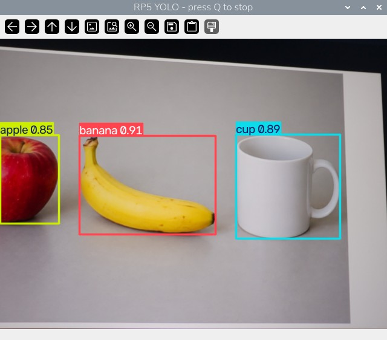
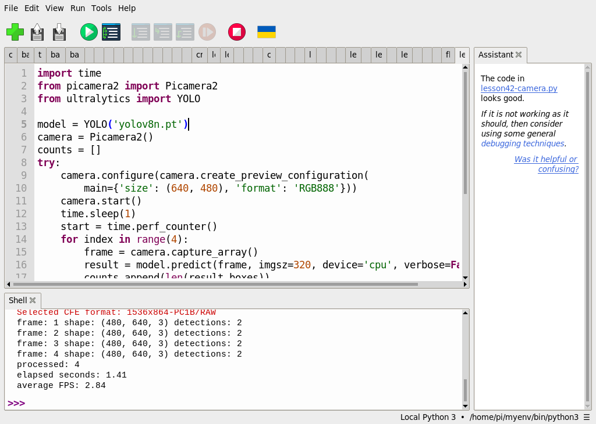

# 42｜YOLOv8 接上相機：即時偵測

## [原課號：第 42 課｜YOLOv8 即時攝影機目標偵測教學](https://github.com/Samuel-ncu/BA5077-RP5-compatibility/blob/main/%E6%95%99%E6%9D%90/%E7%AC%AC%2042%20%E8%AA%B2%EF%BD%9CYOLOv8%20%E5%8D%B3%E6%99%82%E6%94%9D%E5%BD%B1%E6%A9%9F%E7%9B%AE%E6%A8%99%E5%81%B5%E6%B8%AC%E6%95%99%E5%AD%B8.md)

digithouse.net 原文：[第 42 課｜YOLOv8 即時攝影機目標偵測教學](https://digithouse.net/blog/ba5077-lesson-38-yolov8-webcam?locale=zh-TW)

> **本篇狀態**：在**目前 Trixie**（2026-11-12）用 Thonny 建立「相機＋YOLO」環境，已實測；四張影格測試和 20 秒即時預覽，是用同一個環境**從 SSH 在 RP5 桌面上啟動**，不是在 Thonny 按 Run，**Thonny 的操作截圖待補**。相機對著螢幕上的 AI 生成物件圖，預覽框出 apple、banana、cup。較早在**舊環境**（Bookworm 的 `myenv`）有 Thonny 操作截圖。**尚未實測**：實體物品、長時間運作、全新安裝的系統。

前三篇的 YOLOv8 處理的都是存好的圖片和影片，可以慢慢算。這篇要讓 YOLOv8 直接看 RP5 的相機：拍一張、偵測一張、顯示一張，一直重複。第一步不是寫程式，而是準備一個**同時**能用相機和 YOLO 的 Python 環境，因為新 39 的 YOLO 環境沒有 Picamera2。

## 這篇會學到什麼

- 為什麼要建立 `--system-site-packages` 的虛擬環境。
- 用 Picamera2 取像，再交給 YOLOv8 推論。
- 先跑四張影格確認能動，再開即時預覽視窗。
- 程式結束時一定要釋放相機。

## 需要的東西

- RP5 和 CSI 相機，以及 RP5 的桌面環境（預覽視窗要在桌面上顯示）。
- 網路（下載 PyTorch 和 Ultralytics，可能要十幾分鐘）。
- 一個**新的**練習資料夾，放這些檔案：
  - [環境建立程式](https://github.com/Samuel-ncu/BA5077-RP5-compatibility/blob/main/%E6%95%99%E6%9D%90/%E7%AF%84%E4%BE%8B%E7%A8%8B%E5%BC%8F/Thonny%E5%BB%BA%E7%AB%8BTrixie%E7%9B%B8%E6%A9%9FYOLO%E7%92%B0%E5%A2%83.py)
  - [模型下載程式](https://github.com/Samuel-ncu/BA5077-RP5-compatibility/blob/main/%E6%95%99%E6%9D%90/%E7%AF%84%E4%BE%8B%E7%A8%8B%E5%BC%8F/%E7%AC%AC39%E8%AA%B2-Thonny%E4%B8%8B%E8%BC%89YOLOv8%E6%A8%A1%E5%9E%8B.py)（新 39 用過的同一支）
  - [四張影格測試程式](https://github.com/Samuel-ncu/BA5077-RP5-compatibility/blob/main/%E6%95%99%E6%9D%90/%E7%AF%84%E4%BE%8B%E7%A8%8B%E5%BC%8F/%E7%AC%AC42-43%E8%AA%B2-Thonny%E7%9B%B8%E6%A9%9F%E5%81%B5%E6%B8%AC.py)
  - [20 秒即時預覽程式](https://github.com/Samuel-ncu/BA5077-RP5-compatibility/blob/main/%E6%95%99%E6%9D%90/%E7%AF%84%E4%BE%8B%E7%A8%8B%E5%BC%8F/%E7%AC%AC42-43%E8%AA%B2-Thonny%E5%8D%B3%E6%99%82%E9%A0%90%E8%A6%BD.py)
- 鏡頭前要放**不含個人資訊**的東西。本次是另一台螢幕上顯示的 [AI 生成物件圖](https://github.com/Samuel-ncu/BA5077-RP5-compatibility/blob/main/%E6%95%99%E6%9D%90/%E7%B7%B4%E7%BF%92%E7%B4%A0%E6%9D%90/AI%E7%94%9F%E6%88%90%E7%89%A9%E4%BB%B6%E6%B8%AC%E8%A9%A6.png)，不是實物。

## 先懂幾個名詞

- **系統套件**：用 `apt` 裝在系統 Python 裡的套件。Picamera2 就是系統套件，不能只用 pip 裝。
- **`--system-site-packages`**：建立虛擬環境時加上它，新環境就讀得到系統套件；之後再用 pip 裝的東西只放在新環境裡。
- **即時偵測**：取像和推論一直循環，畫面一邊更新、一邊畫框。

## 一步一步操作

### 步驟 1：建立相機 YOLO 環境

**為什麼**：Picamera2 在系統 Python 裡，YOLO 在新 39 的獨立環境裡，兩邊互相看不到。我們要一個兩邊都有的環境。

在 Thonny 右下角先選**系統的** Python 3（`/usr/bin/python3`），開啟環境建立程式。把 `target` 改成家目錄下**還不存在**的資料夾，按 **Run**：

```python
from pathlib import Path
import subprocess
import sys

target = Path.home() / 'ba5077-yolo-camera-trixie-20261112'
if target.exists():
    raise RuntimeError(f'目標已存在：{target}，請修改 target 選擇新資料夾')
print('Creating:', target, flush=True)
subprocess.run([sys.executable, '-m', 'venv', '--system-site-packages', str(target)], check=True)
python = str(target / 'bin' / 'python3')
subprocess.run([python, '-m', 'pip', 'install',
                'torch==2.15.0+cpu', 'torchvision==0.29.2+cpu',
                '--index-url', 'https://download.pytorch.org/whl/cpu'], check=True)
subprocess.run([python, '-m', 'pip', 'install', 'ultralytics==8.4.208'], check=True)
subprocess.run([python, '-c',
                'import cv2, torch, ultralytics; from picamera2 import Picamera2; '
                'print("Picamera2 OK; OpenCV", cv2.__version__, "PyTorch", torch.__version__, '
                '"Ultralytics", ultralytics.__version__)'], check=True)
print('Environment ready:', python, flush=True)
```

- `sys.executable`：就是 Thonny 目前選的 Python，所以一定要先選系統 Python。
- `--system-site-packages`：讓新環境讀得到 Picamera2。
- PyTorch 從官方 CPU 來源安裝，避免下載用不到的 CUDA 套件（新 39 遇過）。這次把 Ultralytics 也固定成 8.4.208。
- 最後一步實際 `import` 一次，確認 Picamera2、OpenCV、PyTorch、Ultralytics 都在。

本次最後兩行輸出：

```text
Picamera2 OK; OpenCV 5.0.0 PyTorch 2.15.0+cpu Ultralytics 8.4.208
Environment ready: /home/pi/ba5077-yolo-camera-trixie-20261112/bin/python3
```

完成後到 **Tools → Options → Interpreter** 選新環境的 `bin/python3`，確認 Thonny 右下角顯示的是這個路徑。

### 步驟 2：準備模型

**為什麼**：每個練習資料夾都要有自己的 `yolov8n.pt`。

在練習資料夾用新環境執行模型下載程式。本次下載 6,549,796 bytes，SHA-256 和新 39 相同。

### 步驟 3：先拍四張試試看

**為什麼**：先確認「相機能取像、模型能推論、相機能釋放」，再開視窗。

```python
import time
from picamera2 import Picamera2
from ultralytics import YOLO

model = YOLO('yolov8n.pt')
camera = Picamera2()
counts = []
try:
    camera.configure(camera.create_preview_configuration(
        main={'size': (640, 480), 'format': 'RGB888'}))
    camera.start()
    time.sleep(1)
    start = time.perf_counter()
    for index in range(4):
        frame = camera.capture_array()
        result = model.predict(frame, imgsz=320, device='cpu', verbose=False)[0]
        counts.append(len(result.boxes))
        print('frame:', index + 1, 'shape:', frame.shape,
              'detections:', counts[-1], flush=True)
    elapsed = time.perf_counter() - start
finally:
    camera.stop()
    camera.close()
print('processed:', len(counts))
print('elapsed seconds:', round(elapsed, 2))
print('average FPS:', round(len(counts) / elapsed, 2))
```

- `'format': 'RGB888'`：指定 3 個通道。不指定的話 Picamera2 會給 4 個通道。
- `time.sleep(1)`：讓相機先暖機。
- `imgsz=320`：用比較小的輸入加快推論。
- `finally` 裡的 `stop()`、`close()`：不管成功或出錯都釋放相機，下一支程式才能用。

本次輸出（目前 Trixie）：

```text
frame: 1 shape: (480, 640, 3) detections: 3
frame: 2 shape: (480, 640, 3) detections: 3
frame: 3 shape: (480, 640, 3) detections: 3
frame: 4 shape: (480, 640, 3) detections: 3
processed: 4
elapsed seconds: 1.91
average FPS: 2.1
```

每張影格都是 480 × 640 × 3，各找到 3 個框。框的數量不代表框得對，要看下一步的畫面。

### 步驟 4：20 秒即時預覽

**為什麼**：親眼看框跟著相機畫面更新。

即時預覽程式和步驟 3 很像，差別是迴圈改成「最多 20 秒」，每張都用 `cv2.imshow` 顯示畫好框的畫面：

```python
    while time.perf_counter() - start < 20:
        frame = camera.capture_array()
        result = model.predict(frame, imgsz=320, device='cpu', verbose=False)[0]
        cv2.imshow('RP5 YOLO - press Q to stop', result.plot())
        frames += 1
        if cv2.waitKey(1) & 0xFF == ord('q'):
            break
```

先點一下預覽視窗，再按小寫 `q` 可以提早結束。本次讓它跑滿 20 秒，預覽視窗標出 `apple 0.85`、`banana 0.91`、`cup 0.89`，Shell 輸出：

```text
frames: 162
elapsed seconds: 20.05
average FPS: 8.08
camera released
```

20 秒處理了 162 張，平均每秒約 8 張。這是這一次、這個畫面的結果，會隨畫面內容和系統負載改變。下一篇會仔細看「為什麼四張只有 2.1、20 秒卻有 8.08」。

### 步驟 5：和原文比一比

**為什麼**：原文是寫給一般電腦的 USB 攝影機。

原文用 `cv2.VideoCapture(0)` 開啟電腦的預設攝影機，用 `pip install ultralytics opencv-python` 安裝。RP5 的 CSI 相機要用 Picamera2 取像，所以本篇改寫取像部分。原文的推論 `model(frame)` 沒有指定 CPU 和輸入大小，每一張都會印出推論訊息；結束時只有按 `q`，沒有 `try ... finally`，中途出錯時攝影機可能沒釋放。原文的 USB 攝影機版本本次沒有測試。

## 成果圖



*程式畫面（目前 Trixie，2026-11-12）：步驟 4 的預覽視窗，只裁切視窗部分。相機拍的是螢幕上的 AI 生成圖，框與分數是 YOLO 的輸出。*



*操作截圖（舊環境）：步驟 3 的程式在 Thonny 執行。當時每張找到 2 個框、平均 2.84 FPS，鏡頭前的東西和本次不同。*

## 常見問題

| 你看到的情況 | 可能原因 | 先試試看 |
| --- | --- | --- |
| `No module named 'picamera2'` | 建立環境時不是用系統 Python，或少了 `--system-site-packages` | 換一個新的資料夾名稱，用系統 Python 重建。不要刪別人的環境。 |
| `No module named 'ultralytics'` | Thonny 選到新 15 的相機環境或系統 Python | 改選本篇建立的環境。 |
| `Could not load the Qt platform plugin "xcb"` | 程式不是在 RP5 桌面環境啟動（例如純 SSH） | 在 RP5 桌面的 Thonny 執行。 |
| 相機開不起來 | 另一支程式（或另一個 Thonny 分頁）還在用相機 | 關掉其他程式後再試。 |
| `Qt no longer ships fonts` 提示 | Qt 的字型提示 | 可以忽略。 |

以上整理自 repo 的排錯說明，本次沒有逐一重現。

## 小結

要讓 YOLOv8 接上 RP5 相機，先建立一個 `--system-site-packages` 的環境，讓 Picamera2 和 Ultralytics 在同一個 Python 裡。之後就是「取像 → 推論 → 顯示」的迴圈，並在 `finally` 裡釋放相機。本次在目前 Trixie 上，四張影格各 3 個框，20 秒預覽 162 張、平均約 8 張／秒，框出螢幕上的生成蘋果、香蕉、杯子。這些都不是實物或準確率測試。

**練習**：把 `imgsz=320` 改成 `640`，先預測每秒張數會變多還是變少、框會不會更多，再執行比較。這是延伸練習，本次尚未實測，請以你實際得到的輸出為準。

## 下一篇預告

會動了，那它快不快？卡在哪裡？下一篇[43｜Picamera2 加 YOLOv8 的完整即時流程](./43-Picamera2%20%E5%8A%A0%20YOLOv8%20%E7%9A%84%E5%AE%8C%E6%95%B4%E5%8D%B3%E6%99%82%E6%B5%81%E7%A8%8B.md)，我們沿著「取像 → 推論 → 畫框 → 顯示」逐段觀察速度，並練習按 `q` 停止和重新開啟相機。
