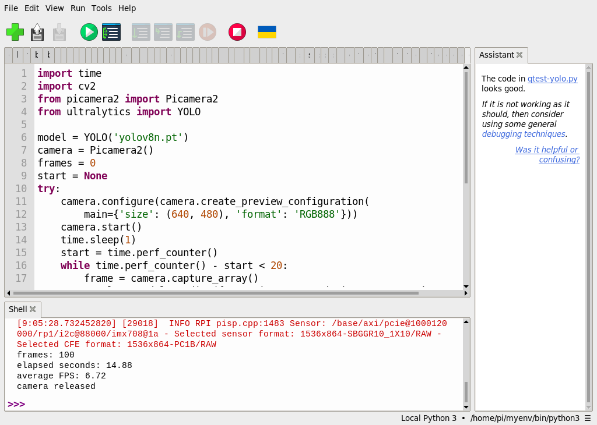
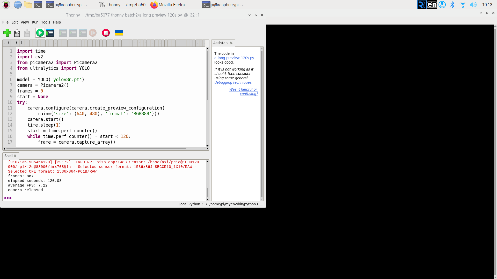
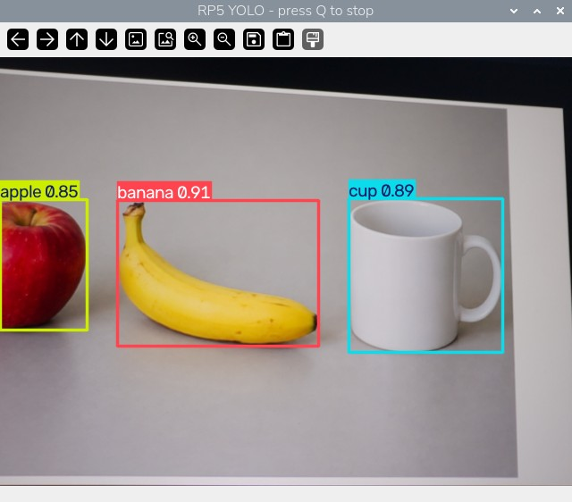

# 43｜Picamera2 加 YOLOv8 的完整即時流程

## [原課號：第 43 課｜使用 PyCamera2 與 YOLOv8 實現即時目標偵測（Raspberry Pi 5）](https://github.com/Samuel-ncu/BA5077-RP5-compatibility/blob/main/%E6%95%99%E6%9D%90/%E7%AC%AC%2043%20%E8%AA%B2%EF%BD%9C%E4%BD%BF%E7%94%A8%20PyCamera2%20%E8%88%87%20YOLOv8%20%E5%AF%A6%E7%8F%BE%E5%8D%B3%E6%99%82%E7%9B%AE%E6%A8%99%E5%81%B5%E6%B8%AC%EF%BC%88Raspberry%20Pi%205%EF%BC%89.md)

digithouse.net 原文：[第 43 課｜使用 PyCamera2 與 YOLOv8 實現即時目標偵測（Raspberry Pi 5）](https://digithouse.net/blog/ba5077-lesson-39-pycamera2-yolov8?locale=zh-TW)

> **本篇狀態**：程式和[新 42](./42-YOLOv8%20%E6%8E%A5%E4%B8%8A%E7%9B%B8%E6%A9%9F%EF%BC%9A%E5%8D%B3%E6%99%82%E5%81%B5%E6%B8%AC.md) 相同。**目前 Trixie**（2026-11-12）的四張影格 2.1 FPS、20 秒預覽 8.08 FPS，是用同一個環境從 SSH 在 RP5 桌面上啟動的結果，Thonny 截圖待補。按 `q` 停止、重新開啟相機、兩分鐘連續預覽，是在**舊環境**（Bookworm 的 `myenv`，Python 3.11、Ultralytics 8.3.50）用 Thonny 實測（2026-10-29），目前 Trixie 尚未重跑。**尚未實測**：數小時的長時間運作、Hailo 加速、全新安裝的系統。

上一篇讓 YOLOv8 接上了相機。這篇不加新功能，而是**看懂整條流程**：每一張畫面都要經過「取像 → 推論 → 畫框 → 顯示」四段，任何一段慢下來，整體就跟著慢。我們用實測數字練習判讀速度，再練習兩件實際使用時一定會遇到的事：中途停止，以及停止後重新開啟相機。

## 這篇會學到什麼

- 即時偵測的四個階段，以及每秒張數（FPS）怎麼算。
- 為什麼短測試和長測試的 FPS 差這麼多。
- 用 `q` 停止預覽的正確方法，以及確認相機能重開。
- 長時間測試要記錄哪些東西。

## 需要的東西

- [新 42](./42-YOLOv8%20%E6%8E%A5%E4%B8%8A%E7%9B%B8%E6%A9%9F%EF%BC%9A%E5%8D%B3%E6%99%82%E5%81%B5%E6%B8%AC.md) 建立的相機 YOLO 環境、`yolov8n.pt`，以及同一組程式：
  - [四張影格測試程式](https://github.com/Samuel-ncu/BA5077-RP5-compatibility/blob/main/%E6%95%99%E6%9D%90/%E7%AF%84%E4%BE%8B%E7%A8%8B%E5%BC%8F/%E7%AC%AC42-43%E8%AA%B2-Thonny%E7%9B%B8%E6%A9%9F%E5%81%B5%E6%B8%AC.py)
  - [20 秒即時預覽程式](https://github.com/Samuel-ncu/BA5077-RP5-compatibility/blob/main/%E6%95%99%E6%9D%90/%E7%AF%84%E4%BE%8B%E7%A8%8B%E5%BC%8F/%E7%AC%AC42-43%E8%AA%B2-Thonny%E5%8D%B3%E6%99%82%E9%A0%90%E8%A6%BD.py)
  - [兩分鐘預覽程式](https://github.com/Samuel-ncu/BA5077-RP5-compatibility/blob/main/%E6%95%99%E6%9D%90/%E7%AF%84%E4%BE%8B%E7%A8%8B%E5%BC%8F/%E7%AC%AC42-43%E8%AA%B2-Thonny%E5%85%A9%E5%88%86%E9%90%98%E9%A0%90%E8%A6%BD.py)：和 20 秒版只差一行，迴圈上限改成 120 秒。
- 鏡頭前放不含個人資訊的東西。

## 先懂幾個名詞

- **FPS（每秒張數）**：這裡指「迴圈每秒跑完幾張」，等於處理張數 ÷ 經過秒數。它不是相機感測器的更新率，也不是準確率。
- **暖機**：第一次推論通常特別慢，因為程式要先準備好各種資源。
- **釋放相機**：`camera.stop()`、`camera.close()`。沒有釋放，下一支程式就打不開相機。

## 一步一步操作

### 步驟 1：認識四個階段

**為什麼**：知道時間花在哪，才知道從哪裡改。

預覽程式的迴圈裡，每一張畫面依序經過：

| 階段 | 程式 | 說明 |
| --- | --- | --- |
| 取像 | `camera.capture_array()` | 從相機拿一張 640 × 480 的影格 |
| 推論 | `model.predict(frame, imgsz=320, device='cpu')` | YOLOv8n 在 CPU 上找物體，通常最花時間 |
| 畫框 | `result.plot()` | 把框和標籤畫上去 |
| 顯示 | `cv2.imshow(...)`、`cv2.waitKey(1)` | 更新視窗，順便檢查有沒有按 `q` |

計時從相機暖機 1 秒之後開始，所以**不包含**模型載入和相機暖機的時間。

### 步驟 2：比較短測試和 20 秒預覽

**為什麼**：同一個環境、同一個模型，FPS 卻差了將近 4 倍。

目前 Trixie 在同一個環境的兩個結果：

| 測試 | 張數 | 秒數 | 平均 FPS |
| --- | --- | --- | --- |
| 四張影格（只推論、不顯示） | 4 | 1.91 | 2.1 |
| 20 秒預覽（推論加顯示） | 162 | 20.05 | 8.08 |

四張測試做的事還比較少，為什麼反而慢？因為它的計時**包含第一次推論**，第一次推論要暖機、特別慢，而總共才 4 張，這一張就把平均拉低了。20 秒預覽有 162 張，第一張的影響被攤平了。所以：**測速度要跑夠多張**，只看幾張很容易誤判。

### 步驟 3：按 `q` 停止，再重新開啟

**為什麼**：實際使用時不會每次都等 20 秒，而且停止後相機要能再用。

在 Thonny 執行 20 秒預覽程式，出現標題 `RP5 YOLO - press Q to stop` 的視窗後：

1. **先用滑鼠點一下預覽視窗**，再按小寫 `q`。如果焦點還在 Thonny 的編輯區，`q` 會被打進程式碼裡，不會送到預覽視窗。
2. 等視窗關閉，確認 Shell 印出 `camera released`。
3. 再按一次 **Run**，確認相機能重新開啟、看到預覽，再按 `q` 停止。

舊環境的兩次實測：

```text
frames: 83
elapsed seconds: 12.6
average FPS: 6.59
camera released
```

```text
frames: 100
elapsed seconds: 14.88
average FPS: 6.72
camera released
```

兩次都在 20 秒前按 `q` 結束，第二次證明相機已經被釋放、可以重開。能做到，是因為程式把 `camera.stop()`、`camera.close()` 放在 `finally` 裡。

### 步驟 4：兩分鐘連續預覽

**為什麼**：看看跑久一點速度會不會掉。

在 Thonny 執行兩分鐘預覽程式，不按鍵讓它跑完。舊環境（2026-10-29）的輸出：

```text
frames: 867
elapsed seconds: 120.08
average FPS: 7.22
camera released
```

兩分鐘處理 867 張、平均約 7.2 張／秒。跑完後再執行一次，按 `q` 提早結束（96 張、14.19 秒、6.77 FPS），確認相機能重開。

這只是一次兩分鐘測試，不能推論數小時的運作。要做更長的測試，應該另外記錄時間、溫度、記憶體、速度變化和停止的結果。

### 步驟 5：和原文比一比

**為什麼**：原文的做法其實和本篇很接近，但有幾處要注意。

原文同樣建立 `--system-site-packages` 的虛擬環境、用 `RGB888` 設定相機，這兩點和本篇一致。不同的地方：

- 原文在虛擬環境裡再 `pip install opencv-python`，可能裝出另一份 OpenCV，和系統的版本混在一起；新 42 的環境建立程式沒有另外裝。
- 原文的推論寫 `model(frame)`，沒有指定 CPU 和輸入大小，每一張都會印出推論訊息。
- 原文用 `Ctrl + C` 中止時，相機有 `stop()` 但沒有 `close()`；本篇放在 `finally` 裡一起做。
- 原文建議安裝支援 GPU 的 PyTorch（`cu118`）來加速，但 Raspberry Pi 沒有 NVIDIA 顯示卡，這個建議用不上。

原文的程式本次沒有原樣重跑。

## 成果圖


*操作截圖（舊環境）：步驟 3 第一次按 `q` 停止。預覽畫面拍到個人物品與螢幕周邊，所以只放停止後的 Thonny 畫面。*



*操作截圖（舊環境）：重新開啟相機、再按 `q` 停止。*



*操作截圖（舊環境，2026-10-29）：步驟 4 兩分鐘預覽跑完。*



*程式畫面（目前 Trixie，2026-11-12）：步驟 2 的 20 秒預覽，相機拍的是螢幕上的 AI 生成圖。*

## 常見問題

| 你看到的情況 | 可能原因 | 先試試看 |
| --- | --- | --- |
| 按 `q` 沒反應，程式碼裡多了字母 q | 焦點在 Thonny 編輯區 | 先點一下預覽視窗再按。 |
| 第二次執行說相機被占用 | 上一次沒有釋放相機 | 確認 `finally` 裡有 `stop()` 和 `close()`；必要時重新啟動 Thonny 的後端。 |
| FPS 很低 | 測太少張、輸入太大，或系統在忙別的事 | 跑久一點再看平均；比較 `imgsz=320` 和 `640`。 |
| 畫面卡住不更新 | 沒有呼叫 `cv2.waitKey` | 迴圈裡一定要有 `waitKey`，視窗才會更新。 |

以上是常見情況的整理，本次沒有逐一重現。

## 小結

即時偵測是「取像 → 推論 → 畫框 → 顯示」不斷循環，在 RP5 的 CPU 上，推論通常最花時間。四張影格的 2.1 FPS 被第一次推論拉低，20 秒預覽才有 8.08 FPS；所以測速度要跑夠多張。按 `q` 前要先點預覽視窗，相機要在 `finally` 裡釋放才能重開。舊環境兩分鐘約 7.2 FPS，但這不能代表數小時的運作。

**練習**：設計一個 10 分鐘的測試計畫，列出你要記錄的項目（例如每分鐘的張數、溫度、記憶體），以及怎麼判斷「速度有沒有變慢」。這是思考練習，本次尚未實測。

## 下一篇預告

圖片、影片、即時相機，三種做法都走過了。下一篇[44｜圖片、影片、即時三種做法總比較](./44-%E5%9C%96%E7%89%87%E3%80%81%E5%BD%B1%E7%89%87%E3%80%81%E5%8D%B3%E6%99%82%E4%B8%89%E7%A8%AE%E5%81%9A%E6%B3%95%E7%B8%BD%E6%AF%94%E8%BC%83.md)，我們把前四篇的結果放在一起比較，整理什麼情況該用哪一種。
