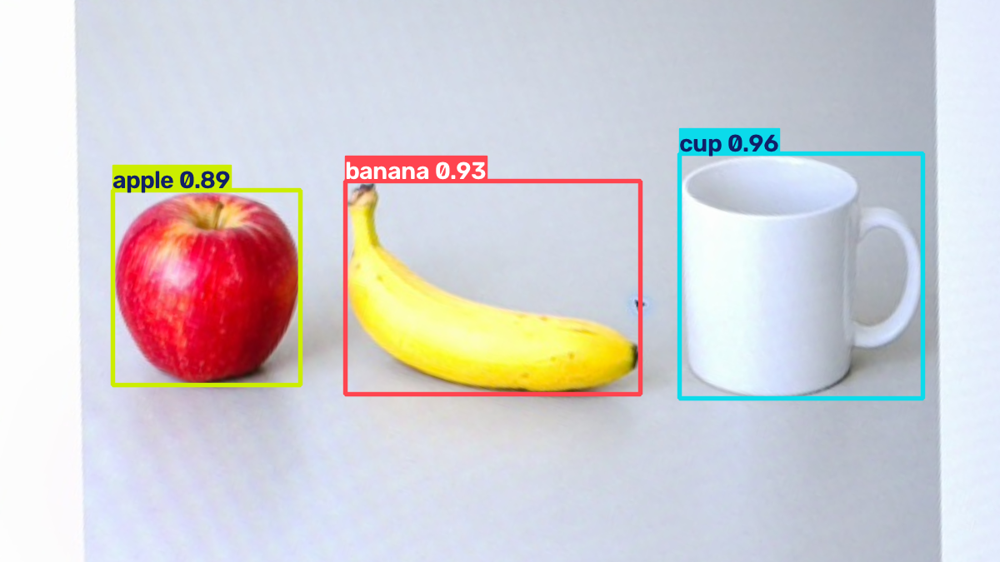
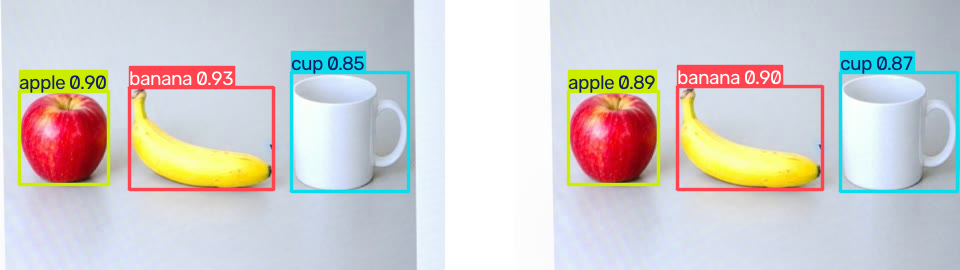
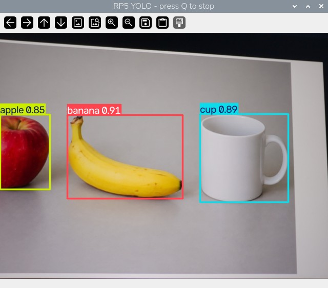

# 44｜圖片、影片、即時三種做法總比較

## [原課號：第 44 課｜YOLOv8 從圖片到即時檢測的完整教學與比較](https://github.com/Samuel-ncu/BA5077-RP5-compatibility/blob/main/%E6%95%99%E6%9D%90/%E7%AC%AC%2044%20%E8%AA%B2%EF%BD%9CYOLOv8%20%E5%BE%9E%E5%9C%96%E7%89%87%E5%88%B0%E5%8D%B3%E6%99%82%E6%AA%A2%E6%B8%AC%E7%9A%84%E5%AE%8C%E6%95%B4%E6%95%99%E5%AD%B8%E8%88%87%E6%AF%94%E8%BC%83.md)

digithouse.net 原文：[第 44 課｜YOLOv8 從圖片到即時檢測的完整教學與比較](https://digithouse.net/blog/ba5077-lesson-40-yolov8-complete-workflow?locale=zh-TW)

> **本篇狀態**：這是**回顧篇**，沒有新的實驗，只整理[新 40](./40-%E7%94%A8%20YOLOv8%20%E5%81%B5%E6%B8%AC%E4%B8%80%E5%BC%B5%E5%9C%96.md)～[新 43](./43-Picamera2%20%E5%8A%A0%20YOLOv8%20%E7%9A%84%E5%AE%8C%E6%95%B4%E5%8D%B3%E6%99%82%E6%B5%81%E7%A8%8B.md) 已經記錄的結果；每個數字都標明出自哪一篇、哪個環境。**尚未實測**：用同一組有標註的影格公平比較準確率、數小時的長時間運作。

前四篇我們讓 YOLOv8 看了一張圖、一段影片，最後接上相機。用的是同一個 `yolov8n.pt`，程式的核心也都是 `predict` 加 `plot`。那差別在哪裡？這篇不寫新程式，而是把前面的結果放進同一張表，練習兩件很重要的事：**分清楚每個數字到底量了什麼**，以及**怎樣的比較才算公平**。

## 這篇會學到什麼

- 圖片、影片、即時相機三種來源，各自多了哪些步驟。
- 「播放 FPS」和「處理速度」的差別（新 41 的延伸）。
- 為什麼前面幾篇的數字不能直接拿來比準確率。
- 自己設計一個公平比較時，要固定哪些條件。

## 需要的東西

- 紙筆或一個文字檔。
- 新 40～43 的內容（想自己重跑的話，環境見[新 39](./39-YOLOv8%20%E8%88%87%20COCO%EF%BC%9A%E5%BB%BA%E7%AB%8B%E7%92%B0%E5%A2%83%E3%80%81%E8%A8%93%E7%B7%B4%E4%B8%80%E5%9B%9E%E5%90%88.md) 和[新 42](./42-YOLOv8%20%E6%8E%A5%E4%B8%8A%E7%9B%B8%E6%A9%9F%EF%BC%9A%E5%8D%B3%E6%99%82%E5%81%B5%E6%B8%AC.md)）。

## 先懂幾個名詞

- **來源**：影像從哪裡來：檔案裡的一張圖、影片檔裡的一連串影格，或相機持續送來的新影格。
- **計時範圍**：計時包含哪些步驟，例如有沒有包含讀檔、解碼、推論、顯示、存檔。
- **公平比較**：除了想比較的那一項，其他條件都相同。

## 一步一步操作

### 步驟 1：三種來源多了什麼

**為什麼**：推論的程式一樣，前後的步驟不一樣。

| 來源 | 讀取方式 | 推論前後多做的事 | 結束時要做的事 |
| --- | --- | --- | --- |
| 圖片 | `cv2.imread` | 無 | 存結果圖 |
| 影片 | `cv2.VideoCapture` 逐格讀 | 解碼每一格、編碼寫回新影片 | `release()` 讀寫兩邊，讀回檢查 |
| 相機 | Picamera2 `capture_array` | 相機暖機、即時顯示、檢查按鍵 | `stop()`、`close()` 釋放相機 |

相機最特別：影格是**一直送來**的。如果推論跟不上，就得決定要排隊等、還是丟掉舊的影格；而影片可以慢慢算，一張都不會少。

### 步驟 2：把結果放進同一張表

**為什麼**：放在一起才看得出哪些數字能比、哪些不能比。

先畫出七欄：來源、素材、環境、影格數、計時範圍、結果、限制。以下是前幾篇的紀錄：

| 來源 | 素材 | 環境 | 影格數 | 計時範圍 | 結果 | 限制 |
| --- | --- | --- | --- | --- | --- | --- |
| 圖片（新 40） | 相機拍下的 AI 生成物件圖 | 目前 Trixie | 1 | 未記錄 | 3 個框：cup 0.958、banana 0.93、apple 0.895 | 單張生成圖 |
| 影片（新 41） | 同一張圖由程式平移成 24 張 | 目前 Trixie | 24 | 讀取、推論、寫出 3.41 秒（不含讀回） | 首尾各 3 個框 | 移動是合成的 |
| 影片（新 41） | 相機拍下的 4 張影格重複 90 次 | 舊環境 | 360 | 38.62 秒，約 9.32 張／秒 | 讀回 360 張 | 同 4 張重複 |
| 相機（新 42） | 螢幕上的 AI 生成物件圖 | 目前 Trixie | 4 | 取像加推論，含第一次推論 | 各 3 個框，2.1 張／秒 | 只有 4 張 |
| 相機（新 42） | 同上 | 目前 Trixie | 162 | 取像、推論、顯示 20.05 秒 | 約 8.08 張／秒 | 20 秒 |
| 相機（新 43） | 螢幕與瓶子 | 舊環境 | 867 | 取像、推論、顯示 120.08 秒 | 約 7.22 張／秒 | 2 分鐘 |

遇到沒記錄的數字，就寫「未記錄」，**不要自己推算，也不要拿別的實驗的數字來填**。

### 步驟 3：分清楚「播放」和「處理」

**為什麼**：這是最常被搞混的地方。

新 41 的 24 張影片以 2 FPS 播放，所以影片長 24 ÷ 2 = **12 秒**；電腦處理這 24 張只花了 **3.41 秒**。前者是影片檔的設定，後者是那一次處理的時間。

自己算算看：如果同樣 24 張改成 4 FPS 播放，影片長幾秒？答案是 6 秒。但這只是算術，**不能**因此說處理時間也會變，處理時間要實際跑過才知道。

### 步驟 4：檢查比較是否公平

**為什麼**：表上的數字看起來可以比，其實條件都不一樣。

看看步驟 2 的表，至少有這些不同：

- **環境不同**：有的是目前 Trixie，有的是舊環境。
- **輸入大小不同**：新 40 用 `imgsz=640`，新 41～43 用 `imgsz=320`。
- **計時範圍不同**：有的含顯示，有的含寫檔，有的含第一次推論。
- **素材不同**：生成圖、程式合成的平移、相機拍螢幕，都不是真實物品。
- **沒有人工核對**：框的數量只是模型輸出幾個框，沒有逐張確認對不對。不能說「3 個框比 2 個框準」。

如果你要自己做公平比較：

1. 固定模型版本、`imgsz` 和場景。
2. 寫清楚計時包含哪些步驟。
3. 準備一組**有人工標註答案**的影格，逐張記錄漏檢（該框沒框）和誤檢（不該框卻框了）。
4. 相機測試另外記錄有沒有丟掉影格、畫面有沒有延遲。

### 步驟 5：和原文比一比

**為什麼**：原文是五段程式的總整理，本篇改成整理實測結果。

原文依序列出單張圖片、多張圖片、影片、PC 攝影機、PyCamera2 五段程式，每段都用 `model(...)` 推論，安裝用 `pip install ultralytics opencv-python`，影片用 `XVID` 編碼。原文第 6 節「功能比較」只有標題，網頁上沒有表格內容。本篇不重複貼程式（前四篇都有），改成用實測數字練習判讀。多張圖片和 PC 攝影機兩段本次沒有測試。

## 成果圖

*程式輸出（新 40，目前 Trixie）：單張圖片的偵測結果。*

*程式輸出（新 41，目前 Trixie）：合成影片的第一張和最後一張。*

*程式畫面（新 42，目前 Trixie）：相機即時預覽。*

## 常見問題

| 你看到的情況 | 可能原因 | 先試試看 |
| --- | --- | --- |
| 圖片讀不到 | 檔名或位置不對 | 回新 40，把圖片和程式放在同一個資料夾。 |
| 影片無法開啟或播放 | 輸出檔沒收好尾，或編碼器不支援 | 回新 41，確認 `release()` 和讀回的張數。 |
| 相機無法開啟 | 另一支程式還在用相機 | 回新 42、43，確認上一次有釋放相機。 |

以上是常見情況的整理，本次沒有逐一重現。

## 小結

圖片、影片、即時相機用的是同一個模型，差別在推論前後：影片要解碼和編碼，相機要暖機、即時顯示和釋放。播放 FPS 是影片設定，處理速度要實際測；前幾篇的數字環境、輸入大小、計時範圍都不同，又沒有人工核對，只能說明「流程能跑」，不能用來比準確率。

**練習**：

1. 列出圖片不存在、影片解碼失敗、相機被占用時，程式各會出現什麼情況。
2. 把圖片、影片、相機共用的「推論加畫框」整理成一個函式，想想參數和回傳值要怎麼設計。

這些是延伸練習，本次尚未實測，請以你實際得到的輸出為準。

## 下一篇預告

偵測畫面目前只能在 RP5 的螢幕上看。下一篇[45｜把偵測畫面搬上網頁：Flask 加 YOLO](./45-%E6%8A%8A%E5%81%B5%E6%B8%AC%E7%95%AB%E9%9D%A2%E6%90%AC%E4%B8%8A%E7%B6%B2%E9%A0%81%EF%BC%9AFlask%20%E5%8A%A0%20YOLO.md)，我們用 Flask 把 YOLO 的即時畫面變成網頁，讓同一個區網的電腦或手機都能打開來看。
