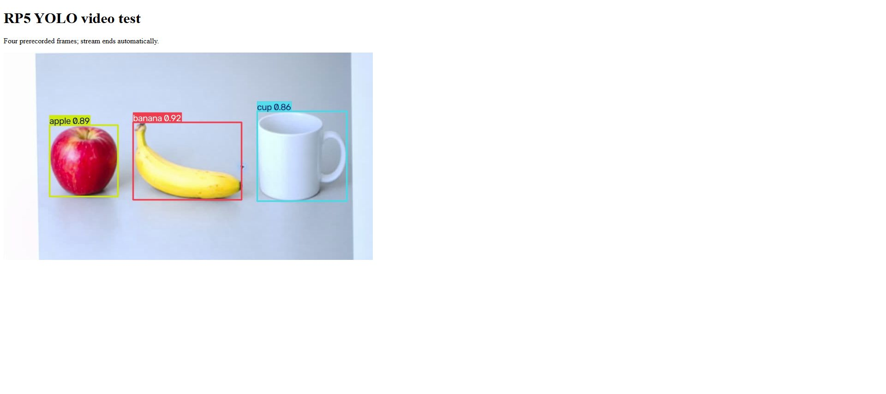
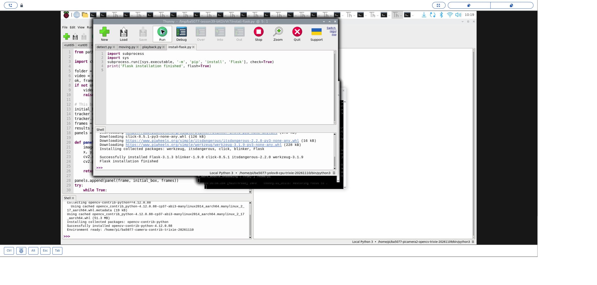
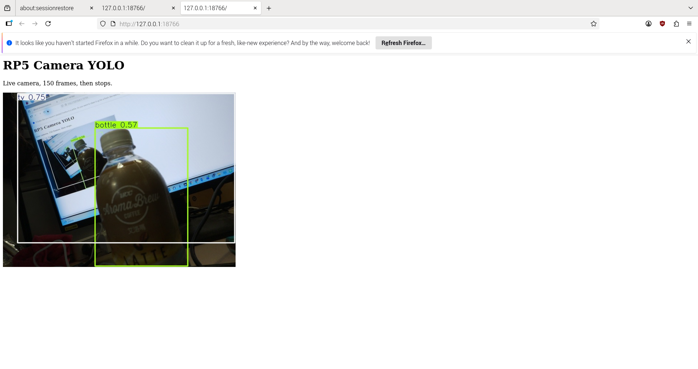
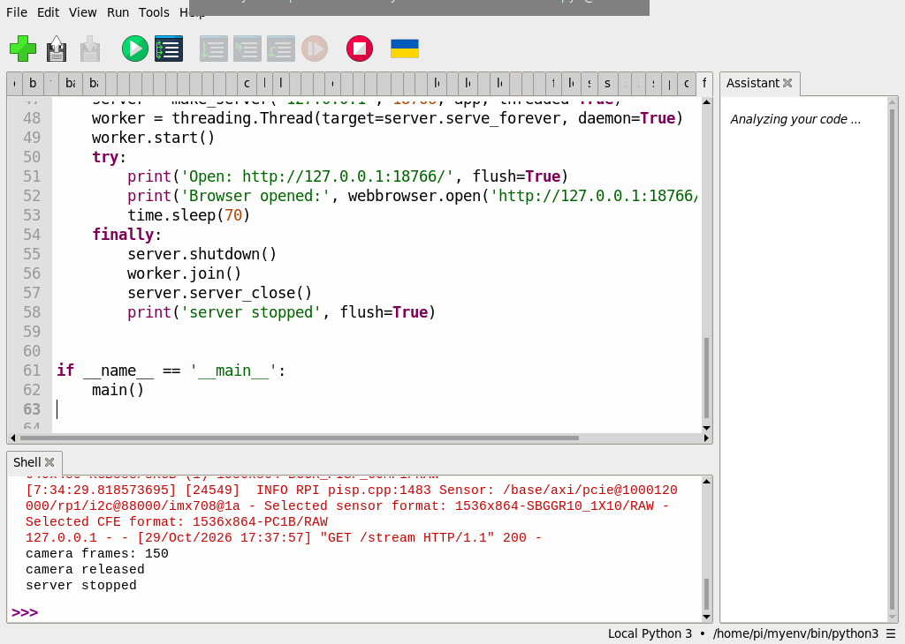

# 45｜把偵測畫面搬上網頁：Flask 加 YOLO

## [原課號：Flask 篇｜使用 Flask 和 YOLO 打造即時物件偵測網頁介面](https://github.com/Samuel-ncu/BA5077-RP5-compatibility/blob/main/%E6%95%99%E6%9D%90/%E4%BD%BF%E7%94%A8%20Flask%20%E5%92%8C%20YOLO%20%E6%89%93%E9%80%A0%E5%8D%B3%E6%99%82%E7%89%A9%E4%BB%B6%E5%81%B5%E6%B8%AC%E7%B6%B2%E9%A0%81%E4%BB%8B%E9%9D%A2.md)

digithouse.net 原文：[使用 Flask 和 YOLO 打造即時物件偵測網頁介面](https://digithouse.net/blog/ba5077-flask-yolo-realtime-web-detection?locale=zh-TW)

> **本篇狀態**：
> - **目前 Trixie**（2026-11-10）：在新 39 的 CPU 環境用 Thonny 安裝 Flask 3.1.3；把 4 張預錄影格經 YOLO 偵測後用網頁送出，**同一區網的另一台 Windows 電腦**瀏覽器看到 apple、banana、cup 的框。這次服務是用同一個環境**從 SSH 啟動**，不是在 Thonny 按 Run。
> - **舊環境**（Bookworm 的 `myenv`，2026-10-29）：Thonny 執行，RP5 相機經 YOLO 送到 **RP5 自己的瀏覽器**，150 張影格與兩分鐘串流。
> - **尚未實測**：目前 Trixie 的相機網頁串流、別台電腦觀看相機直播、多人同時觀看、長時間運作、全新安裝的系統。

到目前為止，偵測畫面都只出現在 RP5 自己的螢幕上。如果想用教室另一台電腦或手機看呢？我們可以讓 RP5 變成一台小小的網頁伺服器：每偵測完一張，就把畫面壓成 JPEG 送給瀏覽器，瀏覽器收到新的一張就換掉舊的一張，看起來就像影片。這篇用 Python 的 Flask 套件做到這件事，先送一段 4 張的預錄影片，確認整條路線通了，再看相機直播的舊紀錄。

## 這篇會學到什麼

- 網頁伺服器、路由、回應的基本觀念。
- 用 `multipart/x-mixed-replace` 把一張張 JPEG 串成「會動的圖」。
- 為什麼示範程式要自己結束、要限制同時只有一個觀看者。
- 把服務開到區網上要注意的安全問題。

## 需要的東西

- [新 39](./39-YOLOv8%20%E8%88%87%20COCO%EF%BC%9A%E5%BB%BA%E7%AB%8B%E7%92%B0%E5%A2%83%E3%80%81%E8%A8%93%E7%B7%B4%E4%B8%80%E5%9B%9E%E5%90%88.md) 的 YOLOv8 CPU 環境和 `yolov8n.pt`。
- 同一個區網裡的另一台電腦（或用 RP5 自己的瀏覽器）。
- 一個**新的**練習資料夾，放這些檔案：
  - [4 張影格的練習影片 lesson42-input.avi](https://github.com/Samuel-ncu/BA5077-RP5-compatibility/blob/main/%E6%95%99%E6%9D%90/%E7%B7%B4%E7%BF%92%E7%B4%A0%E6%9D%90/lesson42-input.avi)：相機拍下螢幕上的 AI 生成物件圖，不是實物。
  - [區網示範程式](https://github.com/Samuel-ncu/BA5077-RP5-compatibility/blob/main/%E6%95%99%E6%9D%90/%E7%AF%84%E4%BE%8B%E7%A8%8B%E5%BC%8F/Flask-YOLO-Thonny%E5%8D%80%E7%B6%B2%E5%9B%9B%E5%BD%B1%E6%A0%BC.py)

## 先懂幾個名詞

- **伺服器**：等別人來要資料、再把資料送回去的程式。
- **路由**：網址的路徑對應到哪個函式。例如 `/` 回傳網頁、`/stream` 回傳影像。
- **HTTP 200**：伺服器表示「成功」的狀態碼。
- **`multipart/x-mixed-replace`**：在同一個回應裡，用分隔字串（boundary）隔開好幾張 JPEG，瀏覽器每收到一張就換掉前一張。
- **區網 IP**：RP5 在家裡或教室網路裡的位址。本系列不公開實際 IP，請在 RP5 桌面的網路資訊自己查。

## 一步一步操作

### 步驟 1：在 YOLO 環境安裝 Flask

**為什麼**：新 39 的環境還沒有 Flask。

在 Thonny 選新 39 的環境，用 **Tools → Manage packages** 搜尋安裝 Flask，或執行下面三行：

```python
import subprocess, sys
subprocess.run([sys.executable, '-m', 'pip', 'install', 'Flask'], check=True)
print('Flask installation finished', flush=True)
```

本次裝到 Flask 3.1.3、Werkzeug 3.1.9。裝好後按 Thonny 的紅色停止鈕重新啟動執行環境。

### 步驟 2：讀程式

**為什麼**：這支程式有三個重點：送影像的方式、只讓一個人看、時間到自己關掉。

```python
from pathlib import Path
import threading
import time

import cv2
from flask import Flask, Response
from ultralytics import YOLO
from werkzeug.serving import WSGIRequestHandler, make_server


def main():
    folder = Path(__file__).resolve().parent
    model = YOLO(str(folder / 'yolov8n.pt'))
    app = Flask(__name__)
    finished = threading.Event()
    stats = {'frames': 0}
    stream_lock = threading.Lock()

    @app.get('/')
    def home():
        return ('<!doctype html><html><head><meta charset="utf-8">'
                '<title>RP5 YOLO test</title></head><body>'
                '<h1>RP5 YOLO video test</h1>'
                '<p>Four prerecorded frames; stream ends automatically.</p>'
                ''
                '</body></html>')

    @app.get('/stream')
    def stream():
        if not stream_lock.acquire(blocking=False):
            return 'Stream already in use', 409

        def frames():
            video = cv2.VideoCapture(str(folder / 'lesson42-input.avi'))
            try:
                if not video.isOpened():
                    raise RuntimeError('Cannot open lesson42-input.avi')
                while stats['frames'] < 4:
                    ok, frame = video.read()
                    if not ok:
                        break
                    result = model.predict(frame, imgsz=320, device='cpu', verbose=False)[0]
                    ok, jpeg = cv2.imencode('.jpg', result.plot())
                    if not ok:
                        raise RuntimeError('JPEG encoding failed')
                    stats['frames'] += 1
                    yield b'--frame\r\nContent-Type: image/jpeg\r\n\r\n' + jpeg.tobytes() + b'\r\n'
                    time.sleep(1)  # 讓讀者有時間觀察各張影格。
                yield b'--frame--\r\n'
            finally:
                video.release()
                finished.set()
                stream_lock.release()
        return Response(frames(), content_type='multipart/x-mixed-replace; boundary=frame')

    class QuietHandler(WSGIRequestHandler):
        def log_request(self, code='-', size='-'):
            pass

    server = make_server('0.0.0.0', 0, app, threaded=True, request_handler=QuietHandler)
    worker = threading.Thread(target=server.serve_forever, daemon=True)
    worker.start()
    print('Listening port:', server.server_port, flush=True)
    print('Open from the same LAN: http://<RP5-IP>:<port>/', flush=True)
    try:
        finished.wait(90)
    finally:
        server.shutdown()
        server.server_close()
        print('frames served:', stats['frames'], flush=True)
        print('server closed', flush=True)


if __name__ == '__main__':
    main()
```

- `/`：回傳一個簡單網頁，裡面的 `` 會去要影像。
- `/stream`：逐格讀影片、YOLO 偵測、`cv2.imencode` 壓成 JPEG，再用 `yield` 一張一張送出去，每張之間停 1 秒讓你看清楚。
- `stream_lock`：同時只允許一個觀看者；第二個人會收到 `409`。
- `make_server('0.0.0.0', 0, ...)`：`0.0.0.0` 表示所有網路介面都能連；埠號 `0` 讓系統挑一個空的埠號，每次可能不同。
- `finished.wait(90)`：串流結束或等滿 90 秒，就關掉伺服器。這是練習用的設計，不是正式的網站。
- 整個程式包在 `main()` 裡。repo 記錄 Thonny 可能會自動辨認最外層的 Flask 應用、再多啟動一個伺服器；包在函式裡可以避開。

### 步驟 3：從另一台電腦打開

**為什麼**：確認影像真的經過網路送到別台電腦。

執行程式後，Shell 會印出埠號：

```text
Listening port: <每次不同>
Open from the same LAN: http://<RP5-IP>:<port>/
```

在同一個區網的另一台電腦，打開瀏覽器輸入 `http://<RP5 的 IP>:<埠號>/`。本次在 Windows 電腦的瀏覽器看到標題 `RP5 YOLO video test`，以及畫好 apple、banana、cup 框的影格。4 張送完後串流結束，畫面可能因瀏覽器處理串流結束而消失。RP5 這邊的 Shell 輸出：

```text
frames served: 4
server closed
```

### 步驟 4：安全提醒

**為什麼**：開在 `0.0.0.0` 的服務，同網路的任何人都連得到。

這支程式**沒有登入、沒有加密**。只在你信任的網路、用不含個人資訊的素材練習；不要設定路由器轉發這個埠號，也不要對外公開。它只是教學示範，不是正式部署的服務。

### 步驟 5：舊環境：相機直播到 RP5 自己的瀏覽器

**為什麼**：把預錄影片換成相機，就是真的「即時」了。

舊環境用 Thonny 跑過另一支[相機網頁程式](https://github.com/Samuel-ncu/BA5077-RP5-compatibility/blob/main/%E6%95%99%E6%9D%90/%E7%AF%84%E4%BE%8B%E7%A8%8B%E5%BC%8F/Flask-YOLO-Thonny%E5%8D%B3%E6%99%82%E7%9B%B8%E6%A9%9F.py)：改成用 Picamera2 取像，送 150 張後結束，約 70 秒後關閉服務；伺服器只開在 `127.0.0.1`，所以**只有 RP5 自己**能看。RP5 的瀏覽器看到相機實拍的桌上瓶子，標出 `bottle 0.57`，Shell 輸出：

```text
camera frames: 150
camera released
server stopped
```

之後再執行新 42 的四張影格程式，相機能重新開啟。另一支[兩分鐘版](https://github.com/Samuel-ncu/BA5077-RP5-compatibility/blob/main/%E6%95%99%E6%9D%90/%E7%AF%84%E4%BE%8B%E7%A8%8B%E5%BC%8F/Flask-YOLO-Thonny%E5%85%A9%E5%88%86%E9%90%98%E7%9B%B8%E6%A9%9F.py)在 120.03 秒內產生 828 張，平均約 **6.9 張／秒**。這是**伺服器產生**的張數，不是瀏覽器實際顯示的張數。

目前 Trixie 要做相機版，需要新 42 的相機 YOLO 環境再裝 Flask；**這個組合尚未實測**。

### 步驟 6：和原文比一比

**為什麼**：原文的程式能跑，但有幾個不適合照抄的地方。

- 原文用 `cv2.VideoCapture(0)` 開電腦的 USB 攝影機；RP5 的 CSI 相機要改用 Picamera2。
- 原文最後是 `app.run(host="0.0.0.0", port=5000, debug=True)`：在所有網路介面開啟**除錯模式**。除錯模式是給開發者在自己電腦用的，開放到網路上有安全風險，本篇不使用。
- 原文的攝影機在程式一開始就開啟、程式中沒有釋放；也沒有限制觀看人數，多個分頁會同時搶同一台攝影機。
- 原文自己用 `cv2.rectangle` 和 `cv2.putText` 畫框；本篇用 `result.plot()`，和新 40～43 一致。

原文的 USB 攝影機版本本次沒有測試。

## 成果圖



*瀏覽器截圖（目前 Trixie，2026-11-10）：步驟 3 從另一台 Windows 電腦看到 RP5 送來的偵測影格。素材是 AI 生成物件圖。*



*操作截圖：步驟 1 在新 39 的環境安裝 Flask。*



*瀏覽器截圖（舊環境，2026-10-29）：步驟 5 相機直播到 RP5 自己的瀏覽器。相機拍到桌上的瓶子和正在顯示這個網頁的螢幕，所以畫面裡還有畫面。*



*操作截圖（舊環境）：送完 150 張後，相機釋放、服務停止。*

## 常見問題

| 你看到的情況 | 可能原因 | 先試試看 |
| --- | --- | --- |
| `No module named 'flask'` | Thonny 選的環境沒裝 Flask | 在同一個環境做步驟 1。 |
| 別台電腦打不開網頁 | IP 或埠號打錯、不在同一個網路，或程式已經結束 | 對照 Shell 印出的埠號；服務最多只開 90 秒。 |
| 第二個分頁顯示 `Stream already in use` | 程式限制只能一個人看 | 關掉其他分頁。 |
| 畫面停住不動 | 4 張已經送完 | 這是正常的，重新執行程式再看一次。 |
| Thonny 多出 `Running the app with options chosen by Thonny` | Thonny 自動啟動了額外的 Flask 伺服器 | 按紅色停止鈕；程式寫在 `main()` 函式裡可以避免。 |

最後一列是 repo 舊環境實測時遇到的情況；其他是常見情況的整理，本次沒有逐一重現。

## 小結

Flask 讓 RP5 變成網頁伺服器：YOLO 偵測完的每一張畫面壓成 JPEG，用 `multipart/x-mixed-replace` 一張張送給瀏覽器。本次在目前 Trixie 上，另一台電腦看到 RP5 送來的 4 張偵測影格；舊環境則測過相機直播到 RP5 自己的瀏覽器，兩分鐘約 6.9 張／秒。服務沒有登入和加密，只在信任的網路練習；跨裝置的相機直播和多人觀看還沒驗證。

**練習**：畫出「相機 → YOLO → JPEG → Flask → 網路 → 瀏覽器」的流程圖，在每一段旁邊寫下：如果這一段出問題，你會在畫面或 Shell 看到什麼。這是思考練習，不需要實際操作。

## 下一篇預告

視覺課程到這裡告一段落。下一篇[46｜在 Pi 上跑語言模型：安裝 Ollama](./46-%E5%9C%A8%20Pi%20%E4%B8%8A%E8%B7%91%E8%AA%9E%E8%A8%80%E6%A8%A1%E5%9E%8B%EF%BC%9A%E5%AE%89%E8%A3%9D%20Ollama.md)，我們換個方向，讓 RP5 跑一個能用文字對話的小型語言模型。
