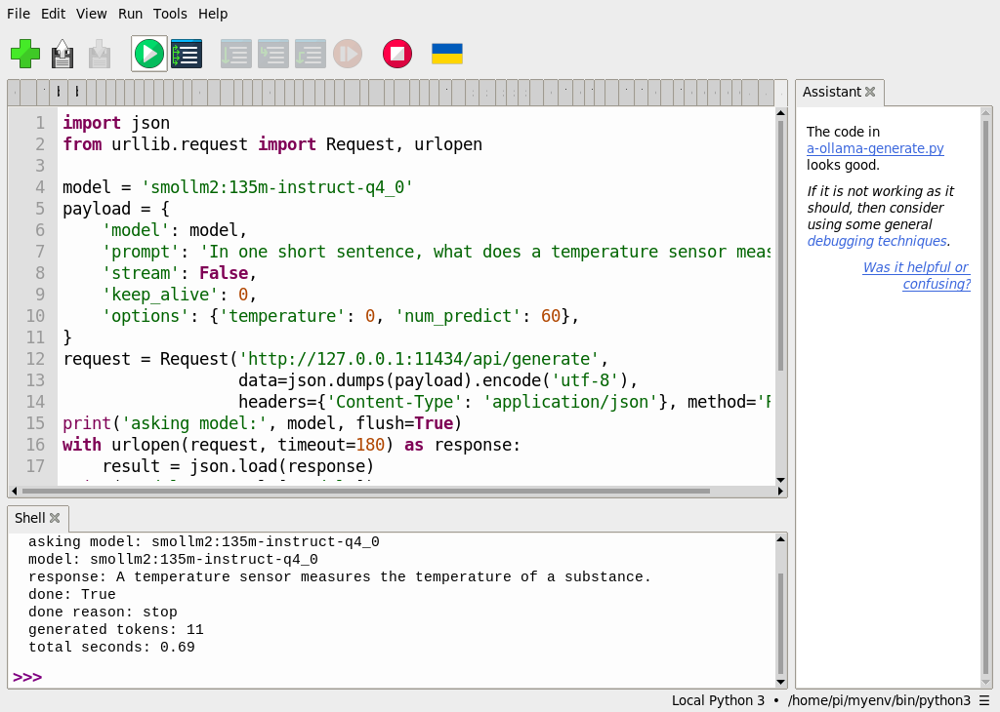
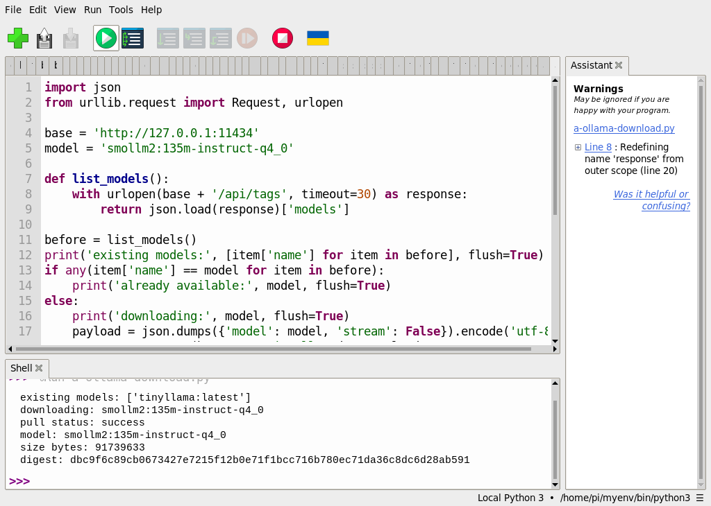

# 46｜在 Pi 上跑語言模型：安裝 Ollama

## [原課號：補充 7｜🧠 Raspberry Pi 5 上安裝 Ollama 完整教學（支援 ARM64）](https://github.com/Samuel-ncu/BA5077-RP5-compatibility/blob/main/%E6%95%99%E6%9D%90/%E8%A3%9C%E5%85%85%207%EF%BD%9C%F0%9F%A7%A0%20Raspberry%20Pi%205%20%E4%B8%8A%E5%AE%89%E8%A3%9D%20Ollama%20%E5%AE%8C%E6%95%B4%E6%95%99%E5%AD%B8%EF%BC%88%E6%94%AF%E6%8F%B4%20ARM64%EF%BC%89.md)

digithouse.net 原文：[補充 7｜Raspberry Pi 5 上安裝 Ollama 完整教學（支援 ARM64）](https://digithouse.net/blog/supplement-07-raspberry-pi-ollama-arm64?locale=zh-TW)

> **本篇狀態**：
> - **目前 Trixie**（2026-11-11）：原本沒有 Ollama，用官方安裝腳本裝好 0.40.16，確認服務與 API，下載 SmolLM2 135M 並回答一題。這些指令是在終端機（經 SSH）執行的，不是 Thonny。
> - **較早的系統**（Bookworm，Ollama 0.9.0）：用 Thonny 透過 Python 呼叫 Ollama API，下載模型並推論。
> - **尚未實測**：在 0.40.16 上重跑 Thonny 的 API 範例、較大的模型、全新安裝的系統。

前面的課程都在處理影像。這篇換個方向：讓 RP5 跑一個**語言模型**，也就是能讀懂文字、再寫出文字的 AI。Ollama 是一個幫你下載、管理、執行語言模型的程式，裝好之後它會在背景待命，你可以在終端機直接問它問題，也可以用 Python 程式向它提問。這篇只需要終端機和 Thonny，和前面的相機、視覺課程沒有關係。

## 這篇會學到什麼

- 用官方腳本安裝 Ollama，並看懂安裝訊息。
- 分清楚四件事：程式裝好了、服務在執行、模型下載了、模型能回答。
- 在終端機下載小模型並提問。
- 用 Python 透過本機 API 向 Ollama 提問。

## 需要的東西

- RP5 能上網，可用儲存空間至少 3 GB（本次安裝後 `/usr/local/lib/ollama` 約 2.2 GB，模型另計）。
- 你的 RP5 帳號密碼：安裝腳本會用 `sudo`。**密碼只輸入在自己的終端機。**
- 安裝會新增一個**開機自動啟動**的背景服務。如果是共用的 RP5，先和老師確認。
- Thonny 的部分需要[模型下載程式](https://github.com/Samuel-ncu/BA5077-RP5-compatibility/blob/main/%E6%95%99%E6%9D%90/%E7%AF%84%E4%BE%8B%E7%A8%8B%E5%BC%8F/%E8%A3%9C%E5%85%857-Thonny%E4%B8%8B%E8%BC%89Ollama%E6%A8%A1%E5%9E%8B.py)和[推論程式](https://github.com/Samuel-ncu/BA5077-RP5-compatibility/blob/main/%E6%95%99%E6%9D%90/%E7%AF%84%E4%BE%8B%E7%A8%8B%E5%BC%8F/%E8%A3%9C%E5%85%857-Thonny%E6%96%B0%E6%A8%A1%E5%9E%8B%E6%8E%A8%E8%AB%96.py)，只用 Python 標準函式庫。

## 先懂幾個名詞

- **語言模型**：從大量文字學會「下一個字可能是什麼」的模型。它寫出的是**生成的文字**，不一定正確。
- **服務**：在背景一直執行、等別人來要求的程式。Ollama 安裝後就是一個服務。
- **API**：讓程式和程式溝通的介面。Ollama 在 `127.0.0.1:11434` 提供 API，只有 RP5 自己連得到。
- **參數量與量化**：`135m` 表示約 1.35 億個參數；`q4_0` 是一種壓縮格式，讓模型變小、跑得動，代價是能力打折。

## 一步一步操作

### 步驟 1：確認還沒裝過

**為什麼**：已經裝過就不用再裝。

在 RP5 的終端機輸入：

```bash
command -v ollama
```

沒有任何輸出，就表示找不到 Ollama，需要安裝。本次的 RP5 就是這樣。如果印出 `/usr/local/bin/ollama`，直接跳到步驟 3。

### 步驟 2：下載官方安裝腳本，看過再執行

**為什麼**：網路上的腳本要用管理員權限執行，先看過內容是好習慣。

```bash
curl -fsSL https://ollama.com/install.sh -o ollama-install.sh
less ollama-install.sh      # 看一下內容，按 q 離開
sh ollama-install.sh
```

出現 `[sudo] password for pi:` 時輸入密碼。腳本要下載數百 MB 的 ARM64 程式包，網路慢時可能要二、三十分鐘。本次的訊息：

```text
>>> Installing ollama to /usr/local
>>> Downloading ollama-linux-arm64.tar.zst
（這裡會有一條慢慢前進的 # 進度列）
>>> Creating ollama user...
>>> Adding ollama user to render group...
>>> Adding ollama user to video group...
>>> Adding current user to ollama group...
>>> Creating ollama systemd service...
>>> Enabling and starting ollama service...
Created symlink '/etc/systemd/system/default.target.wants/ollama.service' → '/etc/systemd/system/ollama.service'.
>>> The Ollama API is now available at 127.0.0.1:11434.
>>> Install complete. Run "ollama" from the command line.
WARNING: No NVIDIA/AMD GPU detected. Ollama will run in CPU-only mode.
```

腳本把程式放到 `/usr/local`、建立專門跑服務的 `ollama` 帳號、設成開機自動啟動，並在 `127.0.0.1:11434` 開放 API。最後的 `WARNING` 只是說 RP5 沒有 NVIDIA／AMD 顯示卡，所以用 CPU 計算，這在 RP5 是正常的。

### 步驟 3：一項一項確認

**為什麼**：「裝好了」其實是好幾件不同的事。

```bash
command -v ollama
ollama --version
systemctl is-active ollama
systemctl is-enabled ollama
curl -s http://127.0.0.1:11434/api/version
ollama list
```

本次輸出（安裝完成後約一分鐘）：

```text
/usr/local/bin/ollama
ollama version is 0.40.16
active
enabled
{"version":"0.40.16"}
NAME    ID    SIZE    MODIFIED
```

| 指令 | 回答的問題 | 本次結果 |
| --- | --- | --- |
| `command -v ollama` | 系統找得到程式嗎？ | `/usr/local/bin/ollama` |
| `ollama --version` | 程式能執行嗎？哪一版？ | 0.40.16 |
| `systemctl is-active`／`is-enabled` | 服務在跑嗎？開機會自動啟動嗎？ | `active`、`enabled` |
| `curl .../api/version` | 其他程式連得到 API 嗎？ | 回傳版本的 JSON |
| `ollama list` | 有哪些模型？ | 只有標題列：**還沒有模型** |

如果在安裝剛結束的那一瞬間查版本，可能看到 `Warning: could not connect to a running Ollama instance`，那只是服務還在啟動，等幾秒再查就好。本次安裝腳本最後就出現過這行。

### 步驟 4：下載小模型並提問

**為什麼**：服務在跑，但沒有模型就沒有東西能回答。

下載很小的練習模型 SmolLM2 135M（約 91 MB），再問它一題：

```bash
ollama pull smollm2:135m-instruct-q4_0
ollama list
ollama run smollm2:135m-instruct-q4_0 "In one sentence, what does a temperature sensor do?"
```

本次輸出：

```text
success
NAME                          ID              SIZE     MODIFIED
smollm2:135m-instruct-q4_0    dbc9f6c89cb0    91 MB    Less than a second ago
A temperature sensor measures temperature by converting heat from the environment into electrical signals that are then measured and interpreted by a computer.
```

下載約 4 分 28 秒（看網路），回答約 0.9 秒就出現。這段回答是模型**寫出來的文字**，不是讀到真的感測器數值；小模型也可能答錯，重要內容要查證。

### 步驟 5：用 Python 向 Ollama 提問

**為什麼**：之後要把語言模型接進自己的程式，就是走這條路。

這一步在**較早的系統**（Ollama 0.9.0）用 Thonny 實測；0.40.16 上還沒重跑。先用模型下載程式透過 `/api/pull` 下載同一個模型（已經有了會顯示 `already available`），再執行推論程式：

```python
import json
from urllib.request import Request, urlopen

model = 'smollm2:135m-instruct-q4_0'
payload = {
    'model': model,
    'prompt': 'In one short sentence, what does a temperature sensor measure?',
    'stream': False,
    'keep_alive': 0,
    'options': {'temperature': 0, 'num_predict': 60},
}
request = Request('http://127.0.0.1:11434/api/generate',
                  data=json.dumps(payload).encode('utf-8'),
                  headers={'Content-Type': 'application/json'}, method='POST')
print('asking model:', model, flush=True)
with urlopen(request, timeout=180) as response:
    result = json.load(response)
print('model:', result['model'])
print('response:', result['response'].strip())
print('done:', result['done'])
print('done reason:', result.get('done_reason'))
print('generated tokens:', result.get('eval_count'))
print('total seconds:', round(result['total_duration'] / 1_000_000_000, 2))
```

- 送一個 POST 請求到本機的 `/api/generate`，內容是 JSON。
- `stream: False`：等整段回答好再一次回傳。
- `keep_alive: 0`：回答完就把模型從記憶體卸載，釋放資源。
- `temperature: 0`：讓回答盡量固定；`num_predict: 60`：最多生成 60 個 token（token 不等於一個字）。

Thonny 輸出：

```text
asking model: smollm2:135m-instruct-q4_0
model: smollm2:135m-instruct-q4_0
response: A temperature sensor measures the temperature of a substance.
done: True
done reason: stop
generated tokens: 11
total seconds: 0.69
```

`done: True` 只表示這次生成結束，不保證內容正確。用不同的問題多試幾次，再對照可信的資料。

### 步驟 6：和原文比一比

**為什麼**：原文的安裝方式能用，但有幾處可以更穩當。

- 原文用 `curl -fsSL https://ollama.com/install.sh | sh`，下載後直接執行；本篇改成先存檔、看過再執行。
- 原文裝好後再執行 `sudo systemctl enable`、`start`，又寫了 `ollama serve`。安裝腳本已經設好開機啟動並啟動服務；服務在跑時再執行 `ollama serve`，會因為埠號已被占用而失敗。
- 原文以 TinyLlama 為例，說約 400 MB；repo 較早系統上的 `tinyllama:latest` 約 637 MB。本篇改用更小的 SmolLM2 135M。
- 原文的 `ollama run tinyllama --chat` 本次沒有測試；`ollama run` 不帶問題時本身就會進入互動對話。

原文的 TinyLlama 下載本次沒有重做。

## 成果圖



*操作截圖（較早的系統）：步驟 5 在 Thonny 透過 API 向 SmolLM2 提問。*



*操作截圖（較早的系統）：用 Python 透過 `/api/pull` 下載模型。右側 `Redefining name 'response'` 是 Thonny 的命名提示，不影響執行。*

## 常見問題

| 你看到的情況 | 可能原因 | 先試試看 |
| --- | --- | --- |
| `curl: (6) Could not resolve host` | RP5 沒有網路 | 先確認能上網，再下載腳本。 |
| 進度列很久才動 | 程式包很大、網路慢 | 耐心等；不要中途按 Ctrl+C。 |
| `systemctl is-active ollama` 不是 `active` | 服務沒起來 | `sudo systemctl status ollama` 看訊息；`sudo systemctl restart ollama`。 |
| `ollama run` 說找不到模型 | 名稱打錯或還沒 pull | 用 `ollama list` 確認名稱，再 `ollama pull`。 |
| Python 連線被拒絕 | 服務沒有在跑 | 先確認服務 `active`，位址是 `127.0.0.1:11434`。 |
| `No space left on device` | 儲存空間不足 | `df -h` 查空間；用 `ollama rm 模型名稱` 刪掉不用的模型。 |

以上整理自 repo 的排錯說明，本次沒有逐一重現。不需要 Ollama 時，可以用 `sudo systemctl disable --now ollama` 停止並取消開機啟動。

## 小結

Ollama 讓 RP5 在本機跑語言模型。本次在目前 Trixie 上用官方腳本裝好 0.40.16，逐項確認程式、服務、API 和模型清單，再下載 91 MB 的 SmolLM2 回答一題。Python 可以透過 `127.0.0.1:11434` 的 API 提問。小模型寫出的是生成文字，不是感測器讀數，可能答錯，要查證。

**練習**：把 `num_predict` 改成 `10`，先預測回答會變怎樣，再執行比較；再換一個你知道答案的問題，檢查模型答得對不對。這是延伸練習，本次尚未實測，請以你實際得到的輸出為準。

## 下一篇預告

語言模型處理文字，影像也有輕量的模型可以跑。下一篇[47｜輕量模型入門：TensorFlow Lite／LiteRT](./47-%E8%BC%95%E9%87%8F%E6%A8%A1%E5%9E%8B%E5%85%A5%E9%96%80%EF%BC%9ATensorFlow%20Lite%EF%BC%8FLiteRT.md)，我們認識適合小裝置的模型格式，在 RP5 上分類一張照片。
