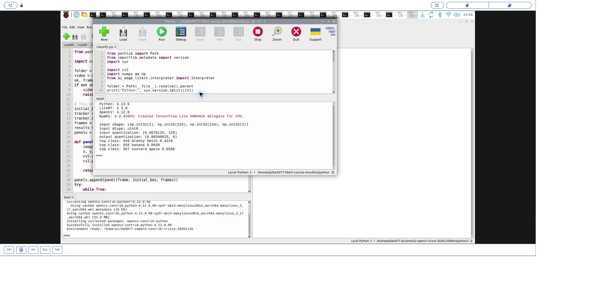
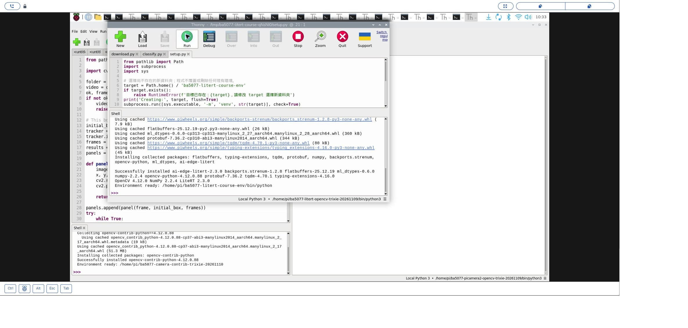
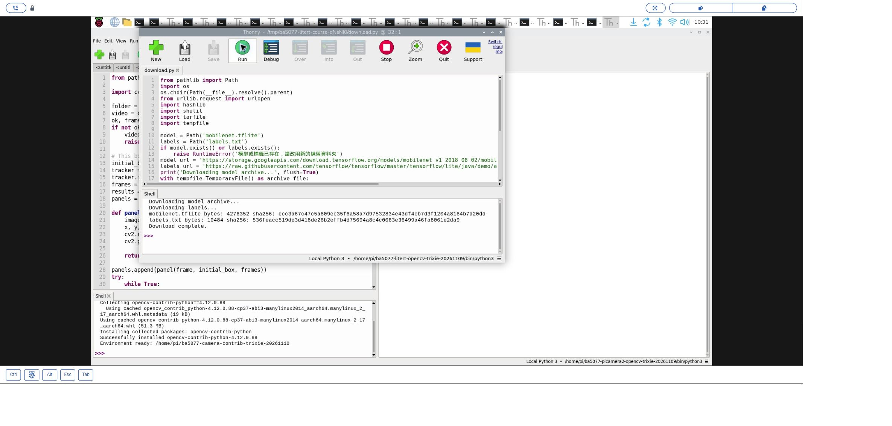

# 47｜輕量模型入門：TensorFlow Lite／LiteRT

## [原課號：補充 3｜🧠 TensorFlow Lite (TFLite) 教學入門指南](https://github.com/Samuel-ncu/BA5077-RP5-compatibility/blob/main/%E6%95%99%E6%9D%90/%E8%A3%9C%E5%85%85%203%EF%BD%9C%F0%9F%A7%A0%20TensorFlow%20Lite%20%28TFLite%29%20%E6%95%99%E5%AD%B8%E5%85%A5%E9%96%80%E6%8C%87%E5%8D%97.md)

digithouse.net 原文：[補充 3｜TensorFlow Lite (TFLite) 教學入門指南](https://digithouse.net/blog/supplement-03-tensorflow-lite-introduction?locale=zh-TW)

> **本篇狀態**：在**目前 Trixie** 的 Thonny 實測（2026-11-10，Python 3.13.5）：建立 LiteRT 環境、下載 MobileNetV1 量化模型、對一張相機拍下的 AI 生成物件圖做分類，前三名是 Granny Smith、banana、custard apple。下載模型的那一次用的是先前已建好的 LiteRT 環境，分類在新建的環境執行。較早在**舊環境**（Bookworm，`tflite_runtime` 2.14.0）得到相同的前三名。**尚未實測**：原文的模型轉換與量化、其他圖片、全新安裝的系統。

YOLOv8 要先裝 PyTorch，動輒好幾百 MB。手機、Raspberry Pi 這類小裝置，常用的是另一種做法：在大電腦上把模型訓練好，轉成又小又快、**只能推論**的格式，再搬到小裝置上跑。TensorFlow Lite（簡稱 TFLite）就是這種格式，副檔名 `.tflite`；它的新名字叫 **LiteRT**。這篇我們下載一個 4 MB 的 MobileNetV1 模型，讓它猜一張照片「整體看起來是什麼」。

## 這篇會學到什麼

- 圖像**分類**和物件**偵測**的差別。
- 用 LiteRT 的 Interpreter 載入 `.tflite` 模型。
- 輸入張量的形狀和型別要和模型一致。
- 量化模型的輸出怎麼換算成分數。

## 需要的東西

- 網路（安裝套件、下載模型）。
- 一個**新的**練習資料夾，放這些檔案：
  - [環境建立程式](https://github.com/Samuel-ncu/BA5077-RP5-compatibility/blob/main/%E6%95%99%E6%9D%90/%E7%AF%84%E4%BE%8B%E7%A8%8B%E5%BC%8F/Thonny%E5%BB%BA%E7%AB%8BTrixie-LiteRT%E7%92%B0%E5%A2%83.py)
  - [模型下載程式](https://github.com/Samuel-ncu/BA5077-RP5-compatibility/blob/main/%E6%95%99%E6%9D%90/%E7%AF%84%E4%BE%8B%E7%A8%8B%E5%BC%8F/%E8%A3%9C%E5%85%853-LiteRT-Thonny%E4%B8%8B%E8%BC%89%E6%A8%A1%E5%9E%8B.py)
  - [分類程式](https://github.com/Samuel-ncu/BA5077-RP5-compatibility/blob/main/%E6%95%99%E6%9D%90/%E7%AF%84%E4%BE%8B%E7%A8%8B%E5%BC%8F/%E8%A3%9C%E5%85%853-LiteRT-Trixie%E7%85%A7%E7%89%87%E5%88%86%E9%A1%9E.py)
  - [lesson24-camera-roi.png](https://github.com/Samuel-ncu/BA5077-RP5-compatibility/blob/main/%E6%95%99%E6%9D%90/%E5%9C%96%E6%AA%94/lesson24-camera-roi.png)：相機拍下螢幕上的 AI 生成物件後裁切的圖，不是真實水果。

## 先懂幾個名詞

- **圖像分類**：替**整張圖**打分數，選出最像的類別，不告訴你東西在哪裡。新 38～45 的物件偵測則會給出每個東西的方框。
- **Interpreter（推論器）**：負責載入 `.tflite` 模型並執行推論的物件。
- **張量**：多維的數字陣列。MobileNetV1 的輸入是 `(1, 224, 224, 3)`：1 張、224 × 224、3 個顏色通道。
- **量化**：用整數（例如 0～255）代替小數存放數值，讓模型更小、更快。量化模型的輸出要用 `scale` 和 `zero_point` 換回分數。
- **標籤檔**：`labels.txt`，第幾行就是第幾類的名稱，順序必須和模型一致。

## 一步一步操作

### 步驟 1：建立 LiteRT 環境

**為什麼**：要一個乾淨、固定版本的環境，結果才好比對。

在 Thonny 右下角選系統的 Python 3.13，開啟環境建立程式，把 `target` 改成家目錄下**還不存在**的資料夾，按 **Run**：

```python
from pathlib import Path
import subprocess
import sys

# 選擇尚不存在的新資料夾；程式不覆蓋或刪除任何現有環境。
target = Path.home() / 'ba5077-litert-course-env'
if target.exists():
    raise RuntimeError(f'目標已存在：{target}，請修改 target 選擇新資料夾')
print('Creating:', target, flush=True)
subprocess.run([sys.executable, '-m', 'venv', str(target)], check=True)
python = target / 'bin' / 'python'
subprocess.run([str(python), '-m', 'pip', 'install',
                'numpy==2.2.4', 'opencv-python==4.12.0.88',
                'ai-edge-litert==2.3.0'], check=True)
subprocess.run([str(python), '-c',
                'import cv2,numpy; from ai_edge_litert.interpreter import Interpreter; '
                'from importlib.metadata import version; '
                'print("OpenCV",cv2.__version__,"NumPy",numpy.__version__,'
                '"LiteRT",version("ai-edge-litert"))'], check=True)
print('Environment ready:', python, flush=True)
```

這個環境裝了 NumPy 2.2.4、OpenCV 4.12.0.88 和 LiteRT 套件 `ai-edge-litert` 2.3.0。看到 `Environment ready:` 後，到 **Tools → Options → Interpreter** 選新環境的 `bin/python`。本次 pip 用了這台 RP5 既有的下載快取。

這個環境沒有加 `--system-site-packages`，所以**讀不到 Picamera2**，只能做單張圖片。相機版本在下一篇。

### 步驟 2：下載模型和標籤

**為什麼**：模型和標籤由 TensorFlow 提供，不放在本系列的 repo 裡。

執行模型下載程式。它下載 TensorFlow 的模型壓縮檔、取出 `mobilenet_v1_1.0_224_quant.tflite` 存成 `mobilenet.tflite`，再下載標籤，最後印出大小與 SHA-256。如果資料夾裡已有同名檔，程式會停下來不覆寫。輸出：

```text
Downloading model archive...
Downloading labels...
mobilenet.tflite bytes: 4276352 sha256: ecc3a67c47c5a609ec35f6a58a7d97532834e43df4cb7d3f1204a8164b7d20dd
labels.txt bytes: 10484 sha256: 536feacc519de3d418de26b2effb4d75694a8c4c0063e36499a46fa8061e2da9
Download complete.
```

模型只有約 4 MB。標籤檔的來源指向上游的 `master` 分支，日後內容可能改變，可以用 SHA-256 比對。

### 步驟 3：讀分類程式

**為什麼**：重點是「準備輸入」和「換算輸出」兩段。

```python
from pathlib import Path
from importlib.metadata import version
import sys
import cv2
import numpy as np
from ai_edge_litert.interpreter import Interpreter

folder = Path(__file__).resolve().parent
print("Python:", sys.version.split()[0])
print("LiteRT:", version("ai-edge-litert"))
print("OpenCV:", cv2.__version__)
print("NumPy:", np.__version__)
image = cv2.imread(str(folder / 'lesson24-camera-roi.png'))
if image is None:
    raise RuntimeError('找不到相機裁切圖 lesson24-camera-roi.png')
with open(folder / 'labels.txt', encoding='utf-8') as f:
    labels = [line.strip() for line in f]
interpreter = Interpreter(model_path=str(folder / 'mobilenet.tflite'))
interpreter.allocate_tensors()
input_info = interpreter.get_input_details()[0]
output_info = interpreter.get_output_details()[0]
print('input shape:', tuple(input_info['shape']))
print('input dtype:', input_info['dtype'].__name__)
print('input quantization:', input_info['quantization'])
print('output quantization:', output_info['quantization'])
if tuple(input_info['shape']) != (1, 224, 224, 3) or input_info['dtype'] != np.uint8:
    raise RuntimeError('此程式預期 MobileNetV1 量化模型的 uint8 224x224 RGB 輸入')
rgb = cv2.cvtColor(image, cv2.COLOR_BGR2RGB)
rgb = cv2.resize(rgb, (224, 224))
interpreter.set_tensor(input_info['index'], np.expand_dims(rgb, axis=0))
interpreter.invoke()
raw = interpreter.get_tensor(output_info['index'])[0]
scale, zero = output_info['quantization']
scores = (raw.astype(np.float32) - zero) * scale
if len(labels) != len(scores):
    raise RuntimeError('標籤數與模型輸出數不一致')
for index in np.argsort(scores)[-3:][::-1]:
    print(f'top class: {index} {labels[index]} {scores[index]:.4f}')
```

- `allocate_tensors()`：讓 Interpreter 準備好輸入輸出的空間。
- `get_input_details()`：先問模型要什麼樣的輸入；不符合 `(1, 224, 224, 3)`、`uint8` 就停下來。
- 準備輸入：BGR 轉 RGB、縮成 224 × 224，再用 `expand_dims` 加上「第 1 張」那一維。
- `invoke()`：執行一次推論。
- 換算輸出：`(原始整數 − zero_point) × scale`，得到 0～1 的分數。
- `argsort(scores)[-3:][::-1]`：取分數最高的三類，由高到低。

### 步驟 4：在 Thonny 執行

**為什麼**：看模型怎麼猜這張圖。

新建環境的輸出：

```text
Python: 3.13.5
LiteRT: 2.3.0
OpenCV: 4.12.0
NumPy: 2.2.4
input dtype: uint8
input quantization: (0.0078125, 128)
output quantization: (0.00390625, 0)
top class: 949 Granny Smith 0.4219
top class: 955 banana 0.0938
top class: 957 custard apple 0.0586
```

Granny Smith 是一種青蘋果。圖裡有蘋果、香蕉、杯子，但分類只能給「整張圖」一個答案，所以會在幾個類別之間分散分數。舊環境（`tflite_runtime` 2.14.0）得到同樣的前三名，分數是 0.3984、0.1055、0.0625，略有不同。這些分數**不能**用來確認水果品種，也不是準確率。

### 步驟 5：和原文比一比

**為什麼**：原文偏重觀念和模型轉換，推論範例沒有真正的模型。

- 原文介紹 TFLite 和 TensorFlow 的差異、用 `TFLiteConverter` 把自己的模型轉成 `.tflite`、整數量化等。轉換需要先 `pip install tensorflow` 並有訓練好的模型，本次**沒有實測**。
- 原文用 `pip install tflite-runtime` 安裝推論函式庫。`tflite-runtime` 已改名為 LiteRT（套件 `ai-edge-litert`），本篇在 Python 3.13 上用 LiteRT；舊環境（Python 3.11）用的是 `tflite_runtime` 2.14.0。
- 原文的推論範例用 `model.tflite` 和一筆假資料 `[[0.1, 0.2, 0.3]]`，沒有提供模型；本篇用公開的 MobileNetV1 模型和真的圖片，並處理量化輸出。

## 成果圖



*操作截圖（目前 Trixie，2026-11-10）：步驟 4 的分類結果。*



*操作截圖：步驟 1 建立環境並確認匯入。*



*操作截圖：步驟 2 下載模型和標籤（在先前已建好的 LiteRT 環境執行；下載程式只用 Python 標準函式庫）。*

## 常見問題

| 你看到的情況 | 可能原因 | 先試試看 |
| --- | --- | --- |
| `No module named 'ai_edge_litert'` | Thonny 選錯環境 | 改選步驟 1 建立的環境。 |
| `模型或標籤已存在` | 資料夾裡已有舊檔 | 換一個新的練習資料夾。 |
| `標籤數與模型輸出數不一致` | 標籤檔和模型不配 | 用步驟 2 一起下載的模型與標籤。 |
| `此程式預期 ... uint8 224x224 RGB 輸入` | 換了別的模型 | 確認模型是 MobileNetV1 量化版，或修改輸入處理。 |

以上整理自 repo 的排錯說明，本次沒有逐一重現。

## 小結

TFLite（LiteRT）是給小裝置用的推論格式：模型在大電腦上訓練、轉換，小裝置只負責推論。使用時先問 Interpreter 要什麼輸入，準備好形狀和型別，`invoke()` 之後再把量化輸出換算成分數。本次在目前 Trixie 上，4 MB 的 MobileNetV1 對一張生成物件圖給出 Granny Smith、banana、custard apple。分類只看整張圖，分數不代表準確率。

**練習**：

1. 用自己的話說明：為什麼這張有蘋果、香蕉、杯子的圖，分類只能給一個最高分？如果要知道每樣東西在哪裡，該用哪一種模型？
2. 把 `[-3:]` 改成 `[-5:]`，先預測會多出哪些類別，再執行看看。

這些是延伸練習，本次尚未實測，請以你實際得到的輸出為準。

## 下一篇預告

單張圖會分類了，接下來接上相機。下一篇[48｜相機即時影像分類：MobileNetV1](./48-%E7%9B%B8%E6%A9%9F%E5%8D%B3%E6%99%82%E5%BD%B1%E5%83%8F%E5%88%86%E9%A1%9E%EF%BC%9AMobileNetV1.md)，我們把同一個模型接上 Picamera2，讓分類結果即時顯示在畫面上。
