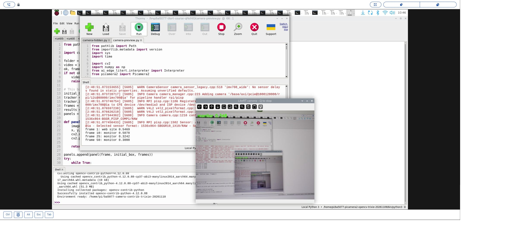
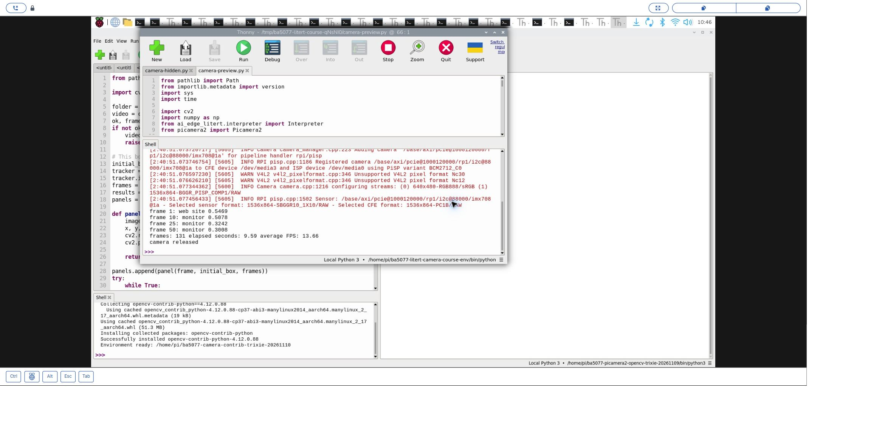
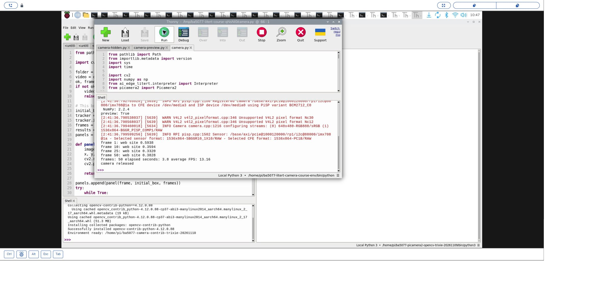
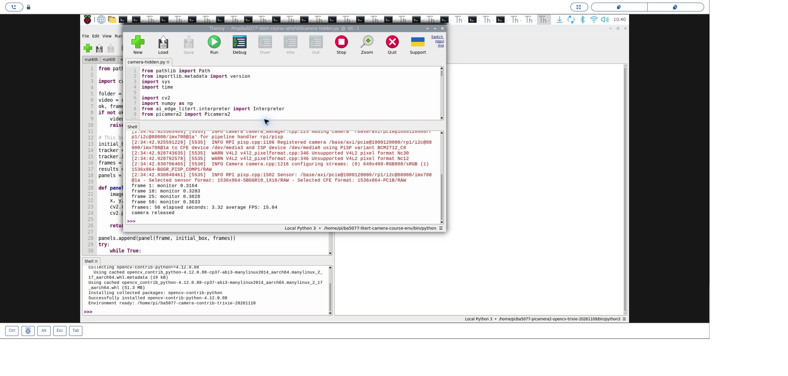
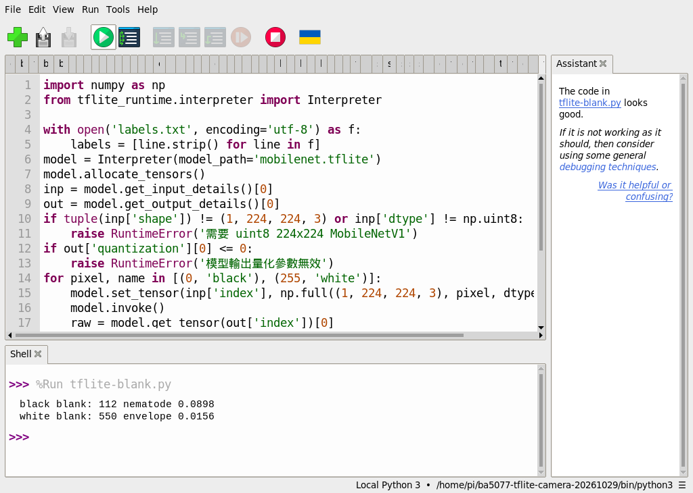

# 48｜相機即時影像分類：MobileNetV1

## [原課號：補充 8｜PiCamera2 + TensorFlow Lite (MobileNetV1) + 即時影像分類 + 顯示分類文字 的 完整教學](https://github.com/Samuel-ncu/BA5077-RP5-compatibility/blob/main/%E6%95%99%E6%9D%90/%E8%A3%9C%E5%85%85%208%EF%BD%9CPiCamera2%20%2B%20TensorFlow%20Lite%20%28MobileNetV1%29%20%2B%20%E5%8D%B3%E6%99%82%E5%BD%B1%E5%83%8F%E5%88%86%E9%A1%9E%20%2B%20%E9%A1%AF%E7%A4%BA%E5%88%86%E9%A1%9E%E6%96%87%E5%AD%97%20%E7%9A%84%20%E5%AE%8C%E6%95%B4%E6%95%99%E5%AD%B8.md)

digithouse.net 原文：[補充 8｜PiCamera2 + TensorFlow Lite (MobileNetV1) + 即時影像分類 + 顯示分類文字的完整教學](https://digithouse.net/blog/supplement-08-tflite-mobilenet-realtime-classification?locale=zh-TW)

> **本篇狀態**：在**目前 Trixie** 的 Thonny 實測（2026-11-10，Python 3.13.5、LiteRT 2.3.0）：建立能用相機的 LiteRT 環境；關閉預覽跑 50 張；開啟預覽按 `q` 在第 131 張停止；重新開啟相機再跑 50 張。相機拍的是顯示 Thonny 的螢幕，分類標籤是 monitor、web site 之類。全黑、全白的負例和兩分鐘連續測試在**舊環境**（Bookworm，`tflite_runtime` 2.14.0）。**尚未實測**：實體物品的分類、相機拍攝的空白背景、數小時運作、全新安裝的系統。

上一篇讓 MobileNetV1 分類了一張照片。這篇把同一個模型接上相機：每拍一張，就縮成 224 × 224 送進模型，把最高分的類別名稱寫在畫面左上角。和新 42 的 YOLO 不同，這裡**不會畫框**，模型只回答「這整個畫面最像什麼」。我們也會看到一個重要的現象：就算畫面裡什麼都沒有，分類器還是會選一個答案。

## 這篇會學到什麼

- 建立能同時用 Picamera2 和 LiteRT 的環境。
- 把新 47 的分類步驟放進相機迴圈，並在畫面上寫字。
- 分類器「一定會給答案」的特性，以及負例測試。
- 按 `q` 停止與重新開啟相機。

## 需要的東西

- RP5、CSI 相機，以及 RP5 的桌面環境。
- [新 47](./47-%E8%BC%95%E9%87%8F%E6%A8%A1%E5%9E%8B%E5%85%A5%E9%96%80%EF%BC%9ATensorFlow%20Lite%EF%BC%8FLiteRT.md) 下載的 `mobilenet.tflite` 和 `labels.txt`。
- 一個**新的**練習資料夾，放這些檔案：
  - [相機環境建立程式](https://github.com/Samuel-ncu/BA5077-RP5-compatibility/blob/main/%E6%95%99%E6%9D%90/%E7%AF%84%E4%BE%8B%E7%A8%8B%E5%BC%8F/Thonny%E5%BB%BA%E7%AB%8BTrixie-LiteRT%E7%9B%B8%E6%A9%9F%E7%92%B0%E5%A2%83.py)
  - [相機分類程式](https://github.com/Samuel-ncu/BA5077-RP5-compatibility/blob/main/%E6%95%99%E6%9D%90/%E7%AF%84%E4%BE%8B%E7%A8%8B%E5%BC%8F/%E8%A3%9C%E5%85%858-LiteRT-Trixie%E7%9B%B8%E6%A9%9F%E5%88%86%E9%A1%9E.py)
  - `mobilenet.tflite`、`labels.txt`
- 鏡頭前放不含個人資訊的東西。

## 先懂幾個名詞

- **最高分類別**：模型對 1000 個類別都給分數，取最高的那一個。
- **負例**：故意給模型「不該有答案」的輸入（例如全黑的圖），看它會怎麼反應。
- **預覽**：把相機畫面顯示在桌面視窗上。本篇程式可以選擇開或關。

## 一步一步操作

### 步驟 1：建立相機 LiteRT 環境

**為什麼**：新 47 的環境讀不到 Picamera2。

在 Thonny 選系統 Python 3.13，開啟相機環境建立程式，把 `target` 改成還不存在的資料夾，按 **Run**：

```python
from pathlib import Path
import subprocess
import sys

target = Path.home() / 'ba5077-litert-camera-course-env'
if target.exists():
    raise RuntimeError(f'目標已存在：{target}，請修改 target 選擇新資料夾')
print('Creating:', target, flush=True)
subprocess.run([sys.executable, '-m', 'venv', '--system-site-packages', str(target)], check=True)
python = target / 'bin' / 'python'
subprocess.run([str(python), '-m', 'pip', 'install',
                'numpy==2.2.4', 'opencv-python==4.12.0.88',
                'ai-edge-litert==2.3.0'], check=True)
subprocess.run([str(python), '-c',
                'import cv2,numpy; from picamera2 import Picamera2; '
                'from ai_edge_litert.interpreter import Interpreter; '
                'from importlib.metadata import version; '
                'print("Picamera2 OK; OpenCV",cv2.__version__,"NumPy",numpy.__version__,'
                '"LiteRT",version("ai-edge-litert"))'], check=True)
print('Environment ready:', python, flush=True)
```

和新 47 唯一的差別是加了 `--system-site-packages`，讓新環境讀得到系統的 Picamera2（新 42 也是同樣做法）。最後一步實際 `import` 一次，看到 `Picamera2 OK` 和 `Environment ready` 才算完成。之後在 Thonny 選新環境的 `bin/python`。

### 步驟 2：讀相機分類程式

**為什麼**：中間的推論和新 47 一樣，多的是相機和畫面。

```python
from pathlib import Path
from importlib.metadata import version
import sys
import time

import cv2
import numpy as np
from ai_edge_litert.interpreter import Interpreter
from picamera2 import Picamera2

# 不希望畫面顯示在桌面時設為 False；程式仍會記錄分類摘要。
SHOW_PREVIEW = True
MAX_FRAMES = 50
folder = Path(__file__).resolve().parent
labels = (folder / 'labels.txt').read_text(encoding='utf-8').splitlines()
model = Interpreter(model_path=str(folder / 'mobilenet.tflite'))
model.allocate_tensors()
inp = model.get_input_details()[0]
out = model.get_output_details()[0]
if tuple(inp['shape']) != (1, 224, 224, 3) or inp['dtype'] != np.uint8:
    raise RuntimeError('此範例需要 224x224 RGB uint8 MobileNetV1 模型')
print('Python:', sys.version.split()[0], 'LiteRT:', version('ai-edge-litert'),
      'OpenCV:', cv2.__version__, 'NumPy:', np.__version__, flush=True)
print('preview:', SHOW_PREVIEW, flush=True)
camera = Picamera2()
started = False
count = 0
try:
    camera.configure(camera.create_preview_configuration(
        main={'size': (640, 480), 'format': 'RGB888'}))
    camera.start()
    started = True
    time.sleep(1)
    begin = time.perf_counter()
    while count < MAX_FRAMES:
        frame = camera.capture_array()
        rgb = cv2.cvtColor(frame, cv2.COLOR_BGR2RGB)
        rgb = cv2.resize(rgb, (224, 224))
        model.set_tensor(inp['index'], np.expand_dims(rgb, 0))
        model.invoke()
        raw = model.get_tensor(out['index'])[0]
        scale, zero = out['quantization']
        scores = (raw.astype(np.float32) - zero) * scale
        if len(labels) != len(scores):
            raise RuntimeError('標籤數與模型輸出數不一致')
        i = int(np.argmax(scores))
        count += 1
        if count in (1, 10, 25, 50):
            print(f'frame {count}: {labels[i]} {scores[i]:.4f}', flush=True)
        if SHOW_PREVIEW:
            cv2.putText(frame, f'{labels[i]} {scores[i]:.3f}', (10, 35),
                        cv2.FONT_HERSHEY_SIMPLEX, 0.7, (0, 255, 0), 2)
            cv2.imshow('LiteRT camera - Q to stop', frame)
            if cv2.waitKey(1) & 0xFF == ord('q'):
                break
    elapsed = time.perf_counter() - begin
    print('frames:', count, 'elapsed seconds:', round(elapsed, 2),
          'average FPS:', round(count / elapsed, 2) if elapsed else 0, flush=True)
finally:
    if started:
        camera.stop()
    camera.close()
    if SHOW_PREVIEW:
        cv2.destroyAllWindows()
    print('camera released', flush=True)
```

- `SHOW_PREVIEW`：設成 `False` 時不顯示畫面，只在 Shell 印出結果；適合不想讓相機畫面出現在螢幕或截圖上的時候。
- 每張影格：BGR 轉 RGB、縮成 224 × 224、推論、換算分數、取最高分。
- 第 1、10、25、50 張印出結果；開預覽時，用 `cv2.putText` 把類別和分數寫在畫面左上角。
- 最多 50 張；開預覽時按 `q` 可以提前結束。
- `finally`：相機啟動過才 `stop()`，一定 `close()`，最後印 `camera released`。

### 步驟 3：先關掉預覽跑一次

**為什麼**：先確認相機、模型、釋放都正常。

把 `SHOW_PREVIEW` 改成 `False`，按 **Run**。本次輸出：

```text
preview: False
frame 1: monitor 0.3164
frame 10: monitor 0.3203
frame 25: monitor 0.3828
frame 50: monitor 0.3633
frames: 50 elapsed seconds: 3.32 average FPS: 15.04
camera released
```

跑完立刻再執行一次，相機同樣拿到 50 張並釋放。這次沒有公開相機畫面，所以沒辦法核對 `monitor` 對不對；15.04 張／秒是**不顯示畫面**時的速度。

### 步驟 4：開預覽，按 `q` 停止，再重開

**為什麼**：看分類文字即時變化，並確認提前停止後相機能再用。

把 `SHOW_PREVIEW` 改回 `True`。這次把 `MAX_FRAMES` 暫時改成 `500`，留時間操作。執行後先點一下預覽視窗，再按小寫 `q`：

```text
frames: 131 elapsed seconds: 9.59 average FPS: 13.66
camera released
```

接著把 `MAX_FRAMES` 改回 `50` 再執行，相機重新開啟、跑完 50 張自動結束：`elapsed seconds: 3.8`、`average FPS: 13.16`、`camera released`。

開預覽後每秒少了 1～2 張，因為多了寫字和顯示的工作。畫面上的標籤在 `monitor`、`web site` 之間跳動，因為相機拍的是顯示 Thonny 的螢幕。

### 步驟 5：負例：全黑、全白也會有答案

**為什麼**：了解分類器的限制。

舊環境用一支[負例程式](https://github.com/Samuel-ncu/BA5077-RP5-compatibility/blob/main/%E6%95%99%E6%9D%90/%E7%AF%84%E4%BE%8B%E7%A8%8B%E5%BC%8F/%E8%A3%9C%E5%85%858-Thonny%E5%88%86%E9%A1%9E%E8%B2%A0%E4%BE%8B.py)，以 NumPy 直接做出 224 × 224 的全黑和全白圖片（不用相機），交給同一個模型：

```text
black blank: 112 nematode 0.0898
white blank: 550 envelope 0.0156
```

全黑的圖被說成線蟲（nematode）、全白的圖被說成信封（envelope）。圖上當然什麼都沒有，這只是模型在 1000 個類別裡挑了分數最高的一個。所以**不能把最高分的類別當成「偵測到了」**；如果要設「不確定」的門檻，需要蒐集很多正例和負例來測，不能只看這兩張。

### 步驟 6：舊環境的兩分鐘測試

**為什麼**：看跑久一點速度穩不穩。

舊環境的[兩分鐘分類程式](https://github.com/Samuel-ncu/BA5077-RP5-compatibility/blob/main/%E6%95%99%E6%9D%90/%E7%AF%84%E4%BE%8B%E7%A8%8B%E5%BC%8F/%E8%A3%9C%E5%85%858-Thonny%E5%85%A9%E5%88%86%E9%90%98%E5%88%86%E9%A1%9E.py)每 30 秒記錄一次：

```text
after 30s: frames=605, top=desktop computer, score=0.7461
after 60s: frames=1212, top=desktop computer, score=0.7500
after 90s: frames=1820, top=desktop computer, score=0.7422
after 120s: frames=2436, top=desktop computer, score=0.6758
stop reason: time limit
frames: 2436
elapsed seconds: 120.02
average FPS: 20.3
camera released
```

兩分鐘處理 2436 張，平均約 20.3 張／秒，比新 43 的 YOLOv8 快很多，因為 MobileNetV1 是很小的分類模型。之後重開相機、按 `q` 停止也正常。這只是一次兩分鐘測試，不代表數小時的穩定性。

### 步驟 7：和原文比一比

**為什麼**：原文的程式有幾處要修正。

- 原文的套件安裝是 `pip install tflite-runtime`，直接對系統 Python 用 pip 在目前 Trixie 會被擋下；本篇用獨立環境和 LiteRT。
- 原文從第三方的 GitHub repo 下載模型和標籤；本篇用 TensorFlow 官方的模型壓縮檔，並記下 SHA-256。
- 原文把相機影格直接縮小送進模型，沒有做色彩順序轉換；本篇轉成 RGB。repo 也提醒：換相機或格式後，要重新確認色彩順序。
- 原文用 `predictions / 255.0` 換算信心度；這個模型的輸出 `scale` 是 0.00390625（1/256），本篇照模型提供的 `scale` 和 `zero_point` 換算。
- 原文結束時沒有 `close()` 相機，也沒有 `try ... finally`。

原文的程式本次沒有原樣重跑。

## 成果圖



*操作截圖（目前 Trixie，2026-11-10）：步驟 4 的預覽，左上角是分類文字。相機拍的是顯示 Thonny 的螢幕。*



*操作截圖：按 `q` 後在第 131 張停止，相機已釋放。*



*操作截圖：重新開啟相機，50 張後自動結束。*



*操作截圖：步驟 3 關閉預覽的 50 張結果。*



*操作截圖（舊環境）：步驟 5 的負例。*

## 常見問題

| 你看到的情況 | 可能原因 | 先試試看 |
| --- | --- | --- |
| `No module named 'picamera2'` | 選到新 47 的單圖環境 | 改選步驟 1 建立的相機環境。 |
| 相機打不開 | 另一支程式還在用相機 | 等 Shell 出現 `camera released` 再執行下一支。 |
| 按 `q` 沒反應 | 焦點在 Thonny，或 `SHOW_PREVIEW` 是 `False` | 先點預覽視窗；關閉預覽時不處理按鍵，會跑滿 50 張。 |
| 分類結果怪怪的 | 分類只看整張畫面，而且一定會挑一個答案 | 換一個畫面單純、物品在 1000 類裡的場景。 |
| 截圖右側出現紅色 `AT-SPI` 提示 | 遠端桌面的輔助功能訊息 | repo 實測時出現過，預覽和分類仍正常。 |

以上整理自 repo 的排錯說明與實測紀錄，本次沒有逐一重現。

## 小結

把 MobileNetV1 接上相機，就是「取像 → 轉 RGB 並縮小 → 推論 → 換算分數 → 寫字顯示」的迴圈。本次在目前 Trixie 上，關閉預覽約 15 張／秒、開預覽約 13 張／秒，按 `q` 停止和重開相機都正常。分類器永遠會挑一個最高分的類別，連全黑、全白的圖也有答案，所以分數和標籤都不能直接當成「偵測到什麼」的證據。

**練習**：設計一個小實驗：準備 3 種在 1000 類裡的物品和 1 個空白背景，各拍 10 張，記錄最高分類別和分數。根據結果，你會把「不確定」的門檻設在多少？這是延伸練習，本次尚未實測。

## 下一篇預告

接下來換一套工具。下一篇[49｜MediaPipe 是什麼？建立環境與第一個範例](./49-MediaPipe%20%E6%98%AF%E4%BB%80%E9%BA%BC%EF%BC%9F%E5%BB%BA%E7%AB%8B%E7%92%B0%E5%A2%83%E8%88%87%E7%AC%AC%E4%B8%80%E5%80%8B%E7%AF%84%E4%BE%8B.md)，我們認識 Google 的 MediaPipe，建立它的環境，跑出第一個手部偵測結果。
