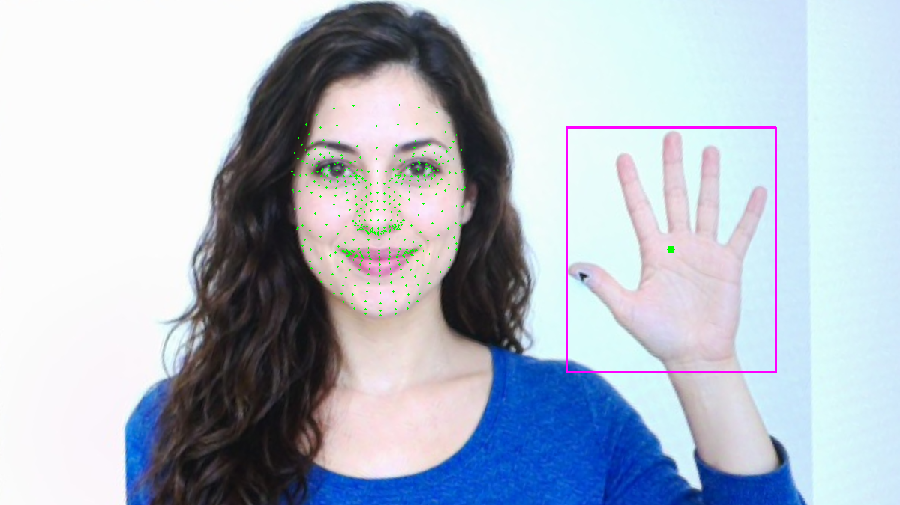
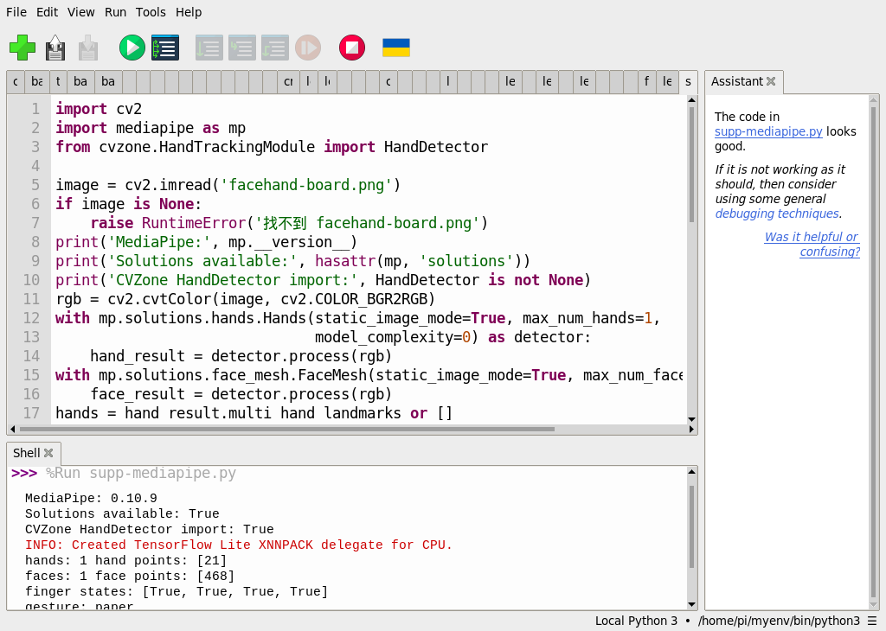

# 49｜MediaPipe 是什麼？建立環境與第一個範例

## [原課號：補充 1｜🎯 MediaPipe 介紹：Google 開源的跨平台視覺 AI 框架](https://github.com/Samuel-ncu/BA5077-RP5-compatibility/blob/main/%E6%95%99%E6%9D%90/%E8%A3%9C%E5%85%85%201%EF%BD%9C%F0%9F%8E%AF%20MediaPipe%20%E4%BB%8B%E7%B4%B9%EF%BC%9AGoogle%20%E9%96%8B%E6%BA%90%E7%9A%84%E8%B7%A8%E5%B9%B3%E5%8F%B0%E8%A6%96%E8%A6%BA%20AI%20%E6%A1%86%E6%9E%B6.md)

digithouse.net 原文：[補充 1｜MediaPipe 介紹：Google 開源的跨平台視覺 AI 框架](https://digithouse.net/blog/supplement-01-mediapipe-overview?locale=zh-TW)

> **本篇狀態**：在**目前 Trixie**（2026-11-12，Python 3.13）用 Thonny 建立 MediaPipe 1.2.2 與 CVZone 2.0.0 的環境，已實測；對一張 AI 生成虛構人物圖找到 1 隻手（21 點）、1 張臉（478 點），手勢判斷為 paper。這次執行是用同一個環境**從 SSH 啟動**，不是在 Thonny 按 Run。舊版 `mp.solutions` 的程式在**舊環境**（Bookworm，MediaPipe 0.10.9）用 Thonny 實測過。**尚未實測**：真人、即時相機（下一篇）、其他手勢與角度、全新安裝的系統。

YOLO 找的是「整個物體在哪裡」。如果想知道得更細，例如手指彎了沒、嘴巴開了沒，就需要**特徵點**：在手上、臉上標出一個個固定位置的小點。Google 的 MediaPipe 提供了現成的手部、臉部模型，能一次標出這些點。這篇是 MediaPipe 系列的第一篇：先建立環境，再對一張圖片找出手和臉的特徵點，最後用一條簡單的規則判斷手勢。

## 這篇會學到什麼

- MediaPipe 和 CVZone 是什麼、彼此的關係。
- 為什麼舊教材的 `mp.solutions` 在目前的系統不能用。
- 建立 MediaPipe 環境，對一張圖找出手（21 點）和臉（478 點）。
- 用「指尖比關節高」的規則判斷手勢。

## 需要的東西

- 網路（安裝套件、第一次執行時下載模型）。
- 一個**新的**練習資料夾，放這些檔案：
  - [環境建立程式](https://github.com/Samuel-ncu/BA5077-RP5-compatibility/blob/main/%E6%95%99%E6%9D%90/%E7%AF%84%E4%BE%8B%E7%A8%8B%E5%BC%8F/Thonny%E5%BB%BA%E7%AB%8BTrixie-MediaPipe%E7%92%B0%E5%A2%83.py)
  - [CVZone 共用程式](https://github.com/Samuel-ncu/BA5077-RP5-compatibility/blob/main/%E6%95%99%E6%9D%90/%E7%AF%84%E4%BE%8B%E7%A8%8B%E5%BC%8F/%E8%A3%9C%E5%85%851-2-4-5-6-Trixie-CVZone.py)
  - 和[新 35](./35-%E6%89%BE%E5%87%BA%E8%87%89%E5%9C%A8%E5%93%AA%E8%A3%A1%EF%BC%9AHaar%20%E8%87%89%E9%83%A8%E5%81%B5%E6%B8%AC.md) 相同的 [facehand-board.png](https://github.com/Samuel-ncu/BA5077-RP5-compatibility/blob/main/%E6%95%99%E6%9D%90/%E5%9C%96%E6%AA%94/facehand-board.png)：**AI 生成的虛構人物**，顯示在螢幕上後由 RP5 相機拍下校正，不是真人照片。

## 先懂幾個名詞

- **MediaPipe**：Google 的開源工具，提供手部、臉部、身體姿勢等現成模型。
- **特徵點（landmark）**：模型標出的固定位置，例如手部 21 點：手腕 1 點，每根手指 4 點。
- **CVZone**：把 MediaPipe 包裝得更好用的 Python 套件，幾行就能找手、找臉。
- **API 換代**：舊版 MediaPipe 用 `mp.solutions`；新版（1.x）改成 Tasks API，舊的寫法已移除。

## 一步一步操作

### 步驟 1：了解為什麼要換寫法

**為什麼**：照舊教材做，在目前的系統一定會卡住。

目前的 Raspberry Pi OS 是 Trixie，Python 3.13。Python 3.13 在 ARM64 上只能裝到 **MediaPipe 1.x**，而 1.x 已經移除了舊的 `mp.solutions`。舊程式會停在：

```text
AttributeError: module 'mediapipe' has no attribute 'solutions'
```

這不是你打錯字，而是版本換代。本篇改用 **CVZone 2.0**，它內部已經改用 MediaPipe 新的 Tasks API。

### 步驟 2：建立 MediaPipe 環境

**為什麼**：MediaPipe 和 CVZone 要裝在獨立環境，而下一篇要用相機，所以順便讓它讀得到 Picamera2。

在 Thonny 右下角選系統的 Python 3（`/usr/bin/python3`），開啟環境建立程式，把 `target` 改成還不存在的資料夾，按 **Run**：

```python
from pathlib import Path
import subprocess
import sys

target = Path.home() / 'ba5077-mediapipe-trixie-20261112'
if target.exists():
    raise RuntimeError(f'目標已存在：{target}，請修改 target 選擇新資料夾')
print('Creating:', target, flush=True)
subprocess.run([sys.executable, '-m', 'venv', '--system-site-packages', str(target)], check=True)
python = str(target / 'bin' / 'python3')
subprocess.run([python, '-m', 'pip', 'install', 'mediapipe==1.2.2', 'cvzone==2.0.0'], check=True)
subprocess.run([python, '-c',
                'import cv2, mediapipe as mp; from picamera2 import Picamera2; '
                'print("Picamera2 OK; OpenCV", cv2.__version__, "MediaPipe", mp.__version__, '
                '"solutions:", hasattr(mp, "solutions"))'], check=True)
print('Environment ready:', python, flush=True)
```

本次最後兩行輸出：

```text
Picamera2 OK; OpenCV 5.0.0 MediaPipe 1.2.2 solutions: False
Environment ready: /home/pi/ba5077-mediapipe-trixie-20261112/bin/python3
```

`solutions: False` 正是「舊 API 已移除」，這是預期的結果。完成後在 Thonny 選新環境的 `bin/python3`。

### 步驟 3：讀共用程式

**為什麼**：這支程式之後新 50～53 都會用到。

```python
from pathlib import Path
from importlib.metadata import version

import cv2
from cvzone.HandTrackingModule import HandDetector
from cvzone.FaceMeshModule import FaceMeshDetector

folder = Path(__file__).resolve().parent
image = cv2.imread(str(folder / 'facehand-board.png'))
if image is None:
    raise RuntimeError('找不到 facehand-board.png，請和程式放在同一個資料夾')
print('MediaPipe:', version('mediapipe'), 'CVZone:', version('cvzone'))

hand_detector = HandDetector(staticMode=True, maxHands=1)
face_detector = FaceMeshDetector(staticMode=True, maxFaces=1)

hands, image = hand_detector.findHands(image, draw=True, flipType=False)
image, faces = face_detector.findFaceMesh(image, draw=True)
print('hands:', len(hands), 'hand points:', [len(h['lmList']) for h in hands])
print('faces:', len(faces), 'face points:', [len(f) for f in faces])

if hands:
    points = hands[0]['lmList']
    # 影像的 y 往下變大：指尖 y 比第二關節小，表示這根手指伸直朝上。
    up = [points[tip][1] < points[pip][1] for tip, pip in [(8, 6), (12, 10), (16, 14), (20, 18)]]
    if all(up):
        gesture = 'paper'
    elif not any(up):
        gesture = 'rock'
    elif up == [True, True, False, False]:
        gesture = 'scissors'
    else:
        gesture = 'unknown'
    print('finger states:', up)
    print('gesture:', gesture)

# 用完就關閉模型，避免程式結束時出現關閉順序的錯誤訊息。
hand_detector.detector.close()
face_detector.detector.close()

output = folder / 'supplement-cvzone-result.png'
if not cv2.imwrite(str(output), image):
    raise RuntimeError('無法儲存結果')
print('saved:', output.name)
```

- `staticMode=True`：每次都當成獨立的圖片處理，適合單張圖。
- `findHands`、`findFaceMesh`：找手和臉，`draw=True` 會直接畫在圖上。`lmList` 是手部每一點的座標。
- 手勢規則：比較食指、中指、無名指、小指的**指尖**（8、12、16、20）和**第二關節**（6、10、14、18）。影像的 y 往下變大，所以指尖 y 比較小，就是手指朝上伸直。
  - 四指都伸直：paper；都彎：rock；只有食指、中指伸直：scissors；其他：unknown。
- 最後兩行關閉模型。少了它們，程式結束時可能出現一大段 `Exception ignored ... __del__` 的訊息。

### 步驟 4：執行並讀懂結果

**為什麼**：確認手和臉都找到了，點數也對。

第一次執行會把 `hand_landmarker.task`（7,819,105 bytes）和 `face_landmarker.task`（3,758,596 bytes）兩個模型下載到**目前的工作資料夾**。本次輸出：

```text
MediaPipe: 1.2.2 CVZone: 2.0.0
hands: 1 hand points: [21]
faces: 1 face points: [478]
finger states: [True, True, True, True]
gesture: paper
saved: supplement-cvzone-result.png
```

- 手 21 點，和舊版一樣。
- 臉 **478 點**：新版臉部模型比舊版的 468 點多了左右眼虹膜各 5 點。
- 四指都伸直，判斷為 paper。這只是這一張生成圖的結果，不代表真人或其他角度也一樣準。

### 步驟 5：和原文比一比

**為什麼**：原文的範例是舊 API，在目前系統跑不起來。

原文介紹 MediaPipe 的特點與模組（FaceMesh 468 點、Hands 21 點、Pose 等），範例用 `pip install mediapipe opencv-python` 安裝，以 `mp.solutions.hands` 搭配 `cv2.VideoCapture(0)` 的 USB 攝影機即時畫出手部特徵點，按 Esc 結束。原文最後提到「MediaPipe 目前僅支援 Python 3.9～3.12」；現在 Python 3.13 能裝的是 MediaPipe 1.x，`mp.solutions` 已經移除，所以本篇改用 CVZone 2.0。原文的 USB 攝影機範例本次沒有測試。

## 成果圖



*程式輸出（目前 Trixie，2026-11-12）：綠點是臉部特徵點，洋紅框是手的範圍。人物是 AI 生成的虛構人物。*



*操作截圖（舊環境，MediaPipe 0.10.9）：舊版 `mp.solutions` 還能用時的版本檢查；目前的系統不能照做。*

## 常見問題

| 你看到的情況 | 可能原因 | 先試試看 |
| --- | --- | --- |
| `module 'mediapipe' has no attribute 'solutions'` | 用了舊程式，或照舊教材安裝 | 改用本篇的 CVZone 共用程式。 |
| `No module named 'cvzone'` | Thonny 選錯直譯器 | 改選步驟 2 建立的環境。 |
| 下載模型失敗 | 沒有網路，或留下不完整的 `.task` 檔 | 確認網路，刪掉不完整的 `.task` 檔再執行。 |
| 結束時出現一大段 `Exception ignored ... __del__` | 程式沒有關閉模型 | 確認用的是最新版程式（最後有兩行 `close()`）。 |
| `hands: 0` | 手太小、太斜或被擋住 | 換一張手掌清楚、正面朝向鏡頭的圖。 |

以上整理自 repo 的排錯說明，本次沒有逐一重現。

## 小結

MediaPipe 提供手部、臉部等特徵點模型，CVZone 把它包得更容易用。目前的系統只能裝 MediaPipe 1.x，舊的 `mp.solutions` 已經移除，所以本篇改用 CVZone 2.0。本次在目前 Trixie 上，對一張 AI 生成圖片找到手 21 點、臉 478 點，並用「指尖比第二關節高」的規則判斷為 paper。規則很簡單，換了角度或真人，結果可能不同。

**練習**：

1. 把圖片左右翻轉（`cv2.flip(image, 1)`）或旋轉 90 度後再執行，記錄手勢判斷有沒有改變，並解釋原因。
2. 想一想：大拇指為什麼沒有放進規則？如果要判斷「比讚」，規則要怎麼改？

這些是延伸練習，本次尚未實測，請以你實際得到的輸出為準。

## 下一篇預告

圖片上找得到手了，接著接上相機。下一篇[50｜手勢偵測：手部 21 個特徵點](./50-%E6%89%8B%E5%8B%A2%E5%81%B5%E6%B8%AC%EF%BC%9A%E6%89%8B%E9%83%A8%2021%20%E5%80%8B%E7%89%B9%E5%BE%B5%E9%BB%9E.md)，我們用 Picamera2 即時找手，並看懂 21 個特徵點各在哪裡。
